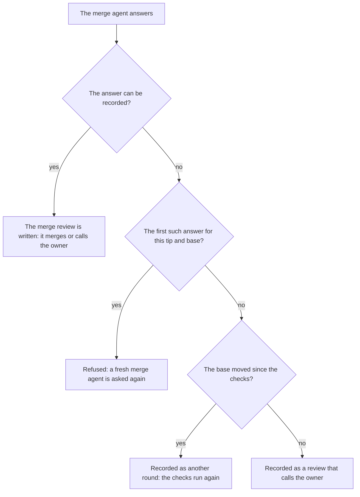

# A merge agent's answer with no verdict is refused at each try on a base that did not move

careful: yes. "The landing lets through a change that should not land: one a person should merge" is in reach: the task changes what `lem land merge-review` records from the merge agent's answer, and that record decides whether the board's server merges with no person.

## Acceptance criteria

Size: full, because the rule is one, but it sits in the step that decides whether a pull request merges without a person, so it is careful and never the fast track.

1. On a base that did not move, a second answer of the merge agent with no verdict ends the tries and calls the owner, as an agent that gives no answer twice does:
   1. Task gift-note is `open`. The base has not moved since its checks ran.
   2. The merge agent answers with `## Review` as its first line and `Verdict: merge.` under it.
   3. `lem land merge-review gift-note --file ANSWER --tip TIP --base BASE` refuses it, and says that the merge agent is asked again.
   4. A fresh merge agent answers in the same form, with the same tip and base.
   5. The same command now writes the answer down as the merge review, which calls the owner and says why in plain words: the merge agent twice put another line above its verdict, and its answer says `Verdict: merge.` lower down.
   6. "Waits for you" shows "Read the merge review" for gift-note, and the board's server does not merge it.
2. On a base that moved, a second answer that cannot be recorded is still recorded as another round of the checks, and the owner is not asked.
   - no test: the change keeps behavior, so a test of it passes on the base too; the unit case of task 1 for a second answer with no verdict on its first line on a moved base holds it, which `mb-mute` in `tests/lem-land-shop.sh` does not (it sends a verdict and no base call)
3. The landing's step of the merge agent, and the agent's own part of the harness, say what follows a second refused answer on a base that did not move.
   - no test: the change is two sentences of a stage file and of a harness file.

## How it works

## Tasks

1. **The second refused answer on a base that did not move calls the owner** (criteria 1, 2 and 3).
   In `skills/lem/scripts/land.py`, `cmd_merge_review`: on a base that did not move, the second answer
   for one tip and base that gives no verdict is written down as `merge-review.md` and as the kept
   `merge_review`, with `verdict` null, `calls` true and a `why` in plain words, from what the two
   answers are known to hold: the first only as one with no verdict on its first line, the second
   whole. So the `why` says that the merge agent twice gave no verdict on its first line, and of the
   last answer: when a line lower down gives `Verdict: merge.` or `Verdict: call.`, that it put
   another line above its verdict, and which verdict that line gives (in criterion 1's case: "the
   merge agent twice gave no verdict on its first line; its last answer puts another line above
   its verdict, `Verdict: merge.`"); when no line does, that it gives no verdict at all. It never
   says what the first answer held beyond that. When `merger_refusal` names a reason too (the
   settings, a careful or not green request), that reason follows after a semicolon. That lower
   line never becomes the verdict: the owner decides. Its `next` is the one of a review that calls the owner. The first such answer is refused as today, and
   the moved base keeps its rule. The choice of what an answer that cannot be recorded leads to
   (asked again, another round, or a review that calls the owner) is a function of its facts (the
   verdict, whether the base moved, the base call, the count of tries for that tip and base), so
   that `tests/unit/test_land.py` calls it with each input: on a base that did not move, the first
   answer with no verdict is asked again and the second calls the owner; on a moved base, the
   second answer with no verdict on its first line is another round, as is the second with a
   verdict and no base call (the `mb-mute` check of `tests/lem-land-shop.sh` holds only that last
   one). The journey is one check in `tests/lem-land-shop.sh`, on a task of the moved-base shop
   (`mb_settings agent squash`, near line 605), never the `first-change` fixture, whose
   `branch.land = "owner"` refuses the merge agent's merge before any verdict is read: a green
   task that is not careful, whose review made the careful call, on a base that did not move.
   `## Review` then `Verdict: merge.` twice: the first exits 1 with "the merge agent is asked
   again", the second exits 0 with `verdict` null and `calls` true in its JSON, in the kept
   `merge_review` and with no `verdict` in its `merge.review` event; `lem project waiting` lists the
   task's merge review; and `lem land merge SLUG --by merger --via server` is refused with "the
   merge review calls the owner", the refusal of the verdict rule, since every other rule of
   `merger_refusal` lets that task through. In `skills/lem/stages/land.md`, step 7
   (the paragraph that starts "A first line with no verdict is refused"), and in
   `skills/lem/harness/claude-code/ask-merger.md` (its last paragraph), one sentence each on what
   follows the second refused answer on a base that did not move, and names the "Read the merge
   review" row the owner then sees in "Waits for you".

## Decisions

- **The record is a merge review that calls the owner, with no verdict.** No new state, row or
  event: the board's `merge_wait` gives "owner" for a review of the proposed tip whose verdict is not
  `merge`, "Waits for you" shows its "Read the merge review" row while `calls` is true, the feed says
  "it calls you" for a `merge.review` with `calls` true, and `lem land merge --by merger` is refused
  with no merge review whose verdict is `merge`. Rests on `merge_wait` and `merge_review_said` in
  `skills/lem/scripts/lem_board_model.py` and on step 8 of `skills/lem/stages/land.md`.
- **The answer is still written down word for word as `merge-review.md`**, so the owner reads what
  the merge agent wrote, as for any answer that is recorded.
- **Out of scope: a merge agent that gives no answer twice on a base that did not move.** It leaves no
  record, so the board still says that the merge agent reads the task. That is a neighbor of this
  defect with another cause (no answer file, so nothing for `merge-review` to read); the builder
  files it as a backlog item when it confirms it in the code.

## What it will not verify

- No real merge agent is started: the answers are files the tests write, since the rule reads the
  text of the answer and nothing of the agent.
