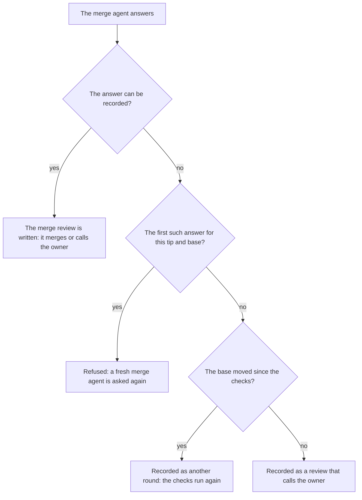

# A merge agent's answer with no verdict is refused at each try on a base that did not move

careful: yes. "The landing lets through a change that should not land: one a person should merge" is in reach: the task changes what `lem land merge-review` records from the merge agent's answer, and that record decides whether the board's server merges with no person.

## Acceptance criteria

Size: full, because the rule is one, but it sits in the step that decides whether a pull request merges without a person, so it is careful and never the fast track.

1. On a base that did not move, a second answer of the merge agent with no verdict ends the tries and calls the owner, as an agent that gives no answer twice does:
   1. Task gift-note is `open`. The base has not moved since its checks ran.
   2. The merge agent answers with `## Review` as its first line and `Verdict: merge.` under it.
   3. `lem land merge-review gift-note --file ANSWER --tip TIP --base BASE` refuses it, and says that the merge agent is asked again.
   4. A fresh merge agent answers in the same form, with the same tip and base.
   5. The same command now writes the answer down as the merge review, which calls the owner and says why in plain words: the merge agent twice put another line above its verdict, and its answer says `Verdict: merge.` lower down.
   6. "Waits for you" shows "Read the merge review" for gift-note, and the board's server does not merge it.
   - test: `python3 -B -m unittest tests.unit.test_land.MergeReview.test_an_answer_with_no_verdict_on_a_base_that_did_not_move_calls_the_owner_the_second_time tests.unit.test_land.MergeReview.test_the_why_of_a_second_answer_with_no_verdict_says_what_the_two_answers_hold` in `tests/unit/test_land.py`
   - test: `bash tests/lem-land-shop.sh` in `tests/lem-land-shop.sh`, `tests/lib.sh`, `tests/checks.sh`
2. On a base that moved, a second answer that cannot be recorded is still recorded as another round of the checks, and the owner is not asked.
   - no test: the change keeps behavior, so a test of it passes on the base too; the unit case of task 1 for a second answer with no verdict on its first line on a moved base holds it, which `mb-mute` in `tests/lem-land-shop.sh` does not (it sends a verdict and no base call)
3. The landing's step of the merge agent, and the agent's own part of the harness, say what follows a second refused answer on a base that did not move.
   - no test: the change is two sentences of a stage file and of a harness file.

## How it works

## Tasks

1. **The second refused answer on a base that did not move calls the owner** (criteria 1, 2 and 3).
   In `skills/lem/scripts/land.py`, `cmd_merge_review`: on a base that did not move, the second answer
   for one tip and base that gives no verdict is written down as `merge-review.md` and as the kept
   `merge_review`, with `verdict` null, `calls` true and a `why` in plain words, from what the two
   answers are known to hold: the first only as one with no verdict on its first line, the second
   whole. So the `why` says that the merge agent twice gave no verdict on its first line, and of the
   last answer: when a line lower down gives `Verdict: merge.` or `Verdict: call.`, that it put
   another line above its verdict, and which verdict that line gives (in criterion 1's case: "the
   merge agent twice gave no verdict on its first line; its last answer puts another line above
   its verdict, `Verdict: merge.`"); when no line does, that it gives no verdict at all. It never
   says what the first answer held beyond that. When `merger_refusal` names a reason too (the
   settings, a careful or not green request), that reason follows after a semicolon. That lower
   line never becomes the verdict: the owner decides. From there the record goes on as the record of
   a valid `Verdict: call.` read of the same brief does, through the same branches of
   `cmd_merge_review` in their order: its `next` is the one of a review that calls the owner, except
   where the owner's own merge of that tip stands (the decision below). The first such answer is refused as today, and
   the moved base keeps its rule. The choice of what an answer that cannot be recorded leads to
   (asked again, another round, or a review that calls the owner) is a function of its facts (the
   verdict, whether the base moved, the base call, the count of tries for that tip and base), so
   that `tests/unit/test_land.py` calls it with each input: on a base that did not move, the first
   answer with no verdict is asked again and the second calls the owner; on a moved base, the
   second answer with no verdict on its first line is another round, as is the second with a
   verdict and no base call (the `mb-mute` check of `tests/lem-land-shop.sh` holds only that last
   one). The journey is one check in `tests/lem-land-shop.sh`, on a task of the moved-base shop
   (`mb_settings agent squash`, near line 605), never the `first-change` fixture, whose
   `branch.land = "owner"` refuses the merge agent's merge before any verdict is read: a green
   task that is not careful, whose review made the careful call, on a base that did not move.
   `## Review` then `Verdict: merge.` twice: the first exits 1 with "the merge agent is asked
   again", the second exits 0 with `verdict` null and `calls` true in its JSON, in the kept
   `merge_review` and with no `verdict` in its `merge.review` event; `lem project waiting` lists the
   task's merge review; and `lem land merge SLUG --by merger --via server` is refused with "the
   merge review calls the owner", the refusal of the verdict rule, since every other rule of
   `merger_refusal` lets that task through. In `skills/lem/stages/land.md`, step 7
   (the paragraph that starts "A first line with no verdict is refused"), and in
   `skills/lem/harness/claude-code/ask-merger.md` (its last paragraph), one sentence each on what
   follows the second refused answer on a base that did not move, and names the "Read the merge
   review" row the owner then sees in "Waits for you".

## Plan talk

Argued by Codex as the reviewer, GPT 6.2 Sol at high effort as its pane's status line showed them,
and by Claude Code as the defender, Opus 5.5 at high effort as the task's `defender:` line gives
them. Two families. Six turns, within the bound of 4 × 4 + 2.

1. **A second answer with no verdict lets the owner's standing merge go through.** The plan said
   that the record waits for the owner and that its `next` is that of a review that calls him. After
   his merge was refused because the base moved and a revert gave main the checks' tree again, the
   record reaches `read_answers` in `cmd_merge_review`, logs `merge.stands`, and the server runs his
   merge. First answered with a refutation: the owner's own merge reads no verdict today, and a
   valid `Verdict: call.` read of the same brief takes the same branch (`read_answers` in
   `skills/lem/scripts/land.py`; `merge_locked` with `--standing`; `stages/land.md`, step 7). The
   reviewer held: the plan's own words then said something false. Repaired (eccedd7c): the record
   goes on as a `call` read of the same brief does, and a decision states the standing case and
   what it rests on. Settled by the two, not checked by the review.
2. **The journey's refused merge passes for the wrong reason.** The `first-change` fixture of
   `tests/lem-land-shop.sh` has `branch.land = "owner"`, which `merger_refusal` refuses before it
   reads any verdict. Repaired (e12c40c3): the journey runs on a task of the moved-base shop with
   `land = "agent"`, green, not careful, with the review's careful call, and checks `verdict` null in
   the JSON, the kept record and the event, and the refusal of the verdict rule. Settled by the
   two, not checked by the review.
3. **The `why` can name an answer the agent never gave.** `merge_unread` keeps no text of the first
   answer, which may hold no verdict line at all. Repaired (07c7a028): the `why` says that the agent
   twice gave no verdict on its first line, and of the last answer only whether a lower line gives a
   verdict and which. Settled by the two, not checked by the review.
4. **The moved-base check holds another input.** `mb-mute` sends a verdict and no base call, so it
   does not hold a second answer with no verdict on a moved base. Repaired (e12c40c3): the choice of
   what an answer that cannot be recorded leads to is a function of its facts, and a unit case calls
   it with that input; criterion 2's `no test:` line names it. Settled by the two, not checked by
   the review.

No repair added a mechanism: no guard, field, flag or retry. No question was raised after the first
turn, no addition was refused as unpriced, and no question closed as a design choice.

What changed in the plan, all in task 1 and the decisions: the words of the `why` (question 3); the
journey's shop and what it checks, the unit cases of the new function, and criterion 2's `no test:`
line (questions 2 and 4); the record's path through `cmd_merge_review` and a new decision on the
owner's standing merge (question 1).

## Decisions

- **The record is a merge review that calls the owner, with no verdict.** No new state, row or
  event: the board's `merge_wait` gives "owner" for a review of the proposed tip whose verdict is not
  `merge`, "Waits for you" shows its "Read the merge review" row while `calls` is true, the feed says
  "it calls you" for a `merge.review` with `calls` true, and `lem land merge --by merger` is refused
  with no merge review whose verdict is `merge`. Rests on `merge_wait` and `merge_review_said` in
  `skills/lem/scripts/lem_board_model.py` and on step 8 of `skills/lem/stages/land.md`.
- **Where the owner's own merge of the tip stands, the record answers Lem's refusal as a `call`
  read does, and his merge goes through.** The case: he pressed merge, Lem refused it because the
  base moved (`merge_refused` with `kind: base`, `owner_tap` of the tip), a revert gave main the
  checks' tree again, and the second answer with no verdict is of a brief on the checks' own base.
  Today a valid `Verdict: call.` read of that brief clears the refusal, logs `merge.stands`, and
  the board's server runs his merge (`read_answers` takes no verdict; `merge_wait` gives "merges";
  `stands_due` in `serve.py`). The record of the second answer with no verdict does the same, and
  its `next` is the one of a merge that stands. Rests on `skills/lem/stages/land.md`, step 7 ("The
  owner's merge stands: ... a read whose brief named the checks' own base because main has their
  tree again"; "do not ask him again"), and SKILL.md ("`--by owner` follows only the owner's own
  words"): the review that calls him asks for a word he already gave for that tip, and his
  standing merge reads no verdict. The merge agent's own merge stays refused: its verdict is not
  `merge`.
- **The answer is still written down word for word as `merge-review.md`**, so the owner reads what
  the merge agent wrote, as for any answer that is recorded.
- **Out of scope: a merge agent that gives no answer twice on a base that did not move.** It leaves no
  record, so the board still says that the merge agent reads the task. That is a neighbor of this
  defect with another cause (no answer file, so nothing for `merge-review` to read); the builder
  lists it as an outside defect when it confirms it in the code, and the polish pass files it.

## What it will not verify

- No real merge agent is started: the answers are files the tests write, since the rule reads the
  text of the answer and nothing of the agent.
