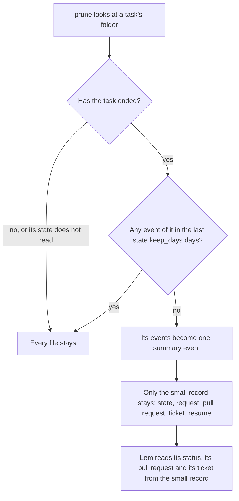

# Past state.keep_days, an ended task keeps only a small record

careful: yes, because it reaches "A task's record is lost or wrong: its state, its decisions and its approved criteria, which nothing rebuilds and the pull request reads": task 1 makes `lem project prune` remove an old ended task's decisions, criteria and report, and every reader of its folder must still read its state.

## Acceptance criteria

Size: full, because `lem project prune`, the board's page of an old task and every reader of an ended task's folder change, and a task's record is in reach.

1. Past `state.keep_days`, `lem project prune` leaves of an ended task only its small record: its state, its request, its pull request, and its ticket's and its resume's files when it has them. Everything else of its folder goes: its pictures, its pages, its report, its decisions, its criteria and its reviews' records.
   1. The task `done-column-shows-newest` landed on 2026-11-22 with pull request 20, and `state.keep_days` is 30.
   2. Its folder holds 1,760 KB, and today's prune would keep 32 files of it, 1,087 KB.
   3. On 2026-12-22 `lem project prune` runs.
   4. Its folder keeps the small record only, about 12 KB.
2. A task that ended less than `state.keep_days` ago, and a task that has not ended, keep every file: a task that landed 10 days ago keeps its pictures, its report and its decisions after a prune.
3. Every part of Lem that reads an ended task reads a pruned one as before:
   1. `lem project tasks` gives `done-column-shows-newest` as landed, with pull request 20.
   2. The board's Done column and its list of older tasks show it.
   3. A task queued after it may start (`lem project may-start`).
   4. A new task cannot take its name (`lem project task-dir`).
   5. A second `lem project prune` changes nothing of it.
4. A ticket step that a pruned task still owes stays shown: a task from issue 7 whose comment at its landing was never posted still shows that comment as owed in `lem project tasks` after the prune.
5. `/lem resume` of a dropped task past the time still refuses, and still ends with `/lem` and the task's ask, so the owner can start it again in one line.
6. The board's page of a pruned task says what stayed and that the rest left after `state.keep_days` days, and no longer says "Its files stay": the page of `done-column-shows-newest` says that its other files left after 30 days.

## How it works

What `lem project prune` does with the folder of each task, by its state and the day of its newest event.

## Tasks

1. **The prune keeps the small record and nothing else** (criteria 1, 2, 3.1, 3.3, 3.4, 3.5, 4 and 5).
   `skills/lem/scripts/lem_artifacts.py` names the small record in one place, beside `RECORDS`:
   `state.md`, `ask.txt`, `task.md`, `landing.json`, `ticket.txt`, `ticket-repo.txt`,
   `ticket-steps.txt` and `resumed-from.txt`, each with the reader that needs it (decision 1). One
   function there gives the files of a task folder that are not in it: every plain file, at any
   depth, read with no link followed, but the small record and the lock files at the top of the
   folder (decision 2). It replaces `working`, which has no other caller (`git grep "\.working("`:
   `cmd_prune` and its unit test). `cmd_prune` in `skills/lem/scripts/project.py` removes those files
   of each task that `task_calls` calls `old`, through `Remover` as now, then the folders that are
   empty; a task that is `open`, `young` or `skip` is not touched, as now. Its answer and its `said`
   stop calling the files "working files", and say that each such task keeps only its small record.
   A second prune finds nothing to remove and reports no task. The texts that this makes false, in
   the same task: the module docstrings of `project.py` (the paragraph about `prune`, near line
   314) and of `lem_artifacts.py` (the paragraph about `working`), the docstrings of `cmd_prune` and
   `task_calls`, the `[state]` comment of `TEMPLATE` (near line 688), and the `prune_once` paragraph
   of the `serve.py` docstring (near line 185). Tests, each of which first checks that the pruned
   folder holds the small record only, so that it fails on the base, where the report and the
   decisions stay:
   - `tests/unit/test_board_task.py`, `test_a_task_loses_only_its_working_files_and_keeps_its_state_and_every_record`,
     is rewritten to the new rule on the same files (criterion 1);
   - the prune block of `tests/lem-state.sh` (from line 218, the check at line 297): an old landed
     task with pictures, a report, decisions, criteria and a review round keeps only its small
     record; a task that landed 10 days ago and an open task keep every file (criteria 1 and 2);
     then `lem project tasks` gives the old task's status and its pull request, a task queued after
     it passes `lem project may-start`, `lem project task-dir` refuses its slug, and a second prune
     removes nothing (criterion 3, items 1, 3, 4 and 5; the summary block from line 339 holds some of
     these already, and may be the one that grows);
   - a check that a pruned task from issue 7, whose `ticket-steps.txt` has no `commented` line after
     its landing, still has that step in `ticket_owed` of `lem project tasks` (criterion 4);
   - a check that `lem project resume` of a pruned dropped task refuses, and that its message ends
     with `/lem` and the text of its `ask.txt` (criterion 5; `tests/unit/test_task.py` near line 1108
     has the summarized case to start from).
   The prune block of `tests/lem-serve.sh` (from line 122) runs a real prune and reads the old task's
   documents on Artifacts: it is task 2's, and this task does not run it.
   Files: `skills/lem/scripts/lem_artifacts.py`, `skills/lem/scripts/project.py`,
   `skills/lem/scripts/serve.py` (its docstring only), `tests/unit/test_board_task.py`,
   `tests/unit/test_task.py`, `tests/lem-state.sh`.
2. **The board's page of a pruned task says what stayed** (criteria 3.2 and 6). `summary_card` in
   `skills/lem/scripts/lem_board_task.py` drops "Its files stay: its state, its request, its reports
   and its documents." and says, in its place, what stayed (its state, its request and its pull
   request, and its ticket's files when it has them) and that its other files left after N days, N
   being the workspace's `state.keep_days` as its settings give it now (decision 3). `went_tab` and
   the module docstring (line 30) stop saying that its files stay on Artifacts. The page gets the
   number from the server, which reads the workspace's settings; a settings file that does not read
   is one of the page's problems (`Ctx.problems`, which the board shows), never a number Lem guessed. Tests:
   the summary card's unit test in `tests/unit/test_board_model.py` (near line 1081), and the prune
   block of `tests/lem-serve.sh` (from line 122), which runs a real prune on the afternoon of
   `tests/board-showcase.py`: the old task's Done card and its place in the list of older tasks are
   as before, its Overview says that its other files left after 30 days, its Artifacts tab lists the
   small record only, and no page says "Its files stay". Files: `skills/lem/scripts/lem_board_task.py`,
   `skills/lem/scripts/lem_board_pages.py` and `skills/lem/scripts/serve.py` as far as the number
   needs, `tests/unit/test_board_model.py`, `tests/lem-serve.sh`.
3. **The documents** (no criterion). `docs/settings.md`, `[state]`: the paragraph says that the
   server removes every file of a task that ended more than `state.keep_days` ago but its small
   record (its state, its request, its pull request, and its ticket's and its resume's files), and
   that a retro or a nap after that time finds no report and no decisions of it; the row of
   `state.keep_days` says the same in a few words. `docs/install.md` line 66: `.lem/state/` is on this
   computer only, git does not see it, Lem removes from it what is older than `state.keep_days`, and
   it touches nothing in the repository (the newcomer's and the teammate's wishes,
   `criteria-read.md`). `skills/lem/stages/learn.md` (near line 97): past `state.keep_days` an ended
   task keeps no `report.md` and no `decisions.jsonl`, so a retro more than that apart from the one
   before reads only the newer tasks. `AGENTS.md`, the `.lem/` item of "Layout": what `prune`
   removes. `site/index.html` where it says the same thing as the pages above. Files: those named,
   and any page that `git grep -n -e "records stay" -e "files stay" -e "working files"` shows to
   say that an old ended task keeps its documents.

## Decisions

1. **The small record is eight files, each kept for one reader.** `state.md`: `read_tasks` (the status
   that `tasks`, `may-start`, `queued_behind` and `task-dir` read) and `task_calls` (a task with no
   state.md is `open`, so a second prune must find it). `ask.txt`, and `task.md` for a task with no
   `ask.txt`: `ask_of`, and the last line of `cmd_resume`'s refusal. `landing.json`, whole:
   `proposal`, the pull request that `tasks` shows; it is 11 KB for `done-column-shows-newest` and at
   most 34 KB in this repository (the scout's dry run of 2026-11-23), and a trimmed copy would be a
   second form of a record that only `land.py` writes. `ticket.txt`, `ticket-repo.txt`,
   `ticket-steps.txt`: `ticket_owed` and `ticket_held_by`. `resumed-from.txt`: `resumed_slug`,
   `ticket_held_by` and the "goes on in X already" check of `cmd_resume`. What the owner confirmed
   (`directions.md`): "name, end, day, pull request, and the files a queued task, a new name, a
   ticket step and /lem resume read".
2. **The lock files stay.** Each is 0 bytes, today's prune keeps them too, and removing a lock file
   while another process holds it lets a second writer lock a new file of the same name.
3. **The page says the workspace's `state.keep_days` as its settings give it now**, not a number kept
   in the summary event. A new key of the summary would need the summaries that this repository and
   others already hold corrected by hand (`AGENTS.md`, "Lem is not released"), and a page that names
   the number now is wrong only after the owner changes the number, by the days between the two.
4. **The summary event does not change.** It already keeps the status, the end, the day and the pull
   request (`summary_of`), and the board reads it; nothing of this task needs a new key there.

## Not verified

- That a retro or a nap more than `state.keep_days` after a task's end does well without its report
  and its decisions: the owner chose that they go (`interview-notes.md`), so no test reads them.
- A real `lem project prune` over this repository's state folder: the build runs the new code in
  throwaway folders, and a `--dry-run --days 0` over this repository, which writes nothing, at the
  end of task 1.
