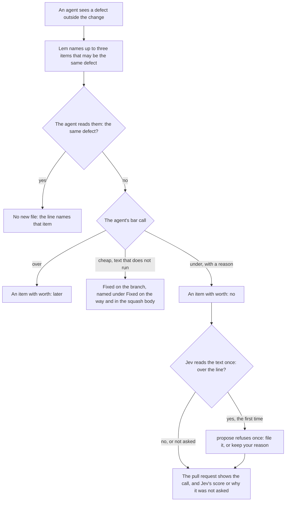

# A finding Lem decides against stays as a `worth: no` item, and Jev reads each "under"

careful: yes, because the change reaches "A change bends a ruling of the owner" (the bar ruling of 2026-11-22 and rule 6 change on his word in the interview), "The landing lets through a change that should not land" and "A pull request says green when it should not" (`propose` gets new refusals), and it sends a finding's text to the Jev model's provider (next to "A developer's typed messages leave the machine without his yes").

## Acceptance criteria

Size: full, because the change reaches the landing's bar check, the builder's rule 6, the board's backlog, the night's and the retro's reviewer, the settings and Jev.

1. A defect outside the task that a review or a builder judges under the bar becomes a file in `docs/backlog/` with `worth: no`, and the pull request lists it as filed as not worth it; a reason line in the item is optional:
   1. Review round 1 of task export-notes sees that `shop/dates.py:format_day` pads the day with a space where the rest of the shop pads it with a zero.
   2. It calls this under the bar: no user is confused, no contract breaks.
   3. The branch gets `docs/backlog/format-day-pads-with-a-space.md` with `worth: no`.
   4. The pull request lists that file under the defects filed as not worth it.
2. Outside the task, an agent fixes on the branch only text that does not run (a comment, a docstring, a sentence of a document) and a finding that a check of the project reports and its rerun shows fixed; any other defect outside the task, a refactor or a removal of code that looks unused too, becomes an item by the bar, and the squash commit's body names each fix outside the task:
   1. The polish pass of task export-notes finds a docstring of `lem_state.py` that the code no longer matches, and CSS rules in `board.css` that match no element; the task changed neither file.
   2. It corrects the docstring in a commit of its own.
   3. It leaves the CSS rules, and files them under the bar as a `worth: no` item.
   4. The squash commit on `main` says in its body that the docstring of `lem_state.py` was corrected on the way.
3. A proposal that the night's or the retro's reviewer refutes becomes a `worth: no` item beside the reviewer's other items: retro of 2026-11-24 proposal 6, refuted as "a first-time lesson, with no question in it", is an item with `worth: no` that holds that reason.
4. The count on the Backlog key never counts a `worth: no` item, and the Backlog view still lists it under "Decided against": with 2 reviewer's items that wait for the owner and 1 refuted one, the key shows 2, and the view shows all 3.
5. The card of a backlog item shows who added it, on which day and in which task, read from the commit that added its file, and no item gets an author field in its frontmatter: the card of `clean-refuses-a-branch-rebased-after-its-push-and-blames-the-forge.md` says it was added by pySilver on 2026-11-22.
6. `lem land propose` refuses every "Seen, not filed" line and every "Left open" finding that has no bar call and no reason, whoever wrote it, and names the line:
   1. The landing session of task seat-defaults-and-fallback writes by hand "Seen, not filed: `land.py:cmd_start` writes over `reviews/review-1.*`", with no bar call.
   2. `lem land propose` refuses, names that line, and says: give it a bar call and a reason, or file it.
   3. The session files it, or calls it under the bar with its reason; then `propose` goes on.
7. Lem asks Jev one plain question about each finding the agent calls under the bar, once for each text, records the score, and refuses one time when Jev reads it as over the bar; the agent's second answer with its reason stands, and the pull request shows the agent's call beside Jev's score:
   1. The agent calls the `cmd_start` finding under the bar, with a reason.
   2. Jev's score for "is this over the bar?" is over the line `land.py` names; `propose` refuses one time: Jev reads this as over the bar, file it or give your reason.
   3. The agent keeps "under" with its reason; `propose` goes on and does not ask Jev again about that text.
   4. The pull request's line reads: under the bar (the agent's reason), Jev's score beside it.
8. Before an agent files a finding, Lem asks Jev, for each existing item, whether the finding is the same defect, and names the three items with the highest scores at most; the agent reads those items and decides: a review that sees the space padding of `format_day` again gets `format-day-pads-with-a-space.md` named, reads it, and files nothing new.
9. With no `JEV_API_KEY` on the machine, or no answer from Jev, the landing goes on as without Jev, and the pull request's line says "Jev: not asked (no key)" or "Jev: not asked (no answer)".
10. Lem sends a finding's text to Jev unless the project's `.lem/settings.toml` says `findings = false` under `[jev]`; with no such key it sends: a repository whose settings say `findings = false` gets "Jev: not asked (off in the settings)" on each line, and sends nothing.

## How it works

One finding outside the change, from the agent's call to the pull request. The duplicate check comes first, then the bar call, then Jev's one look at an "under".

A line that a session writes by hand under "Seen, not filed" or "Left open" takes the same path from E: `propose` refuses it while it has no call and no reason (criterion 6).

## Tasks

1. **The bar's text: an "under" is a `worth: no` item, and "cheap" is only text that does not run.** Serves criteria 1 and 2 (the rule the agents read).
   - `agents/lem-builder.md`, rule 6: "Under the bar?" becomes one item with `worth: no` and its reason line (optional), listed under the new heading of the pull request; "Cheap?" becomes text that does not run (a comment, a docstring, a sentence of a document) and a finding a check of the project reports and its rerun shows fixed, each fixed in a commit of its own whose message names it (`fixed on the way: FILE, what was wrong`), so a squash by GitHub's button that lists the commits carries it (decision 9, the gate); a refactor or a removal of code that looks unused is an item by the bar. The item format gains `worth: no` beside `worth: later`, and an optional body line `Decided against: REASON`. The bar sentence's subject changes, and its condition does not: "An item with `worth: later` is filed only for a defect over the bar: it confuses a user, breaks a contract, damages data or costs money, and it happens today; or the owner said it is worth an item." So no sentence of rule 6 says that an under defect gets no file (talk, question 12).
   - `tests/unit/test_the_bar.py`: `BAR` takes the new subject, and `PARTS` stays; the words of `test_rule_6_says_its_limit_what_is_cheap_and_the_three_outcomes` follow the new rule 6 (the three outcomes become "Fixed on the way", an item with `worth: no`, an item under "Filed in the backlog").
   - The briefs that send an agent to a defect outside a task, where they say "no file" for an under-the-bar defect or describe "cheap": `skills/lem/prompts/review.md`, `landing.md`, `small.md`, `merge.md`, `skills/lem/stages/polish.md`, `skills/lem/stages/land.md`. Each still names "the bar of rule 6" and copies no part of it.
   - `docs/rulings/rulings.md`: the bar bullet of "The review, the pull request and the merge" changes its words, as AGENTS.md says for a ruling that changes a part of another: a defect under the bar is a `worth: no` item, cheap is text that does not run and a check's finding its rerun shows fixed, with the owner's day 2026-11-23 beside 2026-11-22.
2. **`lem land file` files an "under" as `worth: no`, the pull request lists it, `propose` refuses a line with no call, and the squash body names the fixes on the way.** Serves criteria 1, 2 and 6.
   - `skills/lem/scripts/land.py`: `cmd_file` writes an item for each `under` defect of a review too, with `worth: no` and the line `Decided against: WHY` from the review's `why`, in the same commit of its round; `to_file` and `propose` count an `under` defect with no item as one that waits for its item, as they do an `over` one.
   - The pull request's two lists of items come from the tip, not from who filed them: each item the branch adds to the backlog folder (`items_added`, which holds a review's items, the polish pass's and the fast track's builder's alike) goes under `## Filed in the backlog` when the tip's file says `worth: later` or `yes`, and under a new heading after it, `## Filed as not worth it`, when it says `no` (`outside_parts`, `with_outside`, `small_text`, `pr_text`, `builder_filed`). A notes line that names an item the step lists is not written twice. `## Seen, not filed` keeps the lines of a cheap defect nobody fixed and of a defect an open item holds (talk, questions 1 and 3).
   - `cmd_propose` checks the lines of the notes that hold a finding nobody filed (a lone `none` aside): on the standard track the lines under `## Seen, not filed` and `## Left open`; on the fast track, whose notes have no fixed headings, every line before the notes' first heading (where `stages/land.md`, step 6, puts the should findings the review left) and the lines under `## Left open` and `## Seen, not filed`, so a `## Left open` heading a session wrote is checked too (decision 6, the gate). It refuses each such line that has neither a bar call with its reason (`under: REASON`, `cheap: REASON`) nor a path of the backlog folder that the tip holds; the refusal names the line and says "give it a bar call and a reason, or file it". A should finding of `## Left open` takes the same three outcomes: the missing test of #85 is `under:` with why a test is not worth it now, or an item (talk, question 4). `seen_line` writes its lines in the same form, so a line the script writes always passes.
   - `cmd_merge`: with `branch.history = "squash"`, the body of the merge commit holds each line of `## Fixed on the way` of the pull request's text, before the line of a moved base when there is one, and ends with the line `Lem task: SLUG`, which the board reads (task 6).
   - The module docstring of `land.py` and the `BARS` messages follow (an "under" is filed with `worth: no`; what "cheap" is).
   - Tests: `tests/unit/test_land.py` for the pure parts (the line check, `outside_parts`, the squash body), and the journey in `tests/lem-land-backlog.sh` (a review's `under` defect becomes a `worth: no` item on the branch; a hand-written line with no call is refused, named, and passes after a call).
3. **Jev reads each "under" once, and the pull request shows its score or why it was not asked.** Serves criteria 7, 9 and 10.
   - `skills/lem/scripts/project.py` and `lem_state.TABLE_PLACES`: a `[jev]` table in the team's `.lem/settings.toml` with one key, `findings`, a boolean, `true` when absent; `lem project show` gives it.
   - `skills/lem/scripts/land.py`, at `propose`, after the check of task 2: the findings called under the bar are read from the tip, whoever wrote them: each item the branch adds with `worth: no` (its `where`, title and body), and each `under:` line of the notes that task 2 checks. For each one with no entry kept yet, one request to Jev through `jev.py`, run as `corrections.py` runs it (`LEM_JEV` names a stand-in for the tests). The spec: the finding's `where`, title and run as the state, one question of type `noul` with both meanings, as `jev.py:question_body` asks for both or neither: `yes` is the condition of the bar sentence, read at run time from rule 6 of the file `bar_file(main)` names (the project's own `.claude/agents/lem-builder.md` when it has one, else Lem's), the one the builders and the merge agent read; `no` is "the finding does not meet that bar", the plain negation, so the two meanings never both apply (talk, questions 2 and 13; decision 5, the gate). A rule 6 with no sentence of the bar's form gives "Jev: not asked (no bar in FILE)", and nothing is sent.
   - The entry is kept in `landing.json` under a new key `jev`, by the digest of the finding's `where`, title and run (an item's body without its `Decided against:` line, a notes line without its `under:` reason), as `land.py:holds` tells two defects apart, so a new reason does not make a new finding and two runs of one place and title are two findings (decision 4, the gate): `{score, asked_at}` or `{not_asked: "no key" | "no answer" | "off in the settings" | "no bar in FILE"}`. A finding with a kept entry is never sent again. `start_locked` carries `jev` with `pr`, `pushed` and `taken` when a `ready` task starts its landing again, so a second landing of the same task asks nothing twice (talk, question 8).
   - The first `propose` that finds a kept score at or over `JEV_OVER` for a finding it has not refused before refuses once, names each such finding with its score, and says "Jev reads this as over the bar: make the item `worth: later`, or keep `worth: no` with its `Decided against:` line (for a notes line, keep `under:` with its reason), then run this step again"; the refusal is kept (`refused` in the same entry). The agent's second answer is the tip as the next run reads it: an item still `worth: no` with its `Decided against:` line stands and goes under `## Filed as not worth it`; an item made `worth: later` goes under `## Filed in the backlog`, and that edit asks for the checks as any commit does; a refused item still `worth: no` with no `Decided against:` line is refused again until it has one (talk, question 1).
   - Each line of a finding called under the bar in the pull request (`## Filed as not worth it`, the `under:` lines of `## Seen, not filed` and `## Left open`) ends with "Jev: 0.82", or "Jev: not asked (no key)", "(no answer)", "(off in the settings)", "(no bar in FILE)".
   - No `JEV_API_KEY`, a failed request, a timeout, exit 3 (over `jev.py`'s limit): "not asked", and the landing goes on. The request's timeout is `JEV_SECONDS`, shorter than `jev.py`'s 120.
   - `skills/lem/scripts/doctor.py:jev_key`: `used_for` names the landing's read of a finding too; the key stays optional.
   - Tests: `tests/unit/test_land.py` for the pure parts (the spec, the reading of the bar sentence from rule 6, the kept entry, the line's ending); `tests/lem-land-backlog.sh` with a stand-in for Jev (a score over the line refuses once and the second run goes on; no key; `findings = false` sends nothing, which the stand-in's log shows); `tests/lem-settings.sh` and `tests/unit/test_settings_files.py` for the new table.
4. **Lem names the items that may hold the same defect before an agent files one.** Serves criterion 8.
   - `skills/lem/scripts/land.py`: a step `lem land alike SLUG --where WHERE --title TITLE --what FILE` that prints at most three items of the backlog folder as the task's tip holds it (the base's items and those the branch added, a hand-filed one too), each with its path, title and Jev's score, those with a score at or over `SAME_AT`, the highest first, and "Jev: not asked (WHY)" when it sent nothing, with every item's path and title then, for the agent to read. The finding is the state, and each item one `noul` question ("Is the finding the same defect as this item?", with the item's title, its `where` and the first line of its body). Jev answers each question alone, so the questions go in as many requests as `jev.py:LIMIT_BYTES` needs, each under it, and every item is asked; no item is left out by its `where` (talk, question 7).
   - `cmd_file` asks the same, for every defect of every round that waits for an item and has no `open`, before it writes any file. When any defect gets items named, it writes nothing at all and refuses with each such defect, its items and two ways on: `--same rN.M=PATH` (the defect is that item: kept as its `open`) or `--new rN.M` (a defect of its own: filed); the next run writes every item at once, as today (talk, question 6).
   - A defect called over whose `open` item, named by the review or by `--same`, says `worth: no` at the tip is not settled by that path: `to_file` counts it as waiting, and `cmd_file` files a new item for it, `worth: later`, with the defect's run and the line "The same defect as `OLD-PATH`, now over the bar.", in the commit of its round. The old item stays as it is. The new item is an added file, so `covers_one`, `gate_holds` and `items_added` take it unchanged, no second review runs, and the pull request lists it under `## Filed in the backlog`. A builder that files by hand (the polish pass, the fast track's builder) does the same when an item `lem land alike` names says `worth: no` and its own call is over; `prompts/small.md`, `prompts/landing.md` and `stages/polish.md` say so (talk, question 5; decision 10, unsettled).
   - The briefs of the agents that file by hand (`skills/lem/prompts/small.md`, `landing.md`, `skills/lem/stages/polish.md`) say to run `lem land alike` before each item and to read the items it names.
   - The settings' `findings = false` and a missing key hold here as in task 3.
   - Tests: unit cases for the spec and the pick of the three; a journey in `tests/lem-land-backlog.sh` with the stand-in: `format-day-pads-with-a-space.md` on the base, the same defect seen again, `file` refuses naming it and writes no file of any defect of that run, `--same` files nothing; an over defect that names a `worth: no` item gets a new `worth: later` item that names the old one, the old item unchanged, with no second review and no new run of the checks.
5. **A refuted proposal stays as a `worth: no` item of the reviewer.** Serves criterion 3.
   - `skills/lem/scripts/project.py:cmd_proposals_verdict`: each refuted proposal gets one item in `.lem/state/backlog/`, `worth: no`, its `where`, `added`, the `proposals:` line that names it, the move as its title, and the reviewer's reason in its body as `Decided against: REASON`. The records' `refuted` entries keep their keys as they are (`ENTRY_KEYS`): the item names its proposal, so no record changes its form. The items are written before the records, as today, so a verdict cut off between the two comes back from `lem project proposals read`: before it picks a file name, `cmd_proposals_verdict` looks in the folder for a `worth: no` item whose `proposals:` line names that one proposal, and writes that file again in place of a new one (talk, question 10).
   - `cmd_proposals_drop` refuses a `worth: no` item with a message that says it is decided against already; `item_holder` and the start of a task from it stay as for any item.
   - `skills/lem/prompts/proposals.md`: the reviewer's own text says that a refuted proposal becomes such an item.
   - Tests: `tests/unit/test_proposals.py` or the unit file that holds `cmd_proposals_verdict` today: the retro of 2026-11-24 proposal 6, refuted as "a first-time lesson, with no question in it", is a `worth: no` item with that reason; a record of the old form still reads.
6. **The board: the count leaves out `worth: no`, a refuted item is under "Decided against", and the card says who added an item, when and in which task.** Serves criteria 4 and 5.
   - `skills/lem/scripts/lem_board_model.py:undecided` leaves out every item whose worth is `no`; `reviewer_items` and the Backlog page (`lem_board_pages.py`) put a reviewer's `worth: no` item under "Decided against" with the others, with no "Drop".
   - `skills/lem/scripts/board.py:backlog`: for each item of the backlog folder, the commit that added its file, from one `git log --diff-filter=A` over the folder for the whole read: the author's name, the day, and the task. The task is read from git alone, so every clone shows the same card: the `Lem task: SLUG` line of the commit's body, which Lem's squash merge writes (task 2), or the slug a `docs(backlog): what review round N saw outside SLUG` subject names when the history keeps the branch's commits; with neither, the card names the pull request the subject ends with (`(#88)`), and with no number either, no task (talk, question 9). An item git does not have yet shows "not committed yet", as the four untracked items of the main checkout today, `clean-refuses-a-branch-rebased-after-its-push-and-blames-the-forge.md` among them. No frontmatter field is read or written for it.
   - `lem_board_pages.py:backlog_item`: the card's line "added by AUTHOR on DAY, in task SLUG".
   - Tests: `tests/unit/test_board_model.py` (2 undecided and 1 refuted reviewer's item give 2 on the key and 3 in the view), `tests/unit/test_board_pages.py` (the card's line), and a check in `tests/lem-serve.sh` or a unit case over a throwaway repository for the read from git, in which the test commits the item `clean-refuses-a-branch-rebased-after-its-push-and-blames-the-forge.md` as pySilver on 2026-11-22, with a body line `Lem task: SLUG`: the main checkout's copy of that file is not committed, so no history of this repository holds that example.
7. **The documents the change makes false.** Serves no criterion.
   - `docs/pull-request.md`: the headings of what a review saw outside the change, the new refusals of `propose`, Jev's score on a line.
   - `docs/board.md`: what the Backlog key counts, "Decided against" with the reviewer's refuted items, the card's "added by" line.
   - `docs/settings.md`: the `[jev]` table, one to one with `project.py`.
   - `site/index.html`, where it says the same as a changed guide.
   - `AGENTS.md`, "Layout": `jev.py`'s callers, when the list names them.

## Plan talk

Who argued the plan: the reviewer, Codex, GPT 6.2 Sol at high effort (its pane's status line); the defender, Claude Code, Opus 5.5 at high effort (the `defender:` line of the task's state). Two model families. Seven turns, inside the bound of 4 × 13 + 2. The repairs are one commit, a5d226c1.

Agreement carries no authority: the review before the pull request reads each settled position as a claim.

### The list, as the reviewer gave it

1. **Task 3, the agent's second answer to Jev.** Design choice. The repair read the findings called under from the tip (each item the branch adds with `worth: no`, each `under:` line), took the tip's file as the agent's second answer, and keyed Jev's entry by the digest of `where` and title. Its first hold, that an unchanged retry passes, was refuted by criterion 7, step 3 ("The agent keeps 'under' with its reason; propose goes on"), and the reviewer closed that part. Its second hold stands: two findings with the same `where` and title and different runs share one key, while `land.py:holds` tells them apart by the run. Kept position: the key of `where` and title (task 3). Other position: the key the run belongs to as well, as `land.py:holds` compares it. The ladder decided it after the talk: the gate, checkable, picked the other position, the key of `where`, title and run (decision 4), and task 3 says so.
2. **Task 3, Jev's two meanings.** Design choice. The repair gave the noul both meanings, as `jev.py:question_body` asks: yes is the bar's condition, no is "the finding meets none of these, or not today". Defender: an agent never calls `under` a defect the owner called worth an item (rule 6, "The bar binds Lem's agents only"), so both meanings never apply to a text that reaches Jev. Reviewer: `land.py:defects_of` accepted an `under` call on a finding that says it happened yesterday and that the owner asked for an item, and both meanings apply to it. The ladder decided it: the gate, checkable, picked the plain negation, "the finding does not meet that bar" (decision 5), and task 3 says so.
3. **Tasks 2 and 3, items a builder files by hand.** Settled, the same decision as 1: both lists of items come from the tip by the file's worth, whoever filed them (task 2, bullet 2; task 3, bullet 2). Settled by the two, not checked by the review.
4. **Task 2, the scope of the notes check.** Design choice. The repair checks the lines before the first heading and under `## Seen, not filed` on the fast track, and `## Left open` and `## Seen, not filed` on the standard track. Reviewer: a session on the fast track may write a `## Left open` heading, and `small_text` keeps it unchecked, while criterion 6 says "whoever wrote it". No refutation. The ladder decided it: the gate, checkable by criterion 6, picked the check of `## Left open` on the fast track too (decision 6), and task 2 says so.
5. **Task 4, an over call on a `worth: no` item.** Design choice. The repair changed the decision that `--same` settles a defect: `cmd_file` makes the item `worth: later` with the new run, and `gate_holds` takes that edit. Reviewer: `land.py:covers_one` takes only new files of the backlog folder, so the edit of a base item asks for a new review; `items_added` misses it; and a polish or fast-track builder that files by hand has no way to raise such an item. No refutation. The ladder did not settle it: the gate held it, the personas split (the teammate for the raise in place, the developer for a new item), the dialectic confirmed a break of the raise as the plan held it (task 2 lists items from `items_added`, which reads only added files, while task 4 listed the raised item), and the experts split (Fable a new item, Astra a repaired raise). The defender's pick stands, unsettled, against the kept decision for that break: a new `worth: later` item that names the old one (decision 10), and task 4 says so.
6. **Task 4, a refusal halfway through `cmd_file`.** Settled: the duplicate check runs for every waiting defect before any file is written, and a refusal writes nothing (task 4, bullet 2). Settled by the two, not checked by the review.
7. **Task 4, which items Jev reads.** Settled: the items of the backlog folder at the tip, the branch's too, all asked, in as many requests as `jev.py:LIMIT_BYTES` needs (task 4, bullet 1). Its hold, a finding whose state alone passes the limit, was refuted: `jev.py` exits 3 and sends nothing, the plan makes that "not asked" and lists every item for the agent, which criteria 8 and 9 allow. Settled by the two, not checked by the review.
8. **Task 3, the kept score across a second landing.** Settled: `start_locked` carries `jev` with `pr`, `pushed` and `taken` (task 3, bullet 3). Settled by the two, not checked by the review.
9. **Task 6, where the card's task comes from.** Design choice. The repair read the task from git alone: the `Lem task: SLUG` line of Lem's squash body, or the subject `docs(backlog): what review round N saw outside SLUG`, else the pull request's number. Reviewer: with `branch.history = "keep"`, the fast track's `docs(backlog): what the builder of SLUG saw outside it` (`prompts/small.md`, step 7) names the task, and task 6 does not read that form. No refutation. The ladder decided it: the gate, cheap, kept the plan's position (decision 7).
10. **Task 5, a verdict cut off between its two writes.** Settled: `cmd_proposals_verdict` finds the `worth: no` item whose `proposals:` line names the proposal and writes that file again (task 5, bullet 1). Settled by the two, not checked by the review.
11. **Task 2, a merge by GitHub's button.** Design choice. The repair kept the body in Lem's merge and wrote the button's merge under "What this plan does not verify". Reviewer: `docs/pull-request.md`, "Merge it", and the ruling "GitHub pull requests are the one way to land" make the button a path of Lem's, so criterion 2 is not met there. No refutation. The ladder decided it: the gate, checkable against GitHub's documented squash settings and this repository's `COMMIT_MESSAGES`, picked a commit of its own for each fix on the way whose message names it (decision 9), and tasks 1 and "What this plan does not verify" say so.
12. **Task 1, the sentence agents read.** Settled: the bar sentence's subject becomes "An item with `worth: later`", its condition stays, and `BAR` of `test_the_bar.py` follows (task 1). Settled by the two, not checked by the review.
13. **Task 3, whose bar Jev reads.** Design choice. The repair reads the bar from the file `bar_file` names, and a rule 6 with no sentence of the bar's form gives "Jev: not asked (no bar in FILE)". Reviewer: a project may write its bar in its own words, and criterion 7 still applies there. No refutation. The ladder decided it: the gate, cheap, kept the plan's position (decision 8).

### Mechanisms the repairs added

- Question 5: an over call on a defect a `worth: no` item holds files a new `worth: later` item that names the old one. At the cause: it changed task 4's decision that `--same` settles a defect. The talk's repair raised the old item in place; the ladder replaced that with the new item (decision 10).
- Question 8: `start_locked` carries `jev`. A layer over the decision to keep Jev's entries in `landing.json`, whose cite is existing code, `land.py:start_locked`'s carry of `pr`, `pushed` and `taken`.
- Question 9: the `Lem task: SLUG` line of Lem's squash body. At the cause: it changed task 6's decision to read the task from a local `landing.json`.
- Question 10: the look for an item by its `proposals:` line. A layer over the decision to write the items before the records, whose cite is existing code, the docstring of `project.py:cmd_proposals_verdict`.

### Raised, not argued

- A retry that turns an interrupted refute into a pass leaves the refuted `worth: no` item beside the passed item (`project.py:cmd_proposals_read`, `cmd_proposals_verdict`).

### Refused as unpriced

None.

### What changed in the plan

- Task 1 (question 12): the bar sentence's subject, `BAR` with it, and the body line `Decided against: REASON`.
- Task 2 (questions 1, 3, 4, 9): both lists of items from the tip by the file's worth; the notes check on both tracks; `Lem task: SLUG` at the end of the squash body.
- Task 3 (questions 1, 2, 8, 13): the findings from the tip; both meanings of the noul; the bar from `bar_file`; the key of `where` and title; `jev` carried by `start_locked`; the agent's second answer read from the tip; "not asked (no bar in FILE)".
- Task 4 (questions 5, 6, 7): the items of the tip, all asked in split requests; the check before any write; a new `worth: later` item that names an old `worth: no` one on an over call (the ladder, decision 10, in place of the talk's raise).
- Task 5 (question 10): the look for an item by its `proposals:` line.
- Task 6 (question 9): the task from git alone; the example item committed by the test.
- Decisions of the plan and "What this plan does not verify" (questions 1, 9, 11, 13).
- After the talk, the ladder's picks (`lem decisions list backlog-refuted-items-and-jev`, decisions 4 to 10): task 3's key of `where`, title and run (4) and its plain negation for Jev's no (5); task 2's check of `## Left open` on the fast track (6); tasks 1 and 2's commit of its own for each fix on the way, whose message names it (9); task 4's new item on an over call (10, unsettled, so the pull request is not green for it). Decisions 7 and 8 kept the plan.

## Decisions of the plan

- An "under" item goes under its own heading of the pull request, `## Filed as not worth it`, after `## Filed in the backlog`, so the merge agent reads the two apart. It rests on criterion 1's "lists it as filed as not worth it".
- `JEV_OVER = 0.7` in `land.py`: the starting value of Jev's documentation, which the jev-specialist named (`jev-advice.md`, part 2); a guess, not measured on findings. `SAME_AT = 0.5`: a guess, so that a weak match never reaches the agent's three. `JEV_SECONDS = 20`: a guess. Each constant's comment says so, with the day.
- Jev is asked at `propose`, by the script, over every finding called under that the tip holds, whoever filed it: an agent never chooses whether to ask (`jev-advice.md`, part 1). One request per finding, kept by the digest of its `where`, title and run, because the same text moved by up to 0.11 between two runs (`jev-advice.md`, part 2, the measurement of 2026-11-23): a second request could change the result.
- Jev's question carries the bar as rule 6 holds it in the file `bar_file` names, read at run time: `test_the_bar.py` forbids a copy in Lem's documents, a copy in a script would drift the same way, and the merge agent judges the items by that same file.
- A hand-written `under:` line is not forced into a file: criterion 6, step 3, lets the session call it under the bar with its reason.
- The proposal records keep their form: `ENTRY_KEYS` reads each entry's keys exactly, and AGENTS.md asks two releases for a change of a record's form. The refuted item names its proposal instead.
- The task of an item's commit comes from git alone (the `Lem task:` line of Lem's squash body, or the subject of `file`'s commit), so a teammate's clone shows the card this Mac shows; an item merged before this change, or by GitHub's own button, names its pull request instead.

## What this plan does not verify

- Whether Jev's score separates over from under on real findings: no labeled sample of findings exists, and the owner chose to wire Jev now with one plain question (`directions.md`). The tests run a stand-in for Jev.
- A real request to OpenRouter from a landing: the tests send nothing out.
- A merge by GitHub's own button: its squash message follows the repository's setting (GitHub's docs, "Configuring commit squashing for pull requests", read 2026-11-23). The default and "title and commit details" list the commits, whose messages name each fix on the way; "title and description" takes the pull request's text, whose `## Fixed on the way` names them; "title only" names none, and the `Lem task:` line reaches only a merge `lem land merge` makes. This repository's setting is `COMMIT_MESSAGES` (`gh api repos/pySilver/lem`, 2026-11-23).
