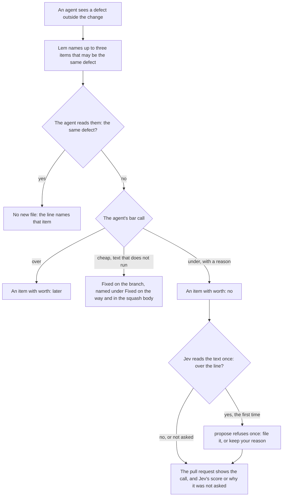

# A finding Lem decides against stays as a `worth: no` item, and Jev reads each "under"

careful: yes, because the change reaches "A change bends a ruling of the owner" (the bar ruling of 2026-11-22 and rule 6 change on his word in the interview), "The landing lets through a change that should not land" and "A pull request says green when it should not" (`propose` gets new refusals), and it sends a finding's text to the Jev model's provider (next to "A developer's typed messages leave the machine without his yes").

## Acceptance criteria

Size: full, because the change reaches the landing's bar check, the builder's rule 6, the board's backlog, the night's and the retro's reviewer, the settings and Jev.

1. A defect outside the task that a review or a builder judges under the bar becomes a file in `docs/backlog/` with `worth: no`, and the pull request lists it as filed as not worth it; a reason line in the item is optional:
   1. Review round 1 of task export-notes sees that `shop/dates.py:format_day` pads the day with a space where the rest of the shop pads it with a zero.
   2. It calls this under the bar: no user is confused, no contract breaks.
   3. The branch gets `docs/backlog/format-day-pads-with-a-space.md` with `worth: no`.
   4. The pull request lists that file under the defects filed as not worth it.
2. Outside the task, an agent fixes on the branch only text that does not run (a comment, a docstring, a sentence of a document) and a finding that a check of the project reports and its rerun shows fixed; any other defect outside the task, a refactor or a removal of code that looks unused too, becomes an item by the bar, and the squash commit's body names each fix outside the task:
   1. The polish pass of task export-notes finds a docstring of `lem_state.py` that the code no longer matches, and CSS rules in `board.css` that match no element; the task changed neither file.
   2. It corrects the docstring in a commit of its own.
   3. It leaves the CSS rules, and files them under the bar as a `worth: no` item.
   4. The squash commit on `main` says in its body that the docstring of `lem_state.py` was corrected on the way.
3. A proposal that the night's or the retro's reviewer refutes becomes a `worth: no` item beside the reviewer's other items: retro of 2026-11-24 proposal 6, refuted as "a first-time lesson, with no question in it", is an item with `worth: no` that holds that reason.
4. The count on the Backlog key never counts a `worth: no` item, and the Backlog view still lists it under "Decided against": with 2 reviewer's items that wait for the owner and 1 refuted one, the key shows 2, and the view shows all 3.
5. The card of a backlog item shows who added it, on which day and in which task, read from the commit that added its file, and no item gets an author field in its frontmatter: the card of `clean-refuses-a-branch-rebased-after-its-push-and-blames-the-forge.md` says it was added by pySilver on 2026-11-22.
6. `lem land propose` refuses every "Seen, not filed" line and every "Left open" finding that has no bar call and no reason, whoever wrote it, and names the line:
   1. The landing session of task seat-defaults-and-fallback writes by hand "Seen, not filed: `land.py:cmd_start` writes over `reviews/review-1.*`", with no bar call.
   2. `lem land propose` refuses, names that line, and says: give it a bar call and a reason, or file it.
   3. The session files it, or calls it under the bar with its reason; then `propose` goes on.
7. Lem asks Jev one plain question about each finding the agent calls under the bar, once for each text, records the score, and refuses one time when Jev reads it as over the bar; the agent's second answer with its reason stands, and the pull request shows the agent's call beside Jev's score:
   1. The agent calls the `cmd_start` finding under the bar, with a reason.
   2. Jev's score for "is this over the bar?" is over the line `land.py` names; `propose` refuses one time: Jev reads this as over the bar, file it or give your reason.
   3. The agent keeps "under" with its reason; `propose` goes on and does not ask Jev again about that text.
   4. The pull request's line reads: under the bar (the agent's reason), Jev's score beside it.
8. Before an agent files a finding, Lem asks Jev, for each existing item, whether the finding is the same defect, and names the three items with the highest scores at most; the agent reads those items and decides: a review that sees the space padding of `format_day` again gets `format-day-pads-with-a-space.md` named, reads it, and files nothing new.
9. With no `JEV_API_KEY` on the machine, or no answer from Jev, the landing goes on as without Jev, and the pull request's line says "Jev: not asked (no key)" or "Jev: not asked (no answer)".
10. Lem sends a finding's text to Jev unless the project's `.lem/settings.toml` says `findings = false` under `[jev]`; with no such key it sends: a repository whose settings say `findings = false` gets "Jev: not asked (off in the settings)" on each line, and sends nothing.

## How it works

One finding outside the change, from the agent's call to the pull request. The duplicate check comes first, then the bar call, then Jev's one look at an "under".

A line that a session writes by hand under "Seen, not filed" or "Left open" takes the same path from E: `propose` refuses it while it has no call and no reason (criterion 6).

## Tasks

1. **The bar's text: an "under" is a `worth: no` item, and "cheap" is only text that does not run.** Serves criteria 1 and 2 (the rule the agents read).
   - `agents/lem-builder.md`, rule 6: "Under the bar?" becomes one item with `worth: no` and its reason line (optional), listed under the new heading of the pull request; "Cheap?" becomes text that does not run (a comment, a docstring, a sentence of a document) and a finding a check of the project reports and its rerun shows fixed; a refactor or a removal of code that looks unused is an item by the bar. The item format gains `worth: no` beside `worth: later`. The bar sentence itself (`BAR` of `tests/unit/test_the_bar.py`) does not change.
   - `tests/unit/test_the_bar.py`: the words of `test_rule_6_says_its_limit_what_is_cheap_and_the_three_outcomes` follow the new rule 6 (the three outcomes become "Fixed on the way", an item with `worth: no`, an item under "Filed in the backlog").
   - The briefs that send an agent to a defect outside a task, where they say "no file" for an under-the-bar defect or describe "cheap": `skills/lem/prompts/review.md`, `landing.md`, `small.md`, `merge.md`, `skills/lem/stages/polish.md`, `skills/lem/stages/land.md`. Each still names "the bar of rule 6" and copies no part of it.
   - `docs/rulings/rulings.md`: the bar bullet of "The review, the pull request and the merge" changes its words, as AGENTS.md says for a ruling that changes a part of another: a defect under the bar is a `worth: no` item, cheap is text that does not run and a check's finding its rerun shows fixed, with the owner's day 2026-11-23 beside 2026-11-22.
2. **`lem land file` files an "under" as `worth: no`, the pull request lists it, `propose` refuses a line with no call, and the squash body names the fixes on the way.** Serves criteria 1, 2 and 6.
   - `skills/lem/scripts/land.py`: `cmd_file` writes an item for each `under` defect of a review too, with `worth: no` and the review's `why` as its reason line, in the same commit of its round; `to_file` and `propose` count an `under` defect with no item as one that waits for its item, as they do an `over` one.
   - The pull request lists those items under a new heading after `## Filed in the backlog`, `## Filed as not worth it` (`outside_parts`, `with_outside`, `small_text`, `pr_text`). `## Seen, not filed` keeps the lines of a cheap defect nobody fixed and of a defect an open item holds.
   - `cmd_propose` reads the notes' lines under `## Seen, not filed` and `## Left open` (a lone `none` aside) and refuses each line that has neither a bar call with its reason (`under: REASON`, `cheap: REASON`) nor a path of the backlog folder that the tip holds; the refusal names the line and says "give it a bar call and a reason, or file it". `seen_line` writes its lines in the same form, so a line the script writes always passes.
   - `cmd_merge`: with `branch.history = "squash"`, the body of the merge commit holds each line of `## Fixed on the way` of the pull request's text, before the line of a moved base when there is one.
   - The module docstring of `land.py` and the `BARS` messages follow (an "under" is filed with `worth: no`; what "cheap" is).
   - Tests: `tests/unit/test_land.py` for the pure parts (the line check, `outside_parts`, the squash body), and the journey in `tests/lem-land-backlog.sh` (a review's `under` defect becomes a `worth: no` item on the branch; a hand-written line with no call is refused, named, and passes after a call).
3. **Jev reads each "under" once, and the pull request shows its score or why it was not asked.** Serves criteria 7, 9 and 10.
   - `skills/lem/scripts/project.py` and `lem_state.TABLE_PLACES`: a `[jev]` table in the team's `.lem/settings.toml` with one key, `findings`, a boolean, `true` when absent; `lem project show` gives it.
   - `skills/lem/scripts/land.py`, at `propose`, after the check of task 2: for each finding called under the bar (a review's `under` defect and each hand-written `under:` line), with no score kept for its text yet, one request to Jev through `jev.py`, run as `corrections.py` runs it (`LEM_JEV` names a stand-in for the tests). The spec: the finding's text as the state, one question of type `noul`, whose `yes` meaning is the bar sentence that `land.py` reads at run time from rule 6 of Lem's own `agents/lem-builder.md`, so no file copies the bar.
   - The score is kept in `landing.json` under a new key `jev`, by the digest of the finding's text: `{score, asked_at}` or `{not_asked: "no key" | "no answer" | "off in the settings"}`. A text with a kept entry is never sent again.
   - The first `propose` that finds a kept score at or over `JEV_OVER` for a text it has not refused before refuses once, names each such finding with its score, and says "Jev reads this as over the bar: file it as an item, or keep your call with its reason and run this step again"; the refusal is kept (`refused` in the same entry), and the next run goes on.
   - Each line of a finding called under the bar in the pull request (`## Filed as not worth it`, the `under:` lines of `## Seen, not filed` and `## Left open`) ends with "Jev: 0.82", or "Jev: not asked (no key)", "(no answer)", "(off in the settings)".
   - No `JEV_API_KEY`, a failed request, a timeout, exit 3 (over `jev.py`'s limit): "not asked", and the landing goes on. The request's timeout is `JEV_SECONDS`, shorter than `jev.py`'s 120.
   - `skills/lem/scripts/doctor.py:jev_key`: `used_for` names the landing's read of a finding too; the key stays optional.
   - Tests: `tests/unit/test_land.py` for the pure parts (the spec, the reading of the bar sentence from rule 6, the kept entry, the line's ending); `tests/lem-land-backlog.sh` with a stand-in for Jev (a score over the line refuses once and the second run goes on; no key; `findings = false` sends nothing, which the stand-in's log shows); `tests/lem-settings.sh` and `tests/unit/test_settings_files.py` for the new table.
4. **Lem names the items that may hold the same defect before an agent files one.** Serves criterion 8.
   - `skills/lem/scripts/land.py`: a step `lem land alike SLUG --where WHERE --title TITLE --what FILE` that prints at most three items of the backlog folder at the base, each with its path, title and Jev's score, those with a score at or over `SAME_AT`, the highest first, and "Jev: not asked (WHY)" when it sent nothing, with every item's path and title then, for the agent to read. One request: the finding as the state, one `noul` question for each item ("Is the finding the same defect as this item?", with the item's title, its `where` and the first line of its body); over `jev.py`'s limit, only the items whose `where` names the finding's file are asked.
   - `cmd_file` asks the same before it writes the item of a defect with no `open`; when it names items, it writes nothing for that defect and refuses with those items and two ways on: `--same rN.M=PATH` (the defect is that item: kept as its `open`, no file) or `--new rN.M` (a defect of its own: filed).
   - The briefs of the agents that file by hand (`skills/lem/prompts/small.md`, `landing.md`, `skills/lem/stages/polish.md`) say to run `lem land alike` before each item and to read the items it names.
   - The settings' `findings = false` and a missing key hold here as in task 3.
   - Tests: unit cases for the spec and the pick of the three; a journey in `tests/lem-land-backlog.sh` with the stand-in: `format-day-pads-with-a-space.md` on the base, the same defect seen again, `file` refuses naming it, `--same` files nothing.
5. **A refuted proposal stays as a `worth: no` item of the reviewer.** Serves criterion 3.
   - `skills/lem/scripts/project.py:cmd_proposals_verdict`: each refuted proposal gets one item in `.lem/state/backlog/`, `worth: no`, its `where`, `added`, the `proposals:` line that names it, the move as its title, and the reviewer's reason in its body. The records' `refuted` entries keep their keys as they are (`ENTRY_KEYS`): the item names its proposal, so no record changes its form.
   - `cmd_proposals_drop` refuses a `worth: no` item with a message that says it is decided against already; `item_holder` and the start of a task from it stay as for any item.
   - `skills/lem/prompts/proposals.md`: the reviewer's own text says that a refuted proposal becomes such an item.
   - Tests: `tests/unit/test_proposals.py` or the unit file that holds `cmd_proposals_verdict` today: the retro of 2026-11-24 proposal 6, refuted as "a first-time lesson, with no question in it", is a `worth: no` item with that reason; a record of the old form still reads.
6. **The board: the count leaves out `worth: no`, a refuted item is under "Decided against", and the card says who added an item, when and in which task.** Serves criteria 4 and 5.
   - `skills/lem/scripts/lem_board_model.py:undecided` leaves out every item whose worth is `no`; `reviewer_items` and the Backlog page (`lem_board_pages.py`) put a reviewer's `worth: no` item under "Decided against" with the others, with no "Drop".
   - `skills/lem/scripts/board.py:backlog`: for each item of the backlog folder, the commit that added its file, from one `git log --diff-filter=A` over the folder for the whole read: the author's name, the day, and the task. The task is the one whose `landing.json` keeps the pull request number that the commit's subject ends with (`(#88)`), or the slug a `docs(backlog): what review round N saw outside SLUG` subject names; none when neither. An item git does not have yet shows "not committed yet". No frontmatter field is read or written for it.
   - `lem_board_pages.py:backlog_item`: the card's line "added by AUTHOR on DAY, in task SLUG".
   - Tests: `tests/unit/test_board_model.py` (2 undecided and 1 refuted reviewer's item give 2 on the key and 3 in the view), `tests/unit/test_board_pages.py` (the card's line), and a check in `tests/lem-serve.sh` or a unit case over a throwaway repository for the read from git, with the item `clean-refuses-a-branch-rebased-after-its-push-and-blames-the-forge.md` added by pySilver on 2026-11-22.
7. **The documents the change makes false.** Serves no criterion.
   - `docs/pull-request.md`: the headings of what a review saw outside the change, the new refusals of `propose`, Jev's score on a line.
   - `docs/board.md`: what the Backlog key counts, "Decided against" with the reviewer's refuted items, the card's "added by" line.
   - `docs/settings.md`: the `[jev]` table, one to one with `project.py`.
   - `site/index.html`, where it says the same as a changed guide.
   - `AGENTS.md`, "Layout": `jev.py`'s callers, when the list names them.

## Decisions of the plan

- An "under" item goes under its own heading of the pull request, `## Filed as not worth it`, after `## Filed in the backlog`, so the merge agent reads the two apart. It rests on criterion 1's "lists it as filed as not worth it".
- `JEV_OVER = 0.7` in `land.py`: the starting value of Jev's documentation, which the jev-specialist named (`jev-advice.md`, part 2); a guess, not measured on findings. `SAME_AT = 0.5`: a guess, so that a weak match never reaches the agent's three. `JEV_SECONDS = 20`: a guess. Each constant's comment says so, with the day.
- Jev is asked at `propose`, by the script, over every finding called under: an agent never chooses whether to ask (`jev-advice.md`, part 1). One request per text, kept by its digest, because the same text moved by up to 0.11 between two runs (`jev-advice.md`, part 2, the measurement of 2026-11-23): a second request could change the result.
- Jev's question carries the bar as rule 6 holds it, read at run time: `test_the_bar.py` forbids a copy in Lem's documents, and a copy in a script would drift the same way.
- A hand-written `under:` line is not forced into a file: criterion 6, step 3, lets the session call it under the bar with its reason.
- The proposal records keep their form: `ENTRY_KEYS` reads each entry's keys exactly, and AGENTS.md asks two releases for a change of a record's form. The refuted item names its proposal instead.
- The task of an item's commit comes from the pull request number in the squash subject, through `landing.json`, which `lem project prune` keeps in an ended task's small record (`lem_artifacts.SMALL_RECORD`).

## What this plan does not verify

- Whether Jev's score separates over from under on real findings: no labeled sample of findings exists, and the owner chose to wire Jev now with one plain question (`directions.md`). The tests run a stand-in for Jev.
- A real request to OpenRouter from a landing: the tests send nothing out.
