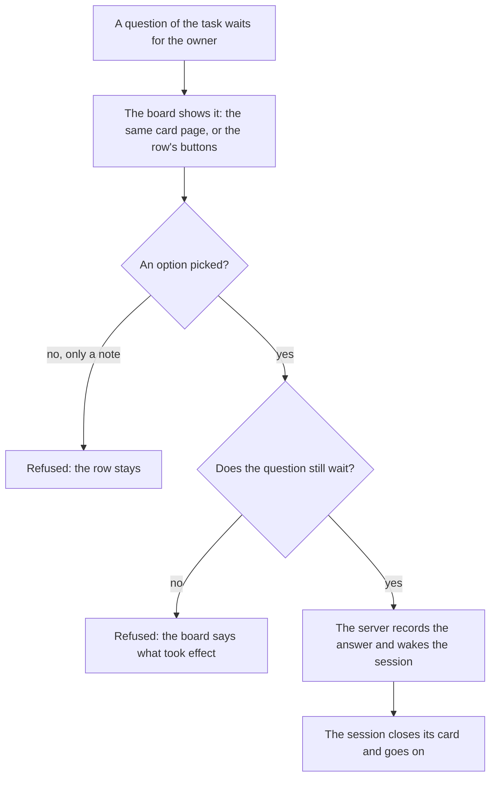

# The board answers a card

careful: yes, because an answer given on the board is recorded as the owner's decision ("A decision that is the owner's is taken without him, or one taken for him is missing from the pull request"), and tasks 2 and 3 take that answer on the board's server; the rulings of 2026-11-21 (the server never types into, closes or decides for a session) and 2026-11-15 (the question page) are in reach too.

## Acceptance criteria

Size: full, because the board, its server, `lem-ask` and the task's session each change, and an answer from the board is recorded as the owner's decision.

1. Every `lem-ask` card that a task's session puts up shows on the board as its row in "Waits for you" and on the task's page, on the Mac and on the phone, and opens there as the same page as in agterm, with the same options, pictures, charts, sliders and note field:
   1. The session of `export-notes` puts up the card "Keep the empty cell? A: yes, B: no, write a dash".
   2. On the owner's phone, the row of `export-notes` in "Waits for you" shows that question.
   3. He taps the row. The same page as in agterm opens, with A, B and the note field.
2. A pick on the board answers the card as a pick on the card in the session does:
   1. The owner taps B on his phone, with the note "a dash, as in the invoice export".
   2. The server records B and the note as his answer to that card, and wakes the session of `export-notes`.
   3. The session reads B and the note, closes its own card, logs his decision as the owner's with his note, and goes on.
   4. The row of `export-notes` leaves "Waits for you" on every open board page, on the Mac and on the phone, with no reload.
3. The board takes an answer with a note, never a conversation: on a question with options, a note with no option picked is refused, and so is the page's wish to talk, and the row stays in "Waits for you":
   1. The owner writes "why not both?" on the card of `export-notes` and picks no option.
   2. The board says that a question goes to the session at the Mac, and records nothing.
   3. The row and the card stay as they were.
4. Only the first answer counts: an answer to a question that no longer waits is refused, and the board says what took effect; when two answers come before the session reads either, the one recorded first counts, and the session says in one line which it took and from where:
   1. The owner picks A on the card in the session at the Mac.
   2. A minute later his phone, still on the old page, sends B.
   3. The board refuses B, says that A was taken in the session, and records nothing.
5. Each kind of card that `lem-ask` makes, one for each template in `skills/lem-ask/templates/`, can be read and answered on a phone screen 390 pixels wide: no part of it is cut off, and each option and control can be tapped. The task's report shows a phone-size screenshot of each kind.
6. A plan that waits for the owner's read gets Build and Drop, and a breaker gets Help, Park and Drop, with the same buttons and note field; Help sends his note to the lead as his part of the talk, and Drop asks for a confirm first, as Park does:
   1. `export-notes` trips breaker 1. Its row shows Help, Park and Drop.
   2. The owner taps Drop. The board asks "Drop export-notes?".
   3. He confirms. The session drops the task as on `/lem drop export-notes`.
7. The two yes/no rows get Yes and No with the same buttons: "Skip the persona read?" of an interview, and "Approve this criterion?" of a small change that someone else asked for. The owner's Yes on "Skip the persona read?" of `export-notes` makes its session skip the read and log his word, as his "y" typed in the session does.
8. The board's server never types into a session, closes its card, or decides: it records the answer and wakes the session, and the session closes its own card. The server's code holds no call that answers or closes a session's overlay.
9. Every answer from the board is in the task's record as the owner's: the question, the option, the note, the time, and whether it came from the Mac or the phone. The decision the session logs from it names that answer, and the pull request lists it.
10. `docs/rulings/rulings.md` holds the owner's ruling "The board takes an answer with a note, never a conversation." as a bullet under "The board and the pages for him", with the day 2026-11-23.

## How it works

## Tasks

1. **`lem-ask` keeps a card of a task's session in the task's folder, and takes the first answer from
   either place.** Serves criteria 2, 4 and 8.
   - When `lem-ask ask` (or `q`) runs with `LEM_TASK` set (a task's session has it: `session_hook.py`
     docstring) and the task's directory exists in the state folder of the repository it runs in, it
     keeps the card in that directory, `cards/PAGEID.html` (a copy of the page's exact bytes, which
     agterm shows from its own file under `OUTDIR`) and `cards/PAGEID.json` (the page id, the agterm session, the time it went up,
     and per question its id, mode and option ids and labels, and whether chat is allowed), and logs
     `card.asked` in the task's event log with the page id and the first question's prompt. A run with
     no `LEM_TASK`, or none whose task directory exists, keeps nothing, as today. The page id exists
     only once `open_overlay` returns it, so `cards/PAGEID.html` is a copy written after the open:
     agterm opens and shows the page under `OUTDIR` as today, and `pending_page`, `close_page` and
     `hook_stop`, which know a page by that folder, stay as they are (talk, question 9).
   - One end counts, and every end of a card goes through one file: `cards/PAGEID.end.json`, made as a
     link of a finished file, as `link_mark` in `project.py` makes a mark (the JSON written whole to
     a temporary name unique to its writer, `cards/PAGEID.end.json.PID.THREAD.TOKEN.new` with a
     random token, since the board server's threads share one PID; then `os.link` to the name,
     which fails when the name is there, and the temporary file removed: decision 7),
     so that a reader never sees a part of it and a writer that stops leaves no empty name (talk,
     question 4). Whoever links it first owns the card's end, and the other one reads it: the board's
     server with an answer, or `lem-ask` in the session with a pick, a dismissal or a `lem-ask close`
     (talk, question 5). It holds `status` (`answered`, `dismissed` or `closed`), the answer JSON as
     the page sends it for an answer, `from` (`session` or `board`), for the board `via` and `device`
     (decision 5), and the time. `card.answered` and `card.closed` are logged after the link, by its
     owner, for the board's stream; the file, not the event, says whether the card is open.
   - While `wait_page` waits, each poll also looks for that file, the first poll too, so a `lem-ask
     wait PAGEID` run after an exit 4 finds an answer the board took in between. When the board made
     it, `lem-ask` closes its own page (the session's own process closes it, as `close_page` does
     today), and prints the board's answer as the card's own answer with `"from": "board"`, `via` and
     `device`, exit 0. When the owner picks on the card in the session, or agterm says the page was
     dismissed, or `lem-ask close` runs, `lem-ask` links the file first and then ends as today
     (answer exit 0, dismissal exit 2, close `closed`); when the board's answer was there already,
     the session's pick, dismissal or close is not taken, and the output is the board's answer, exit
     0, with a `said` line that names both (criterion 4, the last clause). A pending end (exit 4, no
     file) behaves as today.
   - `runtime/ask.js` posts its answer to `answer` (a path relative to the page) instead of
     `/answer`, so that the browser fallback (served at `/`) still reaches `/answer`, and a page the
     board serves under `.../cards/PAGEID/` reaches its own route. It reads the reply: a refusal
     (a status that is not 2xx) shows the reply's `said` and leaves the page as it was, so that
     the owner can pick again (`finished` back to false); a 2xx shows the reply's `said`.
   - Files: `skills/lem-ask/bin/lem-ask`, `skills/lem-ask/runtime/ask.js`, `skills/lem-ask/SKILL.md`
     (the record and `from`), the event forms in `skills/lem/scripts/project.py` if `log` checks a
     new event's form, `tests/test-ask.sh` and a unit test of the first-answer rule.

2. **The board shows each open card and takes its answer.** Serves criteria 1, 2, 3, 4, 8 and 9.
   - The model reads each task's cards (`card.asked` with no `cards/PAGEID.end.json`, whose agterm
     session in `cards/PAGEID.json` is the session `live_of` gives for the task and is live; a card
     of an earlier session of the task, which a change of phase or a crash left, has no row: talk,
     question 6) and gives each open card a row of "Waits for you",
     kind `card`, key `card:SLUG:PAGEID`, with the prompt, and a card on the task's Overview. The
     row's verb opens the card's page; a click on a phone opens it the way a park's step opens
     (`sheet.js`), full width.
   - `GET /HOST/NAME/tasks/SLUG/cards/PAGEID/` sends `cards/PAGEID.html` as it is, with the
     `Content-Security-Policy` `script-src` of only the hashes of the page's own inline scripts that
     `lem-ask` builds (`ask.js` and the pinned mermaid bundle), with no `unsafe-eval` and no
     `unsafe-hashes`; `form-action 'none'`; `base-uri 'none'`; `object-src 'none'`; `frame-src
     'none'`. So the runtime draws every option, picture, chart, slider and note field, and a spec's
     own `script` or `{"js": …}` block does not run on the board's origin, where the owner's acts
     are. A spec's `html` and `svg` blocks are raw markup (`block` in `runtime/ask.js`; `tune.json`
     uses `html`): `form-action` stops a form in one from posting an act of the board, which the
     origin checks of `action_refusal` would take, and `base-uri` stops a `<base>` in one from
     sending the runtime's own relative `answer` post to another route (talk, question 1). None of the
     ten templates holds a `script`, a `js` block or a form (grep of `skills/lem-ask/templates/`,
     2026-11-23).
   - `POST /HOST/NAME/tasks/SLUG/cards/PAGEID/answer` takes the page's JSON through the checks every
     act has (`action_refusal` on the main listener, the door's own checks through the tailnet), and
     then, in this order, refuses with a `said` the page shows: a card that is not open (its end file
     is there: "A was taken in the session at 15:42"; "the card was closed in the session"); a
     `status` of `chat`, or a note with no pick ("A question goes to the task's session, at the Mac:
     nothing was recorded"); an answer whose question or option ids are not the card's. A note with
     no pick is what the page's own `valid` and `finish` (`runtime/ask.js`) send as a `text` with an
     empty `selected` on a `single` or `multi` question, and nothing else: a `tune` question's answer
     is its `values`, with a preset or with none once a slider moved it (`finish` sends `selected: []`
     and `from` then); a question with `optional: true` answered with nothing is an answer; a `text`
     question's answer is its text (talk, question 8). A `dismissed` beacon (the page's `pagehide`)
     records nothing and answers 204. Then it asks agterm for the page's result (`agtermctl session
     overlay result --page PAGEID`, the read `wait_page` makes): when agterm holds a submitted answer
     that no waiter has read, it refuses with "An answer was given on the card at the Mac: the task's
     session takes it", and records nothing; when agterm does not answer, it refuses with what agterm
     said, since it cannot tell (decision 8). A read only: the server never submits or closes the
     page. Otherwise it links the card's end file (task 1); when the link
     fails, it lost to the session's pick, dismissal or close, and it refuses with what that file
     says. When it wins, it logs `card.answered from=board via=…` and `board.act act=answer`, and
     answers 200 with "Your answer is on record: the task's session takes it."
   - The server never calls `agtermctl session overlay submit` or `close` and never types into a
     session: the end of the card's own `lem-ask` in the session is the wake (decision 1). A unit
     test reads `serve.py` and fails on any such call.
   - `card.asked`, `card.answered` and `card.closed` are events of the log, so every open page's stream refreshes
     and the row leaves "Waits for you" with no reload.
   - The Inbox sender (`lem_inbox.things_of`) leaves `card` rows out (decision 3).
   - Files: `skills/lem/scripts/lem_board_model.py`, `serve.py`, `lem_board_pages.py`,
     `lem_board_task.py`, `lem_inbox.py`, `tools/board-kit/controllers/` and the built
     `skills/lem/assets/vendor/board-app.js` when a controller changes, `tests/board-showcase.py`
     (an open card on the afternoon), `tests/lem-serve.sh`, `tests/lem-board-act.sh`, the unit tests
     of the model and the server.

3. **A plan, a breaker and the two yes/no rows get their answers on the board.** Serves criteria 6, 7
   and 9.
   - One answer form, the same on the task's page and in the row of "Waits for you", on the Mac and on
     the phone: the options as buttons and one note field. A plan that waits for the owner's read:
     Build and Drop. A breaker: Help, Park and Drop. "Skip the persona read?": Yes and No. "Approve
     this criterion?" of a small change that someone else asked for: Yes and No.
   - Each row's key names the state block it waits on, by the `ts` of that block's `state` event, to
     the second: `plan:SLUG:TS`, `breaker:SLUG:N:TS`, `skip:SLUG:TS`, `criterion:SLUG:TS`. An answer
     on record applies to that block only: a new block of the same wait is a new row (talk, question
     7).
   - `POST /HOST/NAME/tasks/SLUG/answer` with the row's key, the option and the note. Refused when
     the key is not a row that waits now ("Breaker 1 of export-notes no longer waits: you parked it at
     15:40"), when no option is picked, and when an answer is on record for that key already. The
     record is `answers/KEY.json` in the task's folder, linked as a finished file as the card's end is
     (task 1), with `from: board`, `via`, `device`, the time, the option and the note. Then
     `board.act act=answer` and `lem session wake SLUG --why owner`, as `act_approve` does.
   - The record of a row's key is the one arbiter of every act of the board on that row (talk,
     question 3): the answer route, `act_park`, `act_approve` and Drop's confirm each link
     `answers/KEY.json` before they act, and each refuses with what the record says when the link
     fails ("You picked Drop for breaker 1 at 15:40, from the phone: the task's session takes it").
     An answer in the session (his typed word, or his reply from the Inbox) is the session's to
     order against it, in task 4.
   - Yes on "Approve this criterion?" is `act_approve` as today, with the digest of the criterion the
     page showed, which `criteria.py approve --shown` checks against the bytes it approves; it links
     the row's record first, as above. No carries the same digest, and the route refuses it when
     `criteria.md` changed since the page showed it (talk, question 2). No needs a note, as Help
     does: "No needs your words: what should the criterion say?" (talk, question 12).
   - Park keeps its act (`act_park`). Drop asks first, as Park does: "Drop export-notes?" with
     Confirm, in the same step page (`GET .../tasks/SLUG/drop`). Help needs a note: Help with no note
     is refused ("Help needs your words for the lead").
   - The model hides a row whose key has an answer on record, and the task's Overview says "Your
     answer is on record: the task's session takes it" until the session's next state block.
   - `lem project tasks` gives the answer on record for the key of the task's newest state block
     (`board_answer`, or null), so that the session reads it on its wake. `lem project waiting`
     builds its rows from `waits_of`, which hides an answered row, so it does not carry it (talk,
     question 7).
   - Files: `lem_board_model.py`, `serve.py`, `lem_board_task.py`, `lem_board_pages.py`,
     `project.py`, `skills/lem/assets/board.css`, the controllers if the confirm step needs one,
     `tests/lem-board-act.sh`, `tests/lem-board-keys.sh` (Drop's confirm on a phone), unit tests.

4. **The task's session takes an answer from the board as the owner's typed word.** Serves criteria
   2, 6, 7 and 9. Stage and harness text only, so its test is a real task (`AGENTS.md`, "Checks").
   - `harness/claude-code/ask-owner.md`, "A card in a task's session": the card is on the board too;
     its output's `from` says where the answer came from; the session says in one line which answer it
     took and from where, logs the decision `--by owner` with the note as his words and the card's
     page id, `from`, `via` and `device` in `--why`, and goes on. "A note with no option" and `chat`
     stay as today for a pick in the session. The away card is no longer put up for a thing whose row
     the board answers with its own buttons (decision 3).
   - `prompts/session.md`, "A wake-up", `owner`: read `board_answer` of `lem project tasks` for
     the task; act on it as on his typed word by the stage that waits (a plan: `/lem build` or `/lem
     drop`; a breaker: "After it" of `stages/breaker.md`, Help with his note as his part of the talk;
     Drop as `/lem drop`; skip Yes or No: `stages/interview.md` step 5; the fast track's criterion No:
     its step 1, with his note as "a change of his", which goes into `criteria.md` in his words, and
     then the held block of that step again, so that the row comes back with a new key for his yes to
     the new text), and log it `--by owner` with the record's key, `via`, `device` and note. A board
     answer whose key is no longer the newest block's when the session reads it takes no effect: the
     session says in one line that it came after the answer that took effect.
   - One answer counts between the session and the board (talk, question 3): before the session acts
     on his typed word or his Inbox reply for a row (`ask-owner.md`, "His reply", step 1 reads `lem
     project tasks` already), it reads `board_answer`; when the board's answer is on record for the
     newest block, it takes the board's, which came first, and says so in one line with where each
     came from.
   - A Help whose talk ends with no decision ("He leaves the talk with no decision" in
     `stages/breaker.md`) writes the breaker's held block again, `breaker N waits for the owner`,
     with the lead's one line to his note, so that the row comes back with a new key, and Park and
     Drop with it (talk, question 7).
   - `stages/breaker.md`, `stages/interview.md` step 5, `stages/new.md` ("The fast track", step 1)
     and `stages/plan.md` (step 3, the planned wait) each name the board's answer beside the typed
     word, in one line.
   - `land.py`: the pull request lists each decision as today; a decision whose `--why` names a board
     answer needs no new field (decision 4). Check that the text lists it, with a test only if a
     change is needed.

5. **Each kind of card reads and answers on a phone 390 pixels wide.** Serves criterion 5, and the
   phone half of criteria 1, 3 and 6.
   - Open each of the ten templates of `skills/lem-ask/templates/` through the board's card route in
     headless Chrome at 390 pixels wide (`tests/board-cdp.mjs`), check that nothing is cut off and
     that each option and control can be tapped, and fix `ask.css` where one is not. On `tune.json`
     the check picks a preset, then moves a slider, and submits: the board takes those values as
     the answer (talk, question 8).
   - A check in `tests/lem-board-keys.sh` that opens a card on a phone, picks, and sees the row leave,
     and one that taps Drop and sees the confirm.
   - The report links one phone screenshot of each kind from the task's `media/`.

6. **The documents say what the board answers now.** Serves criterion 10.
   - `docs/rulings/rulings.md`: the bullet "The board takes an answer with a note, never a
     conversation." under "The board and the pages for him", with (2026-11-23).
   - `docs/board.md`, "Act from the board": the card, the plan's, the breaker's and the yes/no rows'
     buttons, Drop's confirm, and the note with no option refused.
   - `docs/when-lem-needs-you.md`: where it says that a card or a breaker is answered only in the
     session, it says the board too; its lines about the Inbox stay as they are (out of scope).
   - `README.md` and `site/index.html` in the same commit, only where they say what the board does.
   - `skills/lem/SKILL.md`, "The board": the card rows.

## Plan talk

Argued on 2026-11-23 by the reviewer, Codex at GPT 6.2 Sol, effort high (its pane's status line),
and the defender, Claude Code at Opus 5.5, effort high (the `defender:` line of the task's state).
Two model families. Six turns; the bound of the rules is 4 × 12 + 2 = 50.

Agreement carries no authority: the review before the pull request reads each settled position as
a claim.

### The questions, as the reviewer listed them

1. **The card page on the board's origin can post an act.** A spec's `html` and `svg` blocks are
   raw markup (`block` in `skills/lem-ask/runtime/ask.js`; `tune.json` uses `html`), and a form in
   one posts with the board's origin, which `action_refusal` in `serve.py` takes. Settled: the CSP
   adds `form-action 'none'`, `base-uri 'none'`, `object-src 'none'` and `frame-src 'none'` (task 2;
   decision 2). Settled by the two, not checked by the review.
2. **Yes on "Approve this criterion?" was not bound to the bytes he read.** Settled: Yes is
   `act_approve` with the shown digest that `criteria.py approve --shown` checks; No carries the
   digest too, needs his words, and goes in as "a change of his", which asks his yes again (task 3,
   task 4). Settled by the two, not checked by the review.
3. **One answer across the board, the terminal and the Inbox.** A design choice. The plan: the row's
   record `answers/KEY.json` orders every act of the board on that row (the answer route,
   `act_park`, `act_approve`, Drop's confirm), and the session reads `board_answer` before it acts
   on a typed word or an Inbox reply; a board answer whose block is no longer the newest takes no
   effect, and the session says so (cite: criterion 4, "the one recorded first counts, and the
   session says in one line which it took and from where"). The reviewer: a typed Park that the
   session already acts on gives the terminal no claim on the row, so the board accepts a later Drop
   and reports it on record, then discards it; the later POST should be refused. Decided by the
   ladder after the talk: decision 6.
4. **The answer file is written after its exclusive create.** A design choice. The repair made both
   files a link of a finished file, as `link_mark` in `project.py` makes a mark, named
   `NAME.PID.new`. The reviewer: `bind` in `serve.py` uses `ThreadingHTTPServer`, so two threads
   of one process write the same `NAME.PID.new`, and the second write lands in the file the first
   linked. The defender found no refutation. The choice: the plan's PID name, against a name unique
   to each writer. Decided by the ladder after the talk: decision 7.
5. **A dismissal and a board answer were two writes.** Settled, at the cause: every end of a card
   (an answer, a dismissal, a `lem-ask close`) goes through one file, `cards/PAGEID.end.json`, and
   the file, not the event, says whether the card is open (task 1, task 2). Settled by the two, not
   checked by the review.
6. **A card with no waiter, and a card of an earlier session.** A design choice. Repaired: a card's
   row stands only while its own agterm session is the one `live_of` gives and is live (task 2).
   The plan: the gap between the exit 4 of `lem-ask ask --timeout 86400` and the next `lem-ask wait`
   is a turn of the session, the next wait's first poll reads the end file, and no Lem stage runs
   `--no-wait` (grep of `skills/lem/`). The reviewer: no deadline bounds when the next wait starts,
   and a pick the Mac made in agterm in that gap loses to a later board answer. Decided by the
   ladder after the talk: decision 8.
7. **A record that hides a breaker for good.** A design choice. Repaired: each row's key names its
   state block's `ts`, to the second, `board_answer` comes from `lem project tasks`, and a Help
   that ends with no decision writes the breaker's held block again (task 3, task 4). The plan: the
   two blocks are separated by the owner's read and tap. The reviewer: `append_event` in
   `project.py` keeps whole seconds of the wall clock, and a clock correction can repeat a second.
   Decided by the ladder after the talk: decision 9.
8. **The Tune card's custom values were refused.** Settled: the refusal is the page's own rule, a
   `text` with an empty `selected` on a `single` or `multi` question; a `tune` answer is its
   `values`; task 5 moves a slider after a preset and submits. Settled by the two, not checked by the
   review.
9. **The page in the task folder, and the overlay's file.** Settled: `cards/PAGEID.html` is a copy
   written after `open_overlay` returns the id, and agterm shows its own file under `OUTDIR`, which
   `pending_page`, `close_page` and `hook_stop` check (task 1). Settled by the two, not checked by
   the review.
10. **The away cards the board does not answer.** A design choice. Repaired: decision 3 keeps the
    text away card of a blocked task and of an order that names no task. The plan: a merge's away
    card goes too, since "Not now" is no act ("his 'Not now' leaves the pull request open",
    `ask-owner.md`, "His reply", step 2) and the merge row stays until he merges. The reviewer: the
    card's "Not now" is an explicit choice that ends the card's command, and whether he needs it is
    the personas' to say. Decided by the ladder after the talk: decision 10.
11. **"Mac or phone" was the listener.** A design choice. Repaired: decision 5 records `device`
    from the request (`Sec-CH-UA-Mobile`, the User-Agent), with the User-Agent whole and `via`
    beside it. The plan: the request holds nothing more, since a phone in desktop mode says it is a
    desktop. The reviewer: such a phone is still recorded as `computer`, and whether a browser's
    report meets criterion 9 is the choice. Decided by the ladder after the talk: decision 11.
12. **A bare No on the fast track's criterion.** A design choice. Repaired: No needs his words,
    which go in as "a change of his" (new.md, "The fast track", step 1). The plan: a bare No has no
    step in the session either, and a question back to him is the session's (criterion 3's ruling).
    The reviewer: a tap on No is a pick, criterion 7 gives the row a No, and the note is optional in
    `task.md`; what a bare No should do is the personas' to say. Decided by the ladder after the
    talk: decision 12.

### Mechanisms the repairs added

- The CSP's `form-action 'none'` and `base-uri 'none'` (question 1): a layer over decision 2, the
  page on the board's origin, whose cite is `action_refusal` in `serve.py`. The reviewer: closed,
  layer over decision 2.
- The one end file of a card (question 5): at the cause, the arbiter of task 1 changed from answers
  only to every end. The reviewer: closed, at the cause.
- The link of a finished file (question 4): at the cause, by the reviewer's word, and open.
- The row's record as the arbiter of every board act on the row (question 3): a layer over task 3's
  first-answer record, whose cite is criterion 4. The reviewer: holds, layer over it; open.
- The row bound to the card's own session (question 6): a layer over decision 1, the wake by the
  card's own command. The reviewer: holds, layer over decision 1; open.
- The key with its block's `ts` (question 7), `device` (question 11), the narrowed decision 3
  (question 10), the No that needs his words (question 12) and the digest kept on Yes and No
  (question 2): at the cause, by the reviewer's word.

### Raised, not argued

- After a successful post the runtime shows the reply's `said` (task 1), but the browser fallback
  of `lem-ask` (`ask_in_browser`, its `do_POST`) answers an empty 204, so a JSON read of that reply
  can report a failure after the answer went through. Place: task 1, the `runtime/ask.js` bullet.

### Refused as unpriced

None.

### What changed in the plan

- Task 1: the copy of the page under the task folder (question 9); one end file for each card, a
  link of a finished file, for an answer, a dismissal and a close (questions 4 and 5); the first
  poll reads it (question 6).
- Task 2: the row bound to the card's own live session (question 6); the CSP against a form and a
  `<base>` (question 1); the refusal as the page's own rule (question 8); the POST that loses the
  link refuses (question 5).
- Task 3: keys with their block's `ts` (question 7); the row's record as the arbiter of the
  board's acts (question 3); Yes through `act_approve` with its digest, No with the digest and his
  words (questions 2 and 12); `board_answer` from `lem project tasks` only (question 7).
- Task 4: the session reads `board_answer` before a typed word or an Inbox reply (question 3); a
  stale record takes no effect (question 3); No's words as "a change of his" (question 12); a Help
  with no decision writes the breaker's block again (question 7); the away cards (question 10).
- Task 5: the tune check moves a slider after a preset (question 8).
- Decisions 2, 3 and 5 (questions 1, 10 and 11).

## Decisions of the plan

1. **The wake of criterion 2 is the end of the card's own command.** The session runs the card in
   the background (`ask-owner.md`); when the server records a board answer, that command sees it,
   closes its own page and ends with the answer, and the end wakes the session as a pick in the
   session does. The server sends no `lem: SLUG owner` for a card: a second wake would find nothing
   to do. Rests on: `wait_page` polls every 0.4 s, and a background command's end wakes an idle
   session (`harness/claude-code.md`, "run-in-background"). By the lead.
2. **A card's page on the board runs only `lem-ask`'s own scripts.** The page is served on the
   board's origin, where a script or a form could post the owner's acts (a merge) in his name; a CSP
   of script hashes keeps the runtime and drops a spec's own `script` and `js` blocks, and
   `form-action 'none'` and `base-uri 'none'` keep the raw markup of an `html` or `svg` block from
   posting an act or moving the runtime's own post (talk, question 1). The other option, a sandboxed
   page on an opaque origin, needs a cross-origin answer route and a token of its own. Rests on: no
   template uses a script, a `js` block or a form (grep, 2026-11-23), and `action_refusal` in
   `serve.py`, which checks the origin of an act and not the page that sent it. By the lead.
3. **No away card for a thing whose row the board answers with its own buttons, and no card rows in
   the Inbox.** Those things are a plan, a breaker, the two yes/no rows, and a merge, whose Merge the
   board has today (`BOARD_ACTS` in `serve.py`; his "Not now" is no act). An away card
   (`ask-owner.md`, "He is away") is a `lem-ask` card, so under task 2 it would be a card row beside
   the thing's own row: two rows for one thing. A blocked task and an order of his that names no
   task have no buttons and keep their away card, a text answer, which the board shows as a card row
   with its text field (talk, question 10). The Inbox keeps sending what it sends today; the later
   task stops it. By the lead.
4. **A board answer is a decision `--by owner` whose `--why` names the record.** `decisions.py` needs
   no new field: the record's key, `via` and note go in `--why`, and the record itself stays in the
   task's folder for criterion 9. By the lead.
5. **"Mac or phone" is the device the request names, and the listener is kept beside it.** `device`
   is `phone` when the request carries `Sec-CH-UA-Mobile: ?1` or a `User-Agent` that names an
   iPhone, an iPad or Android, and `computer` otherwise; the `User-Agent` itself is kept whole in the
   record. `via` is the listener, as `lem_board_model.VIA` names it: `local`, this Mac, or `door`,
   the tailnet. The listener alone does not tell a phone: a second computer joined under one
   address, or this Mac on the tailnet address, comes through the door too (talk, question 11). By
   the lead.
6. **An answer typed in the session, or an Inbox reply, claims nothing on the board's record.** A
   board answer that lands in the seconds the session acts on his typed word is told "on record",
   then takes no effect, and the session says so in one line (task 4). Plan talk, question 3; the
   gate: cheap (record 6 of `lem decisions list`).
7. **The temporary name of an end file or a record is unique to its writer**, PID, thread and a
   random token, since the board server's threads share one PID and a shared `NAME.PID.new` let the
   second writer's answer land in the first one's linked file (a probe in the task directory,
   2026-11-23). Plan talk, question 4; the gate: checkable (record 3).
8. **The board reads agterm's result for a card's page before it takes the card's answer**, and
   refuses when agterm holds a submitted answer that no waiter read, so that a pick at the Mac in
   the seconds between two waits counts first, as criterion 4's case says (task 2). A read, never a
   submit or a close. Plan talk, question 6; the gate: checkable (record 8).
9. **A row's key names its state block by the block's `ts`, to the second.** Plan talk, question 7;
   the gate: cheap (record 5).
10. **A merge gets no away card**: the board's merge row with its Merge is the one place to answer
    it, and "Not now" is no act (decision 3). Plan talk, question 10; the gate: checkable (record
    7).
11. **`device` comes from the request's headers, with the User-Agent whole and `via` beside it**
    (decision 5). Plan talk, question 11; the gate: cheap (record 4).
12. **A bare No on "Approve this criterion?" is refused, and the row stays**: "No needs your words:
    what should the criterion say?" (tasks 3 and 4). Plan talk, question 12. The gate held it, the
    two personas split (the teammate for this option, the developer for a hold at the Mac), and the
    dialectic found no break (record 9), so the pull request is not green for it. Both personas
    noted that a criterion he did not approve is built when he marks himself away
    (`stages/away.md`), and that the pull request then says only that he did not approve it.

## What this plan will not verify

- A real card answered from the owner's real phone over the tailnet: the checks use headless Chrome
  on this Mac at 390 pixels wide. The first real answer is the later task's trigger (`task.md`, "Out
  of scope").
- The session's half (task 4) runs only in a real task; its texts have no test.
