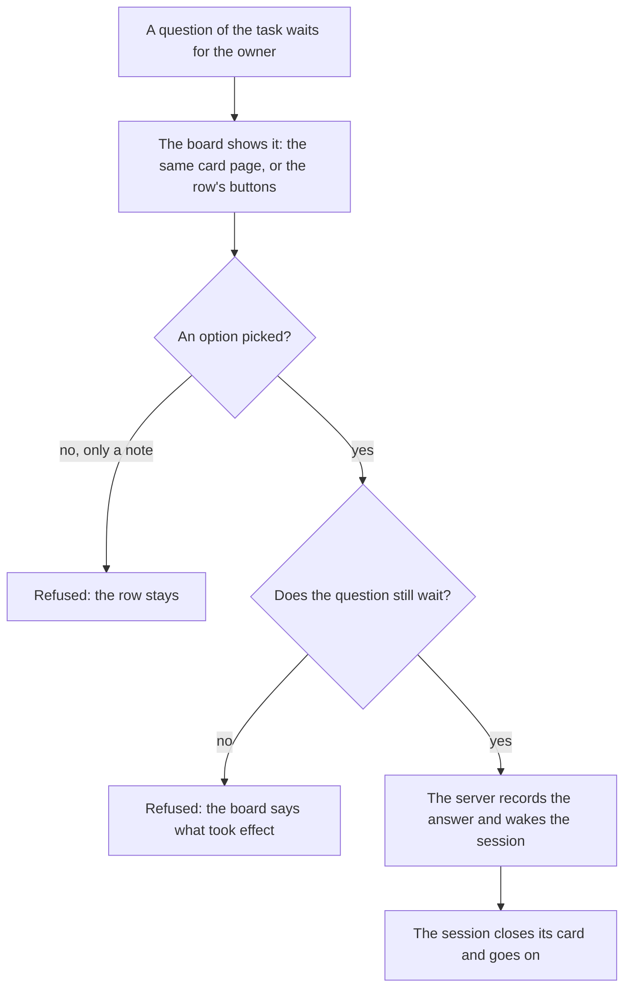

# The board answers a card

careful: yes, because an answer given on the board is recorded as the owner's decision ("A decision that is the owner's is taken without him, or one taken for him is missing from the pull request"), and tasks 2 and 3 take that answer on the board's server; the rulings of 2026-11-21 (the server never types into, closes or decides for a session) and 2026-11-15 (the question page) are in reach too.

## Acceptance criteria

Size: full, because the board, its server, `lem-ask` and the task's session each change, and an answer from the board is recorded as the owner's decision.

1. Every `lem-ask` card that a task's session puts up shows on the board as its row in "Waits for you" and on the task's page, on the Mac and on the phone, and opens there as the same page as in agterm, with the same options, pictures, charts, sliders and note field:
   1. The session of `export-notes` puts up the card "Keep the empty cell? A: yes, B: no, write a dash".
   2. On the owner's phone, the row of `export-notes` in "Waits for you" shows that question.
   3. He taps the row. The same page as in agterm opens, with A, B and the note field.
2. A pick on the board answers the card as a pick on the card in the session does:
   1. The owner taps B on his phone, with the note "a dash, as in the invoice export".
   2. The server records B and the note as his answer to that card, and wakes the session of `export-notes`.
   3. The session reads B and the note, closes its own card, logs his decision as the owner's with his note, and goes on.
   4. The row of `export-notes` leaves "Waits for you" on every open board page, on the Mac and on the phone, with no reload.
3. The board takes an answer with a note, never a conversation: on a question with options, a note with no option picked is refused, and so is the page's wish to talk, and the row stays in "Waits for you":
   1. The owner writes "why not both?" on the card of `export-notes` and picks no option.
   2. The board says that a question goes to the session at the Mac, and records nothing.
   3. The row and the card stay as they were.
4. Only the first answer counts: an answer to a question that no longer waits is refused, and the board says what took effect; when two answers come before the session reads either, the one recorded first counts, and the session says in one line which it took and from where:
   1. The owner picks A on the card in the session at the Mac.
   2. A minute later his phone, still on the old page, sends B.
   3. The board refuses B, says that A was taken in the session, and records nothing.
5. Each kind of card that `lem-ask` makes, one for each template in `skills/lem-ask/templates/`, can be read and answered on a phone screen 390 pixels wide: no part of it is cut off, and each option and control can be tapped. The task's report shows a phone-size screenshot of each kind.
6. A plan that waits for the owner's read gets Build and Drop, and a breaker gets Help, Park and Drop, with the same buttons and note field; Help sends his note to the lead as his part of the talk, and Drop asks for a confirm first, as Park does:
   1. `export-notes` trips breaker 1. Its row shows Help, Park and Drop.
   2. The owner taps Drop. The board asks "Drop export-notes?".
   3. He confirms. The session drops the task as on `/lem drop export-notes`.
7. The two yes/no rows get Yes and No with the same buttons: "Skip the persona read?" of an interview, and "Approve this criterion?" of a small change that someone else asked for. The owner's Yes on "Skip the persona read?" of `export-notes` makes its session skip the read and log his word, as his "y" typed in the session does.
8. The board's server never types into a session, closes its card, or decides: it records the answer and wakes the session, and the session closes its own card. The server's code holds no call that answers or closes a session's overlay.
9. Every answer from the board is in the task's record as the owner's: the question, the option, the note, the time, and whether it came from the Mac or the phone. The decision the session logs from it names that answer, and the pull request lists it.
10. `docs/rulings/rulings.md` holds the owner's ruling "The board takes an answer with a note, never a conversation." as a bullet under "The board and the pages for him", with the day 2026-11-23.

## How it works

## Tasks

1. **`lem-ask` keeps a card of a task's session in the task's folder, and takes the first answer from
   either place.** Serves criteria 2, 4 and 8.
   - When `lem-ask ask` (or `q`) runs with `LEM_TASK` set (a task's session has it: `session_hook.py`
     docstring) and the task's directory exists in the state folder of the repository it runs in, it
     keeps the card in that directory, `cards/PAGEID.html` (the page's exact bytes, the same file it
     opens in agterm) and `cards/PAGEID.json` (the page id, the agterm session, the time it went up,
     and per question its id, mode and option ids and labels, and whether chat is allowed), and logs
     `card.asked` in the task's event log with the page id and the first question's prompt. A run with
     no `LEM_TASK`, or none whose task directory exists, keeps nothing, as today.
   - One answer counts. The answer is the file `cards/PAGEID.answer.json`, made with an exclusive
     create (`O_EXCL`): whoever makes it first, the board's server or `lem-ask` in the session, owns
     the answer, and the other one reads it. It holds the answer JSON as the page sends it, `from`
     (`session` or `board`), `via` for the board (`local` or `door`, `lem_board_model.VIA`), and the
     time.
   - While `wait_page` waits, each poll also looks for that file. When the board made it, `lem-ask`
     closes its own page (the session's own process closes it, as `close_page` does today), logs
     `card.answered from=board`, and prints the board's answer as the card's own answer with
     `"from": "board"` and `via`, exit 0. When the owner picks on the card in the session, `lem-ask`
     makes the file first; when the board's answer was there already, the session's pick is not
     taken, and the output is the board's answer with a `said` line that names both (criterion 4,
     the last clause). A dismissal, a `lem-ask close` and a pending end (exit 4, no file) behave as
     today; a dismissal and a close write `card.closed` so that the card's row leaves the board.
   - `runtime/ask.js` posts its answer to `answer` (a path relative to the page) instead of
     `/answer`, so that the browser fallback (served at `/`) still reaches `/answer`, and a page the
     board serves under `.../cards/PAGEID/` reaches its own route. It reads the reply: a refusal
     (a status that is not 2xx) shows the reply's `said` and leaves the page as it was, so that
     the owner can pick again (`finished` back to false); a 2xx shows the reply's `said`.
   - Files: `skills/lem-ask/bin/lem-ask`, `skills/lem-ask/runtime/ask.js`, `skills/lem-ask/SKILL.md`
     (the record and `from`), the event forms in `skills/lem/scripts/project.py` if `log` checks a
     new event's form, `tests/test-ask.sh` and a unit test of the first-answer rule.

2. **The board shows each open card and takes its answer.** Serves criteria 1, 2, 3, 4, 8 and 9.
   - The model reads each task's cards (`card.asked` with no `card.answered` or `card.closed` after
     it, of a task whose newest session is live) and gives each open card a row of "Waits for you",
     kind `card`, key `card:SLUG:PAGEID`, with the prompt, and a card on the task's Overview. The
     row's verb opens the card's page; a click on a phone opens it the way a park's step opens
     (`sheet.js`), full width.
   - `GET /HOST/NAME/tasks/SLUG/cards/PAGEID/` sends `cards/PAGEID.html` as it is, with a
     `Content-Security-Policy` whose `script-src` allows only the hashes of the page's own inline
     scripts that `lem-ask` builds (`ask.js` and the pinned mermaid bundle) and no `unsafe-eval`. So
     the runtime draws every option, picture, chart, slider and note field, and a spec's own
     `script` or `{"js": …}` block does not run on the board's origin, where the owner's acts are.
     None of the ten templates holds either (grep of `skills/lem-ask/templates/`, 2026-11-23).
   - `POST /HOST/NAME/tasks/SLUG/cards/PAGEID/answer` takes the page's JSON through the checks every
     act has (`action_refusal` on the main listener, the door's own checks through the tailnet), and
     then, in this order, refuses with a `said` the page shows: a card that is not open (the answer
     file is there: "A was taken in the session at 15:42"; the card was closed: "the card was closed
     in the session"); a `status` of `chat`, or a question with options and no option picked
     ("A question goes to the task's session, at the Mac: nothing was recorded"); an answer whose
     question or option ids are not the card's. A `dismissed` beacon (the page's `pagehide`) records
     nothing and answers 204. Otherwise it makes the answer file with the exclusive create (it loses
     to a session pick in the same moment, and refuses as above), logs `card.answered from=board
     via=…` and `board.act act=answer`, and answers 200 with "Your answer is on record: the task's
     session takes it."
   - The server never calls `agtermctl session overlay submit` or `close` and never types into a
     session: the end of the card's own `lem-ask` in the session is the wake (decision 1). A unit
     test reads `serve.py` and fails on any such call.
   - `card.asked` and `card.answered` are events of the log, so every open page's stream refreshes
     and the row leaves "Waits for you" with no reload.
   - The Inbox sender (`lem_inbox.things_of`) leaves `card` rows out (decision 3).
   - Files: `skills/lem/scripts/lem_board_model.py`, `serve.py`, `lem_board_pages.py`,
     `lem_board_task.py`, `lem_inbox.py`, `tools/board-kit/controllers/` and the built
     `skills/lem/assets/vendor/board-app.js` when a controller changes, `tests/board-showcase.py`
     (an open card on the afternoon), `tests/lem-serve.sh`, `tests/lem-board-act.sh`, the unit tests
     of the model and the server.

3. **A plan, a breaker and the two yes/no rows get their answers on the board.** Serves criteria 6, 7
   and 9.
   - One answer form, the same on the task's page and in the row of "Waits for you", on the Mac and on
     the phone: the options as buttons and one note field. A plan that waits for the owner's read:
     Build and Drop. A breaker: Help, Park and Drop. "Skip the persona read?": Yes and No. "Approve
     this criterion?" of a small change that someone else asked for: Yes (the board's Approve, which
     is there today) and No.
   - `POST /HOST/NAME/tasks/SLUG/answer` with the row's key (`plan:SLUG:BLOCKTIME`,
     `breaker:SLUG:N`, `skip:SLUG:BLOCKTIME`, `criterion:SLUG:BLOCKTIME`), the option and the note.
     Refused when the key is not a row that waits now ("Breaker 1 of export-notes no longer waits:
     you parked it at 15:40"), when no option is picked, and when an answer is on record for that key
     already; the record is `answers/KEY.json` in the task's folder with the same exclusive create,
     `from: board`, `via`, the time, the option and the note. Then `board.act act=answer` and `lem
     session wake SLUG --why owner`, as `act_approve` does.
   - Park keeps its act (`act_park`). Drop asks first, as Park does: "Drop export-notes?" with
     Confirm, in the same step page (`GET .../tasks/SLUG/drop`). Help needs a note: Help with no note
     is refused ("Help needs your words for the lead").
   - The model hides a row whose key has an answer on record, and the task's Overview says "Your
     answer is on record: the task's session takes it" until the session's next state block.
   - `lem project waiting` and `lem project tasks` give the answer on record for each of the task's
     rows (`board_answer`), so that the session reads it on its wake.
   - Files: `lem_board_model.py`, `serve.py`, `lem_board_task.py`, `lem_board_pages.py`,
     `project.py`, `skills/lem/assets/board.css`, the controllers if the confirm step needs one,
     `tests/lem-board-act.sh`, `tests/lem-board-keys.sh` (Drop's confirm on a phone), unit tests.

4. **The task's session takes an answer from the board as the owner's typed word.** Serves criteria
   2, 6, 7 and 9. Stage and harness text only, so its test is a real task (`AGENTS.md`, "Checks").
   - `harness/claude-code/ask-owner.md`, "A card in a task's session": the card is on the board too;
     its output's `from` says where the answer came from; the session says in one line which answer it
     took and from where, logs the decision `--by owner` with the note as his words and the card's
     page id and `from`/`via` in `--why`, and goes on. "A note with no option" and `chat` stay as
     today for a pick in the session. The away card for a thing of "Waits for you" is no longer put
     up: the row's own buttons answer it on the board (decision 3).
   - `prompts/session.md`, "A wake-up", `owner`: read `board_answer` of `lem project waiting` for
     the task; act on it as on his typed word by the stage that waits (a plan: `/lem build` or `/lem
     drop`; a breaker: "After it" of `stages/breaker.md`, Help with his note as his part of the talk;
     Drop as `/lem drop`; skip Yes or No: `stages/interview.md` step 5; the fast track's criterion No:
     its step 1), and log it `--by owner` with the record's key, `via` and note.
   - `stages/breaker.md`, `stages/interview.md` step 5, `stages/new.md` ("The fast track", step 1)
     and `stages/plan.md` (step 3, the planned wait) each name the board's answer beside the typed
     word, in one line.
   - `land.py`: the pull request lists each decision as today; a decision whose `--why` names a board
     answer needs no new field (decision 4). Check that the text lists it, with a test only if a
     change is needed.

5. **Each kind of card reads and answers on a phone 390 pixels wide.** Serves criterion 5, and the
   phone half of criteria 1, 3 and 6.
   - Open each of the ten templates of `skills/lem-ask/templates/` through the board's card route in
     headless Chrome at 390 pixels wide (`tests/board-cdp.mjs`), check that nothing is cut off and
     that each option and control can be tapped, and fix `ask.css` where one is not.
   - A check in `tests/lem-board-keys.sh` that opens a card on a phone, picks, and sees the row leave,
     and one that taps Drop and sees the confirm.
   - The report links one phone screenshot of each kind from the task's `media/`.

6. **The documents say what the board answers now.** Serves criterion 10.
   - `docs/rulings/rulings.md`: the bullet "The board takes an answer with a note, never a
     conversation." under "The board and the pages for him", with (2026-11-23).
   - `docs/board.md`, "Act from the board": the card, the plan's, the breaker's and the yes/no rows'
     buttons, Drop's confirm, and the note with no option refused.
   - `docs/when-lem-needs-you.md`: where it says that a card or a breaker is answered only in the
     session, it says the board too; its lines about the Inbox stay as they are (out of scope).
   - `README.md` and `site/index.html` in the same commit, only where they say what the board does.
   - `skills/lem/SKILL.md`, "The board": the card rows.

## Decisions of the plan

1. **The wake of criterion 2 is the end of the card's own command.** The session runs the card in
   the background (`ask-owner.md`); when the server records a board answer, that command sees it,
   closes its own page and ends with the answer, and the end wakes the session as a pick in the
   session does. The server sends no `lem: SLUG owner` for a card: a second wake would find nothing
   to do. Rests on: `wait_page` polls every 0.4 s, and a background command's end wakes an idle
   session (`harness/claude-code.md`, "run-in-background"). By the lead.
2. **A card's page on the board runs only `lem-ask`'s own scripts.** The page is served on the
   board's origin, where a script could post the owner's acts (a merge) in his name; a CSP of script
   hashes keeps the runtime and drops a spec's own `script` and `js` blocks. The other option, a
   sandboxed page on an opaque origin, needs a cross-origin answer route and a token of its own. Rests
   on: no template uses either (grep, 2026-11-23). By the lead; the talk may weigh it.
3. **No away card for a thing of "Waits for you", and no card rows in the Inbox.** With the row's
   own buttons on the board, the away card (`ask-owner.md`, "He is away") would make two rows for one
   thing. The Inbox keeps sending what it sends today; the later task stops it. By the lead.
4. **A board answer is a decision `--by owner` whose `--why` names the record.** `decisions.py` needs
   no new field: the record's key, `via` and note go in `--why`, and the record itself stays in the
   task's folder for criterion 9. By the lead.
5. **"Mac or phone" is the listener the answer came through**: `local` is this Mac, `door` is another
   device of the tailnet, which is his phone or another computer. The record names it as
   `lem_board_model.VIA` does. By the lead.

## What this plan will not verify

- A real card answered from the owner's real phone over the tailnet: the checks use headless Chrome
  on this Mac at 390 pixels wide. The first real answer is the later task's trigger (`task.md`, "Out
  of scope").
- The session's half (task 4) runs only in a real task; its texts have no test.
