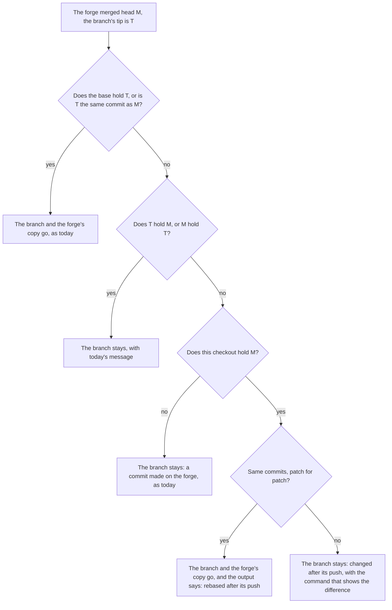

# Clean removes a branch rebased after its push, and says so

careful: yes, because clean removes a branch in a new case: "Lem changes a developer's repository without his word: a push, a merge, a removed worktree or branch", and task 1 reaches it.

## Acceptance criteria

Size: full, because clean removes a branch in a new case, and a branch it removes wrongly is work the developer loses.

1. A branch that the landing rebased after its push goes when the forge merged its pushed head: `lem land clean` removes the local branch and the forge's copy, and says that the branch was rebased after its push and held the same change.
   1. The pull request of task T is open at head 7a6cf2cf, with 12 commits.
   2. The base moves, and the landing rebases T's branch to 955d4716. Nothing pushes it.
   3. The owner merges the pull request on GitHub at 7a6cf2cf, as one commit.
   4. `lem land clean T` removes the worktree, the local branch and the forge's copy.
   5. Its output says that the branch was rebased after its push, and that the forge merged the same 12 commits.
2. A branch that holds a change the merged head does not hold stays, and clean names that change, not a commit made on the forge.
   1. The pull request of task T is open at head 7a6cf2cf.
   2. The landing rebases T's branch, and a builder changes the text of one of its commits. Nothing pushes it.
   3. The owner merges the pull request on GitHub at 7a6cf2cf.
   4. `lem land clean T` removes the worktree, and keeps the local branch and the forge's copy.
   5. Its message says that the branch was changed after its push, names the command that shows the difference, and says nothing of a commit made on the forge.

## How it works

`cmd_clean` in `skills/lem/scripts/land.py` keeps a landed task's branch unless the base holds its tip or its tip is the head the forge merged. After this change one more case removes it: the checkout holds the merged head, and the two hold the same commits by their patches.

## Tasks

1. **The rule and its checks.** In `cmd_clean` (`skills/lem/scripts/land.py`), in the branch that today ends in the message "which this checkout does not hold": when `git cat-file -e M^{commit}` finds the merged head here, compare the two ranges by their patches. Equal: go on to the removal that follows today (the forge's copy only when origin still has M on the branch, then the local branch), and return a sentence in a new key `rebased` of clean's JSON (null in every other case), with the two commits and the count. Not equal: raise with a message that says the branch was changed after its push and names `git range-diff` over the two ranges, and `git branch -D BRANCH`. When the checkout does not hold M, today's message stays word for word. A pure helper that takes the two lists of patch ids and says equal or not, and its unit case in `tests/unit/`; the two journeys of the criteria as checks of `tests/lem-land-github.sh`, beside the "Update branch" check there, each in the throwaway repository that block makes. Serves criteria 1 and 2. Files: `skills/lem/scripts/land.py`, `tests/lem-land-github.sh`, a unit file of `land.py` in `tests/unit/`.
2. **The documents.** `skills/lem/stages/land.md`, the paragraph before step 1 ("`clean` removes the branch only when its tip is the commit GitHub merged"), and step 9: they say that the branch goes when its tip is the merged commit or the same commits rebased after the push, and nothing else. `site/index.html` and `docs/` hold no sentence on this (searched for "land clean", "Update branch" and "branch_left"); the builder checks once more. Serves no criterion.

## Decisions

- **The two ranges.** M's range is `merge-base(M, onto)..M` and T's is `merge-base(T, onto)..T`, each with `git rev-list --reverse --no-merges`, and a merge commit in either range makes them not equal (`git rev-list --merges` over each range is empty, else not equal). The squash on the base is no ancestor of either, so each merge-base is the base its own range was made on. It assumes a task's branch is a straight line of commits, which `lem land base` makes by its rebase.
- **Patch for patch, in order, by `git patch-id --stable`.** Two lists of the same ids in the same order are the same change; the same text in other commits, or one commit fewer, is not. That is what `git range-diff` shows as `=` for each pair, without the parse of its output. A rule of the whole diff would also pass two branches with the same total, and say nothing true about "the same commits".
- **No fetch.** The checkout holds M whenever this checkout pushed it, which is how `lem land propose` makes every head the forge merges, and the object stays until git's garbage collection. When git dropped it, or the forge made M (its "Update branch"), today's message stands. A fetch would reach the network inside clean for a case no run has shown.
- **The forge's copy.** The code after the check already deletes origin's copy only when origin has M on the branch, with a lease on M. The new case reaches that code unchanged, so a push to the forge's branch after the merge still keeps it.

## What it does not verify

- A real GitHub: the checks run on the stand-in for `gh` and a bare repository, as every check of `tests/lem-land-github.sh` does.
- An object of M that git's garbage collection removed: that case gives today's message, and no check makes it.
