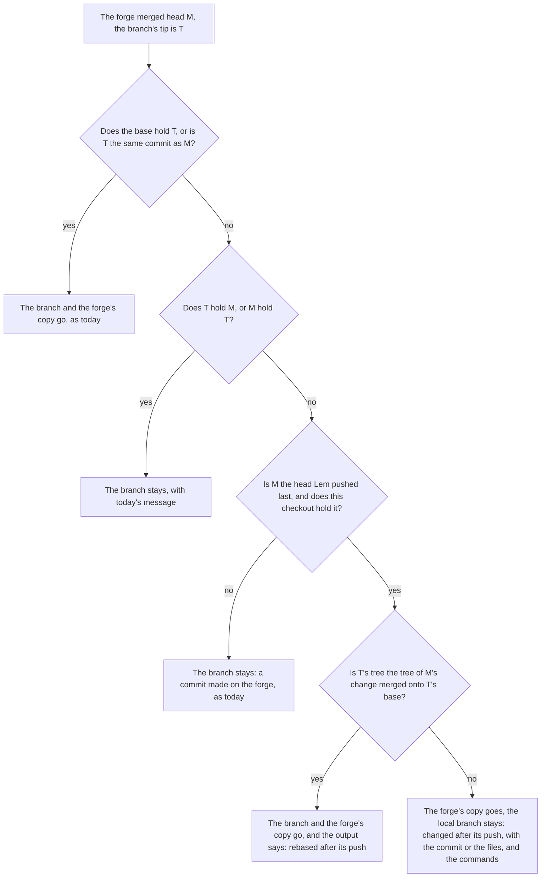

# Clean removes a branch rebased after its push, and says so

careful: yes, because clean removes a branch in a new case: "Lem changes a developer's repository without his word: a push, a merge, a removed worktree or branch", and task 1 reaches it.

## Acceptance criteria

Size: full, because clean removes a branch in a new case, and a branch it removes wrongly is work the developer loses.

1. A branch that the landing rebased after its push goes when the forge merged its pushed head: `lem land clean` removes the local branch, and the forge's copy while it is still the merged head, and says that the branch was rebased after its push and held the same change.
   1. The pull request of task T is open at head 7a6cf2cf, with 12 commits.
   2. The base moves, and the landing rebases T's branch to 955d4716. Nothing pushes it.
   3. The owner merges the pull request on GitHub at 7a6cf2cf, as one commit.
   4. `lem land clean T` removes the worktree, the local branch and the forge's copy.
   5. Its output names 955d4716 and 7a6cf2cf, and says that the branch was rebased after its push and that the forge merged the same 12 commits.
2. A branch that holds a change the merged head does not hold stays, and clean names that change, not a commit made on the forge.
   1. The pull request of task T is open at head 7a6cf2cf.
   2. The landing rebases T's branch, and a builder changes the code of its third commit. Nothing pushes it.
   3. The owner merges the pull request on GitHub at 7a6cf2cf.
   4. `lem land clean T` removes the worktree, and the forge's copy while it is still 7a6cf2cf, and keeps the local branch.
   5. Its message names the commit that changed, the command that shows the difference and the command that removes the branch, and says nothing of a commit made on the forge.

## How it works

`cmd_clean` in `skills/lem/scripts/land.py` keeps a landed task's branch unless the base holds its tip or its tip is the head the forge merged. After this change one more case removes it: the forge merged the head Lem pushed last, this checkout holds it, and the branch's tip holds the same content as that head's change put on the tip's own base.

## Tasks

1. **The rule and its checks.** In `cmd_clean` (`skills/lem/scripts/land.py`), in the branch that today ends in the message "which this checkout does not hold": when M is `pushed` of the task's record (the tip `cmd_propose` pushed last) and `git cat-file -e M^{commit}` finds it here, compare the content as "The same change, by content" says. The removal of the forge's copy that follows today (only when origin still has M on the branch, with a lease on M) becomes one helper that both paths call. Equal: the forge's copy, then the local branch, and a sentence in a new key `rebased` of clean's JSON (null in every other case) that names the tip and M by their short ids and the count of commits on each side ("the same 12 commits" when the counts are equal). Not equal: the forge's copy goes by the same helper, the local branch stays, and clean returns with exit 0 and the sentence in `branch_left`, the key a dropped task's kept branch already uses: the branch was changed after its push, what changed as "What the message names" says, `git range-diff` over the two ranges, and `git branch -D BRANCH`. When M is not Lem's last push or the checkout does not hold it, today's message and its exit 1 stay word for word. A pure helper that takes the two lists of zero-context patch texts and gives the index of the first pair that differs, or none, and its unit case in `tests/unit/`; the two journeys of the criteria as checks of `tests/lem-land-github.sh`, beside the "Update branch" check there, each in the throwaway repository that block makes. In the check of criterion 1 the base moves with an edit two lines above a line the branch changes, which changes git's patch id of that commit and not its content; in the check of criterion 2 the builder's change to the third commit is one space inside a string, which git's patch id does not see. Serves criteria 1 and 2. Files: `skills/lem/scripts/land.py`, `tests/lem-land-github.sh`, a unit file of `land.py` in `tests/unit/`.
2. **The documents.** `skills/lem/stages/land.md`, the paragraph before step 1 ("`clean` removes the branch only when its tip is the commit GitHub merged"), and step 9: they say that the branch goes when the base holds its tip, when its tip is the merged commit, or when it holds the same change as the head Lem pushed and the forge merged, rebased after that push; that otherwise the local branch stays, and after a change made after the push the forge's copy goes and clean's `branch_left` names what changed. `docs/pull-request.md`, lines 86-87 ("After a merge, the session of the task removes the worktree and the branch"): the same, in its STE, in one or two sentences. `site/index.html` holds no sentence on this (searched for "land clean", "Update branch", "branch_left" and "removes the worktree"); the builder checks once more, and changes it in the same commit where it says the same thing. Serves no criterion.

## Decisions

- **The two bases.** M's base `B_M` is `merge-base(M, onto)` and T's base `B_T` is `merge-base(T, onto)`. The squash on the base is no ancestor of either, so each merge-base is the base its own side was made on. The ranges `B_M..M` and `B_T..T`, with `git rev-list --reverse --no-merges`, serve only the message and its count.
- **The same change, by content.** T holds the same change as M when `git merge-tree --write-tree --merge-base B_M B_T M`, M's whole change merged onto T's base, exits 0 and prints the tree of T (`T^{tree}`). Exit 1, a conflict, is not equal; any other exit is git's error, and clean stops with it. The rule compares bytes, so one space or the same edit in another place of a file is another change, which is why `change` in `land.py` does not use git's patch id either ("it ignores spaces and places, and either can be the whole of a change"); a base edit next to the change's lines leaves it equal, where a patch id changes with its context lines (both checked in a throwaway repository during the plan talk, 2026-11-23, git 2.55.0). The order and the number of the commits do not count: what the base would lose is content. A branch that a rebase carried over commit by commit and whose whole change one merge cannot carry gives not equal, and the branch stays: the side that loses nothing. `tests/lib.sh` already runs the same `merge-tree` form for the stand-in's squash.
- **What the message names.** When the two ranges have the same count, clean pairs them in order and compares each pair's `git diff -U0` text with its `index` and `@@` lines left out, so neither a moved base nor a line number counts and a space does; the first pair that differs is named by T's short id and subject. When the counts differ, or no pair differs (an order changed, a hunk moved), the message names the files where T's tree and the merged tree differ (`git diff --name-only`) instead of a commit.
- **The head Lem pushed.** "Rebased after its push" is true only when the forge merged the head this checkout pushed: criterion 1 says "when the forge merged its pushed head", and `cmd_propose` keeps that head as `pushed`. A head someone else pushed to the forge's branch, which a fetch brought here, is not Lem's, and today's message stands for it.
- **No fetch.** The checkout holds M whenever this checkout pushed it, which is how `lem land propose` makes every head the forge merges, and the object stays until git's garbage collection. When git dropped it, or the forge made M (its "Update branch"), today's message stands. A fetch would reach the network inside clean for a case no run has shown.
- **The forge's copy.** The code after the check already deletes origin's copy only when origin has M on the branch, with a lease on M. Both new cases reach that code, as one helper, so a push to the forge's branch after the merge still keeps it. In the case of criterion 2 it goes too, by the owner's answer B1 on the criteria page (2026-11-23): it holds only what was merged.
- **Exit 0 for a changed branch.** Clean did its work there (the worktree and the forge's copy went), and what stays is the owner's to look at, as for a dropped task's branch (`branch_left`). An exit 1 after a deletion would report an error over an act that was done. The other cases that keep a landed task's branch keep their exit 1.
- **A commit whose message alone changed** holds the same content, so it counts as the same change, and the branch goes: the merged squash holds the code, and the pull request's title is its message.

## What it does not verify

- A real GitHub: the checks run on the stand-in for `gh` and a bare repository, as every check of `tests/lem-land-github.sh` does.
- An object of M that git's garbage collection removed: that case gives today's message, and no check makes it.
