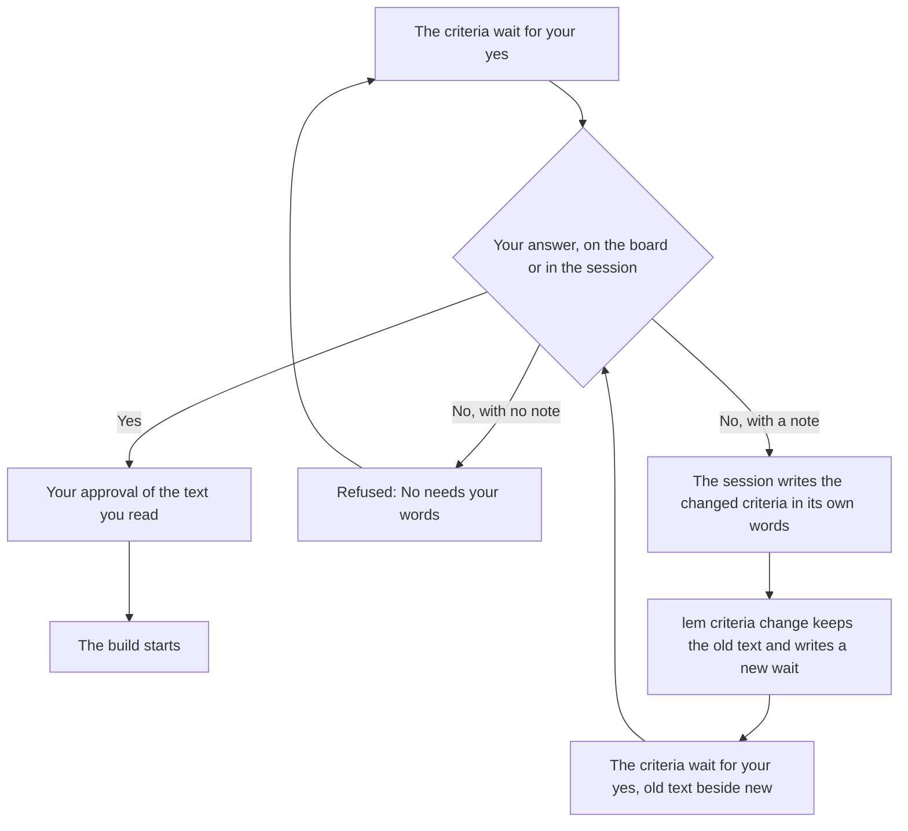

# A No with a note on the criteria asks for his yes again

careful: yes, because the change moves when the owner's approval of the criteria counts ("A decision that is the owner's is taken without him"): task 1 writes the step that keeps a change from being his yes, and task 2 takes his No and his yes on the board's server.

## Acceptance criteria

Size: full, because the change reaches when the owner's approval of the criteria counts, the board's card and the interview's steps.

1. A change of the criteria from the owner's note is never his yes: Lem writes the changed criteria, the task waits for his yes again, and no build starts.
   1. Task `invoice-export-empty-cells` has three criteria that wait for the owner's yes.
   2. He answers No with the note "criterion 2 must also cover empty rows".
   3. Lem writes the new text of criterion 2 into the task's criteria.
   4. The task waits for his yes, and `lem criteria approved invoice-export-empty-cells` shows no approval of the new text by him.
   5. No lead starts.
2. The board's card "The criteria wait for your yes" of a task on the standard track has No with a note beside Approve, on the phone too: a No with the note "criterion 2 must also cover empty rows" reaches the task's session, which changes the criteria from it.
3. A No with no note on that card is refused with a message that asks for his words, and the criteria and the task stay as they were.
4. Lem writes a changed criterion in its own words from his note, with a concrete example, and the request for his yes shows the old text of each changed criterion beside its new text, on the board and on the page in the task's session: criterion 2 "An export keeps an empty cell" shows beside "An export keeps an empty cell and an empty row: order 1042 with no note and a blank line exports both".
5. The personas do not read the changed criteria again: the request for his yes comes at once, with Approve on the board, and the pull request says that the criteria changed after the personas' read.
6. His yes to the changed text is his approval (`by: owner`) of that text, and the build starts from it, the same after a change in the task's session as after a No on the board.

## How it works

Today a change he gives on the interview's page is written into `criteria.md` and approved at once
in his name (`stages/interview.md`, steps 6 and 7), and the board's card of the standard track has
one button, "Approve the criteria" (`approve_card` in `lem_board_task.py`).

After:

1. The interview of `invoice-export-empty-cells` ends, and `criteria.md` holds three criteria.
2. On his phone he taps No on the board's card, with the note "criterion 2 must also cover empty rows".
3. The board records his answer and wakes the task's session (`act_answer`, as for the fast track's No today).
4. The session writes criterion 2 again in its own words, with an example, and runs `lem criteria change`.
5. That command keeps the text he said No to, writes the new `criteria.md`, and writes the held block `the criteria wait for the owner: changed from the owner's note`.
6. The new block is a new key, so the board's row comes back, with criterion 2's old text beside its new text, and Yes and No again.
7. He taps Yes. `act_approve` approves the bytes the card showed, `by: owner`, and the session starts the build.

## Tasks

1. **`lem criteria change`: a change of the criteria that waits for his yes.** Serves criteria 1, 4,
   5 and 6.
   - A new action of `criteria.py`, `lem criteria change SLUG --file FILE --words "HIS NOTE"`, for a
     task on the standard track whose criteria wait for his yes and have no approval yet. It reads
     the text he answered, keeps it as the text before the change (`criteria-before.json` in the
     task directory: that text whole, and the `ts` of the newest state block it was written under,
     written before `criteria.md` moves), writes FILE's section into `criteria.md`, logs an event of
     the change (the criteria it changed, his words), and writes the held block `the criteria wait
     for the owner: changed from the owner's note` through `project.py`'s `state` (in the same
     process, `lem_sibling`). It approves nothing.
   - The text he answered is `criteria.md`, except after a stop in the middle of a change: when
     `criteria-before.json` names the newest state block, the change began under that block and did
     not end, and the text he answered is the one that file keeps. The command then finishes the
     change (`criteria.md`, the event, the held block) from FILE, and "nothing changed" compares
     FILE with that kept text. A unit case stops a change after `criteria.md` moved and runs it again
     to its end. (Talk question 4.)
   - The change runs whole under the task's `criteria.lock`, the lock `cmd_approve` takes, and
     `cmd_approve` reads the file and checks `--shown` under that lock too (today it reads the file
     before it takes the lock). So of his Yes and a change that come at one time, one ends before
     the other starts: a change refuses when an approval of the owner's stands after the newest
     state block (his yes came first, and the session goes on from it), and a Yes whose page showed
     the text before a change is refused by its digest. A unit case for each order. (Talk question 1.)
   - It prints JSON: the criteria before and after, paired by their text and not by their number
     (`difflib.SequenceMatcher` over `whole` of each, the sentence and the case): a text that is the
     same is not shown; one criterion replaced by one is a changed pair, with its number before and
     after; a removed criterion with its number before; an added one with its number after; a run
     of N replaced by M other criteria shows as N removed and M added. So the removal of criterion 2
     of three shows criterion 2 removed, and criterion 3 kept as the new 2. A unit case for that
     removal. One way prints the same pairs again while that wait stands, for a session that opened
     after the change (for example `lem criteria change SLUG --show`; the form is the builder's).
     (Talk question 9.)
   - Refused with exit 1 and a message that names the fix: no `criteria.md`; no words; FILE's
     criteria the same as the ones that wait (nothing changed); FILE not in the form `lem criteria`
     reads, or with a test line under a criterion (the same check as `cmd_approve`'s for the owner's
     file, so that every text that enters the wait can take his Yes; talk question 8); a task whose
     criteria have an approval (`lem criteria approved SLUG` is not null: from then on a change is
     `lem decisions criterion`, and `criteria.py`'s `against` reads the plan against that approval;
     talk question 2); a task on the fast track (its own step keeps his words, `stages/new.md`, "The
     fast track", step 1).
   - The held line starts with `CRITERIA_WAIT`, so `project.py`'s `track_of` reads it as the
     standard track and the board's `held_need` as `criteria`, which takes no read before his yes
     (`settle`: `read_in` is None for that need). Check both with a unit case, and check that `lem
     project state` takes the line as it is.
   - `land.py`'s `unread` already says "the criteria changed after the personas' read, by the
     owner's approval N, and the change was not read" when his approval holds other criteria than
     the read did. A unit case pins it for an approval after a change.
   - The pull request's line of the read (`land.py`'s `read_line`) also counts the change events of
     task 1 after the read, whatever the text he approved at the end: "the criteria changed N
     times after the personas' read, from the owner's notes". So a change from A to B and back to A,
     whose approved text is the one the personas read and which `unread` rightly leaves out, still
     shows in the pull request. A unit case for that A, B, A run. (Talk question 10.)
   - Files: `skills/lem/scripts/criteria.py`, perhaps `skills/lem/scripts/project.py` (an event's
     form, if `log` checks it), `tests/unit/test_criteria*.py` or a new unit file,
     `tests/unit/test_land*.py` for `unread`, and the criteria block of `tests/lem-settings.sh` for
     the command's journey once.

2. **The board's criteria card of the standard track gets Yes and No with a note.** Serves criteria
   2, 3, 4, 5 and 6.
   - `lem_board_model.answer_row` gives the row of kind `criterion` also for criteria of the
     standard track that wait for his yes and whose yes would count (`Task.approvable`, the turn
     his, nobody going on for him): an interview's after its read or his skip, a `the criteria wait
     for the owner` block (a lead's doubt, or the change of task 1). Its question is "Approve the
     criteria?" there, and "Approve this criterion?" on the fast track as today; the key form
     (`criterion:SLUG:STAMP`) stays, so `lem_answers.KEY` and the record's form do not change. Each
     text that names the question (`took_effect`, `acted_head`, the Overview) reads it from the row
     or the record, not from the kind alone.
   - `answer_row` gives no row, of any kind, for a task begun on an older release than the board's
     own (`lem_release.began_on` of the task directory against `lem_release.running()`): the board
     runs the newest Lem of the Mac, and a session of the release before has no `board_answer` to
     read, so a recorded answer would hide the row and reach nobody. Such a task keeps the acts it
     had before (Approve under the criteria, Park), and its owner answers the rest in its session.
     A unit case with a task marked with `BEFORE`. (Talk question 6.)
   - `lem_answers.answer_of_block` gives the newest record of the block, not the first: the skip row
     and the criteria row of one interview stand on the same `the interview waits for the owner`
     block, the skip's answer always comes first, and the session has taken it already (its
     decision names its key). A unit case with a skip's No and then a criteria No on one block.
     (Talk question 3.)
   - On "Waits for you" the criteria row of the standard track keeps "Read and approve…", the link
     to the card, in `lem_board_pages.row_acts`: no Yes is given there, since that row does not
     show the old text beside the new, and "no yes to a contract from one tap on a list" (the
     comment there). Only the fast track's one criterion keeps its Yes and No on the row. A unit case
     of `row_acts` for each track. (Talk question 7.)
   - `approve_card` in `lem_board_task.py` draws that row with the one answer form
     (`P.answer_form`) in place of the one "Approve the criteria" button, on the Mac and in the
     phone's overlay (`confirm_card`), with the digest of the text shown. Yes is `act_approve` as
     today; No needs a note ("No needs your words: what should the criteria say?"), checks the
     digest, records the answer and wakes the task's session (`act_answer`). A No with no note
     leaves `criteria.md`, the state and the record as they were.
   - While the newest held block is the change of task 1, the card shows each changed criterion's
     text before the change beside its new text, from `criteria-before.json` and `criteria.md`, read
     through `criteria.py` (`lem_sibling`, as `whole` reads it). On a phone 390 pixels wide the two
     stand one under the other and nothing is cut off.
   - `tests/board-showcase.py`: a task on the standard track whose criteria changed from his note,
     so that `tests/lem-board-keys.sh` taps No with no note (refused) and Yes on a phone, and
     `tests/lem-board-act.sh` runs a No with a note to the record and the wake. The report of this
     task links a phone screenshot of the card with the old text beside the new.
   - Files: `skills/lem/scripts/lem_board_model.py`, `lem_board_task.py`, `lem_board_pages.py`,
     `serve.py`, `lem_answers.py` (`answer_of_block` and the words of `took_effect`), `skills/lem/assets/board.css`,
     `tests/board-showcase.py`, `tests/lem-board-act.sh`, `tests/lem-board-keys.sh`, and the unit
     tests of the model, the task board and the server.

3. **The task's session writes the change, shows old beside new, and waits for his yes.** Serves
   criteria 1, 2, 4, 5 and 6. Stage and prompt text only, so its test is a real task (`AGENTS.md`,
   "Checks").
   - `stages/interview.md`, steps 6 and 7: a change of his, on the page in the session or as a No
     on the board, is never his yes. The session writes each changed criterion again in its own
     words from his note, with a concrete example, keeps his rule (the personas' rewrite ruling,
     2026-11-22), runs `lem criteria change`, and puts up the page again with each changed
     criterion's old text beside its new text (the pairs `lem criteria change` prints). The
     personas do not read it again. Only his yes to that page, or Yes on the board, is `lem criteria
     approve`; "again after each change of his" goes.
   - `prompts/session.md`, "His answer on the board": a `criterion` `no` on the standard track is
     that change of the interview's step 6, with his note; the fast track keeps its own step. A
     page of the session that waits on the criteria when the board's No comes is closed by the
     session first (`lem-ask close`, as the card's own command), then the new page goes up.
   - The same part, on a later wake: for a `criterion` `no` on the standard track the act is done
     when the newest state block is the change's held block (then `board_answer` is null). A
     decision that names the key while the block he answered is still the newest means that the
     change stopped in the middle: run `lem criteria change` again with the same file, which ends
     it (task 1). Today's rule, "a decision names its key: nothing is done again", stays for every
     other answer. (Talk question 4.)
   - `stages/plan.md`, step 1 (a lead's criteria that wait for him after a doubt): his change there
     takes the same way, through steps 6 and 7 of the interview, which it names already. The lead
     writes the criteria it holds for him into the task's `criteria.md` as well, with no test line,
     so that the board shows them with Yes and No; after his yes to a changed text, the plan's
     section takes the approved text word for word before `lem criteria record`, as the step's
     first bullet says for criteria approved at an interview. (Talk question 2.) Check that
     no other stage text approves a change at once (`grep -n "change of his"` and "approve" in
     `skills/lem/stages/` and `skills/lem/harness/`).
   - Files: `skills/lem/stages/interview.md`, `skills/lem/prompts/session.md`, and
     `skills/lem/stages/plan.md` or `skills/lem/harness/claude-code/ask-owner.md` only where they
     say a change is approved at once.

4. **The documents say that a No with a note changes the criteria and asks again.**
   - `docs/when-lem-needs-you.md`: where it says how he approves or changes the criteria, and on
     the board.
   - `docs/board.md`, "Act from the board": the criteria card's Yes and No, and the old text beside
     the new.
   - `README.md` and `site/index.html` in the same commit, only where they say how the criteria
     are approved or what the board answers.
   - `skills/lem/SKILL.md`, only where it says that a change of the criteria is approved.

## Decisions of the plan

1. **The standard track's criteria row is of the kind `criterion`, the fast track's kind.** The key
   form, the record, the answer route and its refusals stay one; only the question's words differ
   by track. A new kind would be a new key form, which `lem_answers.KEY` and the release before
   would have to read (`AGENTS.md`, two releases). Rests on: `answer_row`, `act_answer` and
   `act_approve` in `serve.py`, which handle Yes, No, the note and the digest for that kind
   already. By the lead.
2. **One command makes the change, and it writes the new wait itself.** The text before the change,
   the new text and the held block that asks again are written together, so no session can change
   the criteria and forget to ask again, and a session that opens after a stop finds the pairs. The
   new held block is what brings the board's row back under a new key (`lem_answers`, a key names
   its block). Rests on: criterion 1, and `settle`, whose need `criteria` asks no read. By the lead.
3. **The held line is `the criteria wait for the owner: changed from the owner's note`.** It starts
   with the line every reader of a criteria wait already reads (`CRITERIA_WAIT` in `project.py`,
   `held_need` in the model), and differs from the fast track's line, which the model compares
   whole. By the lead.
4. **The text before a change is kept in the task directory, `criteria-before.json`, one file, the
   newest change, with the `ts` of the state block it was written under.** The board and the
   session read the pairs from it while the wait stands; an older change is in the event log. The
   block's `ts` tells a change that stopped in the middle from one that ended (talk question 4).
   By the lead.
5. **After a No on the board, the session's page and the board's row both ask again, as the first
   request does.** The interview's page in the session and the board's criteria row stand together
   today; the change keeps that, and the first answer counts: `--shown`, read under `criteria.lock`,
   and the change under the same lock keep it (task 1, talk question 1). By the lead.
6. **While the owner is away, the wait after his change goes on as any wait for his yes.** His
   `/lem im-away` lets the task go on without him (the ruling "A task runs with him or alone, and he
   can let go at any stage", 2026-11-17 and 2026-11-18): "When the watch ends" of `stages/away.md`
   approves the changed criteria with `--alone`, which is never his yes (`by: alone`), and the pull
   request is not green for it. Criterion 1 holds while he is there, as its case says; nothing of
   this plan changes `stages/away.md`. (Talk question 5.) By the lead.

## What this plan will not verify

- His No and Yes from a real phone over the tailnet: the checks use headless Chrome on this Mac,
  390 pixels wide.
- The session's half (task 3): its texts have no test, and the next real task with a change of the
  criteria is its test.
