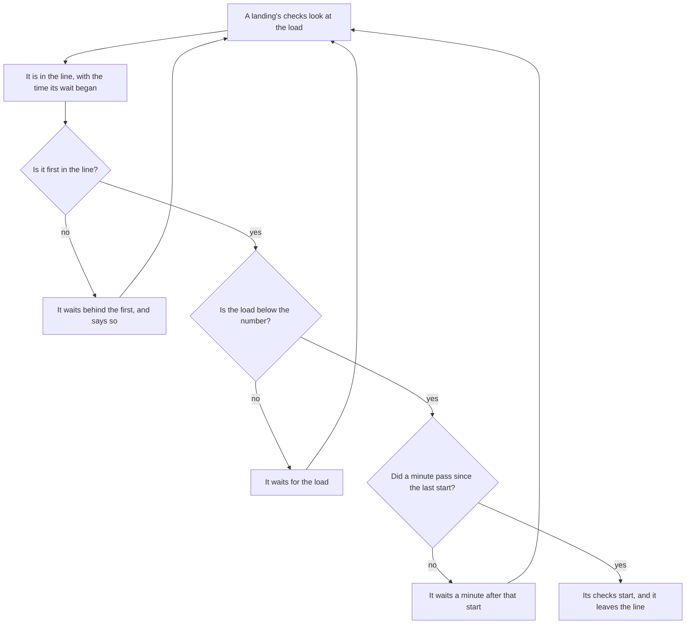

# The load gate serves the landing that waits longest first

careful: yes, because the gate may now hold a landing whose own look reads a load below the number for one look of the first in the line, which reaches the owner's topic "A change bends a ruling of the owner" through his ruling "Landings run in parallel, and the machine's load decides when checks start" (2026-11-20, 2026-11-22; its form is the session's).

## Acceptance criteria

Size: full, because the gate gets a line of the waiting landings for the whole machine, two rules of order, and a new reason of a wait on the board.

1. When the load falls below the number, the landing that waits longest starts its checks first, whichever landing looks at the load first:
   1. `fast-track-checks-documents` waits since 12:01 UTC, and the plan talk's task since 12:17 UTC.
   2. At 12:19 UTC the load falls to 30, with the number at 40.
   3. The plan talk's task looks at the load first, and waits on.
   4. The checks of `fast-track-checks-documents` start.
2. The line is one for all the repositories on the machine: a landing of Lem that waits since 12:01 UTC starts before a landing of mybaze that waits since 12:05 UTC.
3. A landing that another open task of its repository waits for, by the `after:` line of a queued task or of a task blocked by a red base, goes before the longest wait, and of two such landings the one that waits longest goes first:
   1. `keys-help-in-a-sticky-footer` waits since 12:00 UTC.
   2. `new-sessions-open-at-tail` is blocked with `after: fix-red-base`, because the base is red.
   3. `fix-red-base` begins to wait at 12:10 UTC, and the load falls below 40.
   4. The checks of `fix-red-base` start first; `keys-help-in-a-sticky-footer` starts after it.
4. A landing that waits a second time, after a repair, counts its wait from the start of that second wait: `keys-help-in-a-sticky-footer` had its turn at 12:00 UTC, waits again from 12:20 UTC, and goes after `new-sessions-open-at-tail`, which waits since 12:10 UTC.
5. The load still decides: while it is above the number, no landing starts, also the first in the line, and the next start comes a minute after the one before, as today.
6. A landing whose checks process is gone (it died, or `lem land checks --stop` stopped it) loses its place, and the next landing in the line starts at its own next look; a landing whose task session is gone while its checks process still runs keeps its place.
7. The board and `lem land checks --status` say why a landing waits when it waits behind another one: `fast-track-checks-documents` waits for the load, and the plan talk's task "waits behind fast-track-checks-documents, which waits longer".

## How it works

At each look, a run that waits writes itself into the machine's one line, takes out each entry whose process is gone, and starts only when it is first in the line, the load is below the number and a minute passed since the last start.

The first in the line is the one that another task waits for, and among those, or among all when no task waits for one, the one whose wait began first.

## Tasks

1. **The gate keeps one line for the machine, and only the first in it starts** (criteria 1 to 6). In `skills/lem/scripts/land.py` (`wait_for_load` and what it needs), with the line's record in `load.lock` of Lem's home folder (`lem_state.LOAD_LOCK`), the file the gate already holds for its last start:
   - The record holds the last start, as today (`at`, `task`, `repo`), and the line: one entry for each run that waits, with its task, its repository (`task.main`), its process id, the time its wait began (`since`), the time of its newest look (`seen`), and whether another task waits for it (`wanted`). One flock on the file covers each look's read and write, as it covers the last start today; a look now takes it also while the load is at or above the number, so that the line holds every run that waits. A record in the form before (`{"at", "task", "repo"}` alone) reads as a last start with an empty line, so no file needs a hand fix.
   - At each look, under the flock, the run: takes out each entry whose process is gone (`alive`) or whose `seen` is older than `LINE_STALE` seconds (decision 3); writes its own entry, with `since` kept from its first look of this wait and `seen` and `wanted` new; and sorts the line by `wanted` first, then `since`, then the task and the repository as the tie-break, so that every run reads the same first. The order is one pure function of the entries, for the unit cases.
   - It starts only when it is first in the line, the load is below the number and `LOAD_SPACING` passed since the last start; then it writes the last start and takes its own entry out, in the same hold of the flock. Not first: it waits, with the reason `behind` and the first's task and repository, also while the load is above the number (criterion 7's case). First, with the load at or above the number: the reason `load`, as today. First, under a minute after the last start: the reason `after`, as today, with the same shorter sleep. With an empty line and the load below the number, a run starts at its first look, as today.
   - `wanted`: some task of the run's own repository has a newest state block whose status is `queued`, or `blocked` with the line `the base is red`, and whose `after:` line names this run's task. The run reads it at each look from its repository's state folder, through `project.py`'s own readers of a block and its `after:` line (`blocks_of`, `after_in`), reached the way `land.py` already reaches `project.py` (`lem_sibling`), and with no second parser.
   - A wait that ends in any other way (a stop, which is a `KeyboardInterrupt` here, `--start none`, an error) takes its own entry out in a `finally`. A run that is killed takes nothing out: the dead process or the stale `seen` takes it out at the next look of another run (criterion 6). A new wait of the same task, after a repair, gets a new entry with a new `since` (criterion 4).
   - `gate.wait` carries `behind=SLUG`, `behind_repo=PATH` when that task is of another repository, and `why=longer|wanted`: `wanted` when the first is wanted and this run is not, else `longer`. A new line is logged when the reason or the first in the line changes, and again each `LOAD_SAY` seconds, as today. `wait_say` gets the words for it: "SLUG: the checks wait behind OTHER, which waits longer" or "..., which another task waits for", with OTHER followed by "of REPO" (the repository folder's name) when it is of another repository, then "; they start below N". `checks_status` gives `behind`, `behind_repo` and `why` in `waits` beside its keys of today.
   - `LINE_STALE` is a constant beside `LOAD_LOOK`, with its comment that it is a guess.
   - Tests in `tests/unit/test_land.py`, with `land.load_now`, `time.sleep`, `time.time` and `lem_state.machine_file` patched as the scout found (`scout.md`, 3): the order function for criteria 1, 3 and 4 with the stories' slugs and times; two runs of two repositories in one line for criterion 2; a look of the run that is not first, with the load below the number and a minute past: it waits behind; a look of the first with the load above: no start (criterion 5); an entry with a dead process id and one with an old `seen`: taken out, and the next run starts at its look (criterion 6); an entry whose process lives keeps its place; the `wanted` read from a task directory with a `queued` block and one with a `blocked` block that says `the base is red`, both with `after: SLUG`; the old form of the record read as a last start; `wait_say` and the `waits` of `checks_status` for a run behind another (criterion 7, the `--status` half).
2. **The board says that a landing waits behind another one** (criterion 7). In `skills/lem/scripts/lem_board_model.py`: the fold of `gate.wait` keeps `behind`, `behind_repo` and `why` in `t.waits`; `waits_say` gives "Its checks wait behind OTHER, which waits longer" (or "which another task waits for", and OTHER "of REPO" for another repository) before its `after` and `load` cases; the timeline's `gate.wait` text says the same in its own form ("behind OTHER, which waits longer"). Tests in `tests/unit/test_board_model.py`: a `gate.wait` with `behind` gives the card line and the timeline text of criterion 7, and one without `behind` gives today's texts. Then `bash tests/lem-serve.sh` once, since it draws the board's words.
3. **The documents say the order** (no criterion). Each says what is true after task 1:
   - `skills/lem/scripts/land.py`, the module docstring's paragraph on the gate (lines 201 to 206): the runs that wait form one line for the machine; the one another task waits for goes first, then the one that waits longest; only the first starts.
   - `skills/lem/stages/land.md`, step 4, the paragraph of the load gate: the same rule in one or two sentences, and that the board's card then says "waits behind ..."; "Say nothing of a wait" stays.
   - `docs/flow.md`, "Many tasks at once": one sentence in STE that the landing which waits longest starts first, and one that another task waits for starts before it.
   - `site/index.html`, the card "Checks under your load limit", in the same commit as `docs/flow.md`, so that the page says the same thing.
   - Nothing in `docs/install.md` (`[load]` is still the limit) or the comment in `tests/lib.sh` (the gate stays away in the blocks) becomes false; the builder checks both and changes neither unless it finds a false sentence.

## Decisions of the plan

1. **The line lives in `load.lock`, the file the gate already holds.** One flock then orders both the last start and the line, so no look can read a line that another look has half written. A second file would need a second lock and an order between the two. Rests on: `wait_for_load`, read 2026-11-23.
2. **Each run writes its own `wanted` at its own look.** A run reads only its own repository's state, which it knows; another run of another repository would need to read every repository's state folder. A `wanted` is at most one look old (15 s), which changes the order by one look at worst. Rests on: criterion 3 says "another open task of its repository", and `task.directory` gives the state folder (`waits_of`, `gate_ends`).
3. **An entry whose newest look is older than `LINE_STALE` loses its place, as a dead process does.** Four things, as an addition must name them:
   - the failure: one entry that never leaves the line, and every landing of the machine waits behind it for ever;
   - the input: a run killed (no `finally`) whose process id the system gave to another process before any other run looked, or a run whose process is stopped and never looks again;
   - realistic here: rare; pid reuse within a minute on macOS is unlikely, but the line holds every repository's landings, and one miss stops them all;
   - without it: `alive(pid)` alone keeps that entry, and the owner has to remove `load.lock` by hand.
   `LINE_STALE` is a guess with room above one look: `LOAD_LOOK` plus the time a look takes (an event's write, a read of the state blocks), so twice `LOAD_LOOK`, 30 s. It keeps the hold of decision 3 of the record (`decisions.jsonl`, id 3: the first in the line holds the others one look at most), because a live first looks every `LOAD_LOOK` seconds.
4. **A run that is not first says `behind` also while the load is above the number.** Criterion 7 has the first waiting for the load and the second "behind" it at the same moment. The reason the owner reads is then where the run stands in the line; the first's own line says the load.
5. **The tie of two equal `since` breaks by the task and the repository**, so that two runs never both read themselves as first.

## What it will not verify

- Two real `lem land checks` processes that wait at one moment on a loaded machine: the unit cases play the looks of two runs on one record with the clock and the load patched, which is the same code path. A journey block would need the gate on and a load above the number, which `tests/lib.sh` turns off for every block, and a load that a test cannot set (`load_now` reads `os.getloadavg()`).
- The board in a browser: the card line and the timeline are text of the model, which the unit cases and `tests/lem-serve.sh` read.
