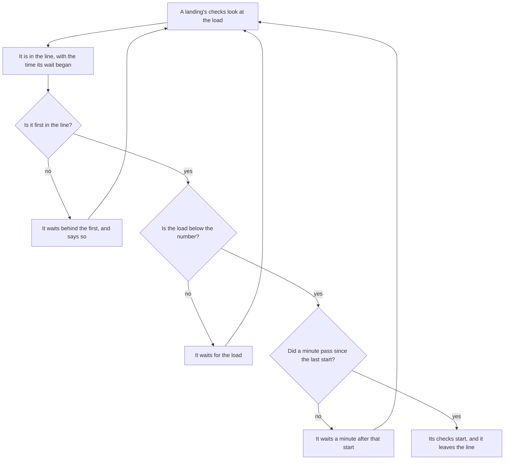

# The load gate serves the landing that waits longest first

careful: yes, because the gate may now hold a landing whose own look reads a load below the number for one look of the first in the line, which reaches the owner's topic "A change bends a ruling of the owner" through his ruling "Landings run in parallel, and the machine's load decides when checks start" (2026-11-20, 2026-11-22; its form is the session's).

## Acceptance criteria

Size: full, because the gate gets a line of the waiting landings for the whole machine, two rules of order, and a new reason of a wait on the board.

1. When the load falls below the number, the landing that waits longest starts its checks first, whichever landing looks at the load first:
   1. `fast-track-checks-documents` waits since 12:01 UTC, and the plan talk's task since 12:17 UTC.
   2. At 12:19 UTC the load falls to 30, with the number at 40.
   3. The plan talk's task looks at the load first, and waits on.
   4. The checks of `fast-track-checks-documents` start.
2. The line is one for all the repositories on the machine: a landing of Lem that waits since 12:01 UTC starts before a landing of mybaze that waits since 12:05 UTC.
3. A landing that another open task of its repository waits for, by the `after:` line of a queued task or of a task blocked by a red base, goes before the longest wait, and of two such landings the one that waits longest goes first:
   1. `keys-help-in-a-sticky-footer` waits since 12:00 UTC.
   2. `new-sessions-open-at-tail` is blocked with `after: fix-red-base`, because the base is red.
   3. `fix-red-base` begins to wait at 12:10 UTC, and the load falls below 40.
   4. The checks of `fix-red-base` start first; `keys-help-in-a-sticky-footer` starts after it.
4. A landing that waits a second time, after a repair, counts its wait from the start of that second wait: `keys-help-in-a-sticky-footer` had its turn at 12:00 UTC, waits again from 12:20 UTC, and goes after `new-sessions-open-at-tail`, which waits since 12:10 UTC.
5. The load still decides: while it is above the number, no landing starts, also the first in the line, and the next start comes a minute after the one before, as today.
6. A landing whose checks process is gone (it died, or `lem land checks --stop` stopped it) loses its place, and the next landing in the line starts at its own next look; a landing whose task session is gone while its checks process still runs keeps its place.
7. The board and `lem land checks --status` say why a landing waits when it waits behind another one: `fast-track-checks-documents` waits for the load, and the plan talk's task "waits behind fast-track-checks-documents, which waits longer".

## How it works

A run that waits keeps a file of its own in the machine's one line, locked while its process lives. At each look it removes each entry whose lock is gone, reads which entries another task waits for, and starts only when it is first in the line, the load is below the number and a minute passed since the last start.

The first in the line is the one that another task waits for, and among those, or among all when no task waits for one, the one whose wait began first.

## Tasks

1. **The gate keeps one line for the machine, and only the first in it starts** (criteria 1 to 6). In `skills/lem/scripts/land.py` (`wait_for_load` and what it needs) and `skills/lem/scripts/lem_state.py` (the name of the line's folder):
   - `load.lock` of Lem's home folder (`lem_state.LOAD_LOCK`) stays what it is: the lock of the gate, and the last start in its form of today (`at`, `task`, `repo`), the one record of the gate written in place. Its form does not change, so no reading of another form is added (decision 1, talk question 5).
   - The line is a folder beside it, `load.line/` (`lem_state.LOAD_LINE`): one file for each run that waits, `PID.json`, with its task, its repository (`task.main`) and the time its wait began (`since`, `time.time()` read under the hold of `load.lock`). The run makes its file, takes an exclusive flock on it, writes it whole and flushes it, all under the hold of `load.lock`, and keeps that file open and locked for the whole wait. Nothing rewrites an entry: what changes from look to look (`wanted`) is not stored (talk question 1).
   - An entry is live while its file's lock is held: the kernel lets that lock go when the process ends, however it ends. At each look, under the hold of `load.lock`, the run tries a shared flock with `LOCK_NB` on each other entry: refused, the entry is live and keeps its place, also when its look is late or its task's session is gone (criterion 6); taken, its process is gone, and the run removes the file. A file whose writer died in the middle of its write is no live entry either, and goes the same way. No entry leaves by its age, so there is no `seen` and no `LINE_STALE` (decision 3, talk question 3).
   - At each look, under the same hold, the run reads `wanted` for every entry, fresh, from that entry's repository: some task there has a newest state block whose status is `queued`, or `blocked` with the line `the base is red`, and whose `after:` line names the entry's task. It reads each repository's state folder once per look (`project.py`'s `state_root`), and each block through `project.py`'s own readers (`blocks_of`, `after_in`), reached the way `land.py` already reaches `project.py` (`lem_sibling`), with no second parser. So every run orders the same entries with the same `wanted` at the moment it decides, and a task queued, parked or dropped since the last look counts at once (talk question 2). The read of Lem's 87 tasks took 15.2 ms for each look (`project.blocks_of` over `.lem/state/tasks/*/state.md`, 2026-11-23). Another repository whose state does not read (`state_root` raises `StateError`: its checkout moved or is gone) is no stop of this run: for that look its entries count as not wanted, and the run's `gate.wait` names it (`unread=PATH`, and in `wait_say` "the state of REPO does not read, so its landings count as wanted by no task"), logged once when it starts and again with the reason's other changes; the run's own repository that does not read refuses the run, as any step of it does today (the ladder's decision 6 of `decisions.jsonl`). A unit case: an entry of a repository whose state folder raises gives the order without its `wanted`, and the `unread` key.
   - It sorts the line by `wanted` first, then `since`, then the task and the repository as the tie-break, so that every run reads the same first. The order is one pure function of the entries and their `wanted`, for the unit cases.
   - It starts only when it is first in the line, the load is below the number and `LOAD_SPACING` passed since the last start; then, in the same hold of `load.lock`, it writes the last start, removes its own file and closes it. Not first: it waits, with the reason `behind` and the first's task and repository, also while the load is above the number (criterion 7's case). First, with the load at or above the number: the reason `load`, as today. First, under a minute after the last start: the reason `after`, as today, with the same shorter sleep. With an empty line and the load below the number, a run starts at its first look, as today.
   - A wait that ends in any other way (a stop, which is a `KeyboardInterrupt` here, `--start none`, an error) removes its own file and closes it in a `finally`. A run that is killed removes nothing: its lock is gone with it, and the next look of another run removes its file (criterion 6). A new wait of the same task, after a repair, makes a new file with a new `since` (criterion 4).
   - A stop while the run waits logs the run's one `gate.end`, with `result=stopped`, `seconds:=0`, its tip and the `say` of `checks_say(..., "stopped")`, before the step's refusal of today, so that the board's wait ends and `--status` gives the stopped end (talk question 4). The module docstring's sentence "A run of the checks is two events" then says that a run stopped while it waited is its `gate.end` alone.
   - `gate.wait` carries `behind=SLUG`, `behind_repo=PATH` when that task is of another repository, and `why=wanted|longer|first`: `wanted` when the first is wanted and this run is not; `longer` when the first's `since` is earlier than this run's; `first` when the two `since` are equal and the tie-break decided (talk question 6). A new line is logged when the reason or the first in the line changes, and again each `LOAD_SAY` seconds, as today. `wait_say` gets the words for it: "SLUG: the checks wait behind OTHER, which waits longer", "..., which another task waits for" or "..., which is first in the line", with OTHER followed by "of REPO" (the repository folder's name) when it is of another repository, then "; they start below N". `checks_status` gives `behind`, `behind_repo` and `why` in `waits` beside its keys of today.
   - Tests in `tests/unit/test_land.py`, with `land.load_now`, `time.sleep`, `time.time` and `lem_state.machine_file` patched as the scout found (`scout.md`, 3): the order function for criteria 1, 3 and 4 with the stories' slugs and times; two runs of two repositories in one line for criterion 2; a look of the run that is not first, with the load below the number and a minute past: it waits behind; a look of the first with the load above: no start (criterion 5); an entry whose file no process holds (a child process that took the lock and ended): removed, and the next run starts at its look; an entry whose holder still runs keeps its place (criterion 6); a file with half a record and no holder: removed; `wanted` read from a task directory with a `queued` block and one with a `blocked` block that says `the base is red`, both with `after: SLUG`; a `queued` block written after the waiting runs made their entries, and read at the next look: the wanted run goes first at that look (question 2's case); a stop in the wait: the entry removed and one `gate.end` with `result=stopped`; `wait_say` and the `waits` of `checks_status` for a run behind another with each `why` (criterion 7, the `--status` half).
2. **The board says that a landing waits behind another one** (criterion 7). In `skills/lem/scripts/lem_board_model.py`: the fold of `gate.wait` keeps `behind`, `behind_repo` and `why` in `t.waits`; `waits_say` gives "Its checks wait behind OTHER, which waits longer" (or "which another task waits for", or "which is first in the line", by `why`, and OTHER "of REPO" for another repository) before its `after` and `load` cases; the timeline's `gate.wait` text says the same in its own form ("behind OTHER, which waits longer"). A `gate.end` with no `gate.start` before it (a stop while the run waited, task 1) ends the wait on the card, as every event but a wait already does (`t.waits = None`), and the timeline draws it as the checks' stopped end with no count of commands. Tests in `tests/unit/test_board_model.py`: a `gate.wait` with `behind` gives the card line and the timeline text of criterion 7 for each `why`, one without `behind` gives today's texts, and a `gate.wait` then a `gate.end` with `result=stopped` and no `gate.start` gives no wait on the card and "The checks were stopped" in the timeline. Then `bash tests/lem-serve.sh` once, since it draws the board's words.
3. **The documents say the order** (no criterion). Each says what is true after task 1:
   - `skills/lem/scripts/land.py`, the module docstring's paragraph on the gate (lines 201 to 206): the runs that wait form one line for the machine; the one another task waits for goes first, then the one that waits longest; only the first starts.
   - `skills/lem/stages/land.md`, step 4, the paragraph of the load gate: the same rule in one or two sentences, and that the board's card then says "waits behind ..."; "Say nothing of a wait" stays.
   - `docs/flow.md`, "Many tasks at once": one sentence in STE that the landing which waits longest starts first, and one that another task waits for starts before it.
   - `site/index.html`, the card "Checks under your load limit", in the same commit as `docs/flow.md`, so that the page says the same thing.
   - `skills/lem/scripts/lem_state.py`, the module docstring's sentence on what the home folder holds beside `load.lock`, and `AGENTS.md`, "Layout", the line of Lem's home folder: both name `load.line/`, the line of the runs that wait.
   - Nothing in `docs/install.md` (`[load]` is still the limit) or the comment in `tests/lib.sh` (the gate stays away in the blocks) becomes false; the builder checks both and changes neither unless it finds a false sentence.

## Plan talk

Who argued the plan: the reviewer was Codex, GPT 6.2 Sol at high (its pane's status line); the defender was Claude Code, Opus 5.5 at high (the `defender:` line of the task's state). Different families. Six turns, against a bound of 26 (4 × 6 questions + 2). The talk's messages are in the task directory, `talk-1-request.md` to `talk-4-refutations.md`.

The reviewer's list, as it came, and how each question ended:

1. **Can one dead process erase the whole line?** The line sat in `load.lock`'s record, which `wait_for_load` truncates and writes again; a writer that dies between the two leaves no line. Settled: repaired at the cause, decision 1 changed. The line is `load.line/`, one file for each run that waits, written once under the hold of `load.lock` and locked by its run for the whole wait; `load.lock` keeps only the last start. The reviewer: "closed, at the cause". Settled by the two, not checked by the review.
2. **How does the gate give a new dependency priority before the next start?** Each run wrote its own `wanted` at its own look, so a task queued or parked since then counts one look late. Repaired at the cause, decision 2 changed: every look reads `wanted` fresh for every entry, from that entry's repository (15.2 ms for each look over Lem's 87 tasks, 2026-11-23). The reviewer held it against the changed decision: (a) a block written after the read and before the start; (b) another repository's checkout that does not read (`project.py:state_root` → `lem_state.main_checkout` raises `StateError`), for which Task 1 gives the other landings no outcome. The defender refuted (a) with a cite (the read and the start are in one hold of `load.lock`, and no rule orders by a state written after its decision) and had no cite against (b). A design choice: the kept decision (the fresh read of every entry's repository, the plan as the talk left it) against the reversed one (each run writes its own `wanted` at its look, a stale window of one look). `stages/plan.md`, step 5, takes it up the ladder; its decision is logged below, under "Decisions the ladder took".
3. **How does expiry keep a live run's place and release the line on time?** An expiry of 30 s (`LINE_STALE`) could take out a live first whose look comes late behind the event log's lock, which criterion 6 forbids, and could not reach a process stopped inside `load.lock`. Repaired at the cause, decision 3 changed: an entry is live while its process holds its file's lock, and nothing else ends it; no `seen`, no `LINE_STALE`. The reviewer held it against the changed decision: a live first that waits for `events_lock` to log, then sleeps, holds the others past the "at most one look of 15 s" of decision 3 of `decisions.jsonl`. The defender refuted with a cite (criterion 6 keeps a live run's place; the record's own words are "until its own next look"; the run decides before it logs). The reviewer held it a second time: the record's limit describes the whole hold. A design choice: the kept decision (a live entry keeps its place for as long as its process lives, however late its look) against the reversed one (an entry also leaves when its look is late past a bound, with the expiry's case of question 3 against it). `stages/plan.md`, step 5, takes it up the ladder; its decision is logged below.
4. **What clears the board's wait when the owner stops the checks before they start?** A stop inside `wait_for_load` logs nothing, so the card keeps the last `gate.wait`. Settled: repaired, a layer over existing code with its cite: a stop while the run waits logs the run's one `gate.end`, `stopped`, which the board's fold of `WAITS` and `checks_status` already read (decision 6). The reviewer: "closed, layer over the board's use of the event log", after a run of the current model with a wait and a stopped end and no start. Settled by the two, not checked by the review.
5. **How does the machine change to the new record form?** The plan read an old form of `load.lock`, against `AGENTS.md`'s rule, and an old process in its loop could overwrite a line inside that record. Settled: repaired through decision 1, which question 1 also named: `load.lock` keeps its form of today, the old-form reading and its test are gone, and the line is a folder no earlier Lem reads or writes. An old process across a plugin update may start out of order for its one wait. The reviewer: "closed, same decision as 1". Settled by the two, not checked by the review.
6. **What does the wait say when the tie-break picks the first task?** With equal `since`, the second run said "which waits longer". Settled: repaired, `why=first` with the words "which is first in the line" (decision 5). The reviewer: "closed". Settled by the two, not checked by the review.

Each mechanism a repair added, with the decision it sits on and the reviewer's word:

- The entry's own lock in `load.line/` (questions 1, 3 and 5): sits on decision 1, changed; at the cause.
- The fresh read of `wanted` for every entry (question 2): sits on decision 2, changed; at the cause, held as a design choice.
- The `gate.end` of a stop while the run waits (question 4): a layer over the board's reading of waits from the event log (`lem_board_model.py`, `WAITS` and `waits_now`; `land.py:checks_status`).

Raised, not argued: `since` from `time.time()` (Task 1, the entry's `since`). If the system clock moves back between two entries, a later arrival sorts ahead of an older wait. The review before the pull request checks it as a claim.

Decisions the ladder took, after the talk (`stages/plan.md`, step 5):

- Question 2, decision 6 of `decisions.jsonl`: the gate's judge answered `cheap` (the ruling "Landings run in parallel, and the machine's load decides when checks start" gives the form to the session; the read is one function with no stored state, so a switch needs no migration). The kept decision stands: every look reads `wanted` fresh. The gap the reviewer named got its outcome in Task 1: another repository whose state does not read counts as not wanted for that look and is named in the run's `gate.wait`.
- Question 3, decision 7 of `decisions.jsonl`: the gate's judge answered `cheap` (no ruling sets the hold; criterion 6 keeps a live run's place; the extra hold is one wait for the event log's lock; a switch is a `seen` time and a bound). The kept decision stands: a live entry keeps its place however late its look.

Refused as unpriced: none. The defender offered no guard for an old process across a plugin update (question 5), and the reviewer asked for none.

What changed in the plan, by question and by task:

- Task 1: the line moved from `load.lock`'s record to `load.line/` (1, 5); `wanted` read fresh at each look, not stored (2); `seen` and `LINE_STALE` removed, liveness by the entry's lock (3); a stop while the run waits logs its `gate.end` (4); `why=first` and its words (6); the unit cases follow each of these.
- Task 2: the words for `why=first` (6); a stopped `gate.end` with no `gate.start` on the card and in the timeline, with its test (4).
- Task 3: `lem_state.py`'s docstring and `AGENTS.md`, "Layout", name `load.line/` (1).
- "How it works" and "Decisions of the plan": decisions 1, 2, 3 and 5 rewritten, decision 6 added; "What it will not verify" names the lock of a gone process.

## Decisions of the plan

1. **The line is a folder of one locked file for each run that waits, beside `load.lock`, and `load.lock` keeps its record of today.** One flock, on `load.lock`, still orders every look of the gate, so no look reads the line while another changes it. Each entry is written once, under that hold, and never rewritten, so no write that a process left half done stands for a live entry, and no shared record is truncated. `load.lock`'s record keeps its form, so the change reads and writes no other form. Rests on: `wait_for_load`, read 2026-11-23; `AGENTS.md`, "Lem is not released, so a change keeps no reading of the form before it". Changed in the talk (questions 1 and 5): the plan had the line inside `load.lock`'s record, which a truncate and a write replace whole.
2. **Every look reads `wanted` fresh for every entry, from the entry's own repository.** The entry names its repository (`task.main`), and `project.py`'s `state_root` gives that repository's state folder, so any run reads any repository's tasks. Fresh at each look, the order follows a task queued, parked or dropped since the last look. Rests on: criterion 3 ("another open task of its repository"); `project.py`'s `state_root`, `blocks_of`, `after_in`; the measured 15.2 ms for each look. Changed in the talk (question 2): the plan had each run write its own `wanted` at its own look. Kept by the ladder after the talk (the gate, `cheap`, decision 6 of `decisions.jsonl`), with the outcome of a repository whose state does not read.
3. **An entry is live while its process holds its file's lock, and nothing else ends it.** The kernel ends the lock with the process, so a dead process, a killed one and a reused process id all read the same: gone. A live process keeps its place however late its look comes, as criterion 6 says of a run whose session is gone. A process that is stopped and not dead (a `SIGSTOP`) keeps its place and holds the line; Lem sends none (`checks_stop` sends `SIGTERM`), and the same stop inside the hold of `load.lock` holds the gate today. Rests on: criterion 6; `flock`'s release at a process's end. Changed in the talk (question 3): the plan had `alive(pid)` and an expiry of 30 s, `LINE_STALE`, which could take a live first out. Kept by the ladder after the talk (the gate, `cheap`, decision 7 of `decisions.jsonl`): decision 3 of the record reads as "until its own next look", which a wait for the event log's lock may make later than 15 s.
4. **A run that is not first says `behind` also while the load is above the number.** Criterion 7 has the first waiting for the load and the second "behind" it at the same moment. The reason the owner reads is then where the run stands in the line; the first's own line says the load.
5. **The tie of two equal `since` breaks by the task and the repository**, so that two runs never both read themselves as first, and the run behind says "which is first in the line", not "which waits longer" (question 6).
6. **A stop while the run waits logs its `gate.end`, `stopped`.** The board ends a wait at any event but a wait, and `--status` reads a run's end from `gate.end`; a stop before the first command logs nothing today, so the card keeps the last wait. Rests on: `lem_board_model.py`, the fold of `WAITS` and `waits_now`; `stages/land.md`, step 4, `stopped`. Added in the talk (question 4).

## What it will not verify

- Two real `lem land checks` processes that wait at one moment on a loaded machine: the unit cases play the looks of two runs on one line with the clock and the load patched, which is the same code path, and the lock of a gone process with a child process that took it and ended. A journey block would need the gate on and a load above the number, which `tests/lib.sh` turns off for every block, and a load that a test cannot set (`load_now` reads `os.getloadavg()`).
- The board in a browser: the card line and the timeline are text of the model, which the unit cases and `tests/lem-serve.sh` read.
