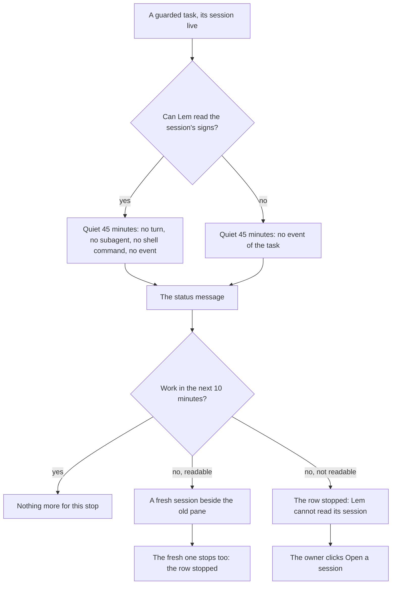

# A quiet task whose session Lem cannot read gets a message, then a row for the owner

careful: yes, because task 1 changes when the board server sends a message to a live session and when it logs a stop of it, so a wrong step puts a second agent on the task's state and branch, and that reaches the topic "A task's record is lost or wrong: its state, its decisions and its approved criteria".

## Acceptance criteria

Size: full, because the guard's rule for a session it cannot read changes in the step and in the act, "Waits for you" gets a new reason for a row, and a wrong step can put two agents on one task.

1. A guarded task whose live session Lem cannot read gets the status message after 45 minutes with no event of the task:
   1. merge-leaves-board-lock is in `landing`, and its newest event is `gate.end` at 10:54 UTC.
   2. Its session is live, and `lem session list` gives `"signs": false` for it.
   3. At 11:39 the board's server sends `lem: merge-leaves-board-lock status` to that session.
2. When 10 more minutes pass with no event of the task, "Waits for you" shows the task as stopped, says that Lem cannot read its session, and offers "Open a session", and Lem opens no second session by itself:
   1. The message of criterion 1 went out at 11:39.
   2. At 11:49 the task still has no new event.
   3. "Waits for you" shows merge-leaves-board-lock as stopped because Lem cannot read its session, with "Open a session".
   4. No fresh session of the task opens until the owner clicks.
3. An event of the task's own work ends the wait and removes the row, and the guard's own message is no such event: a state block that merge-leaves-board-lock writes at 11:42 stops the row of 11:49 from coming, and the 45 minutes count again from 11:42.
4. A session that Lem can read keeps the guard of today: the message after 45 minutes with no sign of work, a fresh session beside it 10 minutes later, and the "stopped" row when the fresh one stops too.

## How it works

The guard looks at a task in `building`, `ready` or `landing` whose session lives, with an agent in its pane. What it does after the status message depends on whether Lem can read the session's own signs of work (its newest turn, a shell command that runs).

Today the "no" branch of the first question ends at once: the guard does nothing, and no row shows.

## Tasks

1. **The guard's step and act for a session Lem cannot read.** Serves criteria 1, 2 (its step 4: no fresh session by itself), 3 and 4.
   - `lem_board_model.stop_due`: a session whose `signs` is not true is no longer skipped. Its clock is the newest of the task's newest work event (`work_event`) and its newest `session.open`; the `sign` field is not used for it, also when it holds a time (Decision 3). After QUIET_MS the step is `status`, as for a readable session. ANSWER_MS after the status wake, with no work event since, the step is `stopped`, never `restart`, and only while no `session.stopped` came after that wake. A readable session keeps every step of today, word for word in the code paths it takes.
   - `session.py:guard_refusal`: signs that do not read no longer refuse the steps `status` and `stopped`; the rule over the new facts decides them. For `restart`, signs that do not read refuse with `unread` unless the task's stop stands (`stop_stands`), which is the owner's "Open a session": an automatic restart beside a session Lem cannot read never acts. The words of `REFUSALS["unread"]` say that.
   - `session.py:cmd_stopped`: the `session.stopped` event it logs carries `unread: true` when the signs it read in the task's lock do not read (Decision 1), and its `say` names that reason.
   - `serve.py`: the `duties` docstring and `NOT_OPENED["unread"]` say the new rule; `duties` itself needs no change, since it follows `stop_due`.
   - Tests, unit level: `tests/unit/test_board_model.py` `StoppedSession` (the #37 case with `signs=False` at 11:39 and 11:49; a state block at 11:42; a `sign` beside unread signs that does not move the clock; the investigator's test `test_a_quiet_task_whose_signs_do_not_read_is_woken_or_shown` stays; the assertion `self.assertIsNone(self.due(*self.landing(), at="15:37", signs=False))` of `test_a_shell_command_that_runs_is_work_and_signs_that_do_not_read_are_no_evidence` goes, with the test's name, since it asserts the rule this task ends), `tests/unit/test_session.py` `Guard` (the `unread` case of `test_a_task_out_of_its_phase_a_gone_or_other_session_and_signs_that_do_not_read`; `cmd_stopped` with unread signs logs `unread: true`; the owner's open of an unread stop acts), `tests/unit/test_serve.py` `StoppedSession` (the duties `wake … status`, then `stopped … stopped` and no `open … stopped`, for unread signs). Every existing test of a readable session stays as it is: that is criterion 4.
   - Files: `skills/lem/scripts/lem_board_model.py`, `skills/lem/scripts/session.py`, `skills/lem/scripts/serve.py`, `tests/unit/test_board_model.py`, `tests/unit/test_session.py`, `tests/unit/test_serve.py`.
2. **The row and every text of a stop that Lem cannot read.** Serves criterion 2. Builds on task 1's `unread` field of `session.stopped`.
   - `lem_board_model.waits_of` gives the row `stopped` an `unread` flag from the standing stop. `wait_say` for it: the verb `Its session stopped, and Lem cannot read it: open a fresh one` (Decision 2), and a `where` that says Lem cannot read whether the session works, sent the status message, saw no event of the task in the 10 minutes after it, and opens no second session by itself. The readable row keeps its words.
   - The timeline's words of `session.stopped` (`lem_board_model`, the `"session.stopped"` entry) for an unread stop: the readable text says "nor in the fresh session", which is false there.
   - `lem_inbox.message_of`, the `stopped` note: its body says "and so did the fresh one that took its place", which is false for an unread stop.
   - `lem_board_task.py`, the Inbox line of a stopped task, and `project.py`'s `waiting` list of `stopped`: read each, and say the reason only where the text is false for an unread stop.
   - Tests, unit level: `tests/unit/test_board_model.py` `StoppedRow` (the #37 unread stop is the row `stopped:gift-note`, the slug the tests give #37, with the new verb and "Open a session" through `opens_session`; a work event after it removes it), `tests/unit/test_inbox.py` (the note's body of an unread stop).
   - Files: `skills/lem/scripts/lem_board_model.py`, `skills/lem/scripts/lem_inbox.py`, `skills/lem/scripts/lem_board_task.py`, `skills/lem/scripts/project.py`, `tests/unit/test_board_model.py`, `tests/unit/test_inbox.py`.
3. **The documents the change makes false.** Serves no criterion.
   - `skills/lem/SKILL.md`, "One session for each task", the paragraph of the board's server: it says the guard acts on a session "whose live session shows no sign of work", with a restart for every stop; add what it does when it cannot read the signs. Its paragraph "The board" on the row "stopped" too.
   - `skills/lem/prompts/session.md`, "A wake-up": "When this session shows no sign of work in the 10 minutes after the line, Lem opens a fresh one beside it" is false for a session Lem cannot read, where the owner gets the row.
   - `skills/lem/stages/status.md`, item 3, `stopped`: the row also comes for a session Lem cannot read, after the message alone.
   - `docs/board.md`, near "opens a fresh session one time. When that session also stops, the task waits for you as \"stopped\"": the same, in STE. `site/index.html` says nothing of the guard today (`grep -n "stopped\|no sign" site/index.html` found nothing), so it stays.
   - The module docstring of `session.py` (the paragraph "The guard of a stopped session") is task 1's, since task 1 changes that file.
   - Files: `skills/lem/SKILL.md`, `skills/lem/prompts/session.md`, `skills/lem/stages/status.md`, `docs/board.md`.

Tasks 1 and 2 share `lem_board_model.py` and its test file, so they run one after the other. Task 3 shares no file with task 1 and runs beside it.

## Decisions

1. **The stop of a session Lem cannot read is a logged `session.stopped` with `unread: true`, not a row read from the events at each look.** Assumes: one record of a stop serves the row, the button, the Inbox and the timeline as it does for a readable stop. Rests on: `stop_stands`, `stopped_of`, `opens_session`, `serve.act_session` and `lem_inbox` all read `session.stopped` today, and `cmd_stopped` already looks once more in the task's lock before it logs. A row read at each look would need a second path through each of them.
2. **The row keeps its kind `stopped` and says the reason in its verb.** Assumes: the owner reads the verb first. Rests on: criterion 2 says "shows the task as stopped, says that Lem cannot read its session"; `answered_in_session`, `opens_session` and the Inbox read the kind, so a new kind would need each of them changed.
3. **The clock of a session Lem cannot read is the task's events and its newest `session.open`, and a `sign` read beside unreadable signs is not used.** Assumes: a turn's time with no live process to back it is no proof that the turn runs now. Rests on: criteria 1 and 3 count "no event of the task"; `lem_signs.read_signs` returns a `sign` with `signs: False` when the process table does not read. A status message to a session that works costs nothing: the mail waits until its turn ends (`prompts/session.md`, "A wake-up").
4. **An automatic restart never acts beside a session Lem cannot read; the owner's "Open a session" on its stop does.** Rests on: the owner's answer "A message, then a row for you" (`interview-notes.md`), and criterion 2, step 4.
5. **The assertion of the dead-tasks-woken-or-shown lead's Decision 6 goes.** That decision ("signs that do not read are no evidence, and Lem acts on nothing") is what the owner's request turns over; its assertion is replaced by tests of the new rule, so the number of assertions does not go down and the bar stays.

## What it will not verify

- A real session whose signs do not read, in agterm, with the real board server: the tests feed the guard the facts of #37 (`signs: false`, live, an agent in the pane), since #37's session is closed and no session of today reads that way (`investigation.md`, "Reach").
- The Inbox send itself: `lem_inbox`'s body is a unit case; the send to Plannotator is not run.
