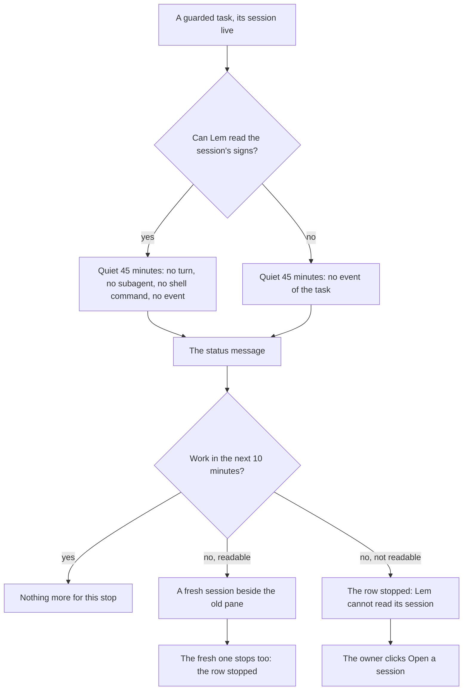

# A quiet task whose session Lem cannot read gets a message, then a row for the owner

careful: yes, because task 1 changes when the board server sends a message to a live session and when it logs a stop of it, so a wrong step puts a second agent on the task's state and branch, and that reaches the topic "A task's record is lost or wrong: its state, its decisions and its approved criteria".

## Acceptance criteria

Size: full, because the guard's rule for a session it cannot read changes in the step and in the act, "Waits for you" gets a new reason for a row, and a wrong step can put two agents on one task.

1. A guarded task whose live session Lem cannot read gets the status message after 45 minutes with no event of the task:
   1. merge-leaves-board-lock is in `landing`, and its newest event is `gate.end` at 10:54 UTC.
   2. Its session is live, and `lem session list` gives `"signs": false` for it.
   3. At 11:39 the board's server sends `lem: merge-leaves-board-lock status` to that session.
   - test: `python3 -B -m unittest tests.unit.test_board_model.StoppedSession.test_criterion_1_signs_that_do_not_read_get_the_message_45_minutes_after_the_newest_event tests.unit.test_board_model.StoppedSession.test_a_quiet_task_whose_signs_do_not_read_is_woken_or_shown` in `tests/unit/test_board_model.py`
   - test: `python3 -B -m unittest tests.unit.test_serve.StoppedSession.test_a_session_whose_signs_do_not_read_gets_the_message_then_its_stop_and_never_a_restart` in `tests/unit/test_serve.py`
   - test: `python3 -B -m unittest tests.unit.test_session.Guard.test_the_status_message_and_the_stop_of_a_session_lem_cannot_read_say_so_on_their_records` in `tests/unit/test_session.py`
2. When 10 more minutes pass with no event of the task, "Waits for you" shows the task as stopped, says that Lem cannot read its session, and offers "Open a session", and Lem opens no second session by itself:
   1. The message of criterion 1 went out at 11:39.
   2. At 11:49 the task still has no new event.
   3. "Waits for you" shows merge-leaves-board-lock as stopped because Lem cannot read its session, with "Open a session".
   4. No fresh session of the task opens until the owner clicks.
   - test: `python3 -B -m unittest tests.unit.test_board_model.StoppedSession.test_criterion_2_ten_minutes_after_the_message_signs_that_do_not_read_give_the_stop_never_a_restart tests.unit.test_board_model.StoppedRow.test_criterion_2_an_unread_stop_is_the_row_stopped_that_says_lem_cannot_read_the_session tests.unit.test_board_model.StoppedRow.test_the_timeline_says_an_unread_wake_and_stop_in_words_of_their_own tests.unit.test_board_model.StoppedRow.test_lem_project_waiting_says_that_lem_cannot_read_the_stopped_session` in `tests/unit/test_board_model.py`
   - test: `python3 -B -m unittest tests.unit.test_session.Guard.test_the_owners_open_of_an_unread_stop_acts_and_a_named_restart_over_a_standing_stop_never_does` in `tests/unit/test_session.py`
   - test: `python3 -B -m unittest tests.unit.test_inbox.ReviewTwo.test_the_note_of_a_stop_lem_cannot_read_says_so_and_names_no_fresh_session_that_took_its_place` in `tests/unit/test_inbox.py`
3. An event of the task's own work ends the wait and removes the row, and the guard's own message is no such event: a state block that merge-leaves-board-lock writes at 11:42 stops the row of 11:49 from coming, and the 45 minutes count again from 11:42.
   - test: `python3 -B -m unittest tests.unit.test_board_model.StoppedSession.test_criterion_3_a_work_event_ends_the_wait_and_the_guards_own_message_is_none tests.unit.test_board_model.StoppedRow.test_the_timeline_says_that_a_stop_over_new_work_leaves_nothing_waiting` in `tests/unit/test_board_model.py`
   - test: `python3 -B -m unittest tests.unit.test_session.Guard.test_a_stop_logged_after_a_state_block_of_the_same_moment_says_that_nothing_waits` in `tests/unit/test_session.py`
4. A session that Lem can read keeps the guard of today: the message after 45 minutes with no sign of work, a fresh session beside it 10 minutes later, and the "stopped" row when the fresh one stops too.
   - no test: the change keeps behavior; the suite holds it

## How it works

The guard looks at a task in `building`, `ready` or `landing` whose session lives, with an agent in its pane. What it does after the status message depends on whether Lem can read the session's own signs of work (its newest turn, a shell command that runs).

Today the "no" branch of the first question ends at once: the guard does nothing, and no row shows.

## Tasks

1. **The guard's step and act for a session Lem cannot read.** Serves criteria 1, 2 (its step 4: no fresh session by itself), 3 and 4.
   - `lem_board_model.stop_due`: while the task's stop stands (`stop_stands`), the step `restart` is not due, in either path: a logged stop waits for the owner's "Open a session". An unread stop comes before any restart, so without this a look at 11:50 that reads the signs again would give `restart` beside the row (the talk's question 1). The steps `status` and `stopped` stay as today: a readable stop at 12:47 and a turn at 13:00 still give `status` at 13:45, which criterion 4 keeps (decision 8 of the task, by the gate).
   - `lem_board_model.stop_stands`: a stop stands only while no work event came after the newest status wake before it (`session.wake why=status`), and no `session.open` after the stop. Today it looks only after the stop, so a state block that the session appends under `state.lock` between `guard_check`'s read of the log and `cmd_stopped`'s append leaves a stop over new work (the talk's question 2). The order of the log, which `append_event` writes under the log's lock, then decides, and criterion 3 holds at that edge too. A readable stop is logged only when no work came after its wake, so today's readable rows keep their rule.
   - `lem_board_model.stop_due`: a session whose `signs` is not true is no longer skipped. Its clock is the newest of the task's newest work event (`work_event`) and its newest `session.open`; the `sign` field is not used for it, also when it holds a time (Decision 3). After QUIET_MS the step is `status`, as for a readable session. ANSWER_MS after the status wake, with no work event since, the step is `stopped`, never `restart`, and only while no `session.stopped` came after that wake. A readable session keeps every step of today, word for word in the code paths it takes.
   - `session.py:guard_refusal`: signs that do not read no longer refuse the steps `status` and `stopped`; the rule over the new facts decides them. For `restart`, signs that do not read refuse with `unread` unless the task's stop stands (`stop_stands`), which is the owner's "Open a session": an automatic restart beside a session Lem cannot read never acts. A standing stop lets a `restart` act only when no session is named: the owner's click from the board names none (`serve.act_session`), and the server's duty always names one (`serve.duty_args` for the why `stopped`), so a duty over a standing stop refuses in both paths (the talk's question 1). The words of `REFUSALS["unread"]` say that.
   - `session.py:guard_check`: the look in the lock gives `agent` as `agent_runs(node) is True`, as `cmd_list` gives it, and no longer the value of `live`. `live` is also true for a pane that agterm has not drawn (`realized: false`, no foreground). Today the signs' live process stood in for the agent, but an unread step has no such process (the talk's question 3).
   - `session.py:cmd_stopped`: the `session.stopped` event it logs carries `unread: true` when the signs it read in the task's lock do not read (Decision 1), and its `say` names that reason. After its append it reads the log once more: when work came before the stop, so that the stop does not stand (`stop_stands`), its `say` tells that and that nothing waits for the owner (decision 9 of the task, by the gate).
   - `session.py:cmd_wake`: the `session.wake why=status` it logs carries `unread: true` when the signs it read in the task's lock do not read, as the stop does, so that Activity can tell which clock sent it (decision 10 of the task, by the gate).
   - `serve.py`: the `duties` docstring and `NOT_OPENED["unread"]` say the new rule; `duties` itself needs no change, since it follows `stop_due`.
   - Tests, unit level: `tests/unit/test_board_model.py` `StoppedSession` (the #37 case with `signs=False` at 11:39 and 11:49; a state block at 11:42; at 11:50, after the unread stop, signs that read again give no `restart`, and `serve.duties` gives no `open … stopped`; a readable stop at 12:47 and a turn at 13:00 still give `status` at 13:45; a state block logged after 11:49 but before the stop's record shows no row and gives `status` 45 minutes after that block; a `sign` beside unread signs that does not move the clock; the investigator's test `test_a_quiet_task_whose_signs_do_not_read_is_woken_or_shown` stays; the assertion `self.assertIsNone(self.due(*self.landing(), at="15:37", signs=False))` of `test_a_shell_command_that_runs_is_work_and_signs_that_do_not_read_are_no_evidence` goes, with the test's name, since it asserts the rule this task ends), `tests/unit/test_session.py` `Guard` (the `unread` case of `test_a_task_out_of_its_phase_a_gone_or_other_session_and_signs_that_do_not_read`; `cmd_stopped` with unread signs logs `unread: true`; the owner's open of an unread stop acts, and a `restart` that names a session over a standing stop refuses; a pane with `realized: false` refuses `gone` for each step; the status wake with unread signs logs `unread: true`; `cmd_stopped` over a state block that came first says that nothing waits), `tests/unit/test_serve.py` `StoppedSession` (the duties `wake … status`, then `stopped … stopped` and no `open … stopped`, for unread signs). Every existing test of a readable session stays as it is: that is criterion 4.
   - Files: `skills/lem/scripts/lem_board_model.py`, `skills/lem/scripts/session.py`, `skills/lem/scripts/serve.py`, `tests/unit/test_board_model.py`, `tests/unit/test_session.py`, `tests/unit/test_serve.py`.
2. **The row and every text of a stop that Lem cannot read.** Serves criterion 2. Builds on task 1's `unread` field of `session.stopped`.
   - `lem_board_model.waits_of` gives the row `stopped` an `unread` flag from the standing stop. `wait_say` for it: the verb `Its session stopped, and Lem cannot read it: open a fresh one` (Decision 2), and a `where` that says Lem cannot read whether the session works, sent the status message, saw no event of the task in the 10 minutes after it, and opens no second session by itself. The readable row keeps its words.
   - The timeline's words of `session.stopped` (`lem_board_model`, the `"session.stopped"` entry) for an unread stop: the readable text says "nor in the fresh session", which is false there.
   - The timeline's words of `session.wake why=status` (the `"session.wake"` entry): "no sign of work for 45 minutes" is false when Lem sent the message from the task's events alone and a turn that it did not use was newer (Decision 3). A wake with `unread: true` gets words of its own: no event of the task for 45 minutes, and Lem cannot read its session. A readable wake keeps today's words, which its test asserts (the talk's question 4, decision 10 of the task, by the gate).
   - The timeline's words of a `session.stopped` that does not stand, since work came after its status wake (`describe`, which has the model, unlike `SAYS`): work came before the stop, and nothing waits (the talk's question 2, decision 9 of the task, by the gate).
   - `lem_inbox.message_of`, the `stopped` note: its body says "and so did the fresh one that took its place", which is false for an unread stop.
   - `lem_board_task.py`, the Inbox line of a stopped task, and `project.py`'s `waiting` list of `stopped`: read each, and say the reason only where the text is false for an unread stop.
   - Tests, unit level: `tests/unit/test_board_model.py` `StoppedRow` (the #37 unread stop is the row `stopped:gift-note`, the slug the tests give #37, with the new verb and "Open a session" through `opens_session`; a work event after it removes it; the unread wake's words and the readable wake's words of today; a stop that a state block came before says that nothing waits), `tests/unit/test_inbox.py` (the note's body of an unread stop).
   - Files: `skills/lem/scripts/lem_board_model.py`, `skills/lem/scripts/lem_inbox.py`, `skills/lem/scripts/lem_board_task.py`, `skills/lem/scripts/project.py`, `tests/unit/test_board_model.py`, `tests/unit/test_inbox.py`.
3. **The documents the change makes false.** Serves no criterion.
   - `skills/lem/SKILL.md`, "One session for each task", the paragraph of the board's server: it says the guard acts on a session "whose live session shows no sign of work", with a restart for every stop; add what it does when it cannot read the signs. Its paragraph "The board" on the row "stopped" too.
   - `skills/lem/prompts/session.md`, "A wake-up": "When this session shows no sign of work in the 10 minutes after the line, Lem opens a fresh one beside it" is false for a session Lem cannot read, where the owner gets the row. The `status` sentence before it ("this session showed no sign of work for 45 minutes (no event of the task, no turn, ...)") is false there too: for a session Lem cannot read, the message comes after 45 minutes with no event of the task (the talk's question 4).
   - `skills/lem/stages/status.md`, item 3, `stopped`: the row also comes for a session Lem cannot read, after the message alone.
   - `docs/board.md`, near "opens a fresh session one time. When that session also stops, the task waits for you as \"stopped\"": the same, in STE. `site/index.html` says nothing of the guard today (`grep -n "stopped\|no sign" site/index.html` found nothing), so it stays.
   - The module docstring of `session.py` (the paragraph "The guard of a stopped session") is task 1's, since task 1 changes that file.
   - Files: `skills/lem/SKILL.md`, `skills/lem/prompts/session.md`, `skills/lem/stages/status.md`, `docs/board.md`.

Tasks 1 and 2 share `lem_board_model.py` and its test file, so they run one after the other. Task 3 shares no file with task 1 and runs beside it.

## Decisions

1. **The stop of a session Lem cannot read is a logged `session.stopped` with `unread: true`, not a row read from the events at each look.** Assumes: one record of a stop serves the row, the button, the Inbox and the timeline as it does for a readable stop. Rests on: `stop_stands`, `stopped_of`, `opens_session`, `serve.act_session` and `lem_inbox` all read `session.stopped` today, and `cmd_stopped` already looks once more in the task's lock before it logs. A row read at each look would need a second path through each of them.
2. **The row keeps its kind `stopped` and says the reason in its verb.** Assumes: the owner reads the verb first. Rests on: criterion 2 says "shows the task as stopped, says that Lem cannot read its session"; `answered_in_session`, `opens_session` and the Inbox read the kind, so a new kind would need each of them changed.
3. **The clock of a session Lem cannot read is the task's events and its newest `session.open`, and a `sign` read beside unreadable signs is not used.** Assumes: a turn's time with no live process to back it is no proof that the turn runs now. Rests on: criteria 1 and 3 count "no event of the task"; `lem_signs.read_signs` returns a `sign` with `signs: False` when the process table does not read. A status message to a session that works costs nothing: the mail waits until its turn ends (`prompts/session.md`, "A wake-up").
4. **An automatic restart never acts beside a session Lem cannot read; the owner's "Open a session" on its stop does.** While a logged stop stands, no restart is due, and a restart over it acts only when it names no session (decision 8 of the task, by the gate). Rests on: the owner's answer "A message, then a row for you" (`interview-notes.md`), and criterion 2, step 4.
5. **The assertion of the dead-tasks-woken-or-shown lead's Decision 6 goes.** That decision ("signs that do not read are no evidence, and Lem acts on nothing") is what the owner's request turns over; its assertion is replaced by tests of the new rule, so the number of assertions does not go down and the bar stays.

## What it will not verify

- A real session whose signs do not read, in agterm, with the real board server: the tests feed the guard the facts of #37 (`signs: false`, live, an agent in the pane), since #37's session is closed and no session of today reads that way (`investigation.md`, "Reach").
- The Inbox send itself: `lem_inbox`'s body is a unit case; the send to Plannotator is not run.

## Plan talk

Who argued the plan: the reviewer, Codex with GPT 6.2 Sol at high effort (its pane's status line); the defender, Claude Code with Opus 5.5 at high effort (the `defender:` line of the task's state). Two families. Five turns: the request, the list, the repairs, the answers, the close.

The list, as the reviewer gave it:

1. **A logged stop does not make the owner's click needed in both paths.** After an unread stop at 11:49, a look at 11:50 whose signs read again gave `restart` from `stop_due`'s readable branch, and `guard_refusal` let a restart act over a standing stop whether or not the server named a session (`lem_board_model.stop_due`, `session.guard_refusal`, `serve.duty_args`, `serve.act_session`). Repaired in task 1: no step while a stop stands, and a restart over a standing stop acts only when it names no session. The reviewer: holds, layer over Decision 4. The hold on every step also stops today's readable status message after a stop with a newer turn (a readable stop at 12:47, a turn at 13:00, `status` at 13:45 today), which criterion 4 keeps; the refusal of a named restart alone closes the command path. No refutation: **a design choice**. Kept: the hold on every step while a stop stands, with the refusal of a named restart (Decision 4, criterion 2 step 4). Against it: only the refusal of a named restart, and `stop_due` as today (criterion 4, `stop_stands`, which reads no sign). `stages/plan.md`, step 5: decision 8 of the task, by the gate (checkable by criteria 4 and 2.4): a third option, no `restart` step while a stop stands, the other steps as today, with the refusal of a named restart.
2. **An unread stop can be logged over new work.** `guard_check` reads the log before agterm and the process table, and a state block appended under `state.lock` before `cmd_stopped`'s append left a standing stop, since `stop_stands` looked only after the stop (`session.guard_check`, `session.cmd_stopped`, `lem_board_model.stop_stands`). Repaired in task 1: a stop stands only while no work event came after the status wake before it. The reviewer: holds, layer over Decision 1. The row and the clock follow, but `cmd_stopped`'s `say` and the Activity entry of `session.stopped` (`SAYS` gets the record alone) still tell of a stop that does not stand. No refutation: **a design choice**. Kept: the new reading of `stop_stands`, with today's words of the stop. Against it: words that know a stop which does not stand. It is also about what the owner reads in Activity. `stages/plan.md`, step 5: decision 9 of the task, by the gate (checkable by the choice "Lem is a companion, not a gate", which owns the truth of Lem's words): the words that know such a stop, in task 1 (`cmd_stopped`) and task 2 (`describe`).
3. **The lock's look does not check for an agent in the pane.** `guard_check` gave `agent` the value of `live`, which is true for a pane agterm has not drawn (`session.agent_runs`, `session.live`, `session.guard_check`). Repaired in task 1: `agent` is `agent_runs(node) is True`, as `cmd_list` gives it. The reviewer: closed. Settled, cite `session.cmd_list` and `lem_board_model.stop_due`, which already require `agent` true; settled by the two, not checked by the review.
4. **The Activity words of the status message are false for a wake from the events alone.** With a turn at 11:30 and a failed process-table read, the message goes out from the 10:54 event (Decision 3), and the `session.wake` text says "no sign of work for 45 minutes" (`lem_board_model.SAYS`, `lem_signs.read_signs`, `prompts/session.md`). Repaired in tasks 2 and 3: one text for both paths, and the session brief's `status` sentence. The reviewer: the brief's sentence holds, but `read_signs` returns that turn's time, so "no work that Lem could read" is false too, and the shared text changes the phrase that `StoppedRow.test_the_timeline_says_each_act_of_the_guard_with_its_time` asserts for a readable wake. No refutation: **a design choice**. Kept: one shared text. Against it: today's readable text, and a text of its own for a wake from the events alone, which needs the wake to carry what the guard read. It is about what the owner reads. `stages/plan.md`, step 5: decision 10 of the task, by the gate (cheap, and the same choice as question 2): today's readable words, and words of its own for a wake with `unread: true`, which `cmd_wake` logs (tasks 1 and 2).

Mechanisms the repairs added: the hold while a stop stands (question 1), a layer over Decision 4, which cites criterion 2, step 4; the talk's hold on every step became a hold on the `restart` step by decision 8. The reading of `stop_stands` from the wake before the stop (question 2) is a layer over Decision 1, which cites existing code, and stays, with the words of decision 9. The `unread` field of the status wake (decision 10) is a field beside Decision 1's field of the stop.

Raised after the first turn and not argued: none. Additions refused as unpriced: none.

What changed in the plan: task 1 got the hold on `restart` and the named restart (question 1, decision 8), the reading of `stop_stands` and the `say` of a stop that does not stand (question 2, decision 9), the agent in the lock's look (question 3), the `unread` field of the status wake (question 4, decision 10), and their tests. Task 2 got the words of the unread wake and of a stop that does not stand (questions 4 and 2). Task 3 got the `status` sentence of `prompts/session.md` (question 4). Decision 4 got its second sentence.

Agreement carries no authority: the review before the pull request reads question 3 as a claim, not a fact.
