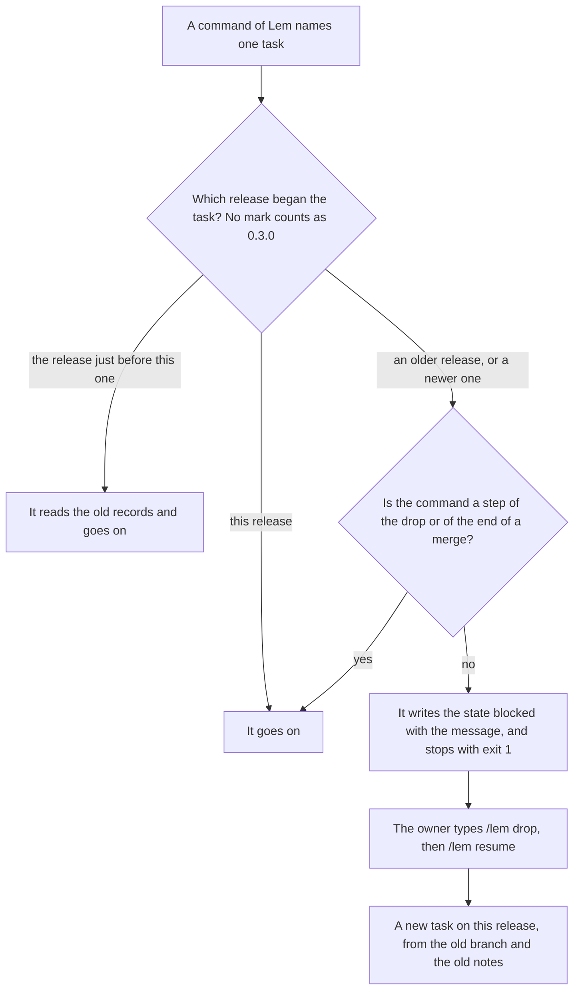

# A user of Lem gets a tested release, and a task that runs meets one newer release at most

careful: yes, because it reaches "Lem as a plugin does not load in a developer's Claude Code" (task 1 changes the source of the `lem` entry of `.claude-plugin/marketplace.json`, which every install and update reads), "Lem changes a developer's repository without his word" (task 2 writes a state block when a command stops), and "A change bends a ruling of the owner" (task 4 changes the words of "No word and no form of a Lem before is kept", on his yes in criterion 5).

## Acceptance criteria

Size: full, because a new install, every release and every task that meets a newer release change, with two of the owner's rulings and the install guide.

1. A new install of Lem, and an update of a project that has Lem, get the newest release, never the head of `main`:
   1. `main` holds `v0.4.0` and, after it, three merged pull requests that no release holds yet.
   2. Ana runs `claude plugin marketplace add pySilver/lem` and installs `lem@lem`; Ben, who has 0.3.0, runs `/plugin marketplace update lem`.
   3. Both get the commit of the tag `v0.4.0`, because the `lem` entry of `.claude-plugin/marketplace.json` names `pySilver/lem` with `"ref": "v0.4.0"`.
2. A release names one number in three places, and the machine checks fail when they differ: `plugin.json` says `"version": "0.4.0"`, and the `lem` entry says `"version": "0.4.0"` and `"ref": "v0.4.0"`; with `"ref": "v0.3.0"` the check fails and names the entry's `ref` and the number it expects.
3. A task begun on the release before the installed one goes on and lands:
   1. Ana's task `invoice-totals` begins on Lem 0.3.0.
   2. Her auto-update installs 0.4.0, which changes the form of a record the task already wrote.
   3. The board server opens the task's landing session on 0.4.0.
   4. 0.4.0 reads the task's 0.3.0 records, and the task lands.
4. A task begun two releases back or more stops at Lem's first command for it, the board shows it as blocked, and the message says that nothing of the work is lost and how to go on: `invoice-totals began on Lem 0.2.0, and Lem 0.4.0 reads only tasks begun on 0.3.0 or 0.4.0. Your branch and its commits stay. /lem drop invoice-totals, then /lem resume invoice-totals, starts a new task on 0.4.0 from that branch and from the notes the task left.` The tasks that run when this release lands count as begun on 0.3.0.
5. `AGENTS.md` says how a release is made: the number in `plugin.json` and in the `lem` entry, the entry's `ref`, the tag on that commit, and one push of the commit and the tag on the owner's word; and that a release reads the records of the release just before it, and no older ones. The owner's ruling "No word and no form of a Lem before is kept" becomes "No word of a Lem before is kept; a release reads the records of the release just before it, and no older ones", and the rule "Lem is not released" of `AGENTS.md` goes.
6. `docs/install.md` and `site/index.html` say that an update brings the newest release; that a running session keeps its Lem until it ends; that each person installs Lem for themself; that auto-update is off at the first install and is each person's choice, which `/plugin` turns on under "Marketplaces"; where a person sees which release they have; what a person sees whose release is older than a teammate's; and that a bad release is repaired forward, by a newer release.

## How it works

Each task keeps the release it began on. Each command of Lem that acts on one task reads that mark first.

## Tasks

1. **The `lem` entry names the release, and a check holds the three places** (criteria 1, 2).
   - `.claude-plugin/marketplace.json`: the `lem` entry gets `"source": {"source": "github", "repo": "pySilver/lem", "ref": "v0.3.0"}` and `"version": "0.3.0"`, the number `plugin.json` has now. Its other fields stay.
   - A unit test, `tests/unit/test_release.py`: a pure function that takes the two manifests as dicts and returns each place that differs, with its message (the entry's `ref` and the number it expects, as criterion 2 says); cases for a match, a wrong `ref`, a wrong entry `version`, an entry with no `ref`, and a source that is not `github` `pySilver/lem`; and one case that reads the two real files of the repository. Where the function lives is the builder's call (a module of `skills/lem/scripts/` when a script needs it, else the test).
   - `tests/lem-machine.sh`, the plugin form check, expects `"./"` as the entry's source today: it expects the new source.
   - **A defect the pin makes, fixed in this task.** `doctor.py:marketplace_lem` and `stable_lem` give two lines that name Lem's marketplace clone, `~/.claude/plugins/marketplaces/lem` (read in `known_marketplaces.json`): the task picker's keymap line (`picker()`) and the line that starts the board server from a terminal with no agent (`board_server()`). After the pin that clone is the head of `main`, not the release, so both lines would run code that no release holds, and the board server merges pull requests. The fix: both lines name the clone's `bin/lem` (`lem picker`, `lem serve --ensure`), and `bin/lem`, when its own folder is a marketplace clone under `~/.claude/plugins/marketplaces/`, runs the `bin/lem` of the newest installed release of `lem` from Claude Code's `installed_plugins.json` instead, with the same arguments. The path of the clone outlives an update, so no keymap line changes at an update. Read the layout of `installed_plugins.json` on this Mac before you write it, and keep the part of `bin/lem` that runs from the clone as small as you can: it is the one part of the head of `main` that runs on a user's machine. The tests of `doctor.py` and of `bin/lem` (`tests/unit/test_doctor.py`, `tests/lem-machine.sh`, `tests/lem-command.sh`) change with it.
   - A probe of criterion 1, only when it leaves nothing behind: with a throwaway `CLAUDE_CONFIG_DIR` (check first that `claude plugin` writes only under it), add a marketplace from a local folder whose `lem` entry names `pySilver/lem` with `"sha"` set to the full commit of `0caa121e`, install `lem@lem`, and see that the installed folder holds that commit's `plugin.json`. No tag exists on GitHub yet (`git ls-remote --tags origin` gave none, 2026-11-23), so the probe pins a commit. Write what it showed in the report, and remove the folder.
   - Files: `.claude-plugin/marketplace.json`, `tests/unit/test_release.py`, `tests/lem-machine.sh`, `bin/lem`, `skills/lem/scripts/doctor.py`, `tests/unit/test_doctor.py`, `tests/lem-command.sh`.

2. **A task keeps the release it began on, and a command for a task two releases back stops** (criteria 3, 4).
   - The mark: `release.txt` in the task directory, one line, the `version` of the running Lem's `plugin.json`. `project.py:cmd_task_dir` writes it when it opens a task (`--ask` or `--ticket`) and the file is not there. A task with no mark counts as begun on 0.3.0 (criterion 4's last sentence).
   - The release before: one constant beside the rule, `BEFORE`, the release just before the version of `plugin.json`. On this branch `plugin.json` says 0.3.0, so `BEFORE` is `0.2.0`. A release moves it (task 4 writes that into the recipe). A check in `tests/lem-machine.sh` holds it, since only git shows it: `BEFORE` is the `version` that `plugin.json` held before its newest change of `version` (`git log -p -- .claude-plugin/plugin.json`). A clone too shallow to show that prints a `SKIP` line of its own.
   - The rule, a pure function: from the mark, the version and `BEFORE`, it returns nothing when the mark is the version or `BEFORE`, and else the message of criterion 4, word for word with the slug and the three numbers. A mark newer than the version gets a message of its own that names `/plugin marketplace update lem`. Unit cases: no mark with the version 0.4.0 and `BEFORE` 0.3.0 goes on; the mark `BEFORE` goes on; the mark 0.2.0 with the version 0.4.0 gives the message of criterion 4 exactly; a newer mark gives the update message.
   - The guard: each `lem` command that acts on one named task runs the rule first: `lem project state` and the other `project.py` commands that take one slug, `lem session` (`open`, `next`, `wake` and the others but `close`), `lem land`, `lem criteria`, `lem decisions`, and the session hooks of `session_hook.py`. These pass, since they end the task: `lem project state SLUG dropped`, `lem project resume`, `lem land merged`, `lem land clean`, `lem session close`, and the tracker's writes at a drop (`lem issue`). Read-only commands over all tasks (`lem project tasks`, `lem project waiting`, `lem session list`, the board) never stop. A command that stops writes the state `blocked` with the message as its line, once (not when the newest block already says it, and not over a parked or ended task, which `cmd_state` refuses), prints the message and exits 1. Find each script's own entry for a task (`project.py:task_directory`, the task classes near `land.py:855`, `criteria.py:419`, `decisions.py:216`, `session_hook.py:139`, and `session.py`'s), and put the call in one shared function, not in each command.
   - Criterion 3's test: the landing journey of `tests/lem-land-shop.sh` writes `BEFORE` into its task's `release.txt` before the landing starts, and its check says that a task begun on the release before lands. One check of an existing run, no second journey.
   - Criterion 4's test: in `tests/lem-decisions.sh`, which runs drop and resume, a task whose `release.txt` says `0.0.1`: `lem criteria approved SLUG` exits 1 with the message, `lem project tasks` shows it `blocked` with the message as its line, and `lem project state SLUG dropped "..."` passes. The resume half is task 3's.
   - Files: `skills/lem/scripts/project.py`, `land.py`, `criteria.py`, `decisions.py`, `session.py`, `session_hook.py`, the module of the rule (the builder's call: in `project.py`, or one small module that the others import), `tests/unit/test_release.py` or the unit file of the module, `tests/lem-machine.sh`, `tests/lem-land-shop.sh`, `tests/lem-decisions.sh`.

3. **`/lem resume` takes a task the release stop blocked** (criterion 4, its way on).
   - Today `project.py:cmd_resume` refuses a dropped task that has no breaker that waits and no `handoff.md` ("there is no talk to go back to"). Criterion 4 says that drop, then resume, starts a new task from the branch and from the notes the task left. So a dropped task whose mark the rule refuses resumes with no breaker and with no `handoff.md`: its new task gets the next free slug as today (`SLUG-2`), its branch from the old tip, the files of `RESUMED_FILES` and `RESUMED_GLOBS` that are there, the events that resume carries over today, `resumed-from.txt`, and its own `release.txt` with this release. Its state is the newest block of the old task before the release stop's `blocked` block, with the line `resumed from SLUG, which began on Lem X` added; its brief's `resumed from:` line names `handoff.md` only when there is one. Every other dropped task keeps today's rule.
   - Its test: the task of task 2's check in `tests/lem-decisions.sh`, dropped, then `lem project resume SLUG`: a new task `SLUG-2` whose `release.txt` holds the version, whose branch holds the old tip, and whose status is the one before the stop. A unit case for the choice of the state block when the rule is a pure function.
   - Files: `skills/lem/scripts/project.py`, `tests/lem-decisions.sh`, the unit file of `cmd_resume`'s rules when it has one.

4. **The documents** (criteria 5, 6; and the texts the change makes false).
   - `AGENTS.md`: a part "A release" that says how one is made: the number in `plugin.json` and in the `lem` entry of `.claude-plugin/marketplace.json`, the entry's `ref` `vNUMBER`, `BEFORE` moved to the release before, the tag `vNUMBER` on that commit, and one push of the commit and the tag (`git push --atomic origin main vNUMBER`, or the form that pushes both at once), on the owner's word; and that a release reads the records of the release just before it, and no older ones. The rule "Lem is not released, so a change keeps no reading of the form before it" goes, and in its place: a change that changes the form of a record, an event or a state also reads the form of the release before (`BEFORE`), with a test that runs one record of that form through the reading code; at the next release that reading may go. The line "`main` of this repository is what every project's next update of the plugin installs" becomes false: it says that a project's update installs the newest release tag, and that a free-hour session still never pushes. The paragraph on `--plugin-dir` stays true; read it.
   - `docs/rulings/rulings.md`: the bullet "No word and no form of a Lem before is kept" takes the words of criterion 5. `docs/rulings/history.md`, "A release is a change of the plugin's `version`": its place, `docs/free-hour.md`, says it still, or the line names the new place (`AGENTS.md`, "A release").
   - `docs/free-hour.md`: each sentence that says `main` is what every project installs at its next update becomes the release tag.
   - `docs/install.md` and `site/index.html`, in the same commit: each item of criterion 6. Check each against Claude Code's own pages (`code.claude.com/docs/en/plugins/loading`, `.../host-marketplace`, `.../discover-plugins`) and against this Mac (`/plugin`, `~/.claude/plugins/known_marketplaces.json`), and write in the guide what a person sees, by its words: where auto-update is turned on, where the release shows (`lem version`, `/plugin`), and what a person whose release is older than a teammate's sees. The settings are shared through git and `.lem/state/` is not, so read what an older Lem does with a key of `.lem/project.toml` it does not know (`project.py`'s refusal of an unknown key) and say that. The "Update" part keeps `/plugin marketplace update lem` (J1).
   - `skills/lem/stages/park.md` ("resume") and `skills/lem/stages/correct.md` ("drop"): a dropped task that the release stop blocked resumes with no breaker.
   - `docs/flow.md`, `docs/when-lem-needs-you.md`, `README.md`: read each for a sentence the change makes false (a blocked task's causes, the install), and correct only those.
   - Files: `AGENTS.md`, `docs/rulings/rulings.md`, `docs/rulings/history.md`, `docs/free-hour.md`, `docs/install.md`, `site/index.html`, `skills/lem/stages/park.md`, `skills/lem/stages/correct.md`, and what the read above finds.

Tasks 2 and 3 touch `project.py`, so 3 starts after 2. Task 1 and task 2 share `tests/lem-machine.sh` and `tests/unit/test_release.py`, so 2 starts after 1. Task 4 comes last.

## Decisions of the plan

- **The mark is a file of the task directory, `release.txt`**, which the task's open writes. It rests on `cmd_task_dir` being the one place that opens a task (`--ask`, `--ticket`, `--night`) and on `cmd_resume` making a resumed one; an event would be lost at `lem project prune`.
- **The release before is one constant, `BEFORE`, which a release moves, and a git check holds it.** The installed folder has no git (`lem version` gives `"commit": null` in `~/.claude/plugins/cache/lem/lem/0.3.0`), so a release cannot find the one before it at run time, and a number cannot say which release came before it (0.1.4, 0.1.5, 0.1.6, then 0.2.0 in `git log -- .claude-plugin/plugin.json`). A release that forgets to move it would stop every task of the release before, which is the harm of criterion 3, so the check is worth its one line.
- **The ending commands pass the guard.** Criterion 4's way on is a drop; a pull request that GitHub merged while its task was two releases back is recorded by `lem land merged` and cleaned by `lem land clean`, never blocked.
- **The pull request keeps 0.3.0 and pins `v0.3.0`; the release of this change is its own commit after the merge.** Criterion 5 makes a release one push of a commit and a tag on the owner's word, so no pull request makes one.
- **The doctor's two lines go through the clone's `bin/lem`.** The other ways cost more: a line that names the installed release's folder changes at each update, and the owner would edit his keymap after each one.

> Before this pull request merges, the tag `v0.3.0` must be on GitHub, on `0caa121e` (`chore(release): Lem 0.3.0`). Without it, every new install and every update after the merge finds no `v0.3.0` and fails. The push of a tag is the owner's step: `git tag v0.3.0 0caa121e` and `git push origin v0.3.0`. A person merges this request, since it is careful.

## What the plan does not verify

- Criterion 1 on GitHub: no suite here reaches GitHub, and no tag exists yet. The unit test holds the form of the entry, and task 1's probe, when it runs, shows that a pinned `github` source installs the commit it names. The first release after the merge shows the rest: `lem version` after `/plugin marketplace update lem` gives the tag's version, with the head of `main` ahead of it.
- A record whose form a release changes: this change changes none but the new mark, and a task with no mark is the 0.3.0 form that the unit cases and the landing journey read. The rule for the next change of a form is task 4's text in `AGENTS.md`.
- The files that resume copies from a task two releases back are read as this release reads them. No form of them changed since 0.2.0; a release that changes one of them comes under the rule of `AGENTS.md` above.
