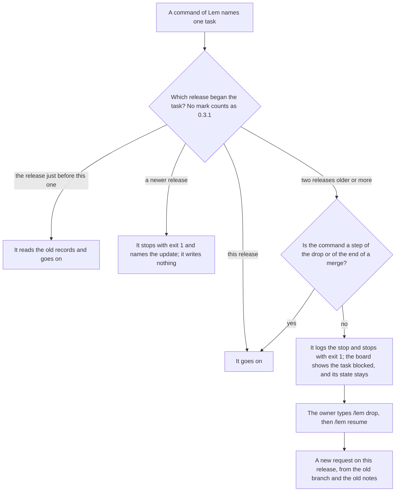

# A user of Lem gets a tested release, and a task that runs meets one newer release at most

careful: yes, because it reaches "Lem as a plugin does not load in a developer's Claude Code" (task 1 changes the source of the `lem` entry of `.claude-plugin/marketplace.json`, which every install and update reads), "Lem changes a developer's repository without his word" (task 2 stops every command of a task two releases back, and the board shows it blocked), and "A change bends a ruling of the owner" (task 4 changes the words of "No word and no form of a Lem before is kept", on his yes in criterion 5).

## Acceptance criteria

Size: full, because a new install, every release and every task that meets a newer release change, with two of the owner's rulings and the install guide.

1. A new install of Lem, and an update of a project that has Lem, get the newest release, never the head of `main`:
   1. `main` holds `v0.4.0` and, after it, three merged pull requests that no release holds yet.
   2. Ana runs `claude plugin marketplace add pySilver/lem` and installs `lem@lem`; Ben, who has 0.3.0, runs `/plugin marketplace update lem`.
   3. Both get the commit of the tag `v0.4.0`, because the `lem` entry of `.claude-plugin/marketplace.json` names `pySilver/lem` with `"ref": "v0.4.0"`.
2. A release names one number in three places, and the machine checks fail when they differ: `plugin.json` says `"version": "0.4.0"`, and the `lem` entry says `"version": "0.4.0"` and `"ref": "v0.4.0"`; with `"ref": "v0.3.0"` the check fails and names the entry's `ref` and the number it expects.
3. A task begun on the release before the installed one goes on and lands:
   1. Ana's task `invoice-totals` begins on Lem 0.3.0.
   2. Her auto-update installs 0.4.0, which changes the form of a record the task already wrote.
   3. The board server opens the task's landing session on 0.4.0.
   4. 0.4.0 reads the task's 0.3.0 records, and the task lands.
4. A task begun two releases back or more stops at Lem's first command for it, the board shows it as blocked, and the message says that nothing of the work is lost and how to go on: `invoice-totals began on Lem 0.2.0, and Lem 0.4.0 reads only tasks begun on 0.3.0 or 0.4.0. Your branch and its commits stay. /lem drop invoice-totals, then /lem resume invoice-totals, starts a new task on 0.4.0 from that branch and from the notes the task left.` The tasks that run when this release lands count as begun on 0.3.1.
5. `AGENTS.md` says how a release is made: the number in `plugin.json` and in the `lem` entry, the entry's `ref`, the tag on that commit, and one push of the commit and the tag on the owner's word; and that a release reads the records of the release just before it, and no older ones. The owner's ruling "No word and no form of a Lem before is kept" becomes "No word of a Lem before is kept; a release reads the records of the release just before it, and no older ones", and the rule "Lem is not released" of `AGENTS.md` goes.
6. `docs/install.md` and `site/index.html` say that an update brings the newest release; that a running session keeps its Lem until it ends; that each person installs Lem for themself; that auto-update is off at the first install and is each person's choice, which `/plugin` turns on under "Marketplaces"; where a person sees which release they have; what a person sees whose release is older than a teammate's; and that a bad release is repaired forward, by a newer release.

## How it works

Each task keeps the release it began on. Each command of Lem that acts on one task reads that mark first.

## Tasks

1. **The `lem` entry names the release, and a check holds the three places** (criteria 1, 2).
   - `.claude-plugin/marketplace.json`: the `lem` entry gets `"source": {"source": "github", "repo": "pySilver/lem", "ref": "v0.3.1"}` and `"version": "0.3.1"`, the number `plugin.json` has now. Its other fields stay.
   - A unit test, `tests/unit/test_release.py`: a pure function that takes the two manifests as dicts and returns each place that differs, with its message (the entry's `ref` and the number it expects, as criterion 2 says); cases for a match, a wrong `ref`, a wrong entry `version`, an entry with no `ref`, and a source that is not `github` `pySilver/lem`; and one case that reads the two real files of the repository. Where the function lives is the builder's call (a module of `skills/lem/scripts/` when a script needs it, else the test).
   - `tests/lem-machine.sh`, the plugin form check, expects `"./"` as the entry's source today: it expects the new source.
   - **A defect the pin makes, fixed in this task.** `doctor.py:marketplace_lem` and `stable_lem` give two lines that name Lem's marketplace clone, `~/.claude/plugins/marketplaces/lem` (read in `known_marketplaces.json`): the task picker's keymap line (`picker()`) and the line that starts the board server from a terminal with no agent (`board_server()`). After the pin that clone is the head of `main`, not the release, so both lines would run code that no release holds, and the board server merges pull requests. The fix: both lines name the clone's `bin/lem` (`lem picker`, `lem serve --ensure`), and `bin/lem`, when its own folder is a marketplace clone under `~/.claude/plugins/marketplaces/`, runs the `bin/lem` of the newest installed release of `lem` from Claude Code's `installed_plugins.json` instead, with the same arguments. The path of the clone outlives an update, so no keymap line changes at an update. The keymap lines that Lem's doctor printed before this change name the clone's `skills/lem/scripts/picker.py` directly (this Mac's `~/.config/agterm/keymap.conf`, line 153), and they stay on each machine that has one: so `picker.py`, when its own folder is a marketplace clone, hands over at its top to the clone's `bin/lem picker` with the same arguments, and the hand-over of `bin/lem` picks the release. No other file of the clone is run by a line Lem printed (`doctor.py:picker` and `board_server` are the two). The row of `doctor.py:picker` counts such an old line as present, says that it has an older form that still works, and prints the line in its current form to put in its place when the person likes (decision 13, the dialectic). Its test of the keymap matches a `command` line that names the clone's `picker.py` or its `bin/lem` by the absolute path or by the same path written with `~/`, as this Mac's line 153 is: today's test (`str(script) in said`) reads that line as missing. Read the layout of `installed_plugins.json` on this Mac before you write it, and keep the part of `bin/lem` that runs from the clone as small as you can: it is the one part of the head of `main` that runs on a user's machine. The tests of `doctor.py` and of `bin/lem` (`tests/unit/test_doctor.py`, `tests/lem-machine.sh`, `tests/lem-command.sh`) change with it.
   - A probe of criterion 1, only when it leaves nothing behind: with a throwaway `CLAUDE_CONFIG_DIR` (check first that `claude plugin` writes only under it), add a marketplace from a local folder whose `lem` entry names `pySilver/lem` with `"sha"` set to the full commit of `0caa121e`, install `lem@lem`, and see that the installed folder holds that commit's `plugin.json`. No tag exists on GitHub yet (`git ls-remote --tags origin` gave none, 2026-11-23), so the probe pins a commit. Write what it showed in the report, and remove the folder.
   - Files: `.claude-plugin/marketplace.json`, `tests/unit/test_release.py`, `tests/lem-machine.sh`, `bin/lem`, `skills/lem/scripts/doctor.py`, `skills/lem/scripts/picker.py`, `tests/unit/test_doctor.py`, `tests/lem-command.sh`, `tests/lem-picker.sh`.

2. **A task keeps the release it began on, and a command for a task two releases back stops** (criteria 3, 4).
   - The mark: `release.txt` in the task directory, one line: the release that the project's sessions load (decision 14, the experts). `project.py:cmd_task_dir` writes it when it opens a task (`--ask` or `--ticket`) and the file is not there: the `version` of the install that `~/.claude/plugins/installed_plugins.json` lists for the project's main checkout (a `"scope": "project"` entry whose `projectPath` is that folder), else of its `"scope": "user"` entry, else the running Lem's own; never newer than the running Lem's own. A task with no mark counts as begun on 0.3.1 (criterion 4's last sentence). The cause: the board server runs the newest Lem of the Mac (`serve.py:outdated`) and opens tasks of every project with its own scripts (`serve.py:act_start`, `lem_run`), while the task's session loads the release installed for that project (`session.py:plugin_dir`; this Mac lists 0.1.6, 0.2.0 and 0.3.0 for its projects, and 0.3.0 for the user), so with the board's own release as the mark, a task the board opens for a project one release behind would stop at its session's first step. `serve.py:act_start` refuses, before `task-dir` writes anything, a project whose install is older than the board's `BEFORE`, with the update message (`/plugin marketplace update lem` in that project), since the board's own acts on such a task would stop at once.
   - The release before: one constant beside the rule, `BEFORE`, the release just before the version of `plugin.json`. On this branch `plugin.json` says 0.3.1, so `BEFORE` is `0.3.0`. A release moves it (task 4 writes that into the recipe). A check in `tests/lem-machine.sh` holds it, since only git shows it: `BEFORE` is the `version` that `plugin.json` held before its newest change of `version` (`git log -p -- .claude-plugin/plugin.json`). A clone too shallow to show that prints a `SKIP` line of its own.
   - The rule, a pure function: from the mark, the running version and `BEFORE`, it returns nothing when the mark is the version or `BEFORE`. A mark older than `BEFORE` returns the message of criterion 4, word for word with the slug and the three numbers, as an *old* stop. A mark newer than the version returns a message of its own that names `/plugin marketplace update lem`, as a *new* stop. Versions are compared as numbers, part by part. Unit cases: no mark with the version 0.4.0 and `BEFORE` 0.3.1 goes on; the mark `BEFORE` goes on; the mark 0.2.0 with the version 0.4.0 gives the message of criterion 4 exactly; the mark 0.5.0 under 0.4.0 gives the update message. A unit case of the mark's choice from an `installed_plugins.json`: the project's own entry, else the user's, else the running version, and never newer than it.
   - The stop writes no state: the task's state stays the one its own work wrote, since every script that ends a task reads it there (`land.py:cmd_merged` takes only `open` or `landing`, and the forge watch of `serve.py:open_prs` takes only `open`). An *old* stop logs one event, `release.stop`, with the task's `began` and `running` versions, the task's branch as `branch`, read from git and from no record (decision 15: the `branch refs/heads/NAME` line of the entry that `git worktree list --porcelain` keeps for the task's worktree path, which stays for a folder removed by hand until a `git worktree prune`, and during a rebase the `head-name` file of the worktree's `rebase-merge/` or `rebase-apply/` folder; `project.py:task_worktree` reads only `git branch --show-current` in a folder that must exist), and the message as `say`, once (not when the task's newest event is a `release.stop` of the same running version); then it prints the message and exits 1. A command of the pass list below, for a task whose mark is older than `BEFORE`, logs the same `release.stop` once and then goes on, so that a drop that is the task's first command on the new release leaves the event that task 3 reads (decision 16, the lead's). A *new* stop logs nothing and writes nothing: its caller is the old one, and the owner's update is the way on. The board model (`lem_board_model.py`) reads the event: a task whose newest `release.stop` is newer than its newest `task.state` is shown blocked, on its card and as a `blocked` row of "Waits for you" with `say` as its line, so `lem project waiting` lists it too (`project.py:cmd_waiting` takes `bm.waits_of`); it is left out of the server's guard of a silent session (`GUARDED`), which would else wake it every 45 minutes into the same stop; and its status for `open_prs` and every other reader stays the status of its state.
   - The guard: each `lem` command that acts on one named task runs the rule first: `lem project state` and the other `project.py` commands that take one slug, `lem session` (`open`, `next`, `wake` and the others but `close`), `lem land`, `lem criteria`, `lem decisions`, and `lem issue` (its rule runs in `issues.py:the_task`, before its first call to GitHub: `cmd_start` adds an assignee before it writes its step). These pass, since they end the task: `lem project state SLUG dropped`, `landed` and `answered` (the three ends of a task; `land.py:forge_done` writes `landed` through a nested `lem project state`, so `lem land merged` needs it: decision 12, the gate), `lem project resume` of a dropped task (resume of a parked task runs the rule first, inside `cmd_resume` once it reads the task parked, so a parked task two releases back stops before it is brought back), `lem land checks SLUG --stop` (the drop of a task in `landing` runs it first, `stages/correct.md`), `lem land merged`, `lem land clean`, `lem session wake` and `lem session open` with `--why merged` (the server's wake after a merge on GitHub, `serve.py:duties`, whose session runs `lem land clean`), `lem session close`, and the tracker's writes at a task's end (`lem issue land`, `drop` and `answer`). The session hooks of `session_hook.py` never stop: a hook cannot refuse, since its wrapper catches every exception and exits 0 so that it never fails the session, and the agent's first `lem` command stops instead. Read-only commands over all tasks (`lem project tasks`, `lem project waiting`, `lem session list`, the board) never stop. Find each script's own entry for a task (`project.py:task_directory`, the task classes near `land.py:855`, `criteria.py:419`, `decisions.py:216`, `issues.py:the_task`, and `session.py`'s), and put the call in one shared function, not in each command.
   - Criterion 3's test: the landing journey of `tests/lem-land-shop.sh` writes `BEFORE` into its task's `release.txt` before the landing starts, and its check says that a task begun on the release before lands. One check of an existing run, no second journey.
   - Criterion 4's test: in `tests/lem-decisions.sh`, which runs drop and resume, a task whose `release.txt` says `0.0.1`: `lem criteria approved SLUG` exits 1 with the message, `lem project waiting` lists it `blocked` with the message as its line, `lem project tasks` still gives its own status, and `lem project state SLUG dropped "..."` passes. A unit case of the board model for the `release.stop` event over a task in `open`: it is shown blocked, it is in `open_prs`, and it is not in `GUARDED`. The resume half is task 3's.
   - Files: `skills/lem/scripts/project.py`, `land.py`, `criteria.py`, `decisions.py`, `session.py`, `serve.py` (`act_start`), `lem_board_model.py`, `skills/lem-github/scripts/issues.py`, the module of the rule (the builder's call: in `project.py`, or one small module that the others import), `tests/unit/test_release.py` or the unit file of the module, the unit file of the board model, `tests/lem-machine.sh`, `tests/lem-land-shop.sh`, `tests/lem-decisions.sh`.

3. **`/lem resume` takes a task the release stop blocked, as a new request** (criterion 4, its way on).
   - Today `project.py:cmd_resume` refuses a dropped task that has no breaker that waits and no `handoff.md` ("there is no talk to go back to"). Criterion 4 says that drop, then resume, starts a new task from the branch and from the notes the task left. So a dropped task that has a `release.stop` event of its own in the log resumes with no breaker and with no `handoff.md`, as a new request: its new task gets the next free slug as today (`SLUG-2`), its branch from the old tip (the branch the newest `release.stop` names, which this release wrote; when it names none, because git had lost the worktree's entry too, the new task starts from the base and the result says which branch it could not find, decision 15), and the notes, the documents an agent reads as text: the Markdown files of `RESUMED_FILES` (`task.md`, `talk.md`, `directions.md`, `interview-notes.md`, `scout.md`, `investigation.md`, `outside.md`, `criteria.md`, `criteria-read.md`, `handoff.md`), the files of `RESUMED_GLOBS` and `media/`, with `ticket.txt` and `ticket-repo.txt` and the ticket's claim as today. It takes no record of the old task: not `criteria.json`, not `decisions.jsonl`, not `brief.md`, no event carried over and no state block. Those are records of a release two back, which this release does not read (criterion 5: "a release reads the records of the release just before it, and no older ones"). This path reads only what this release wrote: the drop's newest block of `state.md`, and the `release.stop` event; never the old task's decisions, which today's path reads for its breaker. It writes `resumed-from.txt` and its own `release.txt`, and it writes no state: its result names the next step, `lem session open SLUG-2 --why new`, the call `serve.py:act_start` makes for a new task. That session takes the shape anew from the ask and the notes (task 4 writes how, in `stages/new.md` and `stages/park.md`): its type, its track, and criteria for the owner's yes, with the old `criteria.md` as their proposal. So the owner approves the criteria once more; the cost falls only on a task that waited across two releases. With no brief written on this path, no `resumed from:` line reaches a lead (`prompts/lead.md`). A dropped task whose events became one summary (`lem project prune`) has no `release.stop` left, and it keeps today's refusal with its "new ask" message. Every other dropped task keeps today's rule.
   - Its test: the task of task 2's check in `tests/lem-decisions.sh`, dropped, then `lem project resume SLUG`: a new task `SLUG-2` whose `release.txt` holds the version, whose branch holds the old tip, which has `task.md` and `handoff.md` and has no `criteria.json`, no `decisions.jsonl` and no state block, and whose result names `lem session open SLUG-2 --why new`. A unit case for the choice of the files when it is a pure function.
   - Files: `skills/lem/scripts/project.py`, `tests/lem-decisions.sh`, the unit file of `cmd_resume`'s rules when it has one.

4. **The documents** (criteria 5, 6; and the texts the change makes false).
   - `AGENTS.md`: a part "A release" that says how one is made: the number in `plugin.json` and in the `lem` entry of `.claude-plugin/marketplace.json`, the entry's `ref` `vNUMBER`, `BEFORE` moved to the release before, the tag `vNUMBER` on that commit, and one push of the commit and the tag (`git push --atomic origin main vNUMBER`, or the form that pushes both at once), on the owner's word; and that a release reads the records of the release just before it, and no older ones. The rule "Lem is not released, so a change keeps no reading of the form before it" goes, and in its place: a change of the form of a record, an event or a state takes two releases. Its release reads the form of the release before (`BEFORE`), and writes a form that the release before still reads: it adds a key beside the old one, and never renames or removes a key the release before reads. The release after it may stop writing the old key, and its reading of the old form may go. The cause is criteria 3 and 6 together: a session of the release before keeps its Lem until it ends, so it reads what the board and the sessions of the new release write for the same task (`serve.py:act_approve` writes `criteria.json` through `lem criteria approve`, then tells the task's live session, `tell_session`). Its test runs one record of the old form through the reading code, and checks that a record the new code writes still holds each key the old reader reads. The line "`main` of this repository is what every project's next update of the plugin installs" becomes false: it says that a project's update installs the newest release tag, and that a free-hour session still never pushes. The paragraph on `--plugin-dir` stays true; read it.
   - `docs/rulings/rulings.md`: the bullet "No word and no form of a Lem before is kept" takes the words of criterion 5. `docs/rulings/history.md`, "A release is a change of the plugin's `version`": its place, `docs/free-hour.md`, says it still, or the line names the new place (`AGENTS.md`, "A release").
   - `docs/free-hour.md`: each sentence that says `main` is what every project installs at its next update becomes the release tag.
   - `docs/install.md` and `site/index.html`, in the same commit: each item of criterion 6. Check each against Claude Code's own pages (`code.claude.com/docs/en/plugins/loading`, `.../host-marketplace`, `.../discover-plugins`) and against this Mac (`/plugin`, `~/.claude/plugins/known_marketplaces.json`), and write in the guide what a person sees, by its words: where auto-update is turned on, where the release shows (`lem version`, `/plugin`), and what a person whose release is older than a teammate's sees. The settings are shared through git and `.lem/state/` is not, so read what an older Lem does with a key of `.lem/project.toml` it does not know (`project.py`'s refusal of an unknown key) and say that. The "Update" part keeps `/plugin marketplace update lem` (J1).
   - `skills/lem/stages/park.md` ("resume"): a dropped task that the release stop blocked resumes with no breaker, as a new request, and the step after it is the `lem session open SLUG-2 --why new` its result names; a parked task two releases back stops at its resume. `skills/lem/stages/correct.md` ("drop"): a task the release stop blocked drops at any status, `open` too, and the line that says it is dropped names its pull request, which stays open on GitHub for the owner to close. `skills/lem/stages/new.md` ("The request"): a task directory with `resumed-from.txt` and no state holds the notes of the task it came from; the session reads them before its first question, asks only what they do not answer, and puts the old `criteria.md` to the owner as the proposal of the criteria.
   - `README.md`: a short part for a person who develops Lem, on the owner's word in the build (decision 18: "We need to save a note (in README.md?) for those who want to develop the plugin - how things should work here to avoid breaking public release."). It says how things work here so that the public release does not break: a clone loads with `claude --plugin-dir`; a merge to `main` reaches no user, since users get the newest release tag; a release is the one commit of `AGENTS.md`, "A release", on the owner's word; a change of a record's form takes two releases; the owner's Mac takes each release first; a bad release is repaired forward. It links `AGENTS.md` for the steps and copies none of them. `site/index.html` says the same only where the page already holds the README's part on install or update.
   - `docs/flow.md`, `docs/when-lem-needs-you.md`, `README.md`: read each for a sentence the change makes false (a blocked task's causes, the install), and correct only those.
   - Files: `AGENTS.md`, `README.md`, `docs/rulings/rulings.md`, `docs/rulings/history.md`, `docs/free-hour.md`, `docs/install.md`, `site/index.html`, `skills/lem/stages/park.md`, `skills/lem/stages/correct.md`, `skills/lem/stages/new.md`, and what the read above finds.

Tasks 2 and 3 touch `project.py`, so 3 starts after 2. Task 1 and task 2 share `tests/lem-machine.sh` and `tests/unit/test_release.py`, so 2 starts after 1. Task 4 comes last.

## Decisions of the plan

- **The mark is a file of the task directory, `release.txt`: the release the project's sessions load**, which the task's open writes. It rests on `cmd_task_dir` being the one place that opens a task (`--ask`, `--ticket`, `--night`) and on `cmd_resume` making a resumed one; an event would be lost at `lem project prune`.
- **The release before is one constant, `BEFORE`, which a release moves, and a git check holds it.** The installed folder has no git (`lem version` gives `"commit": null` in `~/.claude/plugins/cache/lem/lem/0.3.0`), so a release cannot find the one before it at run time, and a number cannot say which release came before it (0.1.4, 0.1.5, 0.1.6, then 0.2.0 in `git log -- .claude-plugin/plugin.json`). A release that forgets to move it would stop every task of the release before, which is the harm of criterion 3, so the check is worth its one line.
- **A release works on the tasks of its own release and of the release before it, and the board marks a task with the release its project's sessions load** (decision 14, settled by the experts; it replaced the window of the release after, which the talk's repair of question 1 made). One board server serves every project of the Mac with the newest Lem, and each project's sessions load the release installed for it, so the open of a task takes the project's release from Claude Code's list of installs. It keeps every Lem that acts on one task within two adjacent releases, which the form rule of task 4 covers and criterion 4's message says.
- **The stop writes no state; it logs `release.stop`, and the board shows the task blocked from it.** The state stays the one the task's work wrote, which every script that ends a task reads (`land.py:cmd_merged`, `serve.py:open_prs`, `project.py:cmd_resume`). Only a stop for an older task logs; a stop for a newer task writes nothing, since the caller is the old one.
- **The ending commands pass the guard.** Criterion 4's way on is a drop; a pull request that GitHub merged while its task was two releases back is recorded by `lem land merged`, its session is woken or opened `--why merged`, and it is cleaned by `lem land clean`, never blocked.
- **A task two releases back resumes as a new request from its notes, and no record of it is read.** Criterion 4 names "that branch" and "the notes the task left"; criterion 5 says no release reads records older than the release before. The cost is one more approval of the criteria by the owner, in a task that waited across two releases.
- **The pull request keeps 0.3.1 and pins `v0.3.1`; the release of this change is its own commit after the merge.** Criterion 5 makes a release one push of a commit and a tag on the owner's word, so no pull request makes one.
- **The doctor's two lines go through the clone's `bin/lem`, and the clone's `picker.py` hands over to it.** The other ways cost more: a line that names the installed release's folder changes at each update, and the owner would edit his keymap after each one. The lines printed before this change name `picker.py` and stay on the machines that have them.

> Before this pull request merges, the tag `v0.3.1` must be on GitHub, on `f030c47b` (`chore(release): Lem 0.3.1`). Without it, every new install and every update after the merge finds no `v0.3.1` and fails. The push of a tag is the owner's step: `git tag v0.3.1 f030c47b` and `git push origin v0.3.1`. A person merges this request, since it is careful.

## What the plan does not verify

- Criterion 1 on GitHub: no suite here reaches GitHub, and no tag exists yet. The unit test holds the form of the entry, and task 1's probe, when it runs, shows that a pinned `github` source installs the commit it names. The first release after the merge shows the rest: `lem version` after `/plugin marketplace update lem` gives the tag's version, with the head of `main` ahead of it.
- A record whose form a release changes: this change changes none but the new mark, and a task with no mark is the 0.3.1 form that the unit cases and the landing journey read. The rule for the next change of a form is task 4's text in `AGENTS.md`.
- The notes that resume copies from a task two releases back are Markdown that the new request's session reads as text, and it writes `task.md` and `criteria.md` again before a script reads them for the new task (its request and its criteria for the owner's yes). No script of this change reads them as records.
- Two releases at once on one task: no suite here runs two releases. The rule of task 4 holds it for the first change of a form, with its test that the new writer keeps each key the old reader reads.

## Plan talk

Argued by Codex as the reviewer, GPT 6.2 Sol at effort high (its pane's status line), and by Claude Code as the defender, Opus 5.5 at effort high (the `defender:` line of the task's state). Two families. Seven turns, within the bound of 38. The repairs are commit `8dda277a`. Agreement carries no authority: the review before the pull request reads each settled position as a claim.

The reviewer's list, numbered as it came:

1. **Which release starts a task from the board?** (task 2, the mark and the rule; `serve.py:act_start`, `session.py:plugin_dir`). A design choice. The repair changed the rule: a mark holds its release and the release before it, and a release goes on with a task of the release just after it. The reviewer held at the cause: one task can then meet three releases (a 0.4.0 session, a 0.5.0 mark, a 0.6.0 board), and the form rule of task 4 covers two; criterion 4's message also says a release reads only tasks of itself and the release before. The defender had no refutation. The two positions: the window as the talk left it, this release with the one before and the one after (cite: `serve.py:outdated`, `installed_plugins.json` with one release for each project), against the window of criterion 4's message, this release and the one before, with the board's mark question open again (cite: criterion 4, the form rule of task 4). Step 5 of `stages/plan.md` took it: decision 14, option C, settled by the experts (Fable and Astra both; the personas split, and the dialectic confirmed a break in the talk's window, criterion 4's message). A release works on tasks of its own release and the one before, and the board marks a task with the release its project's sessions load.
2. **What does the old reader read in a record the new release writes?** (task 4, the form rule; `serve.py:act_approve`, `decisions.py:Task.changes`). Settled: a change of form takes two releases, and the new release writes a form the release before still reads. The reviewer held that the test checks keys, not values; the defender refuted it with the rule's first sentence, which forbids any form the release before does not read; closed (`decisions.py:whole`). Settled by the two, not checked by the review.
3. **How does an old task finish when the stop puts `blocked` over `open`?** (task 2, the stop; `land.py:cmd_merged`, `serve.py:open_prs`, `session.py:cmd_wake`). A design choice. The repair changed the decision: the stop writes no state, and it logs `release.stop`, which the board shows as blocked; `wake` and `open` with `--why merged` pass. The reviewer held at the cause: `land.py:forge_done` writes `landed` through `Task.state`, a nested `lem project state SLUG landed`, which the pass list does not name, so the merge is not recorded. The defender had no refutation. The two positions: the pass list as the talk left it, with only `dropped` at `lem project state`, against the same list with `landed` and `answered` passing too (cite: `land.py:forge_done`, line 4248). Step 5 took it: decision 12, option B, settled by the gate as checkable: `landed` and `answered` pass too.
4. **What state can the new task go on from?** (task 3; `project.py:RESUMED_FILES`, `prompts/lead.md`). A design choice. The repair changed the decision: resume of a task two releases back makes a new request from the branch and the notes, and carries no record. The reviewer held at the cause: the branch comes from `release.stop`, which takes it from `project.py:task_worktree`, and that gives nothing when the worktree is gone (`project.py:2027`, a case `land.py:Task.need_worktree` names), so the new task starts from the base. The defender had no refutation. The two positions: the branch from `release.stop` alone, as the talk left it, against a branch that also comes from the newest `task.state` event that named one, as `cmd_resume` reads it today (cite: `project.py:cmd_resume`). Step 5 took it: decision 15, option A, the lead's pick with no level settled (the personas chose B; the dialectic confirmed a break in B, criterion 5; both experts chose none and advised the read from git that the plan now holds). The pull request is not green for it.
5. **Which records can resume carry across two releases?** (task 3; `decisions.py:Task.decisions`). Settled by the repair of 4, which names the same decision: no record of the old release is carried or read (criterion 5). Settled by the two, not checked by the review.
6. **What does an older caller's stop do to a newer task's state?** (task 2, the update message; `session.py:phase_of`, `land.py:start_locked`). Settled at the cause: a stop for a newer mark logs nothing and writes nothing. Settled by the two, not checked by the review.
7. **What happens to the keymap lines people already have?** (task 1; `picker.py:open_board`, `board.py:ensure_server`). A design choice. The repair: the clone's `picker.py` hands over to the clone's `bin/lem picker`. The reviewer held it as a layer over "the doctor's two lines go through the clone's bin/lem": `doctor.py:picker` tests the keymap for the path it prints, so a working `picker.py` line reads as absent and the doctor asks for a second line. The defender had no refutation. The two positions: the check as the plan leaves it, against a check that also accepts a line that names the clone's `picker.py` (cite: `doctor.py:picker`, the `held` test). Step 5 took it: decision 13, option C, settled by the dialectic: the doctor's row counts an old line as present and names its current form.
8. **Which entry stops a named task before a change outside Lem?** (task 2; `issues.py:cmd_start`, `session_hook.py`). Settled at the cause: the rule runs in `issues.py:the_task` before GitHub, and the session hooks never stop. Settled by the two, not checked by the review.
9. **What stops an old parked task when the first command is resume?** (task 2; `project.py:cmd_resume`, `stages/park.md`). Settled at the cause: resume of a parked task runs the rule before it brings the task back. Settled by the two, not checked by the review.

Mechanisms the repairs added, each with what it sits on:

- The second line of `release.txt` (question 1), at the cause: it sat on the changed rule of task 2, which was the planner's choice. Decision 14 took it out with the window of the release after.
- The two-release form rule of `AGENTS.md` (question 2), a layer over "each release reads the records of the release before", which cites criteria 3 and 6.
- The event `release.stop` and the board model's reading of it (question 3), at the cause: it replaced the state write, which was the planner's choice and which criterion 4 does not name. Its pass of `wake` and `open` with `--why merged`, `lem land checks --stop` and the end steps of `lem issue` is a layer over "the ending commands pass the guard".
- The hand-over at the top of the clone's `picker.py` (question 7), a layer over "the doctor's two lines go through the clone's bin/lem", which cites `doctor.py:marketplace_lem`; decision 13 adds the row's reading of the old line.

Raised after the first turn, not argued: none by the reviewer. The brief checks of the ladder (fresh Opus agents, after the talk) raised these against the plan; each is a claim for the lead and the review before the pull request:

- Task 3 takes the release path only for a dropped task with a `release.stop` event. A drop that is the task's first command on the new release passes the guard and logs no stop, so `/lem resume` then refuses with today's "no breaker" message (`project.py:cmd_resume`; `stages/correct.md`, "drop", writes `dropped` first). Place: task 3, the condition of the path. Taken by the lead, decision 16: a command of the pass list logs the stop too, and goes on (task 2, the stop).
- `project.py:task_worktree` reads `git branch --show-current`, which prints nothing on a detached head, so a stop while the task's worktree is in a rebase (`stages/conflict.md`) records no branch. Place: task 2, the `branch` of `release.stop`.
- `~/.claude/plugins/installed_plugins.json` also holds a `"scope": "user"` install (0.3.0 on this Mac), which a project with no install of its own loads; task 2's sentence on "one install for each project" leaves it out. Place: task 2, the mark. Additions refused as unpriced: none.

What changed in the plan, by question and by task: task 1 took the hand-over of `picker.py` (7). Task 2 took the two-line mark and the window (1), the stop that writes no state and its event in the board model (3), the stop for a newer mark that writes nothing (6), the guard in `issues.py:the_task` and the hooks out of it (8), the guarded resume of a parked task (9), and a longer pass list (3). Task 3 became the new request from the notes (4, 5). Task 4 took the two-release form rule (2) and the lines of `stages/new.md`, `park.md` and `correct.md` (3, 4, 9). "Decisions of the plan" and "What the plan does not verify" took the same changes.
