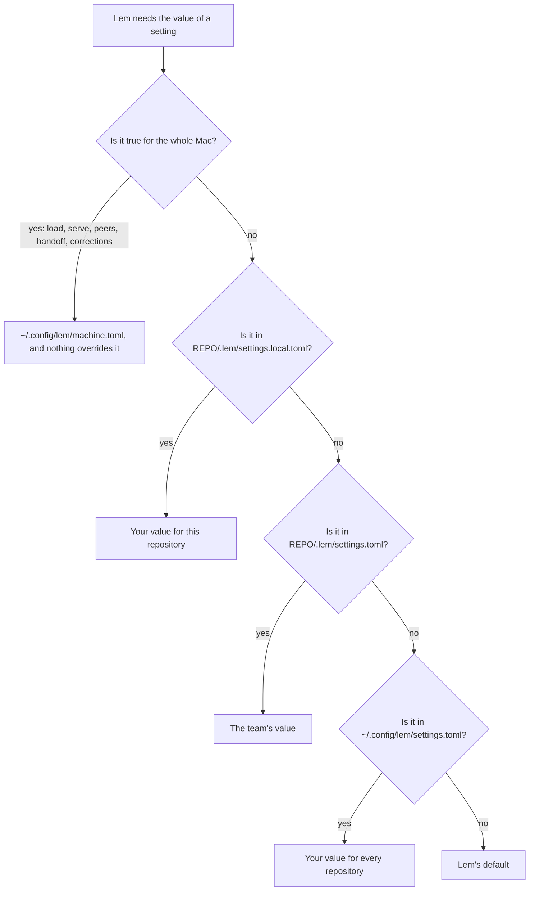

# One home folder for Lem

careful: yes, because tasks 1 and 2 change how the correction hook decides to send ("A developer's typed messages leave the machine without his yes"), task 1 rewrites `machine.toml` in his home ("Lem writes over something of the developer's: a file in his home"), and task 1 changes which file each setting is read from ("Lem reads a project's settings wrong").

## Acceptance criteria

Size: full, because the settings files get new names in every repository, and the correction hook and the question page read a new place.

1. The settings file has one name, `settings.toml`, in three places: `~/.config/lem/settings.toml` is the developer's own, for every repository on his Mac, `REPO/.lem/settings.toml` is the team's and is in git, and `REPO/.lem/settings.local.toml` is the developer's own for that one repository and is not in git. Git ignores `.lem/settings.local.toml` in an onboarded repository. Lem reads no file named `project.toml` or `project.local.toml`: a repository that has only `.lem/project.toml` is a repository that was never onboarded.
   - test: `bash tests/lem-settings.sh` in `tests/lem-settings.sh`, `tests/lib.sh`
   - test: `python3 -B -m unittest tests.unit.test_settings_files` in `tests/unit/test_settings_files.py`
2. For a setting that more than one of the three files may hold, the nearest file that holds it wins, and `lem project show` names the file each such value came from:
   1. `~/.config/lem/settings.toml` says `merger = "claude/opus:high"` under `[seats]`.
   2. `mybaze/.lem/settings.toml` says `merger = "codex/gpt-6.2-sol:high"` under `[seats]`.
   3. In `mybaze`, the merge agent is `codex/gpt-6.2-sol:high`, from the team's file.
   4. `mybaze/.lem/settings.local.toml` says `merger = "claude/fable:high"` under `[seats]`. In `mybaze`, the merge agent is now `claude/fable:high`, from the local file.
   5. In `lem`, whose files name no merger, it is `claude/opus:high`, from the home file.
   6. With the line in no file, it is `claude/opus:high`, and `lem project show` says "Lem's default".
   - test: `bash tests/lem-settings.sh` in `tests/lem-settings.sh`, `tests/lib.sh`
   - test: `python3 -B -m unittest tests.unit.test_settings_files` in `tests/unit/test_settings_files.py`
3. `~/.config/lem/machine.toml` holds only what is true for the whole Mac, which no other file overrides: `[load]`, `[serve]`, `[peers]`, `[handoff]` and `[corrections]`. A `[seats]` table there is refused, and the refusal names `~/.config/lem/settings.toml` as its place.
   - test: `python3 -B -m unittest tests.unit.test_settings_files` in `tests/unit/test_settings_files.py`
   - test: `python3 -B -m unittest tests.unit.test_session` in `tests/unit/test_session.py`
4. What guards a team's repository is valid in the team's file only: Lem refuses `[flow]`, `[checks]`, `[branch]`, `[paths]` and `[tracker]` in `~/.config/lem/settings.toml` and in `.lem/settings.local.toml`, and names `.lem/settings.toml` as their place. `keep_days` under `[state]` is valid in the team's file and in `.lem/settings.local.toml`, and is refused in the home file.
   - test: `python3 -B -m unittest tests.unit.test_settings_files` in `tests/unit/test_settings_files.py`
   - test: `bash tests/lem-settings.sh` in `tests/lem-settings.sh`, `tests/lib.sh`
5. The correction queue's switch, `collect` under `[corrections]`, is the Mac's alone: it is valid in `~/.config/lem/machine.toml` only, and holds in every repository on that Mac:
   1. `~/.config/lem/machine.toml` says `collect = false`. In `lem` and in `mybaze`, the hook sends nothing.
   2. A team member writes `collect = true` under `[corrections]` in `mybaze/.lem/settings.toml`. Lem refuses that table and names `~/.config/lem/machine.toml` as its place, and the hook still sends nothing. It refuses the table in `.lem/settings.local.toml` the same way.
   3. The developer changes his own line to `collect = true`. The hook now sends his typed messages to the provider of the Jev model in each repository on his Mac, `lem-scratch` too.
   - test: `bash tests/lem-machine.sh` in `tests/lem-machine.sh`, `tests/lib.sh`
   - test: `python3 -B -m unittest tests.unit.test_corrections` in `tests/unit/test_corrections.py`
6. When the correction hook cannot read `~/.config/lem/machine.toml` (a file that is no valid TOML), it sends nothing, prints nothing, and the developer's message goes on as he typed it. The next `lem project show` refuses, and names the file that does not read.
   - test: `bash tests/lem-machine.sh` in `tests/lem-machine.sh`, `tests/lib.sh`
   - test: `python3 -B -m unittest tests.unit.test_corrections` in `tests/unit/test_corrections.py`
7. `/lem init` asks about the correction queue one time for a Mac: the first run, with no `[corrections]` table in `~/.config/lem/machine.toml`, asks and writes the developer's answer there; a run in a second repository asks nothing about the queue and writes no `[corrections]` table. The question says what the hook sends (each message that he types, with the agent's message before it), where it sends it (the provider of the Jev model), and the line that turns it off. No update of the plugin writes into `machine.toml` or `settings.toml` of `~/.config/lem/`.
   - test: `bash tests/lem-machine.sh` in `tests/lem-machine.sh`, `tests/lib.sh`
   - test: `python3 -B -m unittest tests.unit.test_corrections` in `tests/unit/test_corrections.py`
8. The question page takes its defaults from the table `[ask]` of `~/.config/lem/settings.toml`, and keeps its cache in `~/.cache/lem/`: a `style` the developer writes under `[ask]` is the style of the next page, in place of `refined`. Lem reads and writes no file under `~/.config/lem-ask/` or `~/.cache/lem-ask/`.
   - test: `bash tests/test-ask.sh` in `tests/test-ask.sh`, `tests/checks.sh`
   - test: `python3 -B -m unittest tests.unit.test_settings_files` in `tests/unit/test_settings_files.py`
9. A first cast of personas comes from Lem's built-in cast only: `lem cast init` in a new repository copies the built-in cast also when `~/.config/personas/cast/` holds files, and no text of Lem names a cast of the user's.
   - test: `bash tests/test-gate-panel.sh` in `tests/test-gate-panel.sh`, `tests/checks.sh`
10. The guides say where each setting is: `docs/settings.md` has one table for each of the three `settings.toml` files and one for `machine.toml`, and `docs/install.md`, `AGENTS.md` and the site name the files by their new names. `docs/settings.md` says which file wins, which kind of setting goes in which file and which tables each file refuses, and `docs/install.md` says how a developer turns the correction queue off for his Mac.
   - test: `python3 -B -m unittest tests.unit.test_settings_files.Texts` in `tests/unit/test_settings_files.py`
   - test: `bash tests/lem-settings.sh` in `tests/lem-settings.sh`, `tests/lib.sh`

## How it works

Each setting is read from one file, or from the nearest of the files that may hold it. The facts of
the Mac are in a file of their own that nothing overrides.

Where each table is valid. A table in another file is refused, and the refusal names the file
where it is valid:

| Table | `~/.config/lem/machine.toml` | `~/.config/lem/settings.toml` | `.lem/settings.toml` | `.lem/settings.local.toml` |
| --- | --- | --- | --- | --- |
| `[load]`, `[serve]`, `[peers]`, `[handoff]` | yes | no | no | no |
| `[corrections]` | yes | no | no | no |
| `[seats]` | no | `merger`, `session` | yes | yes |
| `[ask]` | no | yes | no | no |
| `[flow]`, `[checks]`, `[branch]`, `[paths]`, `[tracker]` | no | no | yes | no |
| `[naps]` | no | no | yes | `on = false` |
| `[state]` | no | no | yes | yes |

In a task's worktree the team's file is the branch's copy, except `[flow]`, `[naps]` and `[state]`,
which are read as the base branch has them, as `load` and `decide` read them today: a branch does not
lift what guards it, switch the naps on, or lower `keep_days` for the files of other tasks. The order
of the chart holds among the files as so read, and `show` gives `from` for the copy it read
(`settings_from` and the `from` of `state.keep_days`, as today).

## Tasks

1. **The three `settings.toml` files and `machine.toml`.** `lem project` reads
   `~/.config/lem/settings.toml`, `REPO/.lem/settings.toml` and `REPO/.lem/settings.local.toml`
   (the main checkout's, as the local file is read today), with the nearest file that holds a
   setting winning, and the table rule above. `show` gives `from` for each value that more than one
   file may hold: each seat, the experts, `naps.on` and `state.keep_days`, with "Lem's default"
   when no file names it. `machine.toml` takes `[corrections]` (one key, `collect`, true or false)
   and loses `[seats]`; `lem_state.write_machine` keeps `[corrections]` when it writes another
   table. `write_machine` writes over nothing it cannot keep: before it writes, it reads the whole
   file and checks every table by the map above, and it refuses, with the file and the fix named, a
   file that does not read and a file that holds a table that is not valid there (a `[seats]` table
   names `~/.config/lem/settings.toml`). It no longer writes such a file again with its one table,
   and no longer drops a table it does not know. It holds an exclusive lock, `machine.lock` in the
   home folder (`fcntl.flock`, the kernel's, as `serial.lock` is), from its read to its rename, so
   that two writers in two panes cannot lose each other's table. Every writer of the file goes
   through it (`cmd_load`, `cmd_handoff`, `serve.py`, `lem_peers.py`, and task 2's command). `lem project init` writes `.lem/settings.toml` with no `[corrections]` table and puts
   `settings.local.toml` in `.lem/.gitignore`; `lem project reviewer` writes
   `.lem/settings.local.toml`. Every script and test that names the two old files names the new
   ones (`land.py` with its careful rule for an edit of either file and `Task.gate`, `criteria.py`,
   `doctor.py`, `serve.py`, `serve_hook.py`, `tests/board-showcase.py`, the `tests/*.sh` blocks and
   `tests/unit/`). This repository gets `.lem/settings.toml`: the text of its `.lem/project.toml`
   with the new file names in its comments and without `[corrections]`; `.lem/project.toml` stays
   as it is (decision 1). The correction hook's own read is task 2's.
   Criteria 1, 2, 3, 4. Files: `skills/lem/scripts/project.py`, `skills/lem/scripts/lem_state.py`,
   `skills/lem/scripts/land.py`, the other scripts above, `.lem/settings.toml`, `.lem/.gitignore`,
   `tests/`.
2. **The correction queue's switch is the Mac's.** The hook (`corrections.collects`) sends only in
   a repository with `.lem/settings.toml`, and only when `collect = true` under `[corrections]` in
   `machine.toml`; with no such line, or a `machine.toml` that does not read, it sends nothing and
   prints nothing, and the message goes on. `lem project show` gives `corrections` with `collect`
   and `from` (`machine.toml`, or "Lem's default", which is no), and refuses a `machine.toml` that
   does not read, by its name. A new command, `lem corrections collect yes|no`, writes the line
   through `lem_state.write_machine` and nothing else. `doctor.py` reads the same answer.
   `stages/init.md` asks the question only when `corrections.from` is "Lem's default", in the
   words criterion 7 names, and runs that command with the answer; a run where the Mac has the line
   asks nothing about it. `harness/claude-code/correction-hook.md` says where the no is. The worker
   (`cmd_worker`) asks `collects` again before it calls Jev, as today, and the worker check of
   `tests/lem-machine.sh` moves to `machine.toml`: with the `LEM_JEV` stand-in, a worker started
   after the hook gets no call of the stand-in and queues nothing when `machine.toml` says
   `collect = false`, has no `[corrections]` line, or does not read, and when only the team's file
   says `collect = true`. Criteria 5, 6, 7. Files: `skills/lem/scripts/corrections.py`, `skills/lem/scripts/project.py`,
   `skills/lem/scripts/doctor.py`, `skills/lem/stages/init.md`,
   `skills/lem/harness/claude-code/correction-hook.md`, `tests/lem-machine.sh`, `tests/unit/`.
3. **The question page's defaults and cache.** `lem-ask` reads its defaults from `[ask]` of the home
   `settings.toml` (found as `lem_state.config()` finds the home folder, with `XDG_CONFIG_HOME`
   first) over the skill's own `defaults.json`, and keeps the Mermaid file in `~/.cache/lem/`
   (`XDG_CACHE_HOME` first). `LEM_ASK_CONFIG` goes (decision 4). TOML has values that JSON has not (a
   date, a time), so the check of each value of `[ask]` takes the type of each key before any value
   is printed or used, by the rules of the spec (decision 8 of `lem decisions list`): `style` and
   `review` as `TOP_TYPES` takes them (`style` one of "refined", "minimal", "bold", "terminal";
   `review` "auto", "always", "never", true or false), `size` as `size_problem` takes it, `browser`
   true or false, `status` a table of two lists of words. A message names the file, the key and the
   value as TOML writes it, never through `json.dumps`, and comes as a `DefaultsError`; tests of
   `tests/test-ask.sh` write `browser = 2026-11-23` and `style = "minmal"` under `[ask]` and read each
   refusal. `lem
   project` takes `[ask]` in the home file with its keys (`style`, `size`, `review`, `browser`,
   `status`), checks only the table's place and its keys, and refuses it elsewhere; the values are
   the question page's to check. Criterion 8. Files: `skills/lem-ask/bin/lem-ask`,
   `skills/lem-ask/SKILL.md`, `skills/lem/scripts/project.py`, `tests/test-ask.sh`.
4. **The built-in cast only.** `cast.py` copies the built-in cast, also when
   `~/.config/personas/cast/` holds files; its docstring, `skills/lem-panel/SKILL.md` and
   `tests/test-gate-panel.sh` name no user layer. Criterion 9. Files:
   `skills/lem-panel/scripts/cast.py`, `skills/lem-panel/SKILL.md`, `tests/test-gate-panel.sh`.
5. **The documents.** `docs/settings.md` gets one table for each of the three `settings.toml`
   files and one for `machine.toml`, with which file wins, which kind of setting goes where and
   which tables each file refuses (the table above), one to one with `project.py` as
   `tests/lem-settings.sh` checks it. `docs/install.md` names the new files ("Not in git", "For all
   repositories, in `~/.config/lem/`", "Remove", which names `~/.cache/lem/`) and says how a
   developer turns the correction queue off for his Mac. `AGENTS.md` ("Layout": the home folder,
   `project.py`, `.lem/`), `README.md` where it names a file, `site/index.html` where it says the
   same, `skills/lem/SKILL.md`, the stages (`init.md` beyond task 2, `land.md`, `plan.md`, `talk.md`),
   `prompts/review.md`, `harness/claude-code/second-opinion.md`, `assets/handover.html` and the two
   bullets of `docs/rulings/rulings.md` that name `machine.toml` and `.lem/project.local.toml` as
   the place of a seat and of `keep_days` name the new files, with no other word of the ruling
   changed. The owner's answer on the correction queue (2026-11-23, criterion 5: "Looks like this
   settings `corrections` belongs on a machine level only", and his "y" to the switch in
   `~/.config/lem/machine.toml` only) is a new ruling, which replaces two lines of
   `docs/rulings/history.md`: it becomes a bullet of `docs/rulings/rulings.md` under "The lessons,
   the correction queue, the naps, the night and the free hour", in the form AGENTS.md gives, dated
   2026-11-23. The line "As a plugin, the correction hook comes with the install, and the
   repository says yes for all; the hook is an optional part, which works only on that yes" keeps
   only "As a plugin, the correction hook comes with the install", with the plugin manifest test of
   `tests/lem-machine.sh` as its cite (decision 10 of `lem decisions list`): what the hook works on
   is the new bullet's; the line "One person can say no to the correction queue, and nobody is switched on by a
   file git does not show" leaves the history, since the new bullet takes its place. Each cite of
   `docs/rulings/history.md` names a test by the name it has after tasks 1 to 3, so that
   `tests/unit/test_agents_md.py` finds each one. A unit test finds no `project.toml` and no `project.local.toml` in `skills/`, `bin/`,
   `hooks/`, `README.md`, `AGENTS.md`, `site/` and the guides of `docs/` (not `docs/plans/`,
   `docs/backlog/` or `docs/rulings/history.md`). Criterion 10.

## Plan talk

Argued by Codex as the reviewer, GPT 6.2 Sol at high effort as its pane's status line showed them,
and by Claude Code as the defender, Opus 5.5 at high effort as the task's `defender:` line gives
them. Two families. Seven turns, within the bound of 4 × 7 + 2. Each of the seven questions got a
repair in a2e89a52; four were settled, and three closed as a design choice, which `stages/plan.md`,
step 5, decides after the talk.

1. **Two writers of `machine.toml` lose the owner's no.** `lem_state.write_machine` reads the file
   and renames a new one over it, and its docstring accepts that two writers at one moment lose one
   change: `lem project load --start 20` that read before `lem corrections collect no` restores
   `collect = true`. Repaired: `write_machine` holds an exclusive lock, `machine.lock` in the home
   folder, from its read to its rename, and every writer goes through it. Settled by the two, not
   checked by the review.
2. **A task's branch would win over the base for `[flow]`, `[naps]` and `[state]`.** The chart gave
   one order for every setting, and a branch with `keep_days = 1` would let `prune` remove other
   tasks' files early; `load` and `decide` read those tables from the base today. Repaired: "How it
   works" says that in a task's worktree those three tables are read as the base branch has them,
   and the chart's order holds among the files as so read. Settled by the two, not checked by the
   review.
3. **A writer drops a table it does not know, and writes over a file that does not read.** With
   `seats` gone from `MACHINE_KEYS`, any write of `machine.toml` drops the developer's `[seats]`, and
   a file that is no TOML is written again with one table, so `lem corrections collect no` would
   drop his `[load]`, `[serve]` and `[peers]`. Repaired at the cause: `write_machine` reads the whole
   file, checks each table by the map, and refuses a file that does not read or holds a table not
   valid there, with the file and the fix named. The reviewer held twice on the changed decision:
   `serve.py` `configure` stops the board before `write_machine` refuses, and with a file that does
   not read `serve_settings` refuses too, so `lem serve --ensure` cannot start the board again until
   the owner fixes the file, where today's writer writes the file again and the board comes back. A
   second issue, a traceback from `cmd_load` and `cmd_handoff`, closed on the plan's own words and
   AGENTS.md. A design choice: the refusal (the topic "Lem writes over something of the developer's:
   a file in his home") against today's rewrite (the board stays up). Decided after the talk by the
   gate, checkable (decision 9): the refusal stays, on that topic of `flow.topics` and criteria 3
   and 6, and the board's cost stays with it. The gate's judge named an option the draft left out,
   that `serve.py` `configure` checks the file before it stops the board: raised, not argued, for
   the review before the pull request.
4. **Nothing proves that the worker stops a send.** A silent hook starts a worker that prints
   nothing, so the hook's silence shows no send. Repaired: task 2 names the worker check of
   `tests/lem-machine.sh` with the `LEM_JEV` stand-in for four cases of `machine.toml`. Settled by
   the two, not checked by the review.
5. **The history keeps rulings that criterion 5 reverses.** `docs/rulings/history.md` holds "the
   repository says yes for all" and "nobody is switched on by a file git does not show". Repaired:
   task 5 makes the owner's answer of 2026-11-23 a bullet of `docs/rulings/rulings.md`, removes the
   second line, and takes "and the repository says yes for all" out of the first. The reviewer held:
   the first line keeps "which works only on that yes", whose yes is gone. No refutation: a design
   choice. Decided after the talk by the gate, checkable (decision 10), on AGENTS.md's rules for a
   ruling that replaces another: the line keeps only "As a plugin, the correction hook comes with
   the install", and task 5 says so.
6. **TOML values that JSON never gave break the defaults check.** `defaults_problem` prints a value
   through `json.dumps`, which raises `TypeError` on `browser = 2026-11-23`. Repaired: task 3 checks
   each key's type before a value is printed, names the value as TOML writes it, and adds a test.
   The reviewer held: the repair's words "`style` and `review` strings" refuse `review = true`, which
   `TOP_TYPES` and `willReview` take, and let `style = "minmal"` through, and `check_spec` runs
   before `apply_defaults`. No refutation: a design choice. Decided after the talk by the gate,
   checkable (decision 8), on `.revmux/profile.md` ("A script that falls back without a word") and
   `TOP_TYPES`: each value of `[ask]` takes the spec's own rule, and task 3 says so.
7. **The cite of decision 1 was wrong.** The installed Lem is 0.3.1, and its `Task.gate` takes the
   main checkout's commands first. Repaired: decision 1 rests on `land.py` `project_now`, which hands
   the worktree's own settings to `may_land`, and that refuses a branch with no `branch.base`.
   Settled by the two, not checked by the review.

Mechanisms the repairs added:

- the lock `machine.lock` of question 1, a layer over decision 5, which rests on criterion 3 (the
  switch in `machine.toml` beside `[load]`, `[serve]`, `[peers]` and `[handoff]`); the reviewer's
  word: closed, layer over decision 5.
- the refusal of question 3, at the cause: it changed the choice of the existing `write_machine` to
  write over what it cannot read, a choice that rested on its docstring alone.

No question was raised after the first turn of the talk, and no addition was refused as unpriced.
The one line raised, not argued, came from the gate after the talk (question 3).

What changed in the plan: "How it works", the paragraph on a task's worktree (question 2); task 1,
the lock and the refusal of `write_machine` (questions 1 and 3); task 2, the worker check (question
4); task 3, the check of the values of `[ask]` (question 6); task 5, the rulings of the correction
queue (question 5); decision 1, its cite (question 7); "What this plan will not verify", the worker
check (question 4).

## Decisions

1. **This repository keeps `.lem/project.toml` on the branch, unchanged, beside the new
   `.lem/settings.toml`.** The installed Lem, 0.3.1, lands this task. Its `land.py` `project_now`,
   run from the task's worktree, loads the worktree's own settings (`load` reads `raw` from the
   branch's `.lem/project.toml`) and hands them to `may_land`, which refuses a branch whose file names
   no `branch.base`; its `Task.gate` takes the main checkout's commands first, so the checks
   themselves do not need the branch's file. Lem of this branch never reads that file. After the merge and the plugin's update, the maintaining
   session deletes it, renames the files of `mybaze`, `lem-trial` and `lem-scratch` by hand, and
   moves their `[corrections]` and `[seats]` lines. The owner's `collect = true` for his Mac is his
   own line in `~/.config/lem/machine.toml` (criterion 7): the maintaining session writes it only on
   his word. Rests on: `land.py` `project_now` and `project.py` `load` and `may_land` of the
   installed 0.3.1, as read on 2026-11-23.
2. **The refusal of a table in a wrong file comes from one map** of each table to the files where
   it is valid, and names the file where it is valid. It names no file of an older Lem: it is the
   rule of the current form, which the ruling of 2026-11-18 ("no refusal of a settings key that
   went") leaves open. Rests on: criteria 3, 4 and 5, which ask for these refusals by name.
3. **The home `settings.toml` holds `[seats]` with `merger` and `session` only, and `[ask]`.** The
   seats keep their rules of today (the task `seat-defaults-and-fallback` holds the rest); `[ask]` is
   the question page's, which reads no repository's file; `keep_days` is refused there by criterion
   4, and `[naps]` stays a repository's switch, as the backlog item says.
4. **`LEM_ASK_CONFIG` goes.** No answer of the owner names it, the defaults are now a table of a TOML
   file and no longer a JSON file of their own, and tests set `XDG_CONFIG_HOME` instead, as every
   other test of the home folder does.
5. **The switch has a command, `lem corrections collect yes|no`.** `init.md` writes the owner's
   answer into a file of his home, and the topic "Lem writes over something of the developer's"
   asks that one script does it, through `write_machine`, which keeps the other tables. The
   command sits under `lem corrections`, which owns the queue.
6. **With no `[corrections]` line on the Mac, the hook sends nothing.** A message leaves the Mac
   only on the developer's yes (the topic in his words), and today's template already writes
   `collect = false`.

## What this plan will not verify

- The hook on the owner's Mac with the Jev model: no test sends a message to the provider; the tests
  check the answer of `collects`, that the hook stays silent, and that the worker never calls the
  `LEM_JEV` stand-in without the Mac's yes (task 2).
- The order of the merge and the plugin's update in the four repositories: that is the maintaining
  session's work after the merge (decision 1).

## The bar

- tests/test-ask.sh: the three `expect` checks of `LEM_ASK_CONFIG`'s JSON defaults file left with that file, and their cases (a value that is not an object, a status glyph that is not a list, a size that is no percent) are now eight checks of the helper `refuses` on `[ask]` of the home settings file, one `expect` on a relative `XDG_CONFIG_HOME`, three checks that the page takes `[ask]` and one that no page writes under `~/.cache/lem-ask/`; the count of the words `assert` and `expect` does not see a call of `refuses`, so it reads two fewer where the file has more checks (`collected` counts each call).
