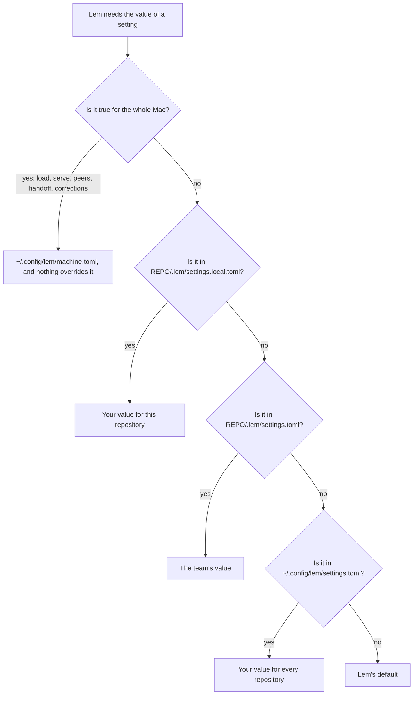

# One home folder for Lem

careful: yes, because tasks 1 and 2 change how the correction hook decides to send ("A developer's typed messages leave the machine without his yes"), task 1 rewrites `machine.toml` in his home ("Lem writes over something of the developer's: a file in his home"), and task 1 changes which file each setting is read from ("Lem reads a project's settings wrong").

## Acceptance criteria

Size: full, because the settings files get new names in every repository, and the correction hook and the question page read a new place.

1. The settings file has one name, `settings.toml`, in three places: `~/.config/lem/settings.toml` is the developer's own, for every repository on his Mac, `REPO/.lem/settings.toml` is the team's and is in git, and `REPO/.lem/settings.local.toml` is the developer's own for that one repository and is not in git. Git ignores `.lem/settings.local.toml` in an onboarded repository. Lem reads no file named `project.toml` or `project.local.toml`: a repository that has only `.lem/project.toml` is a repository that was never onboarded.
2. For a setting that more than one of the three files may hold, the nearest file that holds it wins, and `lem project show` names the file each such value came from:
   1. `~/.config/lem/settings.toml` says `merger = "claude/opus:high"` under `[seats]`.
   2. `mybaze/.lem/settings.toml` says `merger = "codex/gpt-6.2-sol:high"` under `[seats]`.
   3. In `mybaze`, the merge agent is `codex/gpt-6.2-sol:high`, from the team's file.
   4. `mybaze/.lem/settings.local.toml` says `merger = "claude/fable:high"` under `[seats]`. In `mybaze`, the merge agent is now `claude/fable:high`, from the local file.
   5. In `lem`, whose files name no merger, it is `claude/opus:high`, from the home file.
   6. With the line in no file, it is `claude/opus:high`, and `lem project show` says "Lem's default".
3. `~/.config/lem/machine.toml` holds only what is true for the whole Mac, which no other file overrides: `[load]`, `[serve]`, `[peers]`, `[handoff]` and `[corrections]`. A `[seats]` table there is refused, and the refusal names `~/.config/lem/settings.toml` as its place.
4. What guards a team's repository is valid in the team's file only: Lem refuses `[flow]`, `[checks]`, `[branch]`, `[paths]` and `[tracker]` in `~/.config/lem/settings.toml` and in `.lem/settings.local.toml`, and names `.lem/settings.toml` as their place. `keep_days` under `[state]` is valid in the team's file and in `.lem/settings.local.toml`, and is refused in the home file.
5. The correction queue's switch, `collect` under `[corrections]`, is the Mac's alone: it is valid in `~/.config/lem/machine.toml` only, and holds in every repository on that Mac:
   1. `~/.config/lem/machine.toml` says `collect = false`. In `lem` and in `mybaze`, the hook sends nothing.
   2. A team member writes `collect = true` under `[corrections]` in `mybaze/.lem/settings.toml`. Lem refuses that table and names `~/.config/lem/machine.toml` as its place, and the hook still sends nothing. It refuses the table in `.lem/settings.local.toml` the same way.
   3. The developer changes his own line to `collect = true`. The hook now sends his typed messages to the provider of the Jev model in each repository on his Mac, `lem-scratch` too.
6. When the correction hook cannot read `~/.config/lem/machine.toml` (a file that is no valid TOML), it sends nothing, prints nothing, and the developer's message goes on as he typed it. The next `lem project show` refuses, and names the file that does not read.
7. `/lem init` asks about the correction queue one time for a Mac: the first run, with no `[corrections]` table in `~/.config/lem/machine.toml`, asks and writes the developer's answer there; a run in a second repository asks nothing about the queue and writes no `[corrections]` table. The question says what the hook sends (each message that he types, with the agent's message before it), where it sends it (the provider of the Jev model), and the line that turns it off. No update of the plugin writes into `machine.toml` or `settings.toml` of `~/.config/lem/`.
8. The question page takes its defaults from the table `[ask]` of `~/.config/lem/settings.toml`, and keeps its cache in `~/.cache/lem/`: a `style` the developer writes under `[ask]` is the style of the next page, in place of `refined`. Lem reads and writes no file under `~/.config/lem-ask/` or `~/.cache/lem-ask/`.
9. A first cast of personas comes from Lem's built-in cast only: `lem cast init` in a new repository copies the built-in cast also when `~/.config/personas/cast/` holds files, and no text of Lem names a cast of the user's.
10. The guides say where each setting is: `docs/settings.md` has one table for each of the three `settings.toml` files and one for `machine.toml`, and `docs/install.md`, `AGENTS.md` and the site name the files by their new names. `docs/settings.md` says which file wins, which kind of setting goes in which file and which tables each file refuses, and `docs/install.md` says how a developer turns the correction queue off for his Mac.

## How it works

Each setting is read from one file, or from the nearest of the files that may hold it. The facts of
the Mac are in a file of their own that nothing overrides.

Where each table is valid. A table in another file is refused, and the refusal names the file
where it is valid:

| Table | `~/.config/lem/machine.toml` | `~/.config/lem/settings.toml` | `.lem/settings.toml` | `.lem/settings.local.toml` |
| --- | --- | --- | --- | --- |
| `[load]`, `[serve]`, `[peers]`, `[handoff]` | yes | no | no | no |
| `[corrections]` | yes | no | no | no |
| `[seats]` | no | `merger`, `session` | yes | yes |
| `[ask]` | no | yes | no | no |
| `[flow]`, `[checks]`, `[branch]`, `[paths]`, `[tracker]` | no | no | yes | no |
| `[naps]` | no | no | yes | `on = false` |
| `[state]` | no | no | yes | yes |

## Tasks

1. **The three `settings.toml` files and `machine.toml`.** `lem project` reads
   `~/.config/lem/settings.toml`, `REPO/.lem/settings.toml` and `REPO/.lem/settings.local.toml`
   (the main checkout's, as the local file is read today), with the nearest file that holds a
   setting winning, and the table rule above. `show` gives `from` for each value that more than one
   file may hold: each seat, the experts, `naps.on` and `state.keep_days`, with "Lem's default"
   when no file names it. `machine.toml` takes `[corrections]` (one key, `collect`, true or false)
   and loses `[seats]`; `lem_state.write_machine` keeps `[corrections]` when it writes another
   table. `lem project init` writes `.lem/settings.toml` with no `[corrections]` table and puts
   `settings.local.toml` in `.lem/.gitignore`; `lem project reviewer` writes
   `.lem/settings.local.toml`. Every script and test that names the two old files names the new
   ones (`land.py` with its careful rule for an edit of either file and `Task.gate`, `criteria.py`,
   `doctor.py`, `serve.py`, `serve_hook.py`, `tests/board-showcase.py`, the `tests/*.sh` blocks and
   `tests/unit/`). This repository gets `.lem/settings.toml`: the text of its `.lem/project.toml`
   with the new file names in its comments and without `[corrections]`; `.lem/project.toml` stays
   as it is (decision 1). The correction hook's own read is task 2's.
   Criteria 1, 2, 3, 4. Files: `skills/lem/scripts/project.py`, `skills/lem/scripts/lem_state.py`,
   `skills/lem/scripts/land.py`, the other scripts above, `.lem/settings.toml`, `.lem/.gitignore`,
   `tests/`.
2. **The correction queue's switch is the Mac's.** The hook (`corrections.collects`) sends only in
   a repository with `.lem/settings.toml`, and only when `collect = true` under `[corrections]` in
   `machine.toml`; with no such line, or a `machine.toml` that does not read, it sends nothing and
   prints nothing, and the message goes on. `lem project show` gives `corrections` with `collect`
   and `from` (`machine.toml`, or "Lem's default", which is no), and refuses a `machine.toml` that
   does not read, by its name. A new command, `lem corrections collect yes|no`, writes the line
   through `lem_state.write_machine` and nothing else. `doctor.py` reads the same answer.
   `stages/init.md` asks the question only when `corrections.from` is "Lem's default", in the
   words criterion 7 names, and runs that command with the answer; a run where the Mac has the line
   asks nothing about it. `harness/claude-code/correction-hook.md` says where the no is. Criteria 5,
   6, 7. Files: `skills/lem/scripts/corrections.py`, `skills/lem/scripts/project.py`,
   `skills/lem/scripts/doctor.py`, `skills/lem/stages/init.md`,
   `skills/lem/harness/claude-code/correction-hook.md`, `tests/lem-machine.sh`, `tests/unit/`.
3. **The question page's defaults and cache.** `lem-ask` reads its defaults from `[ask]` of the home
   `settings.toml` (found as `lem_state.config()` finds the home folder, with `XDG_CONFIG_HOME`
   first) over the skill's own `defaults.json`, with the same checks of each value, and keeps the
   Mermaid file in `~/.cache/lem/` (`XDG_CACHE_HOME` first). `LEM_ASK_CONFIG` goes (decision 4).
   `lem project` takes `[ask]` in the home file with its keys (`style`, `size`, `review`, `browser`,
   `status`), and refuses it elsewhere. Criterion 8. Files: `skills/lem-ask/bin/lem-ask`,
   `skills/lem-ask/SKILL.md`, `skills/lem/scripts/project.py`, `tests/test-ask.sh`.
4. **The built-in cast only.** `cast.py` copies the built-in cast, also when
   `~/.config/personas/cast/` holds files; its docstring, `skills/lem-panel/SKILL.md` and
   `tests/test-gate-panel.sh` name no user layer. Criterion 9. Files:
   `skills/lem-panel/scripts/cast.py`, `skills/lem-panel/SKILL.md`, `tests/test-gate-panel.sh`.
5. **The documents.** `docs/settings.md` gets one table for each of the three `settings.toml`
   files and one for `machine.toml`, with which file wins, which kind of setting goes where and
   which tables each file refuses (the table above), one to one with `project.py` as
   `tests/lem-settings.sh` checks it. `docs/install.md` names the new files ("Not in git", "For all
   repositories, in `~/.config/lem/`", "Remove", which names `~/.cache/lem/`) and says how a
   developer turns the correction queue off for his Mac. `AGENTS.md` ("Layout": the home folder,
   `project.py`, `.lem/`), `README.md` where it names a file, `site/index.html` where it says the
   same, `skills/lem/SKILL.md`, the stages (`init.md` beyond task 2, `land.md`, `plan.md`, `talk.md`),
   `prompts/review.md`, `harness/claude-code/second-opinion.md`, `assets/handover.html` and the two
   bullets of `docs/rulings/rulings.md` that name `machine.toml` and `.lem/project.local.toml` as
   the place of a seat and of `keep_days` name the new files, with no other word of the ruling
   changed. A unit test finds no `project.toml` and no `project.local.toml` in `skills/`, `bin/`,
   `hooks/`, `README.md`, `AGENTS.md`, `site/` and the guides of `docs/` (not `docs/plans/`,
   `docs/backlog/` or `docs/rulings/history.md`). Criterion 10.

## Decisions

1. **This repository keeps `.lem/project.toml` on the branch, unchanged, beside the new
   `.lem/settings.toml`.** The installed Lem, 0.3.0, lands this task: in the task's worktree it reads
   the branch's own copy of the settings (`load` reads `raw` from the worktree, and `Task.gate` reads
   `.lem/project.toml`), so a branch without that file would run its checks with no command. Lem of
   this branch never reads that file. After the merge and the plugin's update, the maintaining
   session deletes it, renames the files of `mybaze`, `lem-trial` and `lem-scratch` by hand, and
   moves their `[corrections]` and `[seats]` lines. The owner's `collect = true` for his Mac is his
   own line in `~/.config/lem/machine.toml` (criterion 7): the maintaining session writes it only on
   his word. Rests on: `project.py` `load` and `land.py` `Task.gate` as read on 299afc2f.
2. **The refusal of a table in a wrong file comes from one map** of each table to the files where
   it is valid, and names the file where it is valid. It names no file of an older Lem: it is the
   rule of the current form, which the ruling of 2026-11-18 ("no refusal of a settings key that
   went") leaves open. Rests on: criteria 3, 4 and 5, which ask for these refusals by name.
3. **The home `settings.toml` holds `[seats]` with `merger` and `session` only, and `[ask]`.** The
   seats keep their rules of today (the task `seat-defaults-and-fallback` holds the rest); `[ask]` is
   the question page's, which reads no repository's file; `keep_days` is refused there by criterion
   4, and `[naps]` stays a repository's switch, as the backlog item says.
4. **`LEM_ASK_CONFIG` goes.** No answer of the owner names it, the defaults are now a table of a TOML
   file and no longer a JSON file of their own, and tests set `XDG_CONFIG_HOME` instead, as every
   other test of the home folder does.
5. **The switch has a command, `lem corrections collect yes|no`.** `init.md` writes the owner's
   answer into a file of his home, and the topic "Lem writes over something of the developer's"
   asks that one script does it, through `write_machine`, which keeps the other tables. The
   command sits under `lem corrections`, which owns the queue.
6. **With no `[corrections]` line on the Mac, the hook sends nothing.** A message leaves the Mac
   only on the developer's yes (the topic in his words), and today's template already writes
   `collect = false`.

## What this plan will not verify

- The hook on the owner's Mac with the Jev model: no test sends a message to the provider; the tests
  check the answer of `collects` and that the hook stays silent.
- The order of the merge and the plugin's update in the four repositories: that is the maintaining
  session's work after the merge (decision 1).
