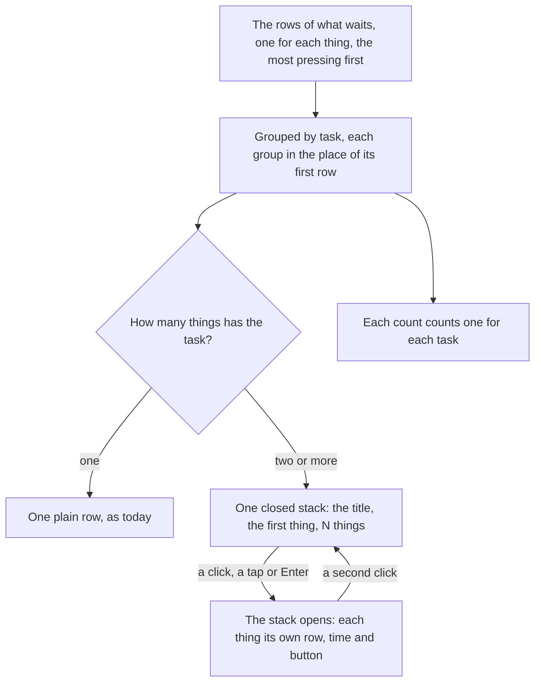

# One task, one stack in "Waits for you"

careful: no, because the change only groups the rows that "Waits for you" and `lem project waiting` already draw: `waits_of`, its rows and their keys stay as they are, so who merges, what is green, the pushes and the Inbox do not change, and no topic of `flow.topics` names how the rows are drawn (checked against each topic; the scout's one topic near it, the visibility of the owner's merge, is kept by the merge row and its button inside the stack, and by the stack's count of things).

## Acceptance criteria

Size: full, because the rows of "Waits for you", its counts, the list of `/lem status`, the board's demo afternoon and three guides change together.

1. A task with two or more things that wait for the owner shows in "Waits for you" as one closed stack, in the place of its first thing:
   1. The merge agent reads pull request 73 of "Logo eyes signal and favicon" and calls the owner.
   2. The task now waits for two things: "Read the merge review" and "Merge the pull request #73".
   3. "Waits for you" shows one closed stack: "Logo eyes signal and favicon", "Read the merge review" and "2 things".
   4. The stack stands where "Read the merge review" stood before.
2. A click on a closed stack opens it, and each thing of the task shows under it as its own row, with its own time and its own button; a second click closes it:
   1. The owner clicks the stack of "Logo eyes signal and favicon", on the Mac or on the phone.
   2. Under it are "Read the merge review", 4m 22s, and "Merge the pull request #73", 7m 01s.
   3. The Merge button is on the row "Merge the pull request #73".
   4. He clicks the stack again, and it shows as one closed stack.
3. A task with one thing that waits for the owner shows one plain row, as today: "Board answers a card", whose interview alone waits for him, shows its one row with the words it has today, with no stack and no "1 thing".
4. Each count of "Waits for you" counts a stack once: with "Logo eyes signal and favicon" (two things) and "Board answers a card" (one thing), the view, the sidebar and the phone's icon say 2, where today they say 3.
5. The bare `/lem` and `/lem status` group the things of one task under that task: "Logo eyes signal and favicon" is one entry, with "read the merge review" and "merge the pull request 73" under it.
6. The guides and the page that describe the rows of "Waits for you" (`docs/when-lem-needs-you.md`, `docs/pull-request.md`, `site/index.html`) say that one task is one stack, and the board's pictures in `assets/screens/` show a task's stack.

## How it works

The rows stay one for each thing; the view, its counts and `lem project waiting` draw them grouped by task.

## Tasks

1. **The board: a stack for a task with two or more things.** Criteria 1, 2, 3 and 4.
   - The model: one function of `lem_board_model` (for example `wait_stacks(m)`) groups the rows
     of `waits_of(m)` by task, each group in the place of its first row, its rows in their order
     of `waits_of`. `waits_of`, its rows, their order and their keys do not change: the pushes
     (`lem_push`) and the Inbox (`lem_inbox`) read them, and they stay one for each thing (Lem's
     decision 1 of the task's record).
   - The view (`waits_page` of `lem_board_pages`): a group of one row is the row it is today, with
     the same id (`wait-KEY`) and the same words. A group of two or more is one stack, a native
     `
` with a `
` that shows the task's title, the words of its first thing (its
     verb), its first thing's icon and actor color, and "N things"; under the summary each row of
     the task as the view draws it today, with its time, its facts and its buttons (the Merge
     button on the merge row, `row_acts`). The stack is closed when the server draws it. A morph
     keeps an open `
` open (`tools/board-kit/app.js`), so the stream's refresh does not
     close a stack the owner opened. The stack's id names its task (`wait-stack-SLUG`).
   - The keys: the cursor of the view (`data-cursor-item-value`, `-link-value` and `-pick-value`
     on `#waits-list`) takes a stack as one item and, while it is open, each of its rows as an
     item too; a closed stack's rows are hidden, and the cursor passes over what is hidden
     (`shown` in `cursor.js`). Enter or Space on a marked stack opens and closes it, as on any
     focused `
`. Prefer selectors in the page to a change of `cursor.js`; a change to a
     controller means a build of `skills/lem/assets/vendor/board-app.js` by
     `tools/board-kit/README.md`, committed with it.
   - The counts: the sidebar's head ("Waits for you" and its number), the rail's icon, the
     phone's inbox icon (`m-waits`), the view's summary ("N things you do…" says tasks now), the
     page's title ("N for you") and `serve.py`'s `counts["waits"]` (`/api/workspaces`) each count
     the groups.
   - The sidebar's list: one row for each group. A group of one is today's row. A group of two or
     more is its first thing's row (verb, time, task, link) with "N things" on it; it does not open
     in the sidebar (decision 2).
   - The look: `skills/lem/assets/board.css`, the stack's summary in the rows' look, with the
     disclosure mark the parked group's `
` uses, on a wide screen and on a phone.
   - Tests: unit cases in `tests/unit/test_board_model.py` for the grouping (the order of criterion
     1, a task of one row, two tasks of two rows) and in `tests/unit/test_board_pages.py` for the
     page (a stack closed with its words and "2 things", a plain row with no "1 thing", each
     count, the Merge button on the merge row inside the stack). In `tests/lem-board-keys.sh`, on
     the demo afternoon in headless Chrome: a click on the stack of `refund-line-on-receipt` opens
     it with its two rows shown, a second click closes it, on a wide screen and at a phone's
     width; and `waits_view_checks` passes with the merge row inside a stack (it opens the stack
     first, or finds the row by its new place). `tests/lem-serve.sh` where it counts the rows of
     the afternoon (`count` 5 is 4 groups now, on the board and in `/api/workspaces`); the line
     that compares `lem project waiting`'s `rows` stays, since `rows` keeps one row for each thing.
   - Files: `skills/lem/scripts/lem_board_model.py`, `skills/lem/scripts/lem_board_pages.py`,
     `skills/lem/scripts/serve.py`, `skills/lem/assets/board.css`, maybe
     `tools/board-kit/controllers/cursor.js` and `skills/lem/assets/vendor/board-app.js`,
     `tests/unit/test_board_model.py`, `tests/unit/test_board_pages.py`, `tests/lem-board-keys.sh`,
     `tests/lem-serve.sh`.
2. **`lem project waiting` and the bare `/lem` group the things by task.** Criterion 5.
   - `cmd_waiting` of `skills/lem/scripts/project.py` gives one more group, `tasks`: one entry for
     each task in the order of the board's groups (task 1's function), each with the task's brief
     (`waiting_brief`, its `line`) and `things`, one for each of its rows in order, each with its
     `key`, its `kind` and its `verb` (the row's own words, `wait_say`). The groups of each kind and
     `rows` stay as they are, since a thing's facts (a breaker's document, a pull request's green)
     are in them. `count` is the tasks and the retros' proposals. The module docstring's paragraph
     on `waiting` says `tasks` and the new `count`.
   - `skills/lem/stages/status.md`: the list says one entry for each task of `tasks`, in its order,
     with the task's plain name, and under it a line for each of its things, in its words, with the
     facts of that thing's kind as the numbered list gives them; a task of one thing is one line,
     as today. The numbered list of kinds stays as the facts each kind's line carries.
     `skills/lem/SKILL.md`, the row of bare `/lem` and `status` in the table: the list groups the
     things of one task under it.
   - Tests: a unit case of `cmd_waiting`, or the block that tests it today (`tests/lem-land-shop.sh`
     near its `reviews` check, line 771 today), with a task whose merge review calls the owner:
     one entry of `tasks` with two things, "Read the merge review" and "Merge the pull request
     #N", and a `count` of one for it. `tests/lem-serve.sh`'s `waiting` line: `count` is 4 on the
     afternoon, the same as `/api/workspaces`.
   - Files: `skills/lem/scripts/project.py`, `skills/lem/stages/status.md`, `skills/lem/SKILL.md`,
     the test file it changes, `tests/lem-serve.sh`.
3. **The documents and the pictures.** Criterion 6.
   - `docs/when-lem-needs-you.md`: "The merge review" (the board shows the review and the merge as
     one stack of the task) and "What waits for you" (Lem lists one entry for each task, its things
     under it; "The board shows the same rows" says the stacks).
   - `docs/pull-request.md`, line 61 today: "Read the merge review" and the merge are one stack of
     the task in "Waits for you".
   - `docs/board.md`: the row of **Waits for you** in the views' table, and the keys (`Enter` on a
     stack opens it).
   - `site/index.html`, line 67 today ("One row for each thing that you do"), and every other
     sentence of the page that the change makes false, in the page's STE, the same as the guides.
   - The pictures: `python3 tests/board-showcase.py OUT` and copy the ones the repository keeps
     (`board-*`, `phone-*`, `task-*`, `backlog-*`, light and dark) into `assets/screens/`. The
     afternoon's `refund-line-on-receipt` has a merge review that calls the owner and its merge,
     so its stack is in the sidebar of `board-*`. Look at each picture before the commit; if no
     kept picture shows the stack, the showcase gets the step that shows it (the sidebar, or the
     view with the stack closed), and the README, the guides and the site keep their pictures'
     names.
   - Files: `docs/when-lem-needs-you.md`, `docs/pull-request.md`, `docs/board.md`,
     `site/index.html`, `assets/screens/*.png`, maybe `tests/board-showcase.py`.

## Decisions

1. **The stack is a layer over the rows, and the rows stay one for each thing.** `waits_of`, its
   keys and its order do not change; the view, the counts and `lem project waiting` group them.
   It rests on Lem's decision 1 of the task's record: the pushes and the Inbox stay one for each
   thing, and both read the rows by their keys (`push.json`, `lem_inbox.thing_of`), so a new key
   would read as a new thing to both.
2. **The sidebar's list shows a stack as one row that does not open.** Its row is its first
   thing's, with "N things", and its click goes where that thing's click goes. It rests on the
   criteria, which name the view for the stack that opens and the sidebar for its count only, and
   on the task's panel, whose Overview already lists each thing of the task ("Waits for"). Undo: a
   `
` in the sidebar too.
3. **The stack is a native `
`.** A click, a tap, and Enter or Space on its focus open and
   close it with no new script, and a morph keeps it open (`app.js`). Each new visit of the view
   draws it closed.

## Not verified

- The look on a real phone: the checks drive headless Chrome at a phone's width, not an iPhone.
