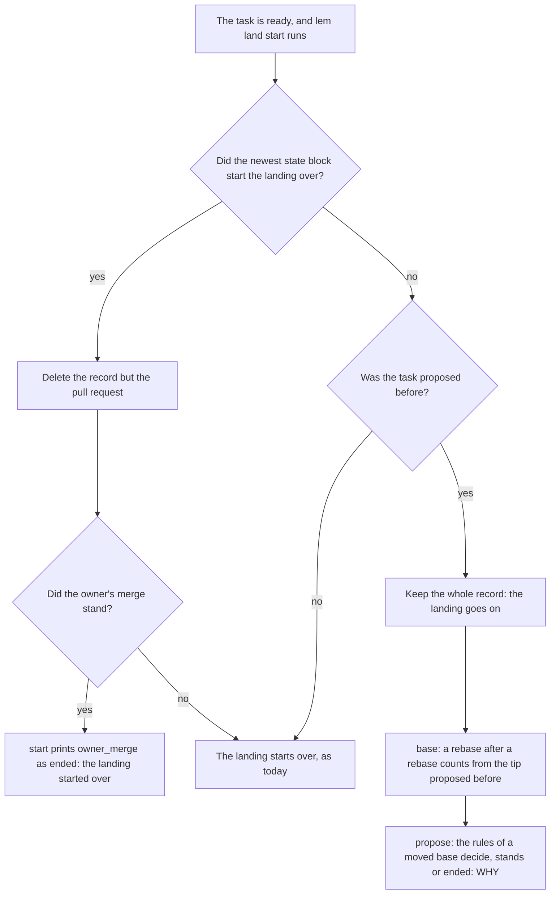

# The owner's merge, and what a new landing carries, survive a wait for a red base

careful: yes, because the change decides whether the board's server merges a pull request on the owner's earlier word, which reaches the topic "Lem changes a developer's repository without his word: a push, a merge", and what `landing.json` keeps through a wait, which reaches "A task's record is lost or wrong".

## Acceptance criteria

Size: full, because it changes what the landing keeps when a task waits for a red base, in `land.py` and in step 4 of the land stage, and it decides whether a merge goes on the owner's earlier word.

1. The owner's standing merge stands through a red base while the change he merged and the reasons for not green stay the same:
   1. Pull request 75 is open, and the owner merges it on the board.
   2. Lem refuses the merge because the base moved, and keeps his merge as standing.
   3. The merge agent says another round, and the new checks are red because `main` is red.
   4. The task waits as `blocked`, "the base is red", and then is `ready`, "the base is green again".
   5. `lem land start` runs, the rebase meets no conflict, and no commit comes after it.
   6. `lem land propose` prints `owner_merge` as `stands: ...`, and the board's server merges pull request 75 with no new question to the owner.
2. A wait for a red base changes nothing of what a new landing carries: the reviews, the merge agent's review, the count of new landings and a conflict's resolution carry as they carry after a moved base with no wait between. In the run of criterion 1, no second full review round runs, no fresh merge agent reads the task, and the pull request's text says what carried.
3. When the owner's standing merge cannot stand after a red base, `lem land propose` prints `owner_merge` as `ended: WHY`, never `null`:
   1. Steps 1 to 4 of criterion 1 run.
   2. After the rebase, a builder adds a commit that repairs a failed check.
   3. `lem land propose` prints `ended: ` with the reason that a commit came after the rebase, and the session tells the owner that reason in one line.
4. `lem project state SLUG ready --start-over` still starts the landing over with nothing carried, and when the owner's merge stood, the end of his merge is told to him as `ended: WHY`, with the start over as WHY: the owner's standing merge of pull request 75 does not end with no word when its landing starts over.

## How it works

The wait for a red base becomes a pause inside the new landing that the merge agent's "another round" started, not the start of another one. Two rebases in one landing count as one rebase from the tip proposed before.

Today and after, for pull request 75 (tip `t0` proposed on base `B0`):

1. The owner merges it. Lem refuses, because `main` moved to `B1`, and keeps his merge (`owner_tap`).
2. The merge agent says another round. `start` of the `open` task counts new landing 1 and keeps the record. `base` rebases `t0` onto `B1` as `t1`, with no conflict: the review carries (`rebase_carried`: `t0` to `t1`).
3. The checks are red, because `B1` is red. The task waits as `blocked`. The repair lands, and `main` is `B2`. The task is `ready` again.
4. Today: `start` deletes `landing.json` but the pull request, and a full round, a fresh merge agent and `owner_merge: null` follow.
   After: `start` keeps it, and counts no second new landing. `base` rebases `t1` onto `B2` as `t2`, and the record says `t0` to `t2`. `propose` finds the rebase it knows, the same reasons, and prints `stands: ...`.

## Tasks

1. **The landing goes on through a wait, and a start over says what it ended** (criteria 1, 2, 3, 4). In `skills/lem/scripts/land.py` and `skills/lem/scripts/project.py`, with their tests in `tests/lem-land-shop.sh` and the unit level:
   - `project.py state ... ready --start-over "WHY"` writes the line `the landing starts over` under WHY in the block, by itself; the writer does not type it. The `--start-over` help says so.
   - `land.py:start_locked`, for a `ready` task (and a task `start` blocked for want of a command of the checks, `again`): when the newest block (`task.record["state"]`) holds the line `the landing starts over`, or the record holds no proposal (`proposed`), it starts over as today. When the record holds a proposal and the block is no start over, it keeps the whole record: no deletion, no new `relands`, no `land.again` event, and `sync`, `conflict`, `resolution`, `rebase_carried`, `rebase_uncovered`, `reads`, `merge_review`, `owner_tap` and `proposed` stay as the cut landing left them. The comment over that branch says why: the task left `open` only through `start`, so a proposal on record means a new landing of that proposal was cut (a red base, a builder that ended twice), and it goes on.
   - On a start over, when the record read and held `owner_tap`, `start` prints `"owner_merge": "ended: the landing started over: WHY; the owner merges it again"`, WHY being the first line of the block, and `null` otherwise. The deletion itself is as today (`pr`, `pushed`, `taken`, and a done polish pass on the branch).
   - `land.py:cmd_base`, so that two rebases inside one landing count as one from the tip before the first:
     - a rebase that moves nothing (`tip == origin`) keeps `rebase_carried`, `rebase_uncovered` and the `sync` facts of the earlier rebase (`onto`, `moved`, `carried`) instead of clearing them;
     - a rebase with no conflict of a tip that an earlier rebase of the same landing made (`rebase_carried.to` or `rebase_uncovered.to` is `before`) writes its record from that earlier `from`: carried stays carried (`from` `t0`, `to` `t2`), uncovered keeps its `from` and takes the newest `why`, and a carried one that does not carry now becomes uncovered from `t0`;
     - `sync.moved` stays true once a rebase of the landing moved the tip.
     A resolution of a conflict is not chained: a rebase after it is "the base moved again after its resolution", as `tip_carry` says today with no wait (decision 3).
   - `tip_carry`, `moved_carry` and `carry_merge` change nothing: they get the record a landing with no wait would give them.
   - Tests:
     - the investigator's check in `tests/lem-land-shop.sh` ("the owner's merge that a moved base refused stands through a red base", commit 00f67b0b) passes as committed (criterion 1);
     - in the same run, or one beside it on the same path: `land read` says `due` `none` after the second `base` (no second full round), `propose` prints `merge_review` `carried` (no fresh merge agent), `relands` is 1, and the pull request's text names what carried (criterion 2);
     - the same path with a commit after the second rebase: `propose` prints `owner_merge` starting with `ended: a commit came after the rebase` (criterion 3);
     - `ready --start-over` over the `open` task with his standing merge: `start` prints `owner_merge` as `ended: the landing started over: ...`, `landing.json` keeps only the pull request's keys, and a `--start-over` over a task with no standing merge prints `null` (criterion 4);
     - a check of `base` run twice with no move in one landing: `rebase_carried` stays, and `propose` still says the merge stands;
     - a unit case in `tests/unit/` for the `--start-over` line of `project.py state`.
     Run the unit level and `bash tests/lem-land-shop.sh` (and the block that holds the start-over guards, `bash tests/lem-land-guards.sh`, when a check there names `--start-over`).
2. **The land stage says what a wait keeps, and who tells the owner of a merge that ended** (criteria 3, 4). In `skills/lem/stages/land.md` and `skills/lem/scripts/project.py`'s comment over `LEADS_WRITE`:
   - step 1: a `ready` task that was proposed before goes on with the new landing that a red base or a stop cut, and its reviews, its merge agent's review and the owner's merge stay; `start` prints `owner_merge` after a start over, and when it says `ended: WHY`, tell the owner WHY in one line;
   - step 4: after "the base is green again", the landing goes on from step 1 with what it carried;
   - step 8: the sentence on `"owner_merge": "ended: WHY"` names the start over beside the other reasons.
   No guide in `docs/` and no page of `site/` names the red base or the owner's standing merge (`grep` for "base is red", "green again", "stands" and "owner's merge", 2026-11-23), so none changes.

## Decisions

1. **`start` keeps the record of a `ready` task that was proposed before, and step 4 still writes `ready`.** Assumes: a task leaves `open` only through `start`, so a proposal on record means a cut new landing. Rests on: criterion 1, step 4 names `ready`, "the base is green again"; `start_locked` is the one place that every way back to `ready` reaches (step 4 of the land stage, the conflict path of `stages/conflict.md`, which sends a red check to step 4, and `again`). The other way, step 4 writing `open`, would change the words of an approved criterion and the stage, and leave the conflict path and `again` as they are.
2. **A start over is told by a line in its own block, `the landing starts over`, which `--start-over` writes.** Assumes: `start` reads the newest block, as `blocked_by_start` does. Rests on: `ready` over `landing` or `open` is refused without `--start-over` (`cmd_state`), but `ready` over `blocked` is written both by a wait and by a lead, so the status alone does not tell them apart; a line typed by the session would be a rule it can forget.
3. **A rebase after a rebase counts as one, and a resolution is not chained.** Assumes: "carry as after a moved base with no wait between" means what a single rebase from the proposed tip onto the newest base would give. Rests on: a rebase with no conflict keeps the review today (`review_carries` with the `carried` patches), so two of them keep it too; a resolution's read saw the resolution on the base of its time, and `tip_carry` already ends the owner's merge when the base moves again after a resolution. In the real run of pull request 75 the second rebase met a conflict on a careful request, so his merge ends there with its reason, which is criterion 3's `ended: WHY`, not `null`.
4. **A start over tells the owner at `start`, not at `propose`.** Assumes: he hears it when it happens. Rests on: the start over deletes `proposed`, so `moved_carry` has nothing to compare at `propose`; a mark kept for `propose` would be one more key of the record.

## What it will not verify

- A start over whose `landing.json` does not read as JSON (the case `land.py`'s own message names): the owner's merge in it cannot be read, so `start` prints `null`. The message already says to move the file aside.
- The real pull request 75: it is out of scope (decision 2 of the task), and the owner merged it himself.
