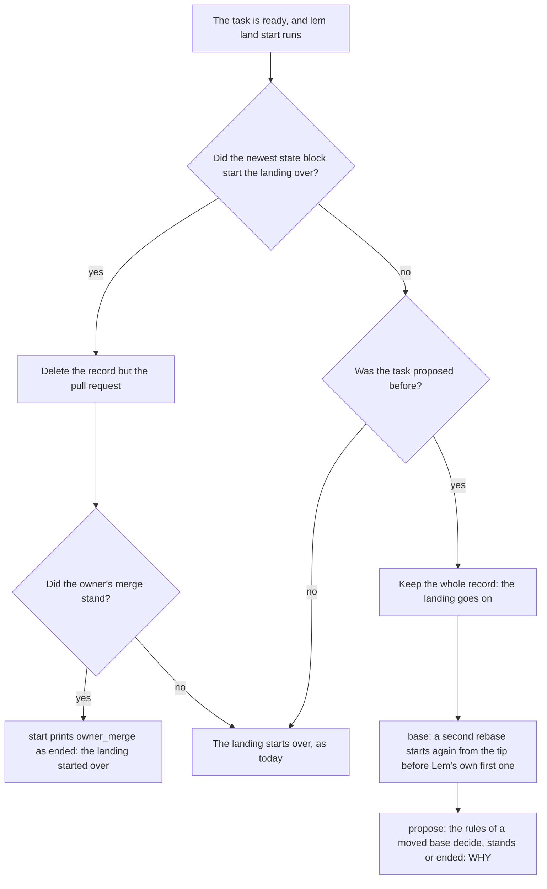

# The owner's merge, and what a new landing carries, survive a wait for a red base

careful: yes, because the change decides whether the board's server merges a pull request on the owner's earlier word, which reaches the topic "Lem changes a developer's repository without his word: a push, a merge", and what `landing.json` keeps through a wait, which reaches "A task's record is lost or wrong".

## Acceptance criteria

Size: full, because it changes what the landing keeps when a task waits for a red base, in `land.py` and in step 4 of the land stage, and it decides whether a merge goes on the owner's earlier word.

1. The owner's standing merge stands through a red base while the change he merged and the reasons for not green stay the same:
   1. Pull request 75 is open, and the owner merges it on the board.
   2. Lem refuses the merge because the base moved, and keeps his merge as standing.
   3. The merge agent says another round, and the new checks are red because `main` is red.
   4. The task waits as `blocked`, "the base is red", and then is `ready`, "the base is green again".
   5. `lem land start` runs, the rebase meets no conflict, and no commit comes after it.
   6. `lem land propose` prints `owner_merge` as `stands: ...`, and the board's server merges pull request 75 with no new question to the owner.
2. A wait for a red base changes nothing of what a new landing carries: the reviews, the merge agent's review, the count of new landings and a conflict's resolution carry as they carry after a moved base with no wait between. In the run of criterion 1, no second full review round runs, no fresh merge agent reads the task, and the pull request's text says what carried.
3. When the owner's standing merge cannot stand after a red base, `lem land propose` prints `owner_merge` as `ended: WHY`, never `null`:
   1. Steps 1 to 4 of criterion 1 run.
   2. After the rebase, a builder adds a commit that repairs a failed check.
   3. `lem land propose` prints `ended: ` with the reason that a commit came after the rebase, and the session tells the owner that reason in one line.
4. `lem project state SLUG ready --start-over` still starts the landing over with nothing carried, and when the owner's merge stood, the end of his merge is told to him as `ended: WHY`, with the start over as WHY: the owner's standing merge of pull request 75 does not end with no word when its landing starts over.

## How it works

The wait for a red base becomes a pause inside the new landing that the merge agent's "another round" started, not the start of another one. The second rebase of that landing starts again from the tip before Lem's own first one, so the landing gives what one rebase with no wait gives (decision 3).

Today and after, for pull request 75 (tip `t0` proposed on base `B0`):

1. The owner merges it. Lem refuses, because `main` moved to `B1`, and keeps his merge (`owner_tap`).
2. The merge agent says another round. `start` of the `open` task counts new landing 1 and keeps the record. `base` rebases `t0` onto `B1` as `t1`, with no conflict: the review carries (`rebase_carried`: `t0` to `t1`).
3. The checks are red, because `B1` is red. The task waits as `blocked`. The repair lands, and `main` is `B2`. The task is `ready` again.
4. Today: `start` deletes `landing.json` but the pull request, and a full round, a fresh merge agent and `owner_merge: null` follow.
   After: `start` keeps it, and counts no second new landing. `base` sees that the branch is still the `t1` its own first rebase made, throws `t1` away (it was never pushed), and rebases `t0` straight onto `B2` as `t2`: the record says `t0` to `t2`, as one rebase with no wait. `propose` finds the rebase it knows, the same reasons, and prints `stands: ...`.

## Tasks

1. **The landing goes on through a wait, and a start over says what it ended** (criteria 1, 2, 3, 4). In `skills/lem/scripts/land.py` and `skills/lem/scripts/project.py`, with their tests in `tests/lem-land-shop.sh` and the unit level:
   - `project.py state ... ready --start-over "WHY"` writes the line `the landing starts over` under WHY in the block, by itself; the writer does not type it. The `--start-over` help says so.
   - `land.py:start_locked`, for a `ready` task (and a task `start` blocked for want of a command of the checks, `again`): when the newest block (`task.record["state"]`) holds the line `the landing starts over`, or the record holds no proposal (`proposed`), it starts over as today. When the record holds a proposal and the block is no start over, it keeps the whole record: no deletion, no new `relands`, no `land.again` event, and `sync`, `conflict`, `resolution`, `rebase_carried`, `rebase_uncovered`, `reads`, `merge_review`, `owner_tap` and `proposed` stay as the cut landing left them. The comment over that branch says why: the task left `open` only through `start`, so a proposal on record means a new landing of that proposal was cut (a red base, a builder that ended twice), and it goes on.
   - On a start over, when the record read and held `owner_tap`, `start` logs the event `merge.ended by=owner tip=TIP why="the landing started over: WHY"` before it deletes the record, and prints `"owner_merge": "ended: the landing started over: WHY; the owner merges it again"`, WHY being the first line of the block, and `null` otherwise. The deletion itself is as today (`pr`, `pushed`, `taken`, and a done polish pass on the branch).
   - `carry_merge` logs the same `merge.ended` (with `owner_why`) when it ends his merge at `propose`, and `lem_board_model.py` draws `merge.ended` on the task's timeline and in "Activity" as "Your merge ended" with its why, beside "Your merge stands". So the end of his merge is a fact of the log the board shows, and not only a line a session may never say (talk, question 4).
   - `start_locked` checks for a command of the checks (`task.gate()`, and its `blocked` block) after the record's two branches, the start over's deletion and the `open` branch's count, `sync` and `land.again`, and after the worktree's checks, which write nothing. So `start`'s own `blocked` block never stands between the block a start over wrote and the record it deletes (talk, question 2), and an `open` task's new landing is counted before anything in `start` can refuse it (talk, question 5). When the gate refuses after a start over that ended his merge, the refusal's message ends with the same `ended: ...` words.
   - `land.py:cmd_base`, so that a second rebase in one landing gives what one rebase with no wait gives (decision 3):
     - each clean rebase keeps, beside `rebase_carried` or `rebase_uncovered`, the tip it made itself (`made`), which `filed_on` does not move: `file`'s commits after a rebase are commits after it here;
     - when the branch's tip is the `made` of the newest clean rebase of this landing, no conflict or resolution is on record, and that rebase's `from` is not the tip, `base` moves the branch back to that `from` (the tip before Lem's own first rebase, which the branch held before it, never pushed since: only `propose` pushes) and runs today's rebase from it: `carries` from that tip's change, the record `from` that tip, a conflict's `before` that tip. With no move of the base since, the same holds, and the record stays the one rebase from `from`;
     - the polish pass's names, which the first rebase moved to its own commits (`through_rebase`), go back to the commits of `from` by their place from the tip, or are dropped when the counts differ, as `through_rebase` does, and the checks then ask for the pass again;
     - a tip with a commit after `made` (a fix of a failed check, `file`'s items), or a first rebase that met a conflict, is rebased as today: a rebase after a resolution is "the base moved again after its resolution", and one after a commit is "a commit came after the rebase", as `tip_carry` says today with no wait.
     The comment over that branch says why it may throw a tip away: `made` is a tip only `base` wrote, and nothing came after it.
   - `tip_carry`, `moved_carry` and `carry_merge` change nothing: they get the record a landing with no wait would give them.
   - Tests:
     - the investigator's check in `tests/lem-land-shop.sh` ("the owner's merge that a moved base refused stands through a red base", commit 00f67b0b) passes as committed, and goes on past `propose` as the server would: `merge.stands` is logged for the new tip (what `serve.py:stands_due` reads), and `land merge mb-red --by owner --via server --standing --tip TIP` lands it, with `merged_by` `owner` and `server` (criterion 1; talk, question 3);
     - a clean first rebase, then a conflict on the second rebase after the wait, resolved by a builder, whose read finds nothing, on a request that is not careful: the conflict's `before` is `t0`, and `propose` prints `owner_merge` `stands` and `merge_review` `carried`; and on a careful request, `ended: the rebase met a conflict, and the request is careful: ...` (criterion 2; talk, question 1);
     - the probe's case (`probe-two-rebases.py` in the task directory): a branch of two commits, a red base that repeats the first commit's edit, a repair that reverts it whole; after the wait the branch holds both commits again, `rebase_carried` is `t0` to `t2`, and `propose` says his merge stands (decision 6);
     - a commit added to the branch after the proposal (the merge's refusal of kind `tip`, then a new landing), a clean first rebase, the wait, and the second `base`: the commit is still on the branch, and `propose` prints `owner_merge` as `ended: a commit came after the tip proposed before`, as one rebase with no wait gives (decision 6, the dialectic's break);
     - `start` of an `open` task with no command of the checks, then again once one is there: `relands` is 1, `sync` is the new landing's and `land.again` is logged once (talk, question 5); and `ready --start-over` followed by the same refusal and retry: the record keeps only the pull request's keys, and the refusal says `ended: the landing started over: ...` (talk, question 2);
     - in the same run, or one beside it on the same path: `land read` says `due` `none` after the second `base` (no second full round), `propose` prints `merge_review` `carried` (no fresh merge agent), `relands` is 1, and the pull request's text names what carried (criterion 2);
     - the same path with a commit after the second rebase: `propose` prints `owner_merge` starting with `ended: a commit came after the rebase` (criterion 3);
     - `ready --start-over` over the `open` task with his standing merge: `start` prints `owner_merge` as `ended: the landing started over: ...` and logs `merge.ended` once, `landing.json` keeps only the pull request's keys, and a `--start-over` over a task with no standing merge prints `null` (criterion 4);
     - a check of `base` run twice with no move in one landing: `rebase_carried` is from `t0`, and `propose` still says the merge stands;
     - a unit case in `tests/unit/` for the `--start-over` line of `project.py state`, and one for the board's line of `merge.ended` (`lem_board_model.py`); the check of criterion 3 also finds `merge.ended` logged once by `propose`.
     Run the unit level and `bash tests/lem-land-shop.sh` (and the block that holds the start-over guards, `bash tests/lem-land-guards.sh`, when a check there names `--start-over`).
2. **The land stage says what a wait keeps, and who tells the owner of a merge that ended** (criteria 3, 4). In `skills/lem/stages/land.md` and `skills/lem/scripts/project.py`'s comment over `LEADS_WRITE`:
   - step 1: a `ready` task that was proposed before goes on with the new landing that a red base or a stop cut, and its reviews, its merge agent's review and the owner's merge stay; `start` prints `owner_merge` after a start over, and when it says `ended: WHY`, tell the owner WHY in one line;
   - step 4: after "the base is green again", the landing goes on from step 1 with what it carried;
   - step 6: "Then step 7, at once" holds unless `propose` printed `"merge_review": "carried"`: then no merge agent starts, and the server merges it, for the merge agent's `merge` or for the owner's merge that `"owner_merge": "stands: ..."` names, as step 8 says of a new landing (talk, question 3);
   - step 8: the sentence on `"owner_merge": "ended: WHY"` names the start over beside the other reasons.
   No guide in `docs/` and no page of `site/` names the red base or the owner's standing merge (`grep` for "base is red", "green again", "stands" and "owner's merge", 2026-11-23), so none changes.

## Plan talk

Who argued the plan: the reviewer, Codex, GPT 6.2 Sol at high effort, as its pane's status line showed; the defender, Claude Code, Opus 5.5 at high effort (the `defender:` line of the task's state). Different families. 7 turns, within the bound of 22 (4 × 5 + 2). The list closed with the reviewer's first turn, 5 questions.

1. **Decision 3 carries across two rebases a change that is no longer the one he merged; a conflict on the second rebase loses the resolution's rules.** A design choice, after a repair. The part on a conflict after a rebase was repaired: the resolution's `before` is the earlier rebase's `from` (Task 1, `cmd_base`), at the cause of decision 3, which rests on criterion 2. The part on a dropped commit holds: `cmd_base` decides `carries` from the change before the rebase and adds the listing after it to `carried` with no check of its own, so a first rebase that drops a commit made empty by the base, and a base repair that removes that edit again, give a second rebase that carries a smaller change, and the server merges it on his earlier word. The plan's position: the chain as it stands, with the carry decided before each rebase as `cmd_base` does today (`cmd_base`, `review_carries`, criterion 2). The other: a carry decided on the change after the rebase as well, which ends his merge with "no review covers the change" there, and changes a single rebase today onto a base that repeats an edit of the change (the reviewer's trace; `covers_one`). The question's gate named a third: the check after the rebase for a chained rebase only. `stages/plan.md`, step 5, took it: decision 6 of the task's log, by the experts (fable and astra), against the plan's position: a second rebase starts again from the tip before Lem's own first one (option D), after the personas (the developer and the teammate, both D, sure) and a dialectic whose one confirmed break moved the tip D goes back to from `proposed` to the first rebase's `from`. The pull request is not green for it. Task 1's `cmd_base` bullets and decision 3 now say D; the chain of the two records, and the repair that chained a resolution's `before`, are gone from the plan: D's rebase from `t0` gives the conflict its `before` by itself.
2. **A start over is lost through the retry after `start` blocked for want of a command of the checks.** Settled: `start_locked` checks for a command of the checks after the record's branches, so its own `blocked` block never stands between the start over's block and the deletion, and the refusal says `ended: ...` (Task 1). The reviewer: closed, a layer over decision 2, which cites `cmd_state`. Settled by the two, not checked by the review.
3. **The usual path still sends a carried merge review to a fresh merge agent, and the test stops before the server's merge.** Repaired: step 6's "Then step 7, at once" holds unless `propose` printed `"merge_review": "carried"` (Task 2), and the check goes on to `merge.stands` and the server's `--standing` merge (Task 1). The reviewer held that a carried review that calls him is then told by nobody; refuted: `carry_merge` logs `merge.review` with `calls`, and the board's "Waits for you" shows "Read the merge review" (`lem_board_model.py`, `waits_of`), the route step 8 already takes. Closed. Settled by the two, not checked by the review.
4. **A session cut after `start` leaves the end of his merge told by nobody.** A design choice, after a repair. First refuted (`propose` has the same window today); it held, and the repair changed decision 4 at its cause: the end is a `merge.ended` event that the board draws, logged by `start` before it deletes the record and by `carry_merge` at `propose`. It held again: a cut between the event and the deletion logs the event twice on the rerun, two rows for one end (`project.py:append_event`, `lem_board_model.py:feed`). The plan's position: the event before the deletion, a second row on that rerun. The other: the decision before the repair, the output alone, which a cut after it loses. `stages/plan.md`, step 5, took it: decision 5 of the task's log, by the gate (cheap), the plan's position.
5. **An `open` task's first new landing gets no count and no `sync` when `start` blocks for want of a command of the checks.** A design choice, after a repair. Repaired at the cause of decision 1: `start` counts the new landing, writes `sync` and logs `land.again` before the gate's check. It held: `Task.gate` can also raise (a malformed `.lem/project.toml` on the branch, read only when the main checkout has no command of the checks), and the retry then counts the same new landing twice, a false fact the merge agent reads for how fast the base moves (`prompts/merge.md`). The plan's position: the new order, with that count on that input. The other: the order before the repair, the gate's check first, which brings back question 2 and question 5. `stages/plan.md`, step 5, took it: decision 4 of the task's log, by the gate (checkable: criterion 4), the plan's position.

Mechanisms the repairs added, each with the decision it sits on and the reviewer's word:
- the resolution's `before` chained to the earlier rebase's `from` (question 1): decision 3, at the cause; replaced after the talk by decision 6, which changed decision 3;
- the gate's check after the record's branches in `start_locked` (questions 2 and 5): a layer over decision 2, which cites `cmd_state`, for question 2; decision 1, at the cause, for question 5;
- step 6's exception for a carried merge review (question 3): at the cause;
- the event `merge.ended` and its line on the board (question 4): decision 4, at the cause.

Raised after the first turn, not argued: none. Refused as unpriced: none.

What changed in the plan, by question and by task: question 1, Task 1 (`cmd_base`'s chain of a resolution, a test of a conflict after a rebase) and decision 3; questions 2 and 5, Task 1 (the order of `start_locked`, two tests of a retry after the gate's refusal) and decision 1; question 3, Task 2 (step 6) and Task 1 (the check goes on to the server's merge); question 4, Task 1 (`merge.ended` in `start` and `carry_merge`, its line in `lem_board_model.py`, a unit case) and decision 4.

## Decisions

1. **`start` keeps the record of a `ready` task that was proposed before, and step 4 still writes `ready`.** Assumes: a task leaves `open` only through `start`, and `start` counts the new landing and writes its `sync` before anything in it can refuse (the gate's check comes after, task 1), so a proposal on record means a cut new landing. Rests on: criterion 1, step 4 names `ready`, "the base is green again"; `start_locked` is the one place that every way back to `ready` reaches (step 4 of the land stage, the conflict path of `stages/conflict.md`, which sends a red check to step 4, and `again`). The other way, step 4 writing `open`, would change the words of an approved criterion and the stage, and leave the conflict path and `again` as they are.
2. **A start over is told by a line in its own block, `the landing starts over`, which `--start-over` writes.** Assumes: `start` reads the newest block, as `blocked_by_start` does. Rests on: `ready` over `landing` or `open` is refused without `--start-over` (`cmd_state`), but `ready` over `blocked` is written both by a wait and by a lead, so the status alone does not tell them apart; a line typed by the session would be a rule it can forget.
3. **A second rebase in one landing starts again from the tip before Lem's own first rebase, when nothing came after that rebase, so the landing gives what one rebase with no wait gives; after a resolution or a commit, a rebase is judged as today.** Assumes: "carry as after a moved base with no wait between" means what one rebase from the tip before the first onto the newest base would give. Rests on: criterion 2; decision 6 of the task's log, which the ladder took by the experts after the plan talk's question 1: a chain of two rebases, each judged before it as `cmd_base` does today, can carry a change from which git left a commit out (the probe `probe-two-rebases.py`, git 2.55.0), and a check of the change after the rebase ends his merge whenever a base changed any line of a file of the change (`change`, `covers_one`); the first rebase is Lem's own and never pushed (only `cmd_propose` pushes); the tip to go back to is the first rebase's `from`, not `proposed`, since a new landing can start from a tip with a commit after the proposal (the merge's refusal of kind `tip`, `stages/land.md` step 8); a resolution's read saw the resolution on the base of its time, and `tip_carry` already ends the owner's merge when the base moves again after a resolution. In the real run of pull request 75 the second rebase met a conflict on a careful request, so his merge ends there with its reason, which is criterion 3's `ended: WHY`, not `null`.
4. **The end of the owner's standing merge is an event of the log, `merge.ended`, which the board shows, logged by `start` at a start over and by `carry_merge` at `propose`; the session's one line comes beside it.** Assumes: the log outlives the session and the command's output. Rests on: the start over deletes `proposed`, so `moved_carry` has nothing to compare at `propose`; the stage reruns a cut step, and the rerun finds no tap to tell of (talk, question 4); `propose` already writes its `owner_merge=ended` in the `proposed` event, which the board does not draw.

## What it will not verify

- A start over whose `landing.json` does not read as JSON (the case `land.py`'s own message names): the owner's merge in it cannot be read, so `start` prints `null`. The message already says to move the file aside.
- The real pull request 75: it is out of scope (decision 2 of the task), and the owner merged it himself.

## Seen outside the change

- **One rebase today, with no wait, can carry the review over a change from which git left a commit out.** A probe (`probe-cherry-revert.py` and `.json` in the task directory, git 2.55.0, 2026-11-23): the base cherry-picks one of the branch's two commits and then reverts it; one rebase of the branch onto that base leaves the commit out (git skips a commit whose patch the base already holds), `feature.txt` stays `old` on the tip, and `cmd_base` carries the review from the change before the rebase. The owner's standing merge, or the merge agent's, then merges a smaller change. The cause is decision 6's (`cmd_base` decides a rebase's carry before it), and it reaches every rebase; the criteria of this task do not name it. The polish pass takes it by the bar of rule 6 of the builder's standing rules: a check of the change after the rebase in `cmd_base` is the fix that decision 6's experts weighed as options B and C, which end the merge whenever a base changed any line of a file of the change, so it is no cheap fix, and it goes to the backlog with this probe.
