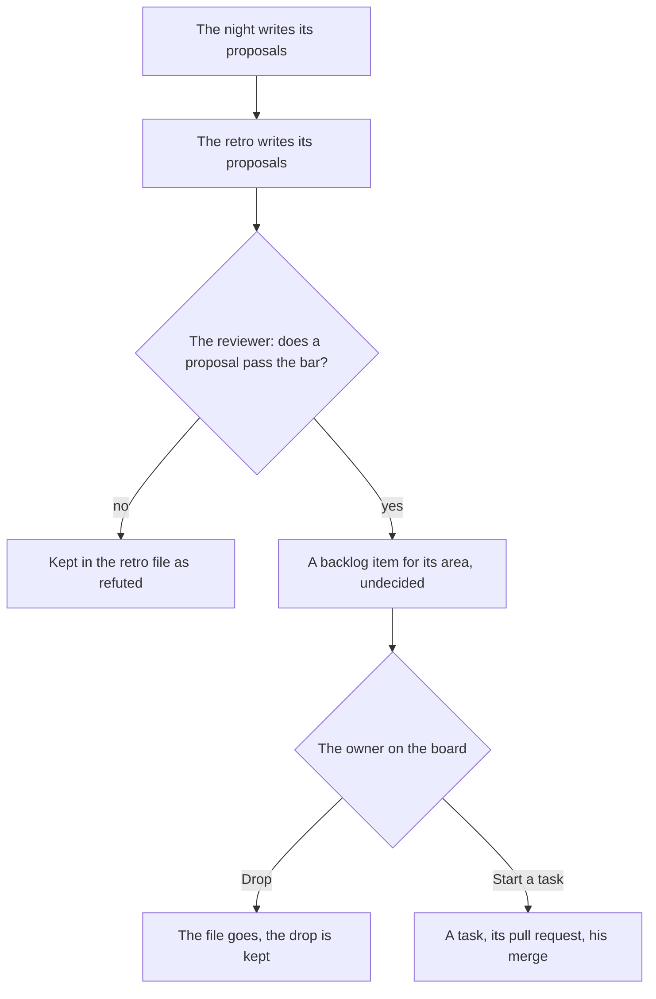
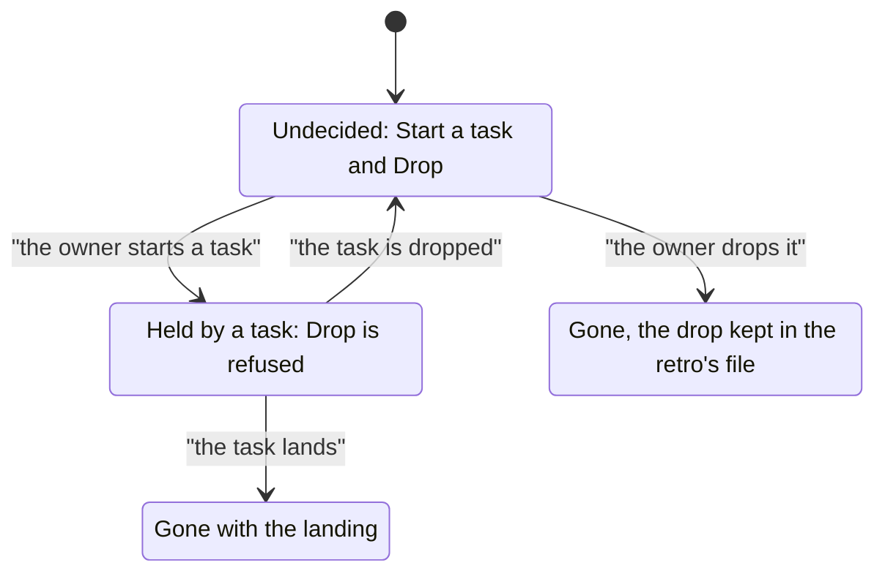

# One reviewed path for the scheduled night and retro

careful: yes, because the change reaches "A change bends a ruling of the owner": task 6 changes the free hour's ruling and the night's work in Lem's own repository, on the owner's words of 2026-11-23, and task 2 removes a file of the state folder on his click.

## Acceptance criteria

Size: full, because the night, the retro, a new reviewer agent, the backlog and the board each change, and the change reaches what the scheduled runs may write in a repository with nobody at the terminal.

1. No scheduled job makes a branch in Lem's own repository: the night's free hour writes what it finds as a proposal into the night's file, and the scheduled retro takes no free hour. In another project, a scheduled job makes no branch but a task's branch for an item a person wrote.
   1. On 2026-11-24 at 01:30 UTC the night runs in Lem's repository.
   2. Its free hour finds a check that fails by chance in `tests/lem-serve.sh`.
   3. `.lem/state/night/2026-11-24.json` holds that finding as a proposal, with its place and its reason.
   4. After the retro of 06:55 UTC, `git branch --list 'free-hour/*'` prints nothing.
2. In another project the night works as today, and it never takes an item the reviewer wrote that the owner did not start.
   1. The backlog of the project `shop` holds `refund-total-zero.md`, which a developer wrote, and its `.lem/state/backlog/` holds an undecided item of the reviewer.
   2. The night of 2026-11-24 runs in `shop`.
   3. It opens a task for `refund-total-zero.md` only.
3. Each scheduled night and retro leaves its file for the day in `.lem/state/`, also on a day it found nothing: the retro of 2026-11-25 with no proposal writes `.lem/state/retros/2026-11-25.json`, which says what it read and that it proposes nothing.
4. After the retro, a fresh reviewer agent reads each proposal of that day's night file and retro file against the backlog bar, and each proposal it refutes stays in the retro's file with its reason.
   1. The retro of 2026-11-23 proposes 10 proposals; one is a first-time lesson with no question in it.
   2. The reviewer refutes it.
   3. `.lem/state/retros/2026-11-23.json` keeps that proposal among the refuted ones, with the reason "a first-time lesson, with no question in it".
5. The reviewer writes the proposals that passed as new backlog items in `.lem/state/backlog/`, which git ignores, one for each area, and each item names every proposal in it and where it came from; it writes nothing into the repository, and adds no item on a morning where nothing passed.
   1. Of 11 proposals, 9 pass: 5 about lessons, 3 about the board, 1 about the tests.
   2. `.lem/state/backlog/` gets 3 new items, one for each of the three areas.
   3. The item about the tests names "night of 2026-11-24" as its source.
6. What the retro and the night propose reaches the owner only as these backlog items: the board's "Backlog" view shows each one as undecided, with "Start a task" and "Drop", the "Backlog" key shows the count of undecided items, and no row of "Waits for you", no line of `/lem status` and no page asks him about the retro's proposals.
7. "Drop" on an undecided item removes its file from `.lem/state/backlog/` at once and keeps the drop in the retro's file, and it is refused while a task that has not ended holds the item.
   1. The owner presses "Drop" on the board item about the board's colors.
   2. Its file is gone from `.lem/state/backlog/`, and the retro's file keeps its text with "the owner dropped it" and the day.
   3. He presses "Drop" on the item about the tests, which the task `tests-flaky-check` builds now.
   4. The board refuses, and its message names `tests-flaky-check`.
8. A proposal that the owner dropped or the reviewer refuted does not come back: the reviewer of a later morning that meets the same proposal refutes it, with the day of the earlier drop or refute as its reason.
9. A task the owner starts from such an item runs and lands as any task does, and the item leaves the backlog with its landing: after the task `tests-flaky-check` lands, the item about the tests is no longer in the "Backlog" view. When the task started from an item is dropped, the item is undecided again.
10. Each scheduled night and retro closes its own agterm session as its last step, once the owner is not looking at it, and changes no file of the owner's cronn jobs. The session closes once agterm selects another session; while he stays in it, it stays open.
   1. The retro of 2026-11-24 ends at 07:20 UTC while the owner works in another session.
   2. Its session is gone from agterm at once.
   3. On another day he looks at the retro's session as it ends; it closes when he leaves it.

## How it works

A proposal of the night or the retro goes through the reviewer, and then the owner, before any task builds it.

An item of the reviewer is undecided while no task holds it. A task holds it while the task's
`ask.txt` is the item's path and the task has not ended.

## Today, in the code

- The retro (`skills/lem/stages/learn.md`, "retro") writes `retros/DATE.json` in the form of the
  question page, and `lem project waiting` lists each such file as `retros` and counts its
  questions (`retro_proposals`, `waiting_model` in `skills/lem/scripts/project.py`).
  `skills/lem/stages/status.md` item 11 and "A retro's proposals are his to answer" open a page of
  them. The board shows no row for them (`waits_of` in `lem_board_model.py`).
- The night (`skills/lem/stages/night.md`) writes `night/DATE.md`. In Lem's own repository it
  takes a free hour instead (`AGENTS.md`, the bullet "A maintainer's session with nobody at the
  terminal reads `docs/free-hour.md` first"), and the free hour makes a `free-hour/*` branch
  (`docs/free-hour.md`). The same bullet sends the scheduled retro to a free hour too.
- The board's "Backlog" view reads only the backlog folder of the settings, `docs/backlog`, of the
  main checkout (`board.backlog`). "Start a task" writes the item's path as the task's ask
  (`act_start` in `serve.py`). A task started from an item of that folder lands with the item
  removed from its branch (`item_of_ask`, `task_item` in `land.py`), which needs the item in git.
  An item in `.lem/state/backlog/` is not in git, so that rule does not reach it.
- `lem session close SLUG` closes only a task's session (`cmd_close` in `session.py`). No command
  closes a session that no task owns, and the night's and the retro's sessions stay open until the
  owner's job wrapper closes them at the next run of the same job.
- `lem project prune` keeps the event log, the night reports, the retros and the correction
  queue, and removes whole entries only from the folders of `PRUNED`.

## Tasks

1. **The proposals' records.** In `skills/lem/scripts/project.py`: the form of `retros/DATE.json`
   and of `night/DATE.json` in the state folder, each with the day, what the run read, and its
   proposals (each with a number, its area, the move in one line, its body and its source), and in
   the retro's file the keys `refuted` (each with the reviewer's reason and the day), `passed` (each
   with the item it went into) and `dropped` (each with its text, "the owner dropped it" and the
   day). One command for the reviewer reads every day's proposals with the earlier refuted and
   dropped ones (`lem project proposals`, or a name the builder finds plainer), and one writes the
   reviewer's verdict on each proposal of the day, so that no agent edits the JSON by hand; a file
   that does not have the form is refused with the fix. The commands, so that no agent writes a
   record or an item by hand:
   - **add**: the retro and the night add a run's proposals to the day's file, which this command
     makes when it is not there. A second run on the same day (the owner's retro at 10:00 after
     the scheduled one) adds its proposals with the next numbers, after those already there, and
     never rewrites a verdict, a drop or a number. Each run is kept in the file with its time and
     what it read, also a run of no proposal; the next retro reads what came after the newest
     run's time.
   - **read**: every proposal with no verdict, of any day (the file of a morning whose reviewer
     did not finish is read on the next one), with the refuted and dropped ones of every day.
   - **verdict**: the reviewer's verdict on each proposal: refuted, with its reason, or passed,
     with its area. The command writes the passed proposals of one area as one item in
     `.lem/state/backlog/`, in the backlog's item format, with a front-matter key that names each
     proposal by its day and number and says where it came from; no item when nothing passed.
   - **drop**: one call that reads whether a task that has not ended holds the item (its
     `ask.txt` is the item's path), refuses with that task's slug when one does, and otherwise
     records the drop of each proposal the item names in its day's file and removes the item's
     file. The board's server makes it one call under its script lock (`lem_run`, `SCRIPT_LOCK`
     in `serve.py`), so a Start's `task-dir` comes before it or after it, never between its read
     and its removal.
   `lem project task-dir SLUG --ask PATH` refuses a PATH in `.lem/state/backlog/` whose file is
   not there, with "the item was dropped: read the backlog again". A file of `retros/` in the
   form of the question page, such as `.lem/state/retros/2026-11-23.json` of this repository, is
   refused with the fix: the maintaining session converts it by hand into the new form, its
   proposals with no verdict, in each repository of `workspaces.json` that uses Lem, at the
   plugin's update that brings this change (`AGENTS.md`, "Lem is not released"), and the next
   reviewer reads them as proposals with no verdict. `lem project waiting` no longer lists the
   retros and no longer counts their proposals. `lem project prune` keeps `retros/`, `night/` and
   `backlog/` of the state folder. A retro file with no proposal is valid. Unit tests in
   `tests/unit/`, and the checks of `tests/lem-decisions.sh` that read `retros` and `count` change
   to the new form. Serves criteria 3, 4, 5, 6, 7 and 8 (their records).
2. **The reviewer's items on the board.** `board.backlog` reads the items of `.lem/state/backlog/`
   of the main checkout beside those of the backlog folder, each marked as the reviewer's, and as
   held with the slug of the task that holds it, or undecided. The "Backlog" view shows the
   reviewer's items in a group of their own with "Start a task" and "Drop", and the "Backlog" key
   of the board shows the count of undecided items. "Drop" posts to a new route of `serve.py`,
   through the confirm step the board's other acts use where one fits, and runs task 1's drop as
   one call: its refusal names the task that holds the item. "Start a task" posts the item's path
   from the root of the main checkout, never its stem alone, and `act_start` finds the item by that
   path, so `tests-flaky-check.md` of `docs/backlog` and of `.lem/state/backlog/` are two items.
   The slug of a start from an item is its stem, or, when a task of that slug has ended, the stem
   with the first free `-2`, `-3`: an item whose task was dropped is undecided again and starts
   again (criterion 9), an item of `docs/backlog` too. A task of that slug that has not ended
   still refuses, as today. An item of `docs/backlog` gets no "Drop".
   Files: `board.py`, `serve.py`, `lem_board_model.py`, `lem_board_pages.py`, the board's assets
   and `tools/board-kit` only where a key needs it, `tests/board-showcase.py`, and checks in
   `tests/lem-serve.sh`, `tests/lem-board-act.sh` and the unit level. Serves criteria 6 and 7.
3. **The item leaves with the landing.** `forge_done` in `land.py`, the one step every path to
   `landed` takes (Lem's merge through `merge_locked`, and `lem land merged`), removes the item's
   file before it writes `landed`, for a task whose `ask.txt` is the path of an item in
   `.lem/state/backlog/`, and says so in its output. A file that is gone already is no error. A
   removal that fails raises the landing's error and leaves the task `open`, so the next `lem land
   merged` tries again, as a failed edit of the pull request's text does (`noted`). A task that is
   dropped leaves the file where it is, so the item is undecided again. A check in
   `tests/lem-land-shop.sh` for Lem's merge and for `merged`, and a unit case. Files: `land.py`.
   Serves criterion 9.
4. **A job's session closes itself.** A `lem session` command closes the caller's own agterm
   session when no task owns it, once the owner is not looking at it (the `--when-unselected` wait
   of `cmd_close`), and refuses the id of a task's session with the fix (`lem session close SLUG`).
   It closes only a session that a job started for that run: the session's `foreground` in
   `agtermctl tree --json` is the agent's command with the job's line as its last argument,
   `/lem night`, `/lem night N` or `/lem retro`. Any other session (one where the owner typed
   `/lem retro` himself, into an agent he started with no prompt) is refused, and stays his. It
   changes no file outside the state folder. A check in `tests/lem-session.sh` with the stand-in
   for agtermctl: it closes at once while another session is selected, waits while this one is,
   closes a session whose foreground ends in `/lem night 2`, and refuses one whose foreground has
   no such argument. Files: `session.py`, the `lem` command's help where it lists the commands.
   Serves criterion 10.
5. **The night, the retro and the reviewer.** `skills/lem/stages/learn.md`, "retro": the retro
   changes no file and asks the owner nothing, by hand or scheduled; it adds its run to the day's
   file through task 1's add, also when it proposes nothing, reads the naps since the newest run
   of the retro and the night's proposals since then, puts a first-time lesson in as a proposal
   too, then starts a fresh reviewer (`spawn-builder`) with a new brief,
   `skills/lem/prompts/proposals.md`. That brief: read each proposal with no verdict (task 1's
   read) against the backlog bar (the ruling of 2026-11-22) and check its facts (the rule is not
   already in the target file, the cited records exist); refute a proposal that fails, and one the
   owner dropped or a reviewer refuted on an earlier day, with that day; give each that passed its
   area; write every verdict, and so every item, through task 1's verdict command, never a file by
   hand; nothing into the repository. `agents/lem-builder.md` gets a seventh job beside the six it
   lists: "It names `prompts/proposals.md`: you review the proposals of the night and the retro".
   It has no worktree and commits nothing, its only writes are the `lem project` commands its file
   names, rules 1, 3 to 6, 9 and 10 are not its own, and its reply is its report.
   `night.md`: a night never takes an item of `.lem/state/backlog/` (it reads only `lem project
   path backlog`), and a project whose own `AGENTS.md` says its night proposes adds its run to
   `night/DATE.json` through task 1's add. Both stages end with task 4's close, which refuses by
   itself a session no job started for that run; the stage runs it and reads the refusal as "this
   session is the owner's". `status.md` loses item 11 and the page of a retro's proposals.
   `SKILL.md` and `harness/claude-code.md` change where they name these steps. The correction
   queue: a first-time lesson that became a proposal is recorded with a new verdict, `proposed`
   (`VERDICTS` in `corrections.py`), `--target` the file the proposal would change, and the
   proposal's day and number in its `--lesson` line; `lem corrections lessons` gives it with that
   verdict, and the retro reads a `proposed` lesson as one in no file yet, never as a lesson to
   remove. A unit case in `tests/unit/` for the new verdict. Serves criteria 2, 3, 4, 5, 8 and 10.
6. **Lem's own repository.** `AGENTS.md`, the bullet "A maintainer's session with nobody at the
   terminal reads `docs/free-hour.md` first", and `docs/free-hour.md`: the night of this repository
   takes its free hour as a search only, writes what it finds as proposals into
   `.lem/state/night/DATE.json`, and makes no branch and no worktree; the scheduled retro takes no
   free hour. `docs/rulings/rulings.md`: the bullet "The free hour may edit Lem's skills on a branch
   of the clone" changes to the owner's words of 2026-11-23, and a bullet for "any project that uses
   lem cannot get impovements produced by lem without following our agreed paths" under the naps
   and night group. The bullet "The lessons, the retro and Jev stay; a night run ends as a pull
   request; naps are not shown" changes its words, as a ruling that changes a part of another
   does: a night that builds a backlog item ends as a pull request, and the night of Lem's own
   repository makes no branch and writes proposals (the owner's "y", 2026-11-23, in
   `directions.md`). `tests/unit/test_agents_md.py` must still pass. Serves criterion 1.
7. **The documents.** `README.md` (the scheduled retro), `docs/when-lem-needs-you.md` (item 9, the
   retro's proposals, becomes the reviewer's items on the "Backlog" view), `docs/board.md` (the
   reviewer's items, "Drop", the count on the "Backlog" key), `docs/flow.md` where it names the
   night or the retro, `site/index.html` in the same commit where it says the same thing, and
   `AGENTS.md`'s layout (`.lem/state/backlog/` in the state folder, `prompts/proposals.md` in the
   prompts). Serves no criterion.
8. **The try of `claude -p`, the owner's direction.** After task 5, a builder runs one retro under
   `claude -p "/lem retro"`, with this worktree as `--plugin-dir`, in a throwaway repository it
   makes in the task directory (onboarded, with a few task records, a nap's waking note and one
   night file in task 1's form), as `tests/lib.sh` makes its throwaway repositories. Its report
   says, each with the command and its last line of output: whether the retro ran to its end,
   whether the day's file holds the run, whether the reviewer it started (a subagent) finished
   before the process ended and wrote its verdicts and items, and what task 4's close answered.
   The night is not tried: it waits hours on background `lem session wait` calls (decision 3).
   No job line changes: the pull request says the result, and with it the line the owner may put
   in his own job. Nothing of this repository changes, and the throwaway repository is removed
   after the report. Serves no criterion.

## Plan talk

Who argued the plan: the reviewer, Codex, GPT 6.2 Sol at high effort, as its pane's status line
showed it; the defender, Claude Code, Opus 5.5 at high effort (the task's `defender:` line). Two
model families. Seven turns, within the bound of 4 × 10 + 2. The plan before the talk is commit
`773efe62`; the repairs are commit `73c53456`.

The reviewer's list, as it gave it:

1. **Start and Drop of one item at one moment.** Repair: task 1's drop is one call that reads the
   holder and removes the file, under the board's `SCRIPT_LOCK`, and `task-dir --ask` refuses a
   path in `.lem/state/backlog/` whose file is gone. The reviewer held: a start typed in a
   terminal (`/lem new PATH`, `stages/new.md`) runs `task-dir` outside that lock, and its call to
   GitHub (`taken_on_remote` in `cmd_task_dir`) comes between the file check and the write of
   `ask.txt`, so a Drop from the phone can end in that wait. The defender's refutation: a page
   without acts shows the terminal line, and Drop is an act (`backlog_item` in
   `lem_board_pages.py`), so the input is two acts of one person on two devices at one moment, not
   realistic. Held a second time: **a design choice**, for the ladder (`stages/plan.md`, step 5).
2. **A second retro on the same day.** Repair: task 1's add appends a run's proposals with the next
   numbers and never rewrites a verdict, a drop or a number; each run keeps its time. The reviewer
   held: an add and a drop that read the file at one moment lose one write. The defender's
   refutation: a record of two writers is written under its file lock from the read to the write
   in `project.py` (`STATE_LOCK`, lines 2066 to 2070, with its comment for this case), and task 1's
   commands are of that module. **Settled**, settled by the two, not checked by the review.
3. **Which item and which task Start selects.** Repair: the form posts the item's path, and the
   slug is the stem, or the stem with the first free `-2`, `-3` when a task of that slug ended.
   The reviewer held: a stale Start chooses `-3` while `-2` holds the item, since `act_start`
   checks the slug and not the holder by the item's path; and a tracked item's task of the same
   stem refuses the reviewer's item. The defender had no refutation of the first. **A design
   choice**, for the ladder.
4. **Which step removes the item for every merge.** Repair: the removal is in `forge_done`, the one
   step every path to `landed` takes, before it writes `landed`; a failed removal leaves the task
   `open` for the next `lem land merged`. **Settled**, at the cause, settled by the two, not checked
   by the review.
5. **Which builder rules hold for the proposals' reviewer.** Repair: a seventh job in
   `agents/lem-builder.md`, and the items written by task 1's verdict command. The reviewer held:
   a project's own `.claude/agents/lem-builder.md` comes first. The defender's refutation: that
   override replaces the whole builder by design (`harness/claude-code.md`, `spawn-builder`), and
   no repository on this machine has one. **Settled**, at the cause, settled by the two, not
   checked by the review.
6. **How a stage knows a scheduled session.** Repair: decision 4 changed, from the first message to
   the session's `foreground` in agterm's tree, the agent with the job's line as its last argument.
   The reviewer held: the owner can start `claude "/lem retro"` in a session he keeps for more work,
   and its arguments match. The defender's refutation: such a session was started for that one run,
   which the ask wants closed, and the close waits while he looks and is undoable (`cmd_close`,
   `--undoable`). Held a second time: **a design choice**, for the ladder.
7. **The retro files of the old form.** Repair: the reader refuses them with the fix, and the
   maintaining session converts each file of the repositories in `workspaces.json` by hand. The
   reviewer held: a project outside `workspaces.json` (a retro before its first task) keeps an old
   file, whose refusal stops its first review. The defender's refutation: the refusal fails loudly
   with the fix, the repository's rule for an old form (`AGENTS.md`, "Lem is not released"). Held a
   second time: **a design choice**, for the ladder.
8. **What a correction record of a proposal means.** Repair: a new verdict, `proposed`, read by the
   retro as a lesson in no file yet. The reviewer held: once a task lands the lesson in a rule
   file, the record still says `proposed`, and the retro no longer checks that lesson. The defender
   had no refutation. **A design choice**, for the ladder.
9. **Which ruling holds for the new night of Lem's repository.** Repair: task 6 changes the words of
   the bullet "The lessons, the retro and Jev stay; a night run ends as a pull request; naps are
   not shown". **Settled**, settled by the two, not checked by the review.
10. **Where the try of `claude -p` happens.** Repair: decision 3 changed, and task 8 tries a retro
    under `claude -p` in a throwaway repository. The reviewer held: Lem is installed at user scope
    here (0.3.0), so the try's `lem` is the installed one (`AGENTS.md`, the lem-scratch case of
    2026-11-21), and the inherited `AGTERM_SESSION_ID` points the close at the builder's parent.
    The defender refuted the second (task 4 refuses a task's session) and had no refutation of the
    first. **A design choice**, for the ladder.

The mechanisms the repairs added, with the decision each sits on and the reviewer's word:

- the drop in one call and the refusal of a gone item by `task-dir` (question 1): a layer over the
  drop's removal at once, which cites the owner's "k1" and criterion 7; open, a design choice;
- the add that never rewrites (question 2): closed, a layer over decision 1, which cites
  criterion 6;
- the slug with `-N` (question 3): a layer over the item's stem as the slug, the planner's choice;
  open, a design choice;
- the removal in `forge_done` (question 4): at the cause;
- the seventh job and the items through a command (question 5): at the cause;
- the foreground check (question 6): at the cause, decision 4 changed; open, a design choice;
- the refusal of the old form and the conversion by hand (question 7): a layer over the new
  record form, which cites `AGENTS.md`; open, a design choice;
- the verdict `proposed` (question 8): a layer over decision 2, which cites criterion 4's case
  and `learn.md` step 4; open, a design choice;
- task 8 (question 10): at the cause, decision 3 changed; open, a design choice.

Raised, not argued: when task 1's verdict saves `passed` before it makes the item, an interruption
leaves no item, and the next read of proposals with no verdict skips that proposal (task 1, the
verdict and the read).

No addition was refused as unpriced.

What changed in the plan, by task: task 1 got the four commands (add, read, verdict, drop), the
refusal of a gone item by `task-dir` and of the old retro form, and the conversion by hand
(questions 1, 2, 5, 7); task 2, the start by the item's path and the slug's `-N`, and the drop in
one call (questions 1, 3); task 3, the removal in `forge_done` (question 4); task 4, the foreground
check (question 6); task 5, the seventh builder job, the writes through commands only, and the
verdict `proposed` (questions 5, 8); task 6, the night bullet of the rulings (question 9); task 8 is
new (question 10); "Decisions of the plan", decisions 3, 4 and 5 and a new one on a day's records
(questions 2, 5, 6, 10); "Not verified", two lines (questions 6, 10).

## Decisions of the plan

- The retro takes one path, by hand and scheduled: it never asks the owner and always hands its
  proposals to the reviewer, since criterion 6 says the proposals reach him only as backlog items.
- The retro changes no file, also for a first-time lesson: criterion 4's case refutes a first-time
  lesson, so such a lesson is a proposal, and criterion 5 keeps the reviewer's writes out of the
  repository.
- The job lines stay the owner's, and no stage needs `claude -p`. A night waits hours on each
  task's session with a background `lem session wait`, whose end wakes an interactive session
  only (harness, `run-in-background`); whether `claude -p` keeps such a wait is untested. Task 4's
  close ends the session of either kind of run, so the open session that the ask names goes. The
  owner's direction to try `claude -p` is task 8, a try of the retro, whose result the pull
  request gives him.
- A run closes its own session only when a job started that session for that run: the agent's
  command in agterm's tree ends in the job's line. The cronn skill's job script starts the agent
  with the prompt as its last argument (`exec ... "$JOB_AGENT" ... "$JOB_PROMPT"` in its
  `agent-session-job.sh`, read 2026-11-23), and agterm's tree gives each session's `foreground`
  as its command's words (`agtermctl tree --json`, 2026-11-23). An agent the owner started with no
  prompt, where he typed `/lem retro`, has no such argument, and its session stays his. Task 4's
  command checks it, so the stage judges nothing.
- The records of a day are added to, never written whole: a second retro of the same day keeps the
  verdicts, the drops and the numbers of the first, since decision 1 lets the owner run one by hand.
- The reviewer is a builder with a brief of its own, as the scout and the investigator are, started
  by the retro: no new scheduled job, and two agents each morning in place of one. It is the
  seventh job of `agents/lem-builder.md`, since the builder's rules give a builder only the jobs
  that file lists, and a worktree and a commit for each.
- A script writes the proposals' records and the reviewer's items, so that the form the drop and
  the next reviewer read is checked, and no agent writes a file in the state folder by hand.

## Not verified

- A real night and a real retro on the machine's schedule: the checks run the scripts with
  stand-ins for agterm; the first scheduled night and retro after the merge are the test of the
  stage texts, and the commit names this task.
- `claude -p` for the night: not tried, as the decision above says; the retro's try is task 8.
- The job's session's `foreground` as agterm gives it for a session the cronn job opened: read for
  other sessions on 2026-11-23, and no job's session was open to read then.
