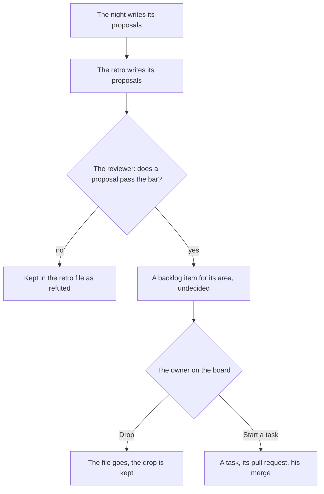
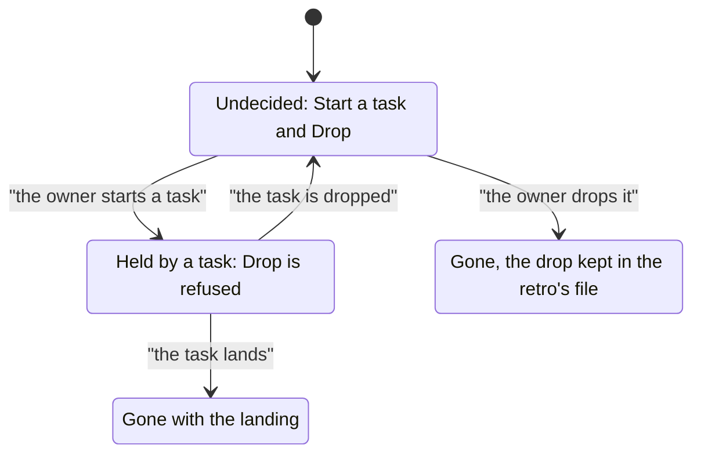

# One reviewed path for the scheduled night and retro

careful: yes, because the change reaches "A change bends a ruling of the owner": task 6 changes the free hour's ruling and the night's work in Lem's own repository, on the owner's words of 2026-11-23, and task 2 removes a file of the state folder on his click.

## Acceptance criteria

Size: full, because the night, the retro, a new reviewer agent, the backlog and the board each change, and the change reaches what the scheduled runs may write in a repository with nobody at the terminal.

1. No scheduled job makes a branch in Lem's own repository: the night's free hour writes what it finds as a proposal into the night's file, and the scheduled retro takes no free hour. In another project, a scheduled job makes no branch but a task's branch for an item a person wrote.
   1. On 2026-11-24 at 01:30 UTC the night runs in Lem's repository.
   2. Its free hour finds a check that fails by chance in `tests/lem-serve.sh`.
   3. `.lem/state/night/2026-11-24.json` holds that finding as a proposal, with its place and its reason.
   4. After the retro of 06:55 UTC, `git branch --list 'free-hour/*'` prints nothing.
2. In another project the night works as today, and it never takes an item the reviewer wrote that the owner did not start.
   1. The backlog of the project `shop` holds `refund-total-zero.md`, which a developer wrote, and its `.lem/state/backlog/` holds an undecided item of the reviewer.
   2. The night of 2026-11-24 runs in `shop`.
   3. It opens a task for `refund-total-zero.md` only.
3. Each scheduled night and retro leaves its file for the day in `.lem/state/`, also on a day it found nothing: the retro of 2026-11-25 with no proposal writes `.lem/state/retros/2026-11-25.json`, which says what it read and that it proposes nothing.
4. After the retro, a fresh reviewer agent reads each proposal of that day's night file and retro file against the backlog bar, and each proposal it refutes stays in the retro's file with its reason.
   1. The retro of 2026-11-23 proposes 10 proposals; one is a first-time lesson with no question in it.
   2. The reviewer refutes it.
   3. `.lem/state/retros/2026-11-23.json` keeps that proposal among the refuted ones, with the reason "a first-time lesson, with no question in it".
5. The reviewer writes the proposals that passed as new backlog items in `.lem/state/backlog/`, which git ignores, one for each area, and each item names every proposal in it and where it came from; it writes nothing into the repository, and adds no item on a morning where nothing passed.
   1. Of 11 proposals, 9 pass: 5 about lessons, 3 about the board, 1 about the tests.
   2. `.lem/state/backlog/` gets 3 new items, one for each of the three areas.
   3. The item about the tests names "night of 2026-11-24" as its source.
6. What the retro and the night propose reaches the owner only as these backlog items: the board's "Backlog" view shows each one as undecided, with "Start a task" and "Drop", the "Backlog" key shows the count of undecided items, and no row of "Waits for you", no line of `/lem status` and no page asks him about the retro's proposals.
7. "Drop" on an undecided item removes its file from `.lem/state/backlog/` at once and keeps the drop in the retro's file, and it is refused while a task that has not ended holds the item.
   1. The owner presses "Drop" on the board item about the board's colors.
   2. Its file is gone from `.lem/state/backlog/`, and the retro's file keeps its text with "the owner dropped it" and the day.
   3. He presses "Drop" on the item about the tests, which the task `tests-flaky-check` builds now.
   4. The board refuses, and its message names `tests-flaky-check`.
8. A proposal that the owner dropped or the reviewer refuted does not come back: the reviewer of a later morning that meets the same proposal refutes it, with the day of the earlier drop or refute as its reason.
9. A task the owner starts from such an item runs and lands as any task does, and the item leaves the backlog with its landing: after the task `tests-flaky-check` lands, the item about the tests is no longer in the "Backlog" view. When the task started from an item is dropped, the item is undecided again.
10. Each scheduled night and retro closes its own agterm session as its last step, once the owner is not looking at it, and changes no file of the owner's cronn jobs. The session closes once agterm selects another session; while he stays in it, it stays open.
   1. The retro of 2026-11-24 ends at 07:20 UTC while the owner works in another session.
   2. Its session is gone from agterm at once.
   3. On another day he looks at the retro's session as it ends; it closes when he leaves it.

## How it works

A proposal of the night or the retro goes through the reviewer, and then the owner, before any task builds it.

An item of the reviewer is undecided while no task holds it. A task holds it while the task's
`ask.txt` is the item's path and the task has not ended.

## Today, in the code

- The retro (`skills/lem/stages/learn.md`, "retro") writes `retros/DATE.json` in the form of the
  question page, and `lem project waiting` lists each such file as `retros` and counts its
  questions (`retro_proposals`, `waiting_model` in `skills/lem/scripts/project.py`).
  `skills/lem/stages/status.md` item 11 and "A retro's proposals are his to answer" open a page of
  them. The board shows no row for them (`waits_of` in `lem_board_model.py`).
- The night (`skills/lem/stages/night.md`) writes `night/DATE.md`. In Lem's own repository it
  takes a free hour instead (`AGENTS.md`, the bullet "A maintainer's session with nobody at the
  terminal reads `docs/free-hour.md` first"), and the free hour makes a `free-hour/*` branch
  (`docs/free-hour.md`). The same bullet sends the scheduled retro to a free hour too.
- The board's "Backlog" view reads only the backlog folder of the settings, `docs/backlog`, of the
  main checkout (`board.backlog`). "Start a task" writes the item's path as the task's ask
  (`act_start` in `serve.py`). A task started from an item of that folder lands with the item
  removed from its branch (`item_of_ask`, `task_item` in `land.py`), which needs the item in git.
  An item in `.lem/state/backlog/` is not in git, so that rule does not reach it.
- `lem session close SLUG` closes only a task's session (`cmd_close` in `session.py`). No command
  closes a session that no task owns, and the night's and the retro's sessions stay open until the
  owner's job wrapper closes them at the next run of the same job.
- `lem project prune` keeps the event log, the night reports, the retros and the correction
  queue, and removes whole entries only from the folders of `PRUNED`.

## Tasks

1. **The proposals' records.** In `skills/lem/scripts/project.py`: the form of `retros/DATE.json`
   and of `night/DATE.json` in the state folder, each with the day, what the run read, and its
   proposals (each with a number, its area, the move in one line, its body and its source), and in
   the retro's file the keys `refuted` (each with the reviewer's reason and the day), `passed` (each
   with the item it went into) and `dropped` (each with its text, "the owner dropped it" and the
   day). One command for the reviewer reads every day's proposals with the earlier refuted and
   dropped ones (`lem project proposals`, or a name the builder finds plainer), and one writes the
   reviewer's verdict on each proposal of the day, so that no agent edits the JSON by hand; a file
   that does not have the form is refused with the fix. `lem project waiting` no longer lists the
   retros and no longer counts their proposals. `lem project prune` keeps `retros/`, `night/` and
   `backlog/` of the state folder. A retro file with no proposal is valid. Unit tests in
   `tests/unit/`, and the checks of `tests/lem-decisions.sh` that read `retros` and `count` change
   to the new form. Serves criteria 3, 4, 5, 6 and 8 (their records).
2. **The reviewer's items on the board.** `board.backlog` reads the items of `.lem/state/backlog/`
   of the main checkout beside those of the backlog folder, each marked as the reviewer's, and as
   held with the slug of the task that holds it, or undecided. The "Backlog" view shows the
   reviewer's items in a group of their own with "Start a task" and "Drop", and the "Backlog" key
   of the board shows the count of undecided items. "Drop" posts to a new route of `serve.py`,
   through the confirm step the board's other acts use where one fits: it refuses with a message
   that names the task while a task that has not ended holds the item, else it records the drop of
   each proposal the item names in its retro's file (task 1's command) and then removes the file.
   "Start a task" on such an item works as for any item. An item of `docs/backlog` gets no "Drop".
   Files: `board.py`, `serve.py`, `lem_board_model.py`, `lem_board_pages.py`, the board's assets
   and `tools/board-kit` only where a key needs it, `tests/board-showcase.py`, and checks in
   `tests/lem-serve.sh`, `tests/lem-board-act.sh` and the unit level. Serves criteria 6 and 7.
3. **The item leaves with the landing.** When `lem land merged` writes `landed` for a task whose
   `ask.txt` is the path of an item in `.lem/state/backlog/`, it removes that file and says so in
   its output; a task that is dropped leaves the file where it is, so the item is undecided again.
   A check in `tests/lem-land-shop.sh` (or the block that holds `merged`) and a unit case. Files:
   `land.py`. Serves criterion 9.
4. **A job's session closes itself.** A `lem session` command closes the caller's own agterm
   session when no task owns it, once the owner is not looking at it (the `--when-unselected` wait
   of `cmd_close`), and refuses the id of a task's session with the fix (`lem session close SLUG`).
   It changes no file outside the state folder. A check in `tests/lem-session.sh` with the stand-in
   for agtermctl: it closes at once while another session is selected, and waits while this one is.
   Files: `session.py`, the `lem` command's help where it lists the commands. Serves criterion 10.
5. **The night, the retro and the reviewer.** `skills/lem/stages/learn.md`, "retro": the retro
   changes no file and asks the owner nothing, by hand or scheduled; it writes its file for the day
   also when it proposes nothing, reads the naps since the retro before and the night's proposals
   file of the days since then, puts a first-time lesson in as a proposal too, then starts a fresh
   reviewer (`spawn-builder`) with a new brief, `skills/lem/prompts/proposals.md`. That brief: read
   each proposal of the day against the backlog bar (the ruling of 2026-11-22) and check its facts
   (the rule is not already in the target file, the cited records exist); refute a proposal that
   fails, and one the owner dropped or a reviewer refuted on an earlier day, with that day; write
   what passed as items in `.lem/state/backlog/`, one for each area, in the backlog's item format,
   each naming its proposals and their sources (a front-matter key that the drop of task 2 reads);
   no item on a morning where nothing passed; nothing into the repository. `night.md`: a night
   never takes an item of `.lem/state/backlog/` (it reads only `lem project path backlog`), and a
   project whose own `AGENTS.md` says its night proposes writes `night/DATE.json` in task 1's form.
   Both stages end, when the session was started for that run (its first message is the job's
   `/lem night` or `/lem retro`), with task 4's close. `status.md` loses item 11 and the page of a
   retro's proposals. `SKILL.md` and `harness/claude-code.md` change where they name these steps.
   The correction queue's records of a retro say `unasked`, with the proposal they went into.
   Serves criteria 2, 3, 4, 5, 8 and 10.
6. **Lem's own repository.** `AGENTS.md`, the bullet "A maintainer's session with nobody at the
   terminal reads `docs/free-hour.md` first", and `docs/free-hour.md`: the night of this repository
   takes its free hour as a search only, writes what it finds as proposals into
   `.lem/state/night/DATE.json`, and makes no branch and no worktree; the scheduled retro takes no
   free hour. `docs/rulings/rulings.md`: the bullet "The free hour may edit Lem's skills on a branch
   of the clone" changes to the owner's words of 2026-11-23, and a bullet for "any project that uses
   lem cannot get impovements produced by lem without following our agreed paths" under the naps
   and night group. `tests/unit/test_agents_md.py` must still pass. Serves criterion 1.
7. **The documents.** `README.md` (the scheduled retro), `docs/when-lem-needs-you.md` (item 9, the
   retro's proposals, becomes the reviewer's items on the "Backlog" view), `docs/board.md` (the
   reviewer's items, "Drop", the count on the "Backlog" key), `docs/flow.md` where it names the
   night or the retro, `site/index.html` in the same commit where it says the same thing, and
   `AGENTS.md`'s layout (`.lem/state/backlog/` in the state folder, `prompts/proposals.md` in the
   prompts). Serves no criterion.

## Decisions of the plan

- The retro takes one path, by hand and scheduled: it never asks the owner and always hands its
  proposals to the reviewer, since criterion 6 says the proposals reach him only as backlog items.
- The retro changes no file, also for a first-time lesson: criterion 4's case refutes a first-time
  lesson, so such a lesson is a proposal, and criterion 5 keeps the reviewer's writes out of the
  repository.
- The job lines stay the owner's, and no stage needs `claude -p`. A night waits hours on each
  task's session with a background `lem session wait`, whose end wakes an interactive session
  only (harness, `run-in-background`); whether `claude -p` keeps such a wait is untested. Task 4's
  close ends the session of either kind of run, so the open session that the ask names goes.
- A run closes its own session when its session was started for that run, its first message the
  job's `/lem night` or `/lem retro`: the scheduled job's line is the one sign a session has of it,
  and a session where the owner typed other words before stays his.
- The reviewer is a builder with a brief of its own, as the scout and the investigator are, started
  by the retro: no new job, and two agents each morning in place of one.
- A script writes the proposals' records, so that the form the drop and the next reviewer read is
  checked.

## Not verified

- A real night and a real retro on the machine's schedule: the checks run the scripts with
  stand-ins for agterm; the first scheduled night and retro after the merge are the test of the
  stage texts, and the commit names this task.
- `claude -p` for a scheduled job: not tried, as the decision above says.
