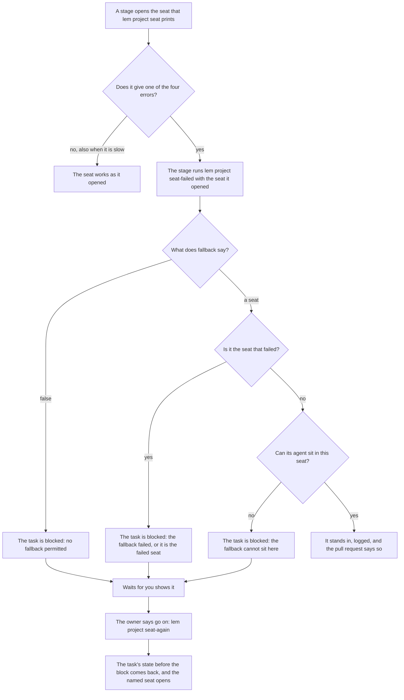

# Each seat gets a default for the machine, and a fallback seat stands in when its agent fails

careful: yes, because task 1 changes which agent and model Lem takes for each seat, which reaches the topic "Lem reads a project's settings wrong: ... a default nobody chose taken for the owner's word", task 2 writes `~/.config/lem/machine.toml` and `.lem/project.local.toml`, which reaches "Lem writes over something of the developer's: ... his settings", and task 3 puts another agent in the merge agent's seat, which reaches "The landing lets through a change that should not land".

## Acceptance criteria

Size: full, because the settings of every seat get two new places and an order, the plan talk and the merge agent get a fallback, and a new command writes the owner's settings in his home.

1. Each seat comes from the first of four places that names it: the repository's `.lem/project.local.toml`, its `.lem/project.toml`, `~/.config/lem/machine.toml`, then Lem's own default, which is `claude/opus:high` for the reviewer too. `lem project show` names the place of each seat:
   1. `machine.toml` has `reviewer = "codex/gpt-6.2-sol:high"`.
   2. The repository `notes-app` names no reviewer in its two files.
   3. `lem project show` in `notes-app` gives the reviewer `codex/gpt-6.2-sol:high`, from this machine.
   4. With no reviewer line in `machine.toml` either, it gives `claude/opus:high`, from Lem's default.
2. The fallback is one key, `fallback`, read from the same four places: a whole seat turns it on, `false` turns it off, and with no line in any place it is `claude/opus:high`. `lem project show` gives it and its place: `mybaze` has no `fallback` line, `machine.toml` has none, and `show` gives `claude/opus:high` from Lem's default.
3. When the agent of the `reviewer`, the `planner` or the `merger` gives an error, Lem takes the fallback seat in its place and goes on, and asks the owner nothing. An error is a program that is not on the Mac, or the agent's own message of no login, no tokens or an unknown model, before its first answer or later. A slow agent is no error, and Lem waits for it:
   1. `mybaze` names `codex/gpt-6.2-sol:high` as its reviewer, and its fallback is `claude/opus:high`.
   2. Codex has no tokens.
   3. A careful task in `mybaze` starts its plan talk, and Codex says that it has no tokens.
   4. Lem closes the Codex pane, opens `claude/opus:high` as the reviewer, and the plan talk runs to its end.
4. The pull request of a task in which a fallback seat stood in says, as a fact, which seat stood in, for which seat, and why: "the reviewer was `claude/opus:high` in place of `codex/gpt-6.2-sol:high`: Codex had no tokens". It does not make the pull request not green, and it does not make the merge agent call the owner. The record of the merge agent's read names the seat that read.
5. When the fallback is `false`, or the fallback seat gives an error too, or it is the seat that failed, the task is `blocked` with a line that names the seat and the error, and "Waits for you" shows it. Nothing tries the seat again by itself; the owner's "go on" in the task's session tries it once more:
   1. The project `billing-core` names `codex/gpt-6.2-sol:high` as its reviewer and has `fallback = false`.
   2. Codex has no tokens, and a careful task starts its plan talk.
   3. The task is `blocked`: "the reviewer `codex/gpt-6.2-sol:high` gave an error: no tokens, and this project permits no fallback".
   4. In the afternoon Codex works again. The owner types "go on" in the task's session, and the plan talk starts with Codex.
6. `/lem set global NAME VALUE` writes `~/.config/lem/machine.toml`, and `/lem set local NAME VALUE` writes the repository's `.lem/project.local.toml`. NAME is a seat or `fallback`; VALUE is a whole seat, `default`, which removes the line, or `false` for `fallback`. Each other line and comment of that file stays as it was, and no command writes `.lem/project.toml`:
   1. `machine.toml` holds `merger = "claude/opus:high"` and the owner's own comment `# the Mac in the office`.
   2. The owner types `/lem set global reviewer codex/gpt-6.2-sol:high`.
   3. `machine.toml` holds the new reviewer line, the merger line and the comment.
   4. `/lem set global reviewer default` removes the reviewer line again, and the other two lines stay.
7. `/lem reviewer` is no command of Lem any more: `/lem set local reviewer` does its work.
8. The experts and the task's own session take no fallback seat: when one expert's agent gives an error, the other expert answers alone, as today, and the `session` seat is the Claude session that runs the task.

## How it works

A seat's agent is started by a stage (the defender opens the reviewer, the lead opens the defender, the landing's session starts the merge agent), always on the seat that `lem project seat SLUG SEAT` prints: the stand-in while one holds, else the seat the settings name. When the stage sees one of the four errors, it runs one command of Lem's with the seat it opened, and that command alone decides: the fallback seat, or the block. A plan talk keeps its turns in `talk-turns.md` of the task directory as they come, so a talk that loses an agent goes on from that file, and a talk whose file has not changed for 45 minutes wakes the lead, which reads both panes' screens for an error.

Today a reviewer that does not answer makes the session ask the owner whether the other agent reviews for now (`harness/claude-code/second-opinion.md`), and a merge agent that fails twice tells the owner that the task waits for his read (`harness/claude-code/ask-merger.md`).

## Tasks

1. **The four places of each seat, and the key `fallback`.** Serves criteria 1, 2 and 8 (no stand-in for `session` and `experts` is task 3's).
   - `project.py:decide`: every seat, `reviewer`, `planner`, `merger`, `session` and `experts`, comes from the first of `.lem/project.local.toml` (main checkout), `.lem/project.toml` (the branch's copy, as today), the `[seats]` table of `machine.toml` (`lem_state.machine_table("seats")`), and Lem's default. Each seat in `show` carries `from`: the path of `LOCAL` or `SETTINGS` as `machine_seat_of` writes it today, the path of `machine.toml`, or `Lem's default`; each expert carries the same `from`. `machine_seat_of` becomes the one rule for all five seats; `MACHINE_SEATS` goes.
   - Lem's defaults: `reviewer` is `claude/opus:high` (a new constant beside `PLANNER`; today a repository with no reviewer gets each part null), `planner` `PLANNER`, `merger` and `session` `MACHINE_SEAT_DEFAULT`, `experts` `EXPERTS`. `init` still writes `REVIEWER_SEATS` by `--codex`, as today.
   - `seats.fallback`: a key of `[seats]` in each of the four places (Decision 1). A whole seat, `agent/model:effort` with `agent` in `REVIEWERS`, turns it on; the TOML boolean `false` turns it off; `true`, an empty string and a seat that is not whole are refused with the fix. With no line anywhere it is `claude/opus:high` (a constant `FALLBACK`). `show` gives `seats.fallback` as `{"seat": ..., "agent", "model", "effort", "from"}`, or `{"seat": false, "from": ...}` when it is off.
   - The whole-seat rule (`WHOLE_SEATS`) holds for a line in `machine.toml` as in the repository's files: `reviewer`, `planner` and each expert written whole, `merger` and `session` as today.
   - `lem_state.py`: `MACHINE_KEYS["seats"]` takes `reviewer`, `planner`, `merger`, `session`, `experts` (a list) and `fallback` (a string or `false`); `machine_table` checks a list value and a value of two kinds. `MACHINE_FIX["seats"]` names `lem project set global` (task 2) as the line that writes it.
   - `local.overrides` stays as it is for the tables that are not seats; `from` is what says that a seat is this machine's.
   - The docstring of `project.py` (the paragraph "A seat is one string") says the four places, the defaults and `fallback`.
   - `docs/settings.md`, the `[seats]` table: one row for `seats.fallback`, and the default column of each seat as the four places give it. `tests/lem-settings.sh` checks the table one to one with `project.py`, so the rows change in this task.
   - Tests, unit level: `tests/unit/test_settings.py` `Seats` (the `notes-app` case of criterion 1 with a temporary `XDG_CONFIG_HOME`, both steps; each seat's `from` in each of the four places; `fallback` from each place, `false`, the refusals of `true` and of a seat that is not whole; `test_lem_defaults_with_no_seat` gives the reviewer `claude/opus:high` now). `tests/lem-settings.sh`: the block that reads `seats.reviewer` keeps passing.
   - Files: `skills/lem/scripts/project.py`, `skills/lem/scripts/lem_state.py`, `docs/settings.md`, `tests/unit/test_settings.py`, `tests/lem-settings.sh`.
2. **`lem project set global|local NAME VALUE`, which keeps every other line.** Serves criteria 6 and 7. Builds on task 1's keys.
   - `project.py`: a command `set` with `global` or `local`, NAME one of `reviewer`, `planner`, `merger`, `session`, `experts`, `fallback`, and VALUE. `global` writes `[seats]` of `machine.toml` (`lem_state.machine_file()`); `local` writes `[seats]` of the main checkout's `.lem/project.local.toml`. VALUE is a whole seat for each seat (Decision 2), one or two whole seats joined by a comma for `experts`, written as a TOML list (Decision 3), `false` for `fallback` only, or `default`, which removes the line. A value is checked by the same rule `show` reads it with before anything is written, and the file is read and checked whole first, as `cmd_reviewer` does today: a wrong file is refused with its fix and stays as it is. It prints the seat as `show` then resolves it, with its `from`.
   - The write keeps every other line: one function in `lem_state.py` that edits the text of a TOML file for one key of one table. It replaces the one line `KEY = ...` inside `[TABLE]`, adds it at the end of that table, or adds the table at the end of the file, and on `default` removes that one line. A table left with no line goes with its header, a file left with no line goes, and comments stay. Before the rename it reads the new text back with `tomllib` and compares it with the old file's values: each table and key as it was, and only KEY of TABLE set or gone as asked (Decision 11). A file where they differ is refused with the fix, "write `KEY` on one line under `[TABLE]`", and stays as it is: a key that the old text writes in another form (a dotted key `seats.reviewer = ...` at the top, an inline table `seats = {...}`, a list over several lines) ends there. It writes through a temporary file and a rename, as `write_machine` does.
   - `lem_state.write_machine`, the writer of `[load]`, `[serve]`, `[peers]` and `[handoff]`, moves onto the same edit, one key at a time, so that a later `lem project load --start N` keeps the owner's comment and the `experts` list in `[seats]` (Decision 4; this is the first defect of `outside.md`). Its callers keep their arguments; a table it takes out (`values` None) is its lines alone.
   - `cmd_reviewer` and the command `reviewer` go, with no alias (criterion 7; `directions.md`, "No backward compatibility").
   - Tests, unit level: `tests/unit/test_settings.py` (the case of criterion 6, all four steps, on a temporary `XDG_CONFIG_HOME`; `set local` on a temporary repository, with its comment and its `[state]` table kept; `default` on the last line of a table and of the file; a list over two lines, a dotted key `seats.reviewer = ...` and an inline table `seats = {...}` each refused with the file unchanged; `false` for a seat refused; no path writes `.lem/project.toml`; `write_machine` keeps a comment and an `experts` list). `tests/lem-settings.sh`: the block at about line 131 that runs `reviewer` runs `set local reviewer`, and one check that `lem project reviewer` is refused as no command.
   - Files: `skills/lem/scripts/project.py`, `skills/lem/scripts/lem_state.py`, `tests/unit/test_settings.py`, `tests/lem-settings.sh`.
3. **The stand-in and the block, as one command with its records, in the pull request and the merge agent's read.** Serves criteria 3, 4, 5 and 8. Builds on task 1's `seats.fallback`.
   - `project.py`: `lem project seat SLUG SEAT`, the seat in use, the one place every opener takes its seat from (Decision 7): the `took` of the newest `seat.stand-in` of SEAT in the task's log when no `seat.again` of SEAT came after it, else the seat `show` gives. It prints the seat as `show` parses one, with `from` (`stand-in`, or the place `show` names).
   - `project.py`: `lem project seat-failed SLUG SEAT --seat LINE --error KIND [--said TEXT]`. SEAT is `reviewer`, `planner` or `merger`; `session` and `experts` are refused with the rule of criterion 8. LINE is the whole seat the stage opened, as `lem project seat` printed it, so the record names the agent that failed and not the settings at a later moment (Decision 6). KIND is one of `missing` (the program is not on the Mac), `login`, `tokens` and `model` (Decision 5); a slow agent has no KIND. `--said` is the agent's own words, kept in the event. The command decides, under the task's state lock:
     - `fallback` is `false`: blocked;
     - `fallback` is LINE, the seat that failed: blocked. This is the stand-in that failed too, and the fallback that is the same seat as the one named;
     - the fallback's agent may not sit in SEAT (the planner is `claude` only, `PLANNERS`): blocked;
     - otherwise it logs `seat.stand-in seat=SEAT failed=LINE took=FALLBACK error=KIND` and prints the seat to open as `show` parses one, with `say`, the one line for the session.
     A block logs `seat.blocked seat=SEAT failed=LINE error=KIND`, writes the state `blocked` with the first line that names the seat and the error ("the reviewer `codex/gpt-6.2-sol:high` gave an error: no tokens, and this project permits no fallback"; "..., and it was the fallback: no login"; "..., and its fallback `codex/gpt-6.2-sol:high` cannot sit in the planner's seat, which takes Claude Code only"), and the fixed line `the seat that failed: SEAT`, which `lem project state` checks in that form (Decision 6), and prints `blocked: true` with `say`.
   - `lem project seat-again SLUG`: the owner's "go on". It refuses a task whose newest block has no line `the seat that failed:`, writes the status of the block before it again (`building` for the plan talk, `open` for the merge agent) with the line `the owner's go on: the SEAT SEAT_LINE is tried again`, logs `seat.again seat=SEAT`, and prints SEAT and the named seat. `cmd_state` lets a block over `blocked` give `open` back only through this command.
   - A stand-in holds for that seat until the task ends or the owner's go on (Decision 7). `lem land merge-review SLUG` prints as `seat` the merger `lem project seat SLUG merger` gives, and keeps it with the brief in `landing.json`, by the brief's tip and base. The record of `--file` takes `by` in `landing.json` and in `merge.review` from that kept seat, never from a new read of the settings, so it names the seat that read.
   - `land.py:pr_text` and `small_text`: one line under "## Checks" for each `seat.stand-in` of the task, with no filter: "- the reviewer was `claude/opus:high` in place of `codex/gpt-6.2-sol:high`: Codex had no tokens" (the agent's name, `Codex` or `Claude Code`, and the words of KIND: "had no tokens", "had no login", "did not know the model", "is not on this Mac"). A stand-in that a block followed did its part of the work before the block, and it opened, since every opener takes `lem project seat`. `not_green` gives no reason for it, and the merge agent's facts carry it as `stand_ins`.
   - A merger's stand-in comes after the pull request is open: `merge-review --file` adds that line to the pull request's text on GitHub once, as `noted` does for the line of a merge on a moved base, and to `pr.md`.
   - A task blocked by its merge agent keeps its pull request. `lem land merged` and the server's look at GitHub (`serve.py`, the list of tasks with a pull request at about line 1968) take a `blocked` task whose newest block names `the seat that failed: merger` as they take an `open` one, so a merge on GitHub while it waits still lands it (Decision 8).
   - The board: the timeline's words for `seat.stand-in`, `seat.blocked` and `seat.again` (`lem_board_model`), and "Waits for you" shows the blocked task with its first line, as for any `blocked` task today.
   - `session.py:phase_of`: a `blocked` task whose newest block holds the line `the seat that failed: merger` is in the land phase, as `open` is, so a session the owner opens on it from the board is the landing's; a block of `reviewer` or `planner` stays in the build phase.
   - `session.py:cmd_wait`: `--quiet FILE` with `--companion ID` also ends the wait, with `"quiet": true`, when FILE (the task's `talk-turns.md`) has not changed for 45 minutes and no state of `--until` came (Decision 10). The rule is a function of the file's time and the clock, a unit case; it starts its count at the wait's start when FILE is not there yet.
   - Tests, unit level: the criterion 3 case (Codex reviewer, `tokens`, fallback `claude/opus:high`: the stand-in and its seat, then `lem project seat` gives the stand-in), the criterion 5 case (`billing-core`, `fallback = false`: the block's line word for word, the row in `waits_of`, then `seat-again`, the status `building` again, and `lem project seat` gives the named seat), the stand-in that fails too (`--seat` is the fallback), the fallback that is the named seat, a planner whose fallback is a Codex seat, `session` and `experts` refused; `pr_text` with one stand-in and with a stand-in that a block followed, both listed; `not_green` unchanged by a stand-in; `merge-review` prints the stand-in, and its `--file` records the kept seat as `by` after the settings name another merger; `phase_of` of a block of the merger and of the reviewer; the quiet end of `cmd_wait` at 45 minutes and none at 44. A block in `tests/lem-land-shop.sh`, on the stand-in for gh: a merger's stand-in adds its line to the pull request's text once, and `lem land merged` lands a task that its merge agent blocked.
   - Files: `skills/lem/scripts/project.py`, `skills/lem/scripts/land.py`, `skills/lem/scripts/session.py`, `skills/lem/scripts/lem_board_model.py`, `skills/lem/scripts/serve.py`, `tests/unit/test_task_rules.py`, `tests/unit/test_land_text.py`, `tests/unit/test_land.py`, `tests/unit/test_session.py`, `tests/unit/test_board_model.py`, `tests/lem-land-shop.sh`.
4. **The stages and the harness use the command, and ask the owner nothing.** Serves criteria 3, 5 and 7. Builds on task 3's commands.
   - `harness/claude-code/second-opinion.md`: the seat comes from `lem project seat SLUG reviewer`, with its `from`; the paragraphs "When the settings name no reviewer, ask the owner once" and "Never change the seat by yourself. When the reviewer does not answer, or says it is out of tokens, ask the owner once" go. In their place: how the opener sees one of the four errors (`command not found`, or the agent's own message of no login, no tokens or an unknown model on the pane's screen, `agtermctl session text`, or in a reply), that a slow reviewer is waited for, `lem project seat-failed` with `--seat` the line it opened, then the close of the pane (`agtermctl session split close`) and the open of the seat it printed, or the block. "This machine's choice" in a report comes from `from`.
   - `harness/claude-code/second-opinion.md`, the Claude Code launch line: `--disallowedTools "Edit Write NotebookEdit"` (a flag of `claude --help`, read 2026-11-23), so that a Claude reviewer cannot edit the plan with those tools; its mailbox send goes on stdin and needs none of them. The flag sits on criteria 1 and 2, which make `claude/opus:high` the reviewer of a repository that names none and the fallback of every seat (Decision 12). The backlog item `docs/backlog/the-plan-talks-claude-code-reviewer-has-no-read-only-guard.md` is removed in the same commit, with `git rm`, and its last open part, a write through the Bash tool, goes into the harness file as what the flag does not hold.
   - `stages/talk.md` and `prompts/defender.md`: the defender writes `talk-turns.md` in the task directory as the talk runs: the reviewer's first list word for word as it came, then one line for each later turn (who, the question's number, `closed`, `holds` with its why, the repair's commit or the refutation's cite). A defender that finds that file at its step 2 goes on from it: it opens the reviewer on `lem project seat SLUG reviewer`, sends it the list and the turns so far, and that reviewer's first turn answers the questions still open; the list stays closed. A reviewer that fails inside a running pair is replaced in the same way, in the same pane (Decision 9). The record of `stages/talk.md` names each reviewer that sat, and `turns` counts the turns of all of them. A block ends the talk: the defender stops after `seat-failed` wrote `blocked`.
   - `prompts/defender.md`: step 5, a block of the reviewer is no step of the owner's to wait for in the pair: the defender stops.
   - `harness/claude-code/plan-talk.md`, step 1: `MODEL` and `EFFORT` come from `lem project seat SLUG planner`. Step 2: a pair whose `claude` line fails (gone at once, or its screen shows one of the four errors) is `seat-failed SLUG planner --seat LINE`, then the pair opens on the seat it printed, or the lead stops on the block.
   - `stages/plan.md`, step 4.3: the wait is `--until planned,held,blocked --companion ID --quiet TASK_DIR/talk-turns.md`. On `blocked` the lead closes the pair, says the block's line in one line, marks the session as waiting (`mark-waiting`), and on the owner's "go on" runs `lem project seat-again SLUG` and opens the pair at step 4.2 again, whose defender goes on from `talk-turns.md`. On `"quiet": true` the lead reads the screen of each pane of the pair (`agtermctl session text`): one of the four errors on the defender's pane is `seat-failed SLUG planner`, on the reviewer's pane `seat-failed SLUG reviewer`, each with the seat `lem project seat` gave when it opened; then it closes the pair and opens it again at step 4.2, or stops on the block. No error on either screen: it runs the same wait again, since a slow agent is no error. The sentence "A defender that stops but stays live in its pane ... ends no wait" goes.
   - `harness/claude-code/ask-merger.md`: an end with one of the four errors (an exit of 127, or the agent's message in `ANSWER.log` or the reply) is `seat-failed SLUG merger --seat LINE`, LINE the `seat` that `merge-review` printed, then a start on the seat it printed; any other non-zero exit is today's start once more. A block waits for the owner's go on, `seat-again`, then the merge agent starts again.
   - `prompts/session.md`, "What comes next": a `blocked` task whose newest block names `the seat that failed: merger` takes `stages/land.md`, step 7, after the owner's go on; one that names `reviewer` or `planner` takes `stages/plan.md`, step 4.
   - `prompts/merge.md`: a stand-in seat is a fact of the request, and no reason to call the owner.
   - `skills/lem/SKILL.md`: the row `reviewer AGENT/MODEL:EFFORT` of the subcommands becomes `set global|local NAME VALUE`, which runs `lem project set` and says the seat `show` then gives.
   - Files: `skills/lem/harness/claude-code/second-opinion.md`, `skills/lem/harness/claude-code/plan-talk.md`, `skills/lem/harness/claude-code/ask-merger.md`, `skills/lem/stages/talk.md`, `skills/lem/stages/plan.md`, `skills/lem/prompts/defender.md`, `skills/lem/prompts/session.md`, `skills/lem/prompts/merge.md`, `skills/lem/SKILL.md`, and the removal of `docs/backlog/the-plan-talks-claude-code-reviewer-has-no-read-only-guard.md`. A stage file has no test: this task is the test of the next careful task with a Codex reviewer.
5. **The documents the change makes false.** Serves no criterion.
   - `docs/settings.md`: the prose of `[seats]` (the four places, `fallback`), and the row of `.lem/project.local.toml` at about line 109, which names `/lem reviewer`.
   - `docs/install.md` at about line 76, on the reviewer's seat.
   - `AGENTS.md`, "Layout", Lem's home folder: `[seats]` holds every seat and `fallback`, not only `merger` and `session`.
   - `README.md`, `docs/flow.md`, `docs/when-lem-needs-you.md` and `site/index.html`: read each for the reviewer's seat, `/lem reviewer`, and what happens when Codex is down, and correct what the change makes false, the page in the same commit as its guide.
   - Files: `docs/settings.md`, `docs/install.md`, `AGENTS.md`, and those of the four above that say it.

## Decisions of the plan

1. `fallback` is a key of `[seats]` in each of the four files, so one table holds who sits where and who stands in. It rests on criterion 2 ("read from the same four places") and on `[seats]` being the one table of seats today.
2. `set` takes a whole seat for every seat, `merger` and `session` too, as criterion 6 says ("VALUE is a whole seat"). A file may still hold `merger = "claude"`; only the command asks for the whole seat.
3. `set ... experts` takes one or two whole seats joined by a comma and writes a list, since the experts are one or two seats (`EXPERTS`) and criterion 1 gives every seat the four places.
4. `write_machine` moves onto the line edit in this task, and is not left to the polish pass: with `experts` and the owner's comments now usual in `machine.toml`, the next `lem serve --port N` would drop them, which is the topic "Lem writes over something of the developer's: ... his settings".
5. The error is one of four kinds that the command takes by name, `missing`, `login`, `tokens` and `model`, so that a slow agent or a crash of another kind cannot make a stand-in, and the words of the pull request and of the block come from one place. It rests on criterion 3's list of what an error is.
6. One command decides the stand-in and writes the block, with a fixed line `the seat that failed: SEAT`, so no stage text decides it by its own reading, and the owner's go on finds what to try again. It takes the seat the stage opened (`--seat`), so the seat that failed is the one that ran, whatever the settings say a moment later, and "the fallback failed too" is the failed seat being the fallback, with no reading of the log.
7. A stand-in holds for its seat until the task ends or the owner's go on, so that the next read of the merge agent in the same task does not try a Codex that had no tokens an hour ago. It rests on the outcome's Codex that has "no tokens until tomorrow". `lem project seat` is its one place: every opener takes its seat there, so a fresh session or a fresh defender opens the stand-in, and the pull request can list each stand-in as it ran.
8. A task that its merge agent blocked keeps the server's look at its pull request, since a merge on GitHub while it waits must still land it (the rulings: "The button on GitHub and `/lem land` are the same merge").
9. A plan talk keeps its turns in `talk-turns.md` from its first turn, and a reviewer or a defender that takes over goes on from it with the list as it stands, so the talk's rule "The list closes with the reviewer's first turn" holds also when the pair is opened again after a block.
10. A plan talk with no new turn for 45 minutes wakes the lead, which reads both screens, since an agent that stops at a limit and stays live in its pane sends nothing and ends no wait (`session.py:cmd_wait`, and today's sentence of `stages/plan.md`, step 4.3). It rests on criterion 3, "before its first answer or later". The 45 minutes are the guard's number for a session with no sign of work (the owner's, 2026-11-22), taken here as a guess for a talk; a wake with no error on either screen costs one read and the same wait again.
11. The line edit of task 2 reads its result back and refuses any file where the result differs from the one change, instead of a list of TOML forms it refuses, so that no form the settings accept (a dotted key, an inline table) can leave a line it did not find.
12. The Claude Code reviewer starts with `--disallowedTools "Edit Write NotebookEdit"`, since criteria 1 and 2 make it the default reviewer and the fallback that Lem opens with nobody there, and the contract calls the reviewer read-only (`harness/README.md`, `second-opinion`).

## What this plan will not verify

- A real Codex with no tokens, no login or an unknown model in a reviewer's pane, and a real `claude` line of the defender that fails: they cannot be made to happen on demand here. The stage texts of task 4 are tried by the next careful task whose reviewer fails.
- The words Codex and Claude Code print for each of the four errors: they change with their releases, so the harness names what to look for, and the KIND is the opener's call.
- The Claude Code reviewer's `--disallowedTools` line in a real talk, and whether the 45 minutes of a quiet talk wake the lead too often: both are tried by the next talks.
