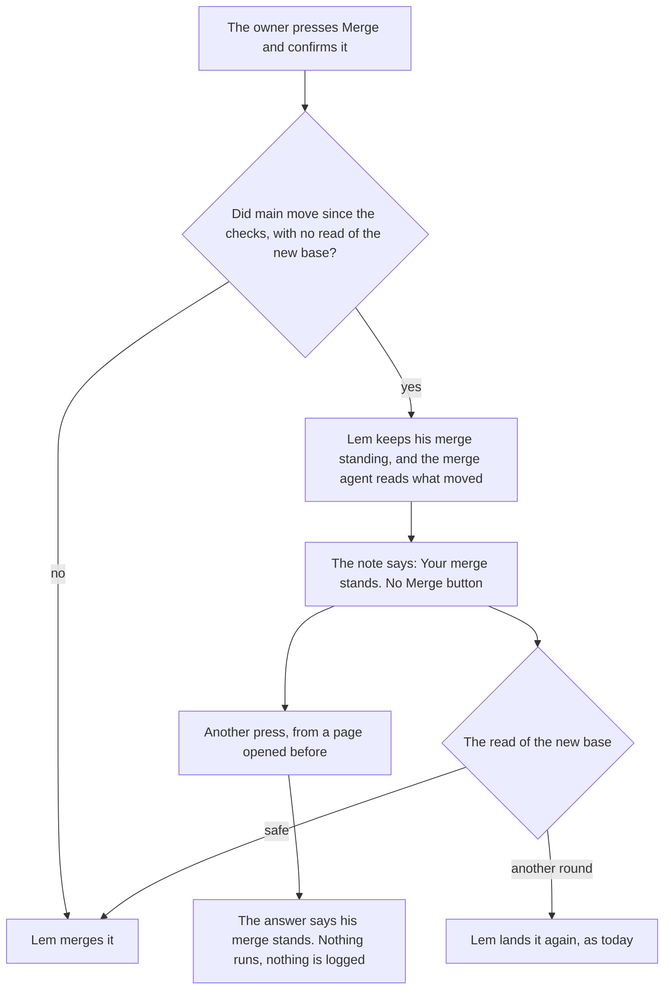

# The owner's merge that a moved base refused shows as standing, with no second Merge

careful: yes, because the change decides when the board offers the owner's merge and what the server does with a second press, which reaches the owner's topic "Lem changes a developer's repository without his word: a push, a merge".

## Acceptance criteria

Size: full, because the change decides when the board offers the owner's merge of a pull request, a careful topic.

1. While the owner's merge stands, the task's page offers no Merge button for that pull request, and its note says that his merge stands and waits for the read:
   1. The merge agent read pull request 60 on base `ea54c2a2c` and called the owner.
   2. The owner clicks Merge and confirms it.
   3. `main` moved to `d48c6a9b`, so Lem refuses the merge and keeps the owner's merge standing.
   4. The task's page shows no "Merge #60" button, and the note "Your merge stands. It goes through when the merge agent's read of the new base says safe." It does not say "Not done."
2. A press of Merge that reaches the server while the owner's merge stands, from a page opened before it, starts no second merge: the answer says that his merge stands, and Lem logs no second refusal of pull request 60.
3. When the moved base refused the merge agent's own merge, and the owner never pressed Merge, the Merge button stays on the task's page for him.

## How it works

What the board does with the owner's merge of an open pull request, from his press:

## Tasks

1. **The board knows that the owner's merge stands** (criteria 1, 2, 3). In `skills/lem/scripts/lem_board_model.py`, `skills/lem/scripts/serve.py`, `skills/lem/scripts/lem_board_task.py` and `skills/lem/scripts/lem_board_pages.py`:
   - The model gets one predicate for the case, named for what it means (for example `owner_stands(t)`), and it is the one definition of "his merge stands" that every part below reads. It holds while the task is `open` and the owner's merge stands for the tip Lem proposed last, in either of two spans (talk, question 1):
     - **it waits for the read**: the newest refusal (`t.refused`) is Lem's (`from: lem`) of `kind: base`, `by: owner`, for that tip, and no read of that tip said `another round` (`merge_wait` "reads");
     - **the server runs it**: no refusal stands, `merge.stands` is logged for that tip since the proposal (by a safe read, or by `propose` after a new landing), and the newest review of that tip does not say `another round` (`merge_wait` "merges", the server's `stands_due`). On #60 this span ran from 10:41:22 (`merge.stands`) to 10:41:27 (the server's `merge.start`).
     A refusal `by: merger` is not his word, so the predicate is false for it (criterion 3), and so is a refusal by GitHub of his standing merge (`from: github`), which waits for him as today. `merge_wait` keeps its values: the merge agent or the server still acts next, and the session and the server's duties read them as they do today.
   - `acts_of` offers no `merge` while that predicate holds, so `head_acts` draws no "Merge #60…" (criterion 1). Its docstring and `merge_wait`'s docstring say the new rule where they now say "stays in every case but relands" (`investigation.md`, "Reach").
   - The note of his merge gets a state of its own (not `refused`), with a sentence for each span: "Your merge stands. It goes through when the merge agent's read of the new base says safe." while it waits for the read (criterion 1, step 4), and "Your merge stands. Lem merges it now." while the server runs it.
   - `serve.py:merge_in_thread`, for the owner's merge (`by == "owner"`) that is not `standing`, reads the task again (`task_of`, a fresh model) in its worker, twice (talk, question 2):
     - before it runs land.py: while `owner_stands` holds, the worker runs no land.py and changes the note to that state, with the span's sentence. This is what keeps a second press from a second land.py, also when the press's request read the model before the first merge ended: `Notes.start_merge` gives a new token only when no merge of the task is in `NOTES.merging`; a worker leaves it only in its `finally`, after land.py exited; land.py logs `merge.refused` (or `merge.stands`) before it exits; and `Reader.current` makes the model again when the log has a new line.
     - after an exit 1 of land.py: while `owner_stands` holds, the note gets that state and the span's sentence. Every other exit 1 stays `refused` with land.py's line, as today.
   - `lem_board_pages.py:NOTE_LOOK` gets that state, drawn in the look of a wait (the gate's color and the clock), with no "Not done." before the sentence. `act_note` draws a note of that state only while `owner_stands` holds for its task in `ctx.model`; once it ends (merged, refused by GitHub, another round, a new proposal) it draws no note, and the page shows the task as it is (talk, question 3).
   - `serve.py:act_merge`: a press while the predicate holds starts no thread and runs no land.py (so no second `merge.refused` is logged and no wake follows), and answers with a note in the same state and the span's sentence (criterion 2). A press while the server's merge of it runs gets that merge's token, as today. Its refusal text no longer falls through to the conflict's text for this case.
   - `lem_board_task.py:merge_step`: the confirm step opened from an old link while the predicate holds says the span's sentence, not the conflict's text.
   - Tests: the investigator's two tests in commit 79ac23b2 (`tests.unit.test_board_model.MovedBase.test_a_merge_the_moved_base_refused_is_not_offered_again_until_the_next_proposal`, `tests.unit.test_serve.Duties.test_his_merge_that_a_moved_base_refused_stands_and_its_note_says_so`) pass, the second one with the exact sentence asserted and its stand-in workspace given a `model()` whose task holds the refusal its stand-in for land.py logs (its assertions stay as committed); a model case of the second span, the events of #60 to 10:41:22: `merge_wait` "merges", `owner_stands` true and no `merge` in `acts_of`, and the same with GitHub's refusal of the standing merge after it: `merge` offered; a unit case for the task's page (`tests/unit/test_board_task.py`) of the case of criterion 1: no "Merge #" link in the header, and the confirm step's sentence; a unit case in `tests/unit/test_serve.py` for `act_merge` while his merge stands: the note says it stands, and the stand-in for land.py's process is never called; a unit case for the worker: `merge_in_thread` by owner on a workspace whose model already holds his standing refusal, as a press whose request read the model before it was logged would reach it: the stand-in for land.py's process is never called and the note says it stands; the note's look in `tests/unit/test_board_pages.py` (no "Not done."); and `act_note` of a note in that state over a model where the task merged: no note. Then the block that holds the owner's acts from the board, `bash tests/lem-board-act.sh`, once at the end.

## Decisions of the plan

- **No new value of `merge_wait`.** "reads" says who acts next, the merge agent, and the task's session, the server's duties (`stands_due`, the wake of a refusal) and the board's column read it. A new value would reach each of them for no change of who acts. The predicate sits beside it. Rests on: `merge_wait`'s readers in `lem_board_model.py` and `serve.py`, read 2026-11-23.
- **The button, the note and the guard read one predicate of the model.** `owner_stands` is the one definition of "his merge stands"; `merge_in_thread`'s worker reads it on a fresh model, since `Reader.current` (`lem_board_model.py`) makes the model again when the event log has a new line, and land.py logs its refusal before it exits. A second reading of `landing.json` (`merge_refused`, `owner_tap`) beside it could disagree with the button. Rests on: `Reader.current` and `cmd_merge`'s `kept_refusal` branch in `land.py`, read 2026-11-23 (talk, question 2: this replaced the plan's first decision that the note reads the landing record, whose premise that the worker runs before the log is folded again was false).
- **A second press is answered by the server and never reaches land.py.** land.py would refuse it again on the same moved base (`moved_refusal`), log a second `merge.refused` and wake the session once more (`investigation.md`, "Reach"), and in the span where the server runs his merge it would start a merge beside the server's; criterion 2 asks that none of this happens. The check is in `act_merge` for the page's answer and in `merge_in_thread`'s worker, where the server's merges of one task take turns (`Notes.start_merge`), for a press whose request read the model before the first merge ended.
- **No document changes.** `docs/pull-request.md` "Merge it" says "Your merge stays while the change and its reasons stay the same", which stays true, and `docs/board.md` describes the Merge page only. Rests on: a search for "merge" in `docs/board.md`, `docs/pull-request.md` and `docs/when-lem-needs-you.md`, 2026-11-23.

## What it will not verify

- The board's page in a browser: the unit cases draw the task's page and the note as HTML, and the block `tests/lem-board-act.sh` runs the acts over HTTP with a stand-in for land.py. A screenshot of the real page needs a task in this state, which only a moved base during a real merge makes.
- The time the note stays on its address (`serve.py`, the note's lifetime): unchanged.
