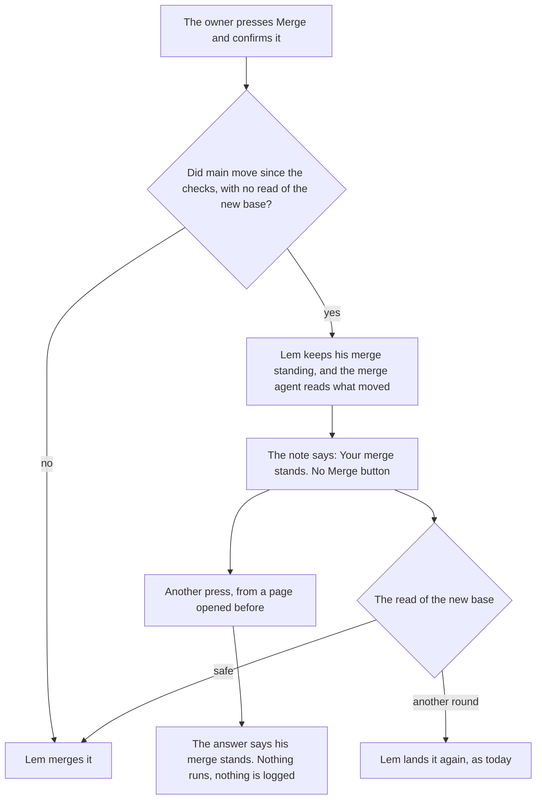

# The owner's merge that a moved base refused shows as standing, with no second Merge

careful: yes, because the change decides when the board offers the owner's merge and what the server does with a second press, which reaches the owner's topic "Lem changes a developer's repository without his word: a push, a merge".

## Acceptance criteria

Size: full, because the change decides when the board offers the owner's merge of a pull request, a careful topic.

1. While the owner's merge stands, the task's page offers no Merge button for that pull request, and its note says that his merge stands and waits for the read:
   1. The merge agent read pull request 60 on base `ea54c2a2c` and called the owner.
   2. The owner clicks Merge and confirms it.
   3. `main` moved to `d48c6a9b`, so Lem refuses the merge and keeps the owner's merge standing.
   4. The task's page shows no "Merge #60" button, and the note "Your merge stands. It goes through when the merge agent's read of the new base says safe." It does not say "Not done."
2. A press of Merge that reaches the server while the owner's merge stands, from a page opened before it, starts no second merge: the answer says that his merge stands, and Lem logs no second refusal of pull request 60.
3. When the moved base refused the merge agent's own merge, and the owner never pressed Merge, the Merge button stays on the task's page for him.

## How it works

What the board does with the owner's merge of an open pull request, from his press:

## Tasks

1. **The board knows that the owner's merge stands** (criteria 1, 2, 3). In `skills/lem/scripts/lem_board_model.py`, `skills/lem/scripts/serve.py`, `skills/lem/scripts/lem_board_task.py` and `skills/lem/scripts/lem_board_pages.py`:
   - The model gets one predicate for the case, named for what it means (for example `owner_stands(t)`): the task is `open`, its `merge_wait` is "reads", and its refusal (`t.refused`) is Lem's (`from: lem`) of `kind: base`, `by: owner`, for the tip Lem proposed last. A refusal `by: merger` is not his word, so the predicate is false for it (criterion 3). `merge_wait` keeps "reads": the merge agent still acts next, and the session and the server's duties read that value as they do today.
   - `acts_of` offers no `merge` while that predicate holds, so `head_acts` draws no "Merge #60…" (criterion 1). Its docstring and `merge_wait`'s docstring say the new rule where they now say "stays in every case but relands" (`investigation.md`, "Reach").
   - `serve.py:merge_in_thread`: after an exit 1 of land.py, the note reads the task's landing record again (`workspace.landing_of(slug)`). When it holds `merge_refused` of `kind: base` with `by: owner` and `owner_tap` for the same tip, the note gets a state of its own (not `refused`), and its text is the sentence of criterion 1, step 4: "Your merge stands. It goes through when the merge agent's read of the new base says safe." Every other exit 1 stays `refused` with land.py's line, as today.
   - `lem_board_pages.py:NOTE_LOOK` gets that state, drawn in the look of a wait (the gate's color and the clock), with no "Not done." before the sentence; `act_note` draws it so that the page reads the sentence of criterion 1 as it is.
   - `serve.py:act_merge`: a press while the predicate holds runs no land.py (so no second `merge.refused` is logged and no wake follows) and answers with a note in the same state that says his merge stands, in the same words (criterion 2). Its refusal text no longer falls through to the conflict's text for this case.
   - `lem_board_task.py:merge_step`: the confirm step opened from an old link while the predicate holds says the same sentence, not the conflict's text.
   - Tests: the investigator's two tests in commit 79ac23b2 (`tests.unit.test_board_model.MovedBase.test_a_merge_the_moved_base_refused_is_not_offered_again_until_the_next_proposal`, `tests.unit.test_serve.Duties.test_his_merge_that_a_moved_base_refused_stands_and_its_note_says_so`) pass, the second one with the exact sentence asserted; a unit case for the task's page (`tests/unit/test_board_task.py`) of the case of criterion 1: no "Merge #" link in the header, and the confirm step's sentence; a unit case in `tests/unit/test_serve.py` for `act_merge` while his merge stands: the note says it stands, and the stand-in for land.py's process is never called; and the note's look in `tests/unit/test_board_pages.py` (no "Not done."). Then the block that holds the owner's acts from the board, `bash tests/lem-board-act.sh`, once at the end.

## Decisions of the plan

- **No new value of `merge_wait`.** "reads" says who acts next, the merge agent, and the task's session, the server's duties (`stands_due`, the wake of a refusal) and the board's column read it. A new value would reach each of them for no change of who acts. The predicate sits beside it. Rests on: `merge_wait`'s readers in `lem_board_model.py` and `serve.py`, read 2026-11-23.
- **The note reads the landing record, not the model.** `merge_in_thread` runs before the event log is folded again, and `landing.json` is what land.py's `cmd_merge` wrote for this refusal (`merge_refused`, `owner_tap`). Rests on: `investigation.md`, "Cause", step 1.
- **A second press is answered by the server and never reaches land.py.** land.py would refuse it again on the same moved base (`moved_refusal`), log a second `merge.refused` and wake the session once more (`investigation.md`, "Reach"); criterion 2 asks that none of this happens.
- **No document changes.** `docs/pull-request.md` "Merge it" says "Your merge stays while the change and its reasons stay the same", which stays true, and `docs/board.md` describes the Merge page only. Rests on: a search for "merge" in `docs/board.md`, `docs/pull-request.md` and `docs/when-lem-needs-you.md`, 2026-11-23.

## What it will not verify

- The board's page in a browser: the unit cases draw the task's page and the note as HTML, and the block `tests/lem-board-act.sh` runs the acts over HTTP with a stand-in for land.py. A screenshot of the real page needs a task in this state, which only a moved base during a real merge makes.
- The time the note stays on its address (`serve.py`, the note's lifetime): unchanged.
