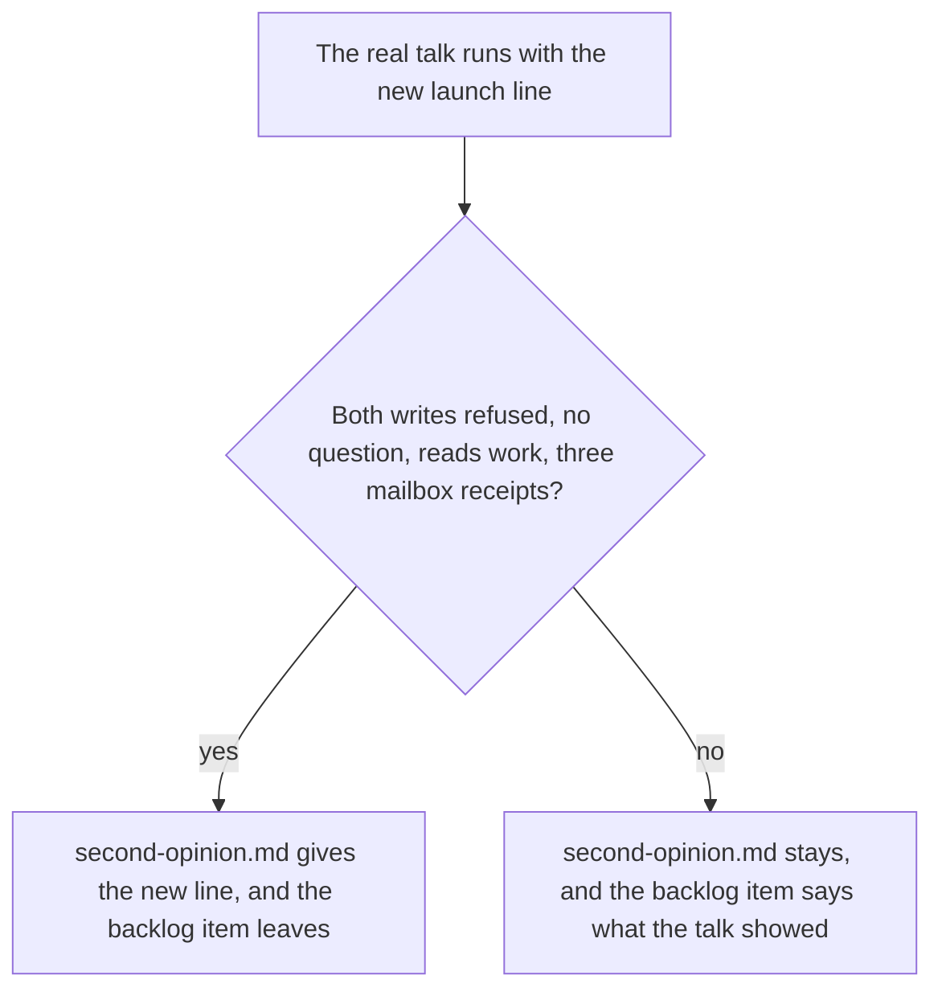

# The plan talk's Claude Code reviewer can read and cannot write

careful: yes, because the owner says so, and the change sets what the plan talk's reviewer may write, which reaches the owner's topic "A builder or a lead works outside its brief: it edits the main checkout, another task's worktree or a branch it does not own": the reviewer's pane stands in the main checkout, and a wrong launch line leaves it free to edit there or stops the talk.

## Acceptance criteria

Size: full, because the change is careful and rests on one real talk in agterm before any file changes.

1. A plan talk's Claude Code reviewer reads the repository and cannot change a file of it:
   1. A talk opens in a throwaway repository on this Mac, with the owner's own Claude Code settings and the reviewer `claude/opus:high`.
   2. The reviewer reads `plan.md` and runs `git log` there.
   3. The reviewer tries to write a line into `plan.md` with its file tool, and once more with a shell command.
   4. Claude Code refuses both writes with no question in the reviewer's pane, and `git status` in the repository shows no change.
   - no test: one real talk in agterm shows it; its screens and `git status` go into the builder's report, since no suite starts agterm and Claude Code
2. The reviewer still answers through the mailbox:
   1. In the same talk, the reviewer writes a long answer into a file under `/tmp`, outside the repository.
   2. It sends its message, which names that file, with `mailbox-chat.py say`, and the send prints no error.
   3. The message reaches the defender's pane, and the defender reads the file.
   - no test: the same real talk shows it, with the three receipts in the builder's report
3. `skills/lem/harness/claude-code/second-opinion.md` gives the launch line that the talk showed, and only that one: its Claude Code line starts Claude Code with the seat's model and effort, the reviewer's brief, and a guard that refuses every write into a repository and lets the mailbox send and the write under `/tmp` through. The guard is only on the launch line, or in a file of Lem's that the line names: Lem writes no file in the developer's Claude Code settings and none in the repository. When the talk did not show criteria 1 and 2, the harness file stays as it is, the backlog item in Lem's own `docs/backlog/` says what the talk showed, and the pull request says that the reviewer can still write.
   - no test: a sentence of the harness file

## How it works

## Tasks

1. **The probe, then the real talk.** First find the guard with `claude -p` runs in a throwaway
   git repository under the task directory, each with the owner's own settings loaded and one
   candidate guard (decisions 1 to 5): an `Edit` of `plan.md`, a `Write` of a new file there, a
   shell write there (`echo x >> plan.md`), a shell write of `/tmp/lem-reviewer-probe.txt`, and
   `git log`. Keep the narrowest guard that refuses the three repository writes and lets the
   other two through. Then open a pair in agterm whose session and panes start in Lem's main
   checkout, as a real talk's pair does (`plan-talk.md`, step 1, `MAIN`): a Claude Code agent as
   the defender in one pane, and the Claude Code reviewer in the other, started by the
   `second-opinion` steps with the candidate line and `skills/lem/prompts/reviewer.md` as its
   brief. The defender's message names the throwaway repository as the directory to work in, as a
   real talk names the worktree, and sends a short `plan.md` there with one wrong path. It asks the
   reviewer to read it, run `git log`, fix the path itself with its file tool, then with a shell
   command, and to answer with its long text in a file under `/tmp` and a short `say` that names
   the file. Record each refusal and its words, that no permission question showed in the
   reviewer's pane, the reviewer's screen, `git status` of the throwaway repository and of the main
   checkout, the `/tmp` file, the send's JSON and the defender's receipt, and the model and effort
   the reviewer's status line shows. Close every session and pane the task opened, and remove the
   throwaway repository's files only from the task directory. Serves criteria 1 and 2. Touches no
   file of the repository; its record goes into the task directory, `reports/task-1.md`.
2. **The harness file, by what task 1 showed.** When task 1 showed criteria 1 and 2:
   `skills/lem/harness/claude-code/second-opinion.md`, step 2, gives the Claude Code line that ran,
   with one sentence on what the guard refuses and what it lets through, its source and day (the
   talk of this task), and one on what it does not hold, from task 1's record (a command the
   developer's own settings run outside the sandbox, when there is one). When the guard is a file,
   it goes in `skills/lem/harness/claude-code/` beside the harness part, and the line names it by
   absolute path, as it names `prompts/reviewer.md`. The last note, "Not run yet", loses the Claude
   Code reviewer; `git rm` of
   `docs/backlog/the-plan-talks-claude-code-reviewer-has-no-read-only-guard.md`. Otherwise:
   `second-opinion.md` stays, and the backlog item is rewritten with what the talk showed. Serves
   criterion 3.

## Decisions

1. **The guard goes on the launch line, as a `--settings` value**, the same place the Codex guard
   took. It changes no file of the developer's. It rests on the ruling "Another program's settings
   stay where that program keeps them" and on the Codex line of
   `docs/plans/2026-11-21-plan-reviewer-read-only.md`, decision 1. `claude --help` (2.1.330, read
   2026-11-23) gives `--settings <file-or-json>`, "Settings file or JSON string to load more
   settings from". Whether the value is a JSON string on the line or a file Lem ships is task 1's
   finding: a file keeps the typed line free of nested quotes in fish and zsh.
2. **The file tools are denied by permission rules** (`Edit`, `Write`, `NotebookEdit` under
   `permissions.deny`). A deny rule wins over an allow rule in every settings scope, so the
   owner's `defaultMode = "auto"` in `~/.claude/settings.json` (its line 33) and his allow rules
   do not let an edit through. The reviewer writes its `/tmp` file with a shell command, under
   decision 3.
3. **A shell command runs in Claude Code's sandbox, and writes only under `/tmp`.** `sandbox.enabled`,
   `sandbox.failIfUnavailable` and `sandbox.allowUnsandboxedCommands = false`: the docs' strict
   sandbox mode, in which Claude Code ignores the `dangerouslyDisableSandbox` retry
   (code.claude.com, settings reference, read 2026-11-23 through Context7). The sandbox writes the
   working directory by default, which is the main checkout here, so the guard denies it
   (`sandbox.filesystem.denyWrite`) and allows `/tmp` (`allowWrite`). `/tmp` is the whole folder,
   not one file: the Claude side of the mailbox names "a file under `/tmp`" of any name
   (`~/.claude/skills/mailbox-chat/SKILL.md`, "Sending"), and no task's worktree or state is there.
   The exact path forms (`/tmp` or `/private/tmp`, the prefix for the working directory) are task
   1's finding.
4. **The send reaches agterm's socket and stays in the sandbox when it can.**
   `mailbox-chat.py say` talks to agterm over its Unix socket (`$AGTERM_SOCKET`,
   `~/Library/Application Support/agterm/agterm.sock` on this Mac), and the macOS sandbox blocks
   every Unix socket unless `sandbox.network.allowUnixSockets` names it (the same reference). The
   first candidate names the socket; `sandbox.excludedCommands` for `mailbox-chat.py` is the second,
   taken only when the first fails, and the harness says so.
5. **The developer's own settings still load.** No `--setting-sources`, no `--safe-mode`, no
   `--restricted`: the reviewer receives its mail through his mailbox hook, and his login and model
   settings stay his. What his settings add that runs outside the sandbox (an `excludedCommands`
   entry of his) is outside the guard, and task 2's sentence says so when task 1 finds one.
6. **The line keeps `--model "MODEL" --effort "EFFORT" --append-system-prompt` and the first
   prompt as they are.** The seat names model and effort, and `second-opinion.md` reads them back
   from the status line.

## What it will not verify

- The whole plan talk of Lem (`stages/talk.md`, its events and its record): task 1 runs the launch
  line, the reviewer's brief and the mailbox, which are what the change touches.
- Another Claude Code version than the installed 2.1.330, and Linux, where the sandbox reads no
  socket path (the same reference: `allowUnixSockets` is ignored there).
- A command the developer's own settings exclude from the sandbox: his word for every Claude Code
  session, which the ruling "Another program's settings stay where that program keeps them" keeps
  Lem out of.
