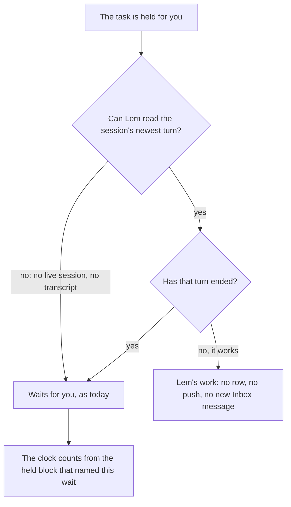

# "Waits for you" lists a task only while its session waits

careful: no, because the change reads a session's transcript and draws the rows of what waits; it writes no record of a task, lands nothing, sends nothing new, and no topic of `flow.topics` names the board's rows (checked against all 13).

## Acceptance criteria

Size: full, because the board's model, the list of what waits for the owner and the read of a session's transcript change together.

1. A held task whose session's newest turn still runs is Lem's work, not yours: it is no row of "Waits for you", `lem project waiting` does not list it, no push goes for it, and its panel does not say "Waits for":
   1. one-home-folder-for-lem is held with "the criteria wait for the owner" at 11:39 UTC.
   2. At 11:42 you press "Discuss in chat" on the criteria page, and the session's turn starts.
   3. At 11:43 the board shows the task as Lem's work, and "Waits for you" does not list it.
2. When the session's newest turn has ended, the held task waits for you again: at 11:43:33 UTC the session asks you one question in the terminal and its turn ends, and the task is a row of "Waits for you" again. A page that is up counts the same way: its turn has ended, so the task waits for you.
3. When Lem cannot tell whether the session's turn runs (the task has no live session, or Lem finds no transcript of it), the held task shows as it does today: a task with no transcript Lem can read stays under "Waits for you".
4. The wait counts from the held or blocked block that named this wait, on the row, the pill and "In this state": one-home-folder-for-lem's interview block is at 09:55 UTC and its criteria block at 11:39 UTC, so at 11:44 the row says "since 12:39" local, "5m", not "since 10:55", "1h 48m".
5. A held or blocked block written again with the same first line keeps the clock of its wait: a session that opens again at 12:10 UTC and writes "held: the criteria wait for the owner" once more leaves the wait at 11:39. A task in any other status keeps today's rule: a building task that moves from "task 1 of 3" to "task 2 of 3" counts from when it started to build.

## How it works

A held task is the owner's only when its session's newest turn has ended, or when Lem cannot read that turn.

The fact that tells a running turn from an ended one is the newest decisive record of the session's
main transcript, read from its end:

- an `assistant` record with `stop_reason` `tool_use`: the turn runs, unless its tool is the
  question widget (`AskUserQuestion`), which asks the owner;
- an `assistant` record with any other `stop_reason` (`end_turn`, `stop_sequence`, `refusal`,
  `max_tokens`): the turn ended. A record with no `stop_reason` is skipped;
- a `user` record that is an interrupt (`[Request interrupted`): the turn ended;
- a `user` record of a local command (its text starts with `<command-name>`, `<command-message>`,
  `<command-args>`, `<local-command-`, `<bash-input>`, `<bash-stdout>` or `<bash-stderr>`) or a
  compaction's summary (`isCompactSummary`): skipped, since none runs a turn;
- any other `user` record (a prompt, a tool's result, a task notification, a skill's text, another
  session's message): the turn runs;
- every other record type, and every `isSidechain` record: skipped.

A subagent's transcript is never read for this: an interview's scout runs in the background while
the session's turn has ended on its question to the owner.

## Tasks

1. **The session's turn, read from its transcript.** `lem_signs` gives a fourth fact, `turn`:
   `"runs"`, `"ended"`, or None when it cannot tell, by the rule of "How it works", from the newest
   transcript of the session's records (the one with the newest turn), its main thread only. It is
   None whenever `signs` is false: no live process, no turn. `lem session list` prints it in each
   entry, and `lem_board_model.session_entries` takes it. Unit cases in `tests/unit/test_signs.py`
   for each branch of the rule, with transcript lines of the forms the probes read (a prompt, a
   tool's result, `end_turn` after a tool's result, an interrupt, a local command after `end_turn`,
   a `/lem` command with its skill text, a compaction's summary, `AskUserQuestion`, a sidechain
   record, no decisive record). Serves criteria 1, 2 and 3. Files: `skills/lem/scripts/lem_signs.py`,
   `skills/lem/scripts/session.py` (`cmd_list`), `skills/lem/scripts/lem_board_model.py`
   (`session_entries`), `tests/unit/test_signs.py`, and `tests/unit/test_session*.py` where `list`'s
   entry is checked.
2. **The model: who waits, and since when.**
   - The clock: in `settle`, the walk-back of `t.since` crosses an earlier block of a `held` or
     `blocked` task only when that block has the same status and the same first line; every other
     status keeps today's walk-back. `tests.unit.test_board_model.WaitStart` (commit 4bd244de)
     passes, and new cases hold criterion 5: the same first line written again at 12:10 UTC keeps
     11:39, and a building task from "task 1 of 3" to "task 2 of 3" keeps its start. The row, the
     pill (`lem_board_task.pill`) and "In this state" (`lem_board_task.facts`) read `t.since`, so
     each case checks the three. Serves criteria 4 and 5.
   - The session at work: one function of `lem_board_model` puts the session facts on a model
     (`Model.sessions`) and, for each held task whose session is live with an agent and whose
     `turn` is `"runs"`, makes the task Lem's: not `for_owner`, its own `info` ("The task's session"
     works on your answer), its lane among Lem's work, out of `m.for_owner`, and no row of
     `waits_of`. It is idempotent, since the server sets the sessions again on a model it cached
     (`Workspace.model`); a task whose turn ends gets back what `settle` gave it. Every place that
     sets `Model.sessions` calls it: `serve.py` (`Workspace.model`, `Workspace.look_sessions`),
     `project.py` (`waiting_model`) and `session.py` (`guard_check`). A held task with no
     session facts, a session that is not live, or a `turn` of `"ended"` or None, stays as `settle`
     gave it. The push follows the rows as it does. Unit cases build the case of criterion 1 and 2
     from one-home-folder-for-lem's events at 11:42:52Z (turn `"runs"`: no row of `waits_of`, no
     "Waits for" on the panel, the task in Lem's lane) and at 11:43:33Z (turn `"ended"`: the row is
     back, since 11:39), and criterion 3 (no session facts; a live session with `turn` None).
   - The Inbox: a row that a working session holds back keeps its sent thing as it stands. `lem_inbox`'s
     `plan` gets the keys of those rows, as it gets `behind`, and for each one neither withdraws,
     forgets nor sends. Unit cases in `tests/unit/test_inbox.py`: the owner away, a breaker's
     question sent, the server's wake starts a turn: the question stays open and nothing is sent;
     the turn ends with the same block: nothing is sent again.
   Files: `skills/lem/scripts/lem_board_model.py`, `skills/lem/scripts/lem_board_task.py` (only if
   the panel reads `for_owner` before the sessions), `skills/lem/scripts/serve.py`,
   `skills/lem/scripts/project.py`, `skills/lem/scripts/session.py`, `skills/lem/scripts/lem_inbox.py`,
   `tests/unit/test_board_model.py`, `tests/unit/test_inbox.py`. Serves criteria 1, 2 and 3.
3. **The documents.** `docs/when-lem-needs-you.md`, "What waits for you": the sentence "An interview
   is on the list only while it asks you a question" is true no longer in full; add that a held task
   whose session works on your answer is not on the list until its turn ends, and that a wait counts
   from the block that named it. `site/index.html` where it says the same. The module docstrings of
   `lem_signs.py` (a fourth fact, `turn`, where it is read, and the probe's numbers) and
   `lem_inbox.py` (a row a working session holds back). `docs/board.md` only if a sentence there is
   made false. Serves no criterion.

## Decisions

1. **The fact is the main transcript's newest decisive record**, by the rule of "How it works". It
   rests on three probes of 2026-11-23 in the task directory (`probe_turns.py`, `probe_end.py`,
   `probe_status.py`), over the 300 newest transcripts on this Mac, Claude Code 2.1.294 to 2.1.330:
   - `stop_reason` of the main thread's assistant records: 53,528 `tool_use`, 5,411 `end_turn`, 29
     `stop_sequence` (an API error's message), 3 null, 1 `refusal`.
   - A `turn_duration` record follows 4,114 of 4,122 ended turns, but none of 8 interrupts, so it is
     no mark of an end.
   - Claude Code's own `status` in `sessions/PID.json` read `busy` for 4 of 26 live sessions whose
     main transcript had ended on `end_turn`, so it is no mark of a running turn; my read, not
     checked, is that a background subagent keeps it `busy`.
2. **A breaker's held task follows the same rule**: criterion 1 says "a held task", and a breaker is
   one. While the session works on his help, the breaker's row is held back; when it logs his help,
   the task is `helped`; when its turn ends without that, the row is back.
3. **`blocked` keeps today's rule of who acts**: criterion 1 names a held task. Its clock follows
   criteria 4 and 5.
4. **The question widget's `tool_use` is an ended turn.** The failure it prevents: a held task whose
   session asks the owner through the widget is hidden. The input: a session that follows a personal
   rule of the owner's that asks through the widget. Realistic here: the owner's own rules name the
   widget. Left out: the task sits under Lem's work until he looks at the session.
5. **The Inbox keeps a held-back row's thing.** The failure it prevents: a loop of messages on the
   owner's phone. The input: the owner is away, the Inbox sends a held task's question that does not
   go on without him (a breaker; an interview or criteria wait goes on with Lem's guesses and has no
   row, `goes_on_of`) and wakes the task's session (`lem_inbox`, "After each question it sends ... it wakes the task's session"), the
   woken turn runs past one look (LOOK_SECONDS), the row leaves and its question is withdrawn, the
   turn ends, the row is back as a new thing, and the Inbox sends and wakes again. Realistic: each
   send while away starts such a turn. Left out: every question while away repeats until he answers.
6. **The push keeps its own rule.** A row that leaves and comes back within `FLAP_SECONDS` (300, a
   guess in `lem_push.py`) is not sent twice, so a short turn sends nothing; a turn longer than that
   which ends on a new question sends one push, which is news: the task waits again.
7. **The board lags a turn by up to one look of the server**: `look_sessions` runs at each
   `FORGE_TICK` (20 seconds, `serve.py`), and the rows read that look. No faster look is added.

## Not verified

- A turn that stops on a permission prompt reads as running: the transcript holds no record of the
  prompt in the probes, and none of the 300 transcripts showed one to check. Such a held task shows
  as Lem's work until the turn goes on.
- Transcripts of Claude Code before 2.1.294, or of an agent other than Claude Code: none were read.
- A session with more than one transcript (a `/clear`): the rule reads the one with the newest turn,
  which is the one Claude Code writes now; no such held task was in the log to try.
