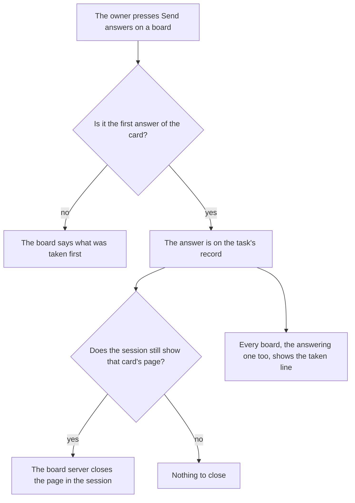

# A card answered on the board closes everywhere

careful: no, because no task reaches a topic of `flow.topics`: the change is what the board and a session's page show after an answer, and the answer's record, its first-answer rule and the pull request are not touched; it starts no pattern that product code copies.

## Acceptance criteria

Size: full, because the fix reverses a choice of commit d0c19d29 that a browser test holds, and it touches the board's script, the page's style and the server's close of a session's page.

1. The board where the owner answers a card closes the card and shows the same "taken" line as every other board. Example: the owner presses "Send answers" on the card "Approve the criteria?" of task `board-views-tight-like-linear` on his computer's board; that board then shows the "taken" line in place of the card, with no "Send answers" button, as his phone's board does.
   - test: `.venv/bin/python -I -B tests/__main__.py --level browser tests/browser/test_cards.py::test_the_board_that_took_the_answer_closes_the_card tests/browser/test_cards.py::test_an_answer_on_one_board_replaces_the_open_card_on_the_other` in `tests/browser/test_cards.py`
2. A line that a page shows after an answer stands on a background of its own and is readable over the text under it. Example: "Answer sent — you can close this tab." in a browser tab of `lem ask`, and any such line on the board, have a background that is not transparent.
   - test: `.venv/bin/python -I -B tests/__main__.py --level browser tests/browser/test_cards.py::test_the_line_after_an_answer_has_a_background_of_its_own tests/browser/test_cards.py::test_the_line_after_an_answer_takes_the_page_s_ground_in_light_and_dark` in `tests/browser/test_cards.py`
3. After the owner answers a card on the board, the task's session closes its page for that card, also when no wait for it runs. Example:
   1. A session asks "Approve the criteria?" at 10:00.
   2. Its wait ends at 10:09 with `pending`.
   3. The owner answers on the board at 10:30.
   4. The page in the session closes at 10:30, with no step of the session's agent.
   - test: `.venv/bin/python -I -B tests/__main__.py --level unit tests/unit/ask/test_card.py::test_a_board_answer_closes_the_page_when_no_wait_runs tests/unit/ask/test_card.py::test_the_board_closes_the_page_by_its_id_wherever_its_file_is` in `tests/unit/ask/test_card.py`

## How it works

The board's answer route closes the session's page itself, as soon as its answer is the first one. A waiter that still runs reads the same answer and finds the page already closed, or closes it first; the second close finds no page and does nothing.

## Tasks

1. **The answering board closes the card, and the line after an answer has its own background** (criteria 1 and 2). Remove the receipt that keeps the card's frame on the board that took the answer: `answeredHere` and the `:answered` key in `tools/board-kit/app.js`, and the key that `ended` gives in `src/lem/board/views/panel/card.py`. Rebuild `skills/lem/assets/vendor/board-app.js` with `tools/board-kit`. Give `.hd-done` in `skills/lem-ask/runtime/ask.css` a background that does not depend on a variable set only on `.hd`, in light and dark. Change the last two lines of `tests/browser/test_cards.py::test_an_answer_on_one_board_replaces_the_open_card_on_the_other` to the new rule, and make the investigator's two tests of cbe166b1 pass. Files: `tools/board-kit/app.js`, `skills/lem/assets/vendor/board-app.js`, `src/lem/board/views/panel/card.py`, `skills/lem-ask/runtime/ask.css`, `tests/browser/test_cards.py`, `tests/unit/board/views/test_panel_steps.py`.
2. **The board server closes the session's page after a board answer** (criterion 3). When `src/lem/board/ask/accept.py:commit` records the first answer, the server closes the card's page in the card's own session (`card.session` of the card's metadata) when that session's overlay still shows that page id. The close of one page moves to a function that the command line and the board both call, below `cli` and `board` in the import layers; `src/lem/cli/ask/overlay.py:Overlay.close` and `card_wait.close_board_answer` keep their behavior through it. The server reads the terminal as `src/lem/board/ask/observe_card.py` does (the caller's window left, `opening.detached`). A failed close leaves the answer on record and the reply 200, and is written to the server's log with the page id and the reason. Files: `src/lem/board/ask/accept.py`, `src/lem/cli/ask/overlay.py`, `src/lem/cli/ask/overlay_tree.py`, a module under `src/lem/app/asking/`, their tests under `tests/unit/ask/` and `tests/unit/board/`.
3. **Documentation**. `skills/lem-ask/SKILL.md`, "A card of a task's session": the line "The overlay waiter closes its page when it reads the board's answer" becomes the server's close, also with no wait. `docs/board.md`, the part on cards: one sentence that the card closes on every board and in the session after an answer, only if the page says nothing about it now. Files: `skills/lem-ask/SKILL.md`, `docs/board.md`.

## Decisions

- **The server's close of a page is no close of a session.** The ruling "What reaches across tasks is the board server's" says it never types into a session, selects one or closes one. Closing the card's page is none of these: the session and its agent stay. The owner asked for this close on 2026-11-27 ("y", `directions.md`).
- **The page is matched by its id in the session's overlay tree, not by its file's folder.** The board server's temporary folder can differ from the session's, so `temp_pages.ours` would miss the page; the id is the card's page id, which only that card has.
- **The waiter's own close stays.** It is the close when the server's close failed, and the second of two closes finds no page and does nothing (`Overlay.close` reads the tree first).
- **A failed close does not refuse the answer.** The answer is on record when the close runs; the owner's "Send answers" stays a success, and the log keeps the reason.

## Not verified

- A real agterm session: the tests fake `agtermctl`. The task's landing does not open an overlay on the owner's Mac.
- The embedded WebKit view of the owner's picture: the browser tests run Chromium.
