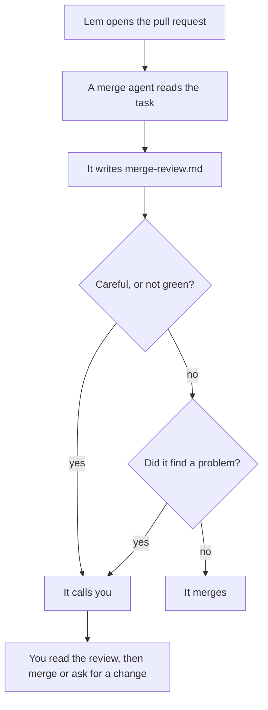

# The pull request

## What it says

The first line says green or not green, and each reason for "not green" comes next. Then come your
request, the acceptance criteria with their tests, the checks (your test commands), and each
decision with who took it and why.

A pull request is not green when one of these is true:

- your tests got less strict (the bar went down), even with a reason in the plan;
- the review left a must-fix after two rounds, or no reviewer answered;
- a criterion changed during the build;
- a decision went past the personas: the dialectic or the experts took it;
- Lem approved the criteria without you: while you were away, or in a night task;
- the personas did not answer, two times, when they read the criteria;
- the change brings the first checks into a project that had none;
- a task on the fast track turned out to be careful: it can affect what must never go wrong.

Smaller choices of an agent do not change green. The pull request lists the ones that matter.

## What Lem saw outside the task

The pull request names each defect that an agent found outside the task, under one of three
headings:

- **Fixed on the way**: a cheap defect (no change of behavior, no new test). An agent that already
  works on the branch fixed it in a commit of its own.
- **Filed in the backlog**: a defect that occurs today and confuses a user, breaks a contract,
  damages data or costs money. It is an item in `docs/backlog/`.
- **Seen, not filed**: each other defect, with its place and the reason, or the open item that
  already names it.

The bar is rule 6 of `agents/lem-builder.md`, or of your own `.claude/agents/lem-builder.md`. It
is for Lem's agents only: an item that you write or ask for is always filed. When Lem filed an
item under the bar, the merge agent calls you.

## The merge review

Lem opens each pull request on GitHub, the one way a task lands. Then a fresh merge agent reads
the task: its files, its reviews and its diff. It changes nothing, and it writes `merge-review.md`.
The review starts with its verdict, merge or call. Then it tells what Lem built and why, the
results, each decision that Lem took without you, and the time and the tokens. For a safe small
change, it is the verdict and three sentences. A change to what you see also gets the before and
after pictures of the builders, or one line that says why there is none. When the review calls you
for such a change, its last line tells you how to try the branch: in its worktree, or with `gh pr
checkout`.

When the merge agent calls you, the board shows "Read the merge review" in "Waits for you", and
the review is the first card of the task.

After the verdict merge, the board server merges the pull request. Until then the task stays in
the column "Checks and review", with no row in "Waits for you" and no notification.

With `branch.land = "owner"`, the merge agent still writes its review, but it never merges
([Settings](settings.md#branch)).

## Merge it

There is one merge: the merge of the pull request. You start it with the Merge button on GitHub,
with Merge on the [board](board.md), or with `/lem land <task>`. While you are away, you can also
answer Merge in the [Inbox](when-lem-needs-you.md#answer-from-the-inbox). Lem merges only the
commit that the question names.

- A merge goes through GitHub, under the rules of your base branch. When GitHub refuses it,
  "Waits for you" shows the line that GitHub gave. Lem refuses it when the pull request on
  GitHub has another base branch than yours, and names the fix.
- When the base branch moved after the checks, the merge agent reads what moved. When it says
  "safe", Lem merges with no new run of the checks, and the pull request gives both bases and the
  reason. When it says "another round", Lem runs the checks again first. Your merge stays while
  the change and its reasons stay the same. Otherwise Lem tells you why, and waits for you.
- With more than one task, `/lem land` merges them one at a time, in your order.

Do not merge the branch of a task by hand: Lem knows only a merge through the pull request. After
a merge, the session of the task removes the worktree, the branch and its copy on GitHub, and
updates the ticket of the task. A branch that Lem rebased after its push also goes when it holds the
change that GitHub merged. A branch with a change that GitHub did not merge stays, and Lem tells you
what changed and how to delete it.

On GitHub's button, you select the merge method. `branch.history` is for Lem's merge.

The board server sees a merge or a close on GitHub within a few minutes.

## A conflict

When a merge makes another open pull request conflict, the board server wakes the session of its
task. That session rebases the branch, and a builder resolves the conflict. The checks run again,
and one read checks the resolution. Lem leaves every other open pull request as it is.

When the read finds nothing and the change is not careful, the merge review stays, and so does
your merge while the reasons for "not green" stay the same. A fresh merge agent reads the pull
request, and your merge stops, when:

- the read found a must-fix, a should or a nit, or did not answer two times;
- the change is careful;
- a commit came after the resolution;
- the review before the conflict left a must-fix (then the whole change gets the review rules).

The pull request says what stayed, or why a merge agent reads it.

## A commit of a teammate

Lem never pushes over a commit that it did not push. Such a commit stops Lem before its next push,
and Lem names the `git pull --rebase` that brings it in. Then the commit gets the checks and a read.

## Stop a task

Type `/lem drop <task>`, or close the pull request on GitHub with no merge. Lem removes the
worktree. A branch with commits of its own stays, and Lem tells you how to delete it. For new work,
make a new request.
