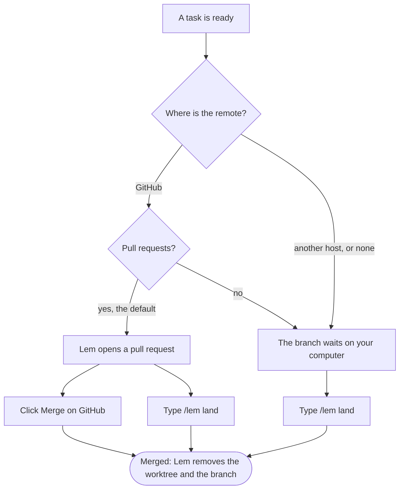

# The pull request

## What it says

The first line says green or not green, and each reason for "not green" comes next. Then come your
request, the acceptance criteria with their tests, the checks (your test commands), and each
decision with who took it and why.

A pull request is not green when one of these is true:

- your tests got less strict (the bar went down), even with a reason in the plan;
- the review left a must-fix after two rounds, or no reviewer answered;
- a criterion changed during the build;
- Lem took a decision of yours while you were away;
- the personas did not answer, two times, when they read the criteria;
- the change brings the first checks into a project that had none;
- a task on the fast track turned out to be careful: it can affect what must never go wrong.

An agent also makes smaller choices inside a task, all the time. They do not change green: the pull
request lists the ones that matter, each with its reason.

You can merge a green pull request without a read.

On the standard track, Lem also makes a page that tells what was built, why, and who took each decision.
Type `/lem status <task>` to open it.

## Merge it

Each project has one way to merge. The remote and one setting decide it.

- **GitHub, with pull requests** (the default). Click Merge on GitHub: the rules of your base
  branch guard the merge, and Lem does not run its checks again. Type `/lem land <task>` when the
  base moved and Lem's checks are your only checks: Lem rebases the branch and runs them again
  first.
- **GitHub, with no pull requests** (`branch.propose = "merge"`), for a developer who works alone.
  `/lem land <task>` puts the task on the base branch and pushes it to GitHub.
- **Another host**, for example GitLab. Lem opens pull requests on GitHub only. `/lem land <task>`
  pushes the task to the base branch of the remote, which fits a developer who works alone.
- **No remote.** `/lem land <task>` moves the base branch on your computer.

Do not merge the branch of a task by hand: Lem knows only a merge through the pull request or
through `/lem land`. After a merge, Lem removes the worktree and the branch, and updates the Linear
ticket of the task.

On GitHub's button, you select the merge method. `branch.history` is for a merge by Lem, and
`branch.land = "agent"` lets Lem merge a green pull request with no word from you
([Settings](settings.md#branch)).

A script looks at Lem's pull requests one time each minute, with the GitHub CLI `gh`, while Lem's
session is open. It uses no model until a pull request changes. Each `/lem` also looks.

## A conflict

When a merge makes another open pull request conflict, Lem rebases its branch, and a builder
resolves the conflict. The checks run again, and one read checks the resolution. Then Lem updates
the pull request and tells you in one line, for example:

> Rebased on main after the forge called it conflicting; one conflict in shop/dates.py, resolved by
> a builder; the checks passed again.

Lem leaves every other open pull request as it is.

## A commit of a teammate

Lem never pushes over a commit that it did not push. Such a commit stops Lem before its next push,
and Lem names the `git pull --rebase` that brings it in. Then the commit gets the checks and a read.

## Stop a task

Type `/lem drop <task>`, or close the pull request on GitHub with no merge. Lem removes the worktree. A branch
with commits of its own stays, and Lem tells you how to delete it. A task that ended does not start
again: for new work, make a new request.
