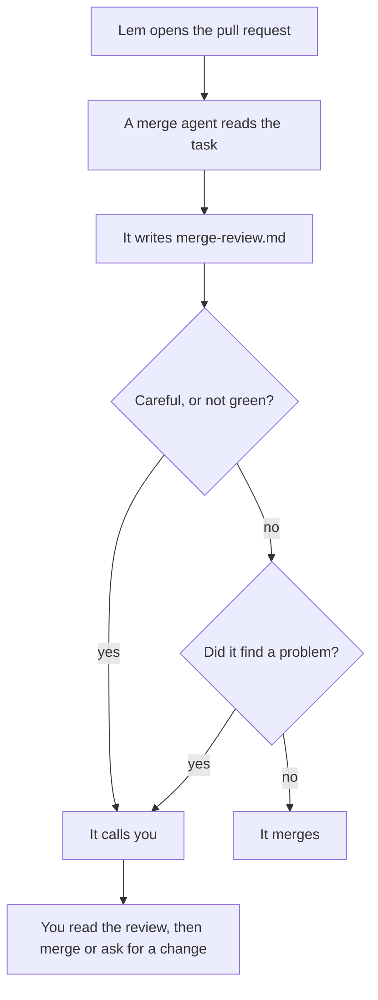

# The pull request

## What it says

The first line says green or not green, and each reason for "not green" comes next. Then come your
request, the acceptance criteria with their tests, the checks (your test commands), and each
decision with who took it and why.

A pull request is not green when one of these is true:

- your tests got less strict (the bar went down), even with a reason in the plan;
- the review left a must-fix after two rounds, or no reviewer answered;
- a criterion changed during the build;
- a decision went past the personas: the dialectic or the experts took it;
- Lem approved the criteria without you: while you were away, in a night task, or for a request
  that someone else wrote;
- the personas did not answer, two times, when they read the criteria;
- the change brings the first checks into a project that had none;
- a task on the fast track turned out to be careful: it can affect what must never go wrong.

Smaller choices of an agent do not change green. The pull request lists the ones that matter.

## The merge review

Lem opens each pull request on GitHub, the one way a task lands. Then a fresh merge agent reads
the task: its files, its reviews and its diff. It changes nothing, and it writes `merge-review.md`.
The review starts with its verdict, merge or call. Then it tells what Lem built and why, the
results, each decision that Lem took without you, and the time and the tokens of the task. For a
safe small change, it is the verdict and three sentences.

When the merge agent calls you, the board shows "Read the merge review" in "Waits for you", and
the review is the first card of the task.

After the verdict merge, the board server merges the pull request. Until then the task stays in
the column "Checks and review", with no row in "Waits for you" and no notification.

With `branch.land = "owner"`, the merge agent still writes its review, but it never merges
([Settings](settings.md#branch)).

## Merge it

There is one merge: the merge of the pull request on GitHub. You start it with the Merge button
on GitHub, with Merge on the [board](board.md), or with `/lem land <task>`. When the merge agent
gives the verdict merge, the board server starts the same merge.

- A merge goes through GitHub, under the rules of your base branch. When GitHub refuses it,
  "Waits for you" shows the line that GitHub gave.
- When the base branch moved, Lem runs the checks again first. The review and the merge review
  stay when the rebase has no conflict. Then Lem merges, also after you pressed merge: your merge
  stays while the change and its reasons stay the same. Otherwise Lem tells you why, and waits for
  you.
- With more than one task, `/lem land` merges them one at a time, in your order.

Do not merge the branch of a task by hand: Lem knows only a merge through the pull request. After
a merge, the session of the task removes the worktree and the branch, and updates the Linear ticket.

On GitHub's button, you select the merge method. `branch.history` is for Lem's merge.

The board server asks GitHub about the open pull requests every few minutes, so it sees a merge
or a close that you make on GitHub.

## A conflict

When a merge makes another open pull request conflict, the board server wakes the session of its
task. That session rebases the branch, and a builder resolves the conflict. The checks run again,
one read checks the resolution, and the merge agent reads the pull request again. Lem leaves every
other open pull request as it is.

## A commit of a teammate

Lem never pushes over a commit that it did not push. Such a commit stops Lem before its next push,
and Lem names the `git pull --rebase` that brings it in. Then the commit gets the checks and a read.

## Stop a task

Type `/lem drop <task>`, or close the pull request on GitHub with no merge. Lem removes the
worktree. A branch with commits of its own stays, and Lem tells you how to delete it. For new work,
make a new request.
