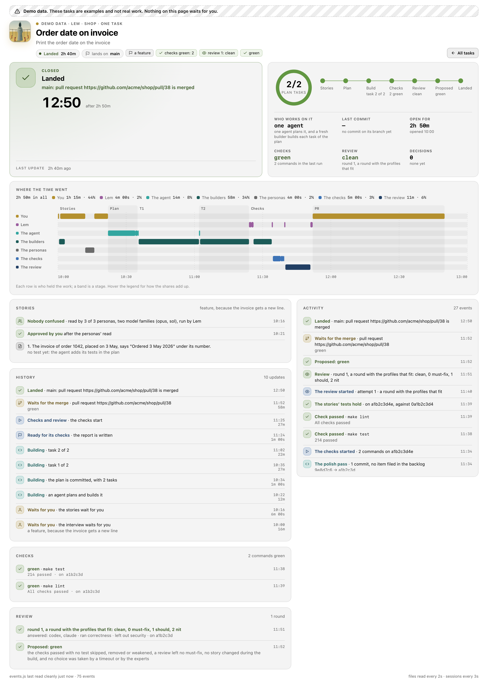

# When Lem needs you

## Three touches

1. **The shape**, on the standard track. You answer an interview if needed. You say yes to the
   acceptance criteria when [the task needs your approval](flow.md#the-standard-track).
2. **A circuit breaker**: a task stops, and leaves a document for you.
3. **A pull request that the merge agent calls you for**: you read its review, and merge.

On the fast track, only the third touch can come. One exception: when another person wrote the
ticket, you say yes to its one acceptance criterion before the build starts. You answer the first
two in the session of the task, or on the [board](board.md#act-from-the-board). The build asks you
nothing.

To change the acceptance criteria, tell the session of the task what to change, or answer No with
a note on the board. Lem writes the changed criteria, and asks for your yes again, with the old
text of each changed criterion beside its new text. The pull request says that the criteria
changed after the personas' read.
When your note changes no criterion, Lem follows the instruction or answers your question. Then
it asks for your yes to the same criteria.

## A decision in doubt

The build takes each decision in doubt up a ladder, until one level settles it:

1. **The question gate**: a test, a rule or one of your [rulings](settings.md#paths) settles it.
2. **The personas** vote: agents answer as each person that the decision affects.
3. **Two agents** argue for and against the option with the most votes.
4. **Two experts** answer: the latest Anthropic Fable, and the latest OpenAI Astra through Codex.
   Without Codex, one expert answers alone.

The task takes the pick at once and goes on. A pick past the personas makes the pull request not
green.

## The circuit breaker

The breaker stops one task, and the other tasks go on. It has two causes:

- the next step cannot be undone: it deletes data, writes to another system, sends a message to a
  person, or spends money;
- no option of the ladder keeps a criterion that you approved.

A task that takes longer than expected does not stop. The task writes `breaker.md`: the case that
broke, its root cause, the options, a recommendation and the assumptions. The board shows it first
on the task, and sends a notification to [your phone](phone.md).

Answer in the session of the task, or with the buttons of its row on the board:

- talk about it in the session, and decide. On the board, **Help** sends your note to the lead,
  and the talk starts from it;
- `/lem park <task>`, or **Park**: the worktree, the branch and the files stay;
- `/lem drop <task>`, or **Drop**: the worktree goes, and the files and the commits of the branch
  stay.

`/lem resume <task>` opens the talk again after a park or a drop. After the days of
[`state.keep_days`](settings.md#state), only a small record of a dropped task stays, and Lem
cannot resume it. Then type `/lem` and its request to start a new task.

## What waits for you

Type `/lem`. Lem opens the board, and gives one list. Each task that waits for you is one entry,
with the things that you do for it under it. A task has the place of its first thing, in this
order:

1. the breakers, and each task with no session or a session that stopped: "Open a session"
   starts a fresh agent;
2. interviews, criteria, cards, waits for your action or a fact, waits for a dropped task, and
   blocked tasks. In this group, the oldest wait comes first. A blocked task can be from an
   [older release](update.md#a-task-of-an-older-release).
3. the plans that wait for you to read them;
4. the [merge reviews](merge.md#the-merge-review) that call you;
5. the pull requests that wait for your merge, and each merge that GitHub or Lem refused.

For a task that waits for a dropped task, type `start <task> now` or `/lem drop <task>`.

A task is on the list only while it waits for you: not while its session works on your answer.
The time of a thing starts with the step that started its wait.

What the night and the retro propose is not on the list. A reviewer agent reads each proposal
first, and the proposals that pass wait as items of the board's
[**Backlog**](board.md#the-reviewers-items).

The board shows the same list in its view **Waits for you**. A task with two or more things is one
stack. Click it, and each thing shows as a row of its own, with its time and its button.

<picture>
  <source media="(prefers-color-scheme: dark)" srcset="../assets/screens/task-dark.png">
  
</picture>

*A task on the board, on its Overview. The picture shows demo data.*
