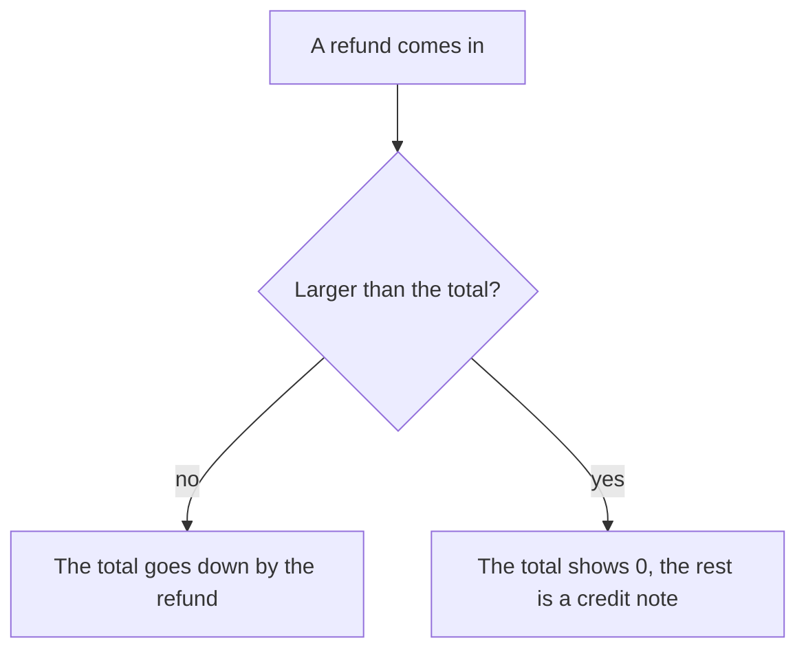

# Writing a document of a task for a person

Read this when you are about to write a document that the owner reads: the outcome of `task.md`,
the criteria for his yes, a plan, a report, the story of an important decision, an investigation.
Never for a state line, a log line, a commit message, a reply to Lem, or anything of the fast
track: there one plain sentence is the whole form.

The owner is a senior developer with little time, who reads English as a second language. "I'm a
`rubber duck user story guy`. I love simple step-by-step stories and explanation of the end result
`this vs that`. I also love flowcharts to visually absorb some logic which is otherwise maybe
misundestood in plain english", and "good flowchart is so much easier to understand than a text
explanation alone" (2026-11-20). The forms below are how a document of Lem reaches him; the board
draws each of them.

## The numbered story

One concrete run, with real names and values, one step to a line, ending in what the person sees.

```
1. Invoice 1042 is 100 EUR.
2. A refund of 30 EUR comes in.
3. The invoice shows 70 EUR.
```

A change is told as two runs of the same input, **Today** and **After**; a choice as one run for
each option, or one run and a "this or that" of how it ends. A story is required for the outcome
of a task on the standard track, for a criterion with more than one condition, for the cause of a
bug, and for an important decision: one that went past the personas, makes the request not green,
or cannot be reversed. It is noise for a rule that one sentence already says: "The button says
Save" needs no steps.

## The flowchart

A fenced `mermaid` block, under the sentence it shows, never in its place: the text version stands
above it.

````

````

- `flowchart TD` or `LR` for a rule with branches; `sequenceDiagram` for who tells whom, between
  several actors; `stateDiagram-v2` for a state that moves.
- Every node's text and every edge's text in double quotes, the owner's rule for every chart, and
  a state's name too (`state "Waits for the owner" as W`). A sequence diagram's names and messages
  take no quotes: there the quotes show on the page (mermaid 11.12, 2026-11-20). No `#` and no `;`
  in any text: `#` starts an entity and cuts the line ("pull request 4", not "#4").
- A node is named by what the person sees ("The total shows 0"), never by a function's name.
- About a dozen nodes at most (a guess, not a measurement), and one chart for one idea.

A chart earns its place when the logic branches, when several actors take turns, or when a state
moves. A list in disguise, or a straight line of three steps, is no chart: the numbered story says
it better.

## In the acceptance criteria

The criteria are read by `lem criteria`, so their two forms have a fixed place:

- A criterion with more than one condition carries its numbered case as lines under its sentence,
  three spaces in, before its test lines. The case is a part of the criterion's text, approved
  with it word for word.
- A criterion with branches gets its chart directly under it, at any indent: the script reads it
  as that criterion's chart, no part of its text, and the chart can change without a record.
  Criteria that together describe one flow get one chart under `## How it works`, after the
  criteria section, below the sentence it shows. Write no sentence inside the section around a
  chart: a loose line joins a criterion's text.

## A table

A table compares things across the same attributes: options against what each costs, before
against after. Each cell is a few words; a cell that needs a sentence belongs in the text under
the table. Never a table for prose.

## A picture

A picture is evidence you made in this task: a screenshot of a page you changed, a render of a
command's output that a person reads, a chart of a measurement. Save it in the task directory's `media/`, named
by what it shows (`media/invoice-after-refund.png`), and link it from the document with its path
relative to that document and a caption that says what to look at:

```

*The total reads 70 EUR; the refund is a line of its own.*
```

Never a decorative picture, and never one you did not make. A file in the repository (a plan) links
no picture: the task directory never reaches git.

### A screenshot

A change to what a person sees (a page, a screen, a dialog, the text a command prints for a person)
is shown with a screenshot, which you take with `take-screenshot`, since a sentence about a layout is
a guess until someone looks:

- **A pair.** Take the same view before the change and after it, with the same window size and the
  same data, and name them as a pair (`media/invoice-before.png`, `media/invoice-after.png`). A view
  that is new has only its "after". Put the two side by side in a table of one row, or one under
  the other, and say in the caption what differs.
- **The real thing.** The product as it runs, in the state the acceptance criterion names, started
  the way the project's own `AGENTS.md` says. Never a mock, a drawing or an edited picture.
- **Only what matters.** Crop to the part that changed, or mark it in the caption; a whole screen
  for a change of one line hides it. A narrow screen and a dark theme get a picture of their own
  only when the change touches them. Three pictures for one change at most; more is a gallery
  nobody reads.
- **Nothing private.** Demo or test data only: no real person's name, address, order or message,
  and no key, token or password, in the picture or in its file name. A picture is read on the
  owner's phone and may be shown to others.
- **A failure too.** For a bug, the picture of what is wrong is the report's first evidence, and the
  picture after the fix is its last.
- **Readable.** Two device pixels for each pixel where the tool can, in PNG; text in the picture
  must be readable at the width of a phone.

When you could not take one (the product does not start here, the view needs a login you do not
have), say so in one line with the reason. Do not describe the picture you did not take as if you
saw it.

## Emphasis

- **Bold** for the one phrase of a paragraph that carries the outcome.
- A `> ` line for what the owner must not miss: a step that cannot be reversed, a reason the
  request is not green.
- Code formatting for names only: a file, a command, a symbol.
- Headings to three levels at most, and no emoji.

## Where a document goes

The board shows a task's documents in the same sections, in the same order, in every project:
Request, Criteria, Plan, Build, Checks, Review, Pull request, then Working files. A document keeps
the name its stage gives it, and the board finds its section by that name. Pictures go in
`media/`. A file you make that no stage names is a working file: give it a name that says what it
holds.
