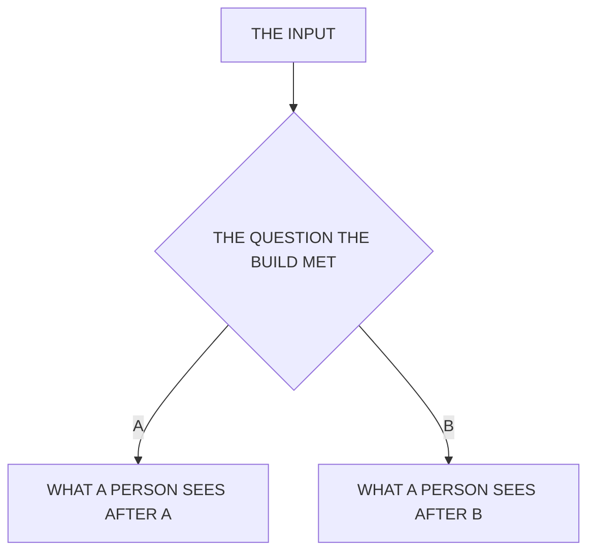

# WHAT STOPPED THE BUILD, IN ONE SENTENCE THE OWNER READS FIRST

<!--
The breaker's document: the one thing of a build that reaches the owner. He reads it far from the
task, often on his phone, days after he thought about it, so it brings the context back before it
asks anything. The board draws this markdown as a page: the title, the callouts, the stories, the
chart and the table are its layout. Write each part; `lem decisions breaker` refuses a document
without one. Write each paragraph and each callout on one line: the board keeps every line break.
Remove these comments, and replace each line in capitals.
Forms: SKILL_DIR/prompts/writing.md (the story, the chart, the table, emphasis).
-->

> [!IMPORTANT]
> **The build of SLUG stopped here, and only this task.** WHY IN ONE LINE: the next step cannot be reversed (data, system, person or money), or no option keeps the criterion N he approved. Help with the choice below, `/lem park SLUG`, or `/lem drop SLUG`. `/lem resume SLUG` brings it back after either.

**THE OUTCOME HE ASKED FOR, AND WHAT STANDS IN ITS WAY, IN TWO SENTENCES.**

## Today and after

**Today**, as the build left it:

1. THE SAME INPUT, WITH REAL NAMES AND VALUES.
2. WHAT THE BUILD DOES NOW.
3. WHERE IT STOPS, AND WHAT A PERSON WOULD SEE.

**After**, with the recommendation:

1. THE SAME INPUT.
2. WHAT CHANGES.
3. WHAT A PERSON SEES THEN.

## The case that broke

<!-- One concrete run, one step to a line, with where each step was read (a file and line, a test). -->

1. STEP, WITH ITS PLACE.
2. STEP.
3. THE STEP THAT BREAKS, AND THE CRITERION OR THE STEP IT CANNOT KEEP.

## The root cause

WHY THE CASE BECAME POSSIBLE (A DECISION OF THE PLAN, A FACT OF THE CODE NOBODY KNEW, A RULE OF THE CRITERIA), AND HOW FAR THE SAME CAUSE REACHES. Whether it is a sign of a plan that missed something, or a fact that only the build could find.

## The options

<!-- This or that: one column for each option, a few words to a cell; a sentence goes under the table. -->

| | A: LABEL | B: LABEL |
| --- | --- | --- |
| What a person sees | FEW WORDS | FEW WORDS |
| The criterion | KEPT, OR WHICH ONE CHANGES | KEPT, OR WHICH ONE CHANGES |
| Can a later no undo it | YES OR NO, WHY | YES OR NO, WHY |
| Cost | FEW WORDS | FEW WORDS |

- **A: LABEL** leads to WHAT FOLLOWS, FOR THE BUILD AND FOR A PERSON.
- **B: LABEL** leads to WHAT FOLLOWS.

## The recommendation

> [!TIP]
> **A: LABEL.** WHY, IN ONE OR TWO SENTENCES, FROM THE CASE AND THE CRITERIA.

What the ladder said: THE GATE, THE PERSONAS, THE DIALECTIC AND THE EXPERTS, ONE LINE EACH THAT RAN.

## The assumptions

- WHAT THIS DOCUMENT TAKES AS TRUE AND DID NOT CHECK, ONE ITEM EACH.
- WHAT WOULD CHANGE THE RECOMMENDATION.
